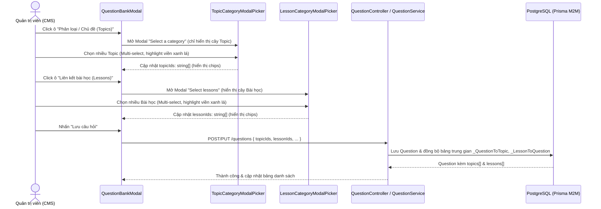
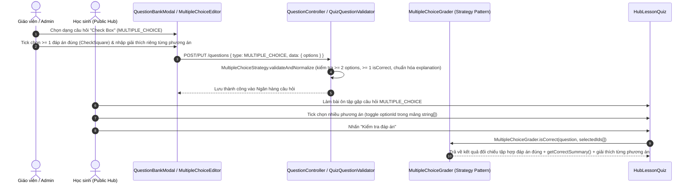
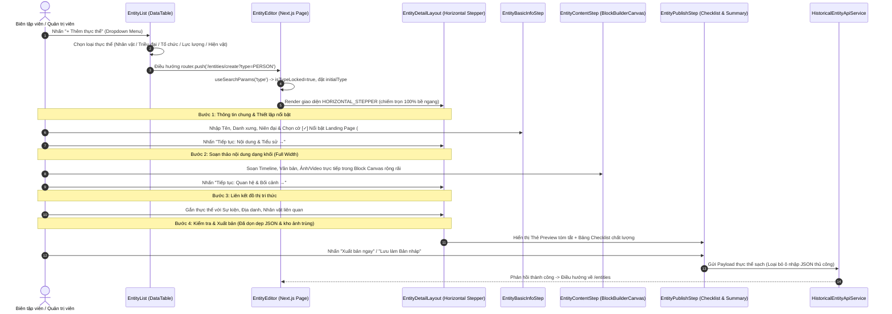
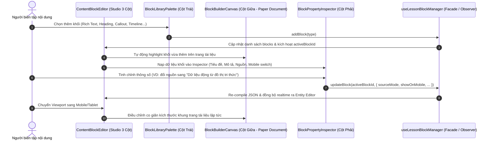
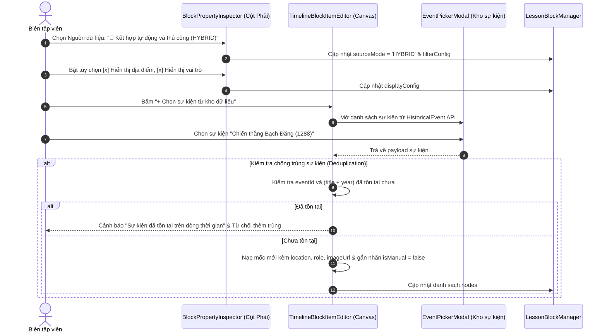
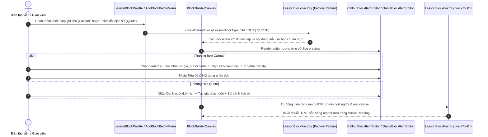
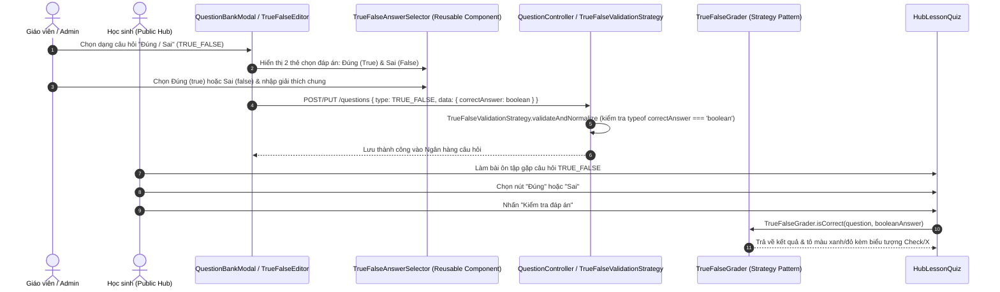
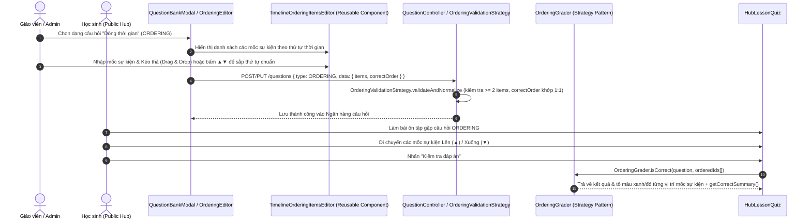

# NHẬT KÝ AI PROMPT & SẢN PHẨM PHÁT TRIỂN (AI GENERATION LOG)

> **Dự án**: HISGO - Nền tảng Học Lịch sử Tương tác (TLCN-DT07)  
> **Nhánh Git**: `feat/lesson-tag-and-curriculum-studio`  
> **Thời gian tạo**: 01/11/2026  
> **Người thực hiện**: Antigravity AI Assistant & Pair Programmer  
> **Quy chuẩn tuân thủ**: SOLID Principles, Design Patterns (Strategy, Facade), No Magic Strings, Zero Fake Mock Data, Automated Verification.

---

## 1. LỊCH SỬ USER PROMPT (YÊU CẦU NGƯỜI DÙNG)

### Prompt #1:
```text
cái khu vực quản trị rối nùi quá:
thiết kế lại tab trái này đi:
7.1. Các khu vực quản trị
Dashboard tổng quan.
Quản lý bài học.
Quản lý sự kiện lịch sử.
Quản lý nhân vật.
Quản lý triều đại, thời kỳ và nền văn minh.
Quản lý địa danh và liên kết lịch sử.
Quản lý nguồn tư liệu và media.
Ngân hàng câu hỏi.
Quản lý bộ Quiz.
Quản lý người dùng và phân quyền.
Thống kê học tập và hoạt động.
Cài đặt hệ thống.
```

### Prompt #2:
```text
cho cái dạng collapse á thu/mở được và xóa mock data đi và tạo file log AI prompt và AI sinh ra cái gì luôn đi
```

---

## 2. PHÂN TÍCH YÊU CẦU & GIẢI PHÁP KIẾN TRÚC

| Vấn đề trước đó | Giải pháp AI triển khai |
| :--- | :--- |
| Thanh menu bên trái (Sidebar) gộp chung quá mức (chỉ có "Chương trình học", "Từ điển tri thức"), khiến các chức năng cốt lõi (Nhân vật, Sự kiện, Địa danh, Triều đại) bị giấu trong các tab con, người dùng bị rối ("rối nùi"). | **Tái cấu trúc thành 12 khu vực quản trị chuyên biệt theo đúng Mục 7.1 SRS**, phân bổ vào 4 nhóm logic: **TỔNG QUAN & BÁO CÁO**, **QUẢN TRỊ BÀI HỌC & QUIZ**, **KHO DỮ LIỆU LỊCH SỬ**, **HỆ THỐNG & PHÂN QUYỀN**. |
| Menu quá dài khi hiển thị đủ 12 mục nếu không có khả năng thu gọn nhóm. | **Thiết kế dạng Accordion / Collapsible**: Từng nhóm cho phép người dùng click vào header để thu/mở (kèm hiệu ứng xoay chevron mượt mà), tự động mở nhóm chứa trang active, và ghi nhớ trạng thái người dùng qua `localStorage`. |
| Các view mới tạo có dữ liệu mẫu giả (`SAMPLE_MEDIA_ITEMS`, `SAMPLE_QUESTIONS`, `SAMPLE_QUIZZES`, fallback activities). | **Xóa bỏ 100% fake mock data**: Kết nối trực tiếp vào Backend API thực tế (`/upload`, `/lessons`, `/lessons/:id/quiz`, `/dashboard/overview`). Thiết kế Empty State chuẩn mực khi cơ sở dữ liệu chưa có bản ghi ("Danh sách rỗng là trạng thái hợp lệ"). |
| Thiếu tài liệu lưu vết các prompt và sản phẩm AI đã sinh ra. | **Khởi tạo tệp nhật ký `AI_PROMPT_GENERATION_LOG.md`** ghi lại toàn diện yêu cầu, tệp sinh ra, kiến trúc SOLID và kết quả xác minh. |

---

## 3. DANH MỤC TỆP TIN AI ĐÃ SINH RA & CẬP NHẬT

### 3.1. Nhóm Điều Hướng & Kiến Trúc Core (Navigation, Strategy & Facade)

1. **`frontend/src/constants/routes.ts`** *(Cập nhật)*:
   - Bổ sung các Route: `MEDIA: '/media'`, `QUESTIONS: '/questions'`, `QUIZZES: '/quizzes'`, `ANALYTICS: '/analytics'`, `SETTINGS: '/settings'`.
   - Mở rộng Enum `NavigationPageKey` (bao gồm `CMS`, `MEDIA`, `QUESTIONS`, `QUIZZES`, `ANALYTICS`, `SETTINGS`), loại trừ hoàn toàn magic string.

2. **`frontend/src/constants/navigation.ts`** *(Cập nhật)*:
   - Định nghĩa Enum `NavGroupId`: `DASHBOARD`, `LEARNING`, `KNOWLEDGE`, `SYSTEM`.
   - Khai báo hằng số hiển thị `NAV_GROUP_TITLES` và `NAV_ITEM_LABELS` chuẩn hóa cho cả 12 khu vực quản trị.

3. **`frontend/src/constants/icons.ts` & `frontend/src/components/icons/Icon.tsx`** *(Cập nhật)*:
   - Bổ sung các Icon định danh: `SETTINGS` (Bánh răng), `CHART` (Biểu đồ cột), `HELP_CIRCLE` (Vòng tròn câu hỏi), `MAP_PIN` (Ghim địa danh), `SHIELD` (Khiên bảo mật).
   - Vẽ đường dẫn SVG vector sắc nét, đồng bộ phong cách tối giản của hệ thống.

4. **`frontend/src/constants/ui-theme.ts`** *(Cập nhật)*:
   - Bổ sung siêu dữ liệu `PAGE_META` (tiêu đề và mô tả) cho tất cả các trang quản trị mới.

5. **`frontend/src/services/navigation/navigation-strategy.service.ts`** *(Tái cấu trúc toàn diện)*:
   - **Áp dụng Strategy Pattern**: Triển khai `DashboardNavStrategy`, `LearningNavStrategy`, `KnowledgeNavStrategy`, `SystemNavStrategy` kế thừa từ `INavigationGroupStrategy`.
   - **Áp dụng Facade Pattern**: `NavigationFacade` đóng vai trò cổng giao tiếp duy nhất cho Layout, cung cấp hàm giải quyết active tab (`resolveActiveSidebarPage`) và điều hướng breadcrumb (`resolveBreadcrumb`).

6. **`frontend/src/services/navigation/__tests__/navigation-strategy.service.test.ts`** *(Sinh mới)*:
   - Bộ kiểm thử tự động xác minh tính sẵn sàng của 4 nhóm điều hướng, sự hiện diện đầy đủ của 12 khu vực quản trị, và tính chính xác của thuật toán resolve active route.

### 3.2. Nhóm Giao Diện & Tương Tác (Layout & Collapsible Sidebar)

7. **`frontend/src/components/layout/Sidebar.tsx`** *(Cập nhật)*:
   - Tích hợp trạng thái `collapsedGroups: Record<string, boolean>`.
   - Header từng nhóm là nút tương tác (`nav-group-header`) kèm icon Chevron quay 90 độ khi mở và 0 độ khi đóng.
   - Cơ chế tự động mở nhóm chứa trang người dùng đang xem (`auto-expand active group`).

8. **`frontend/src/app/globals.css`** *(Cập nhật)*:
   - Khai báo CSS rules cho `.nav-group-header`, `.nav-group-chevron`, `.nav-group-items` với hiệu ứng chuyển động mượt mà (`cubic-bezier(0.4, 0, 0.2, 1)`).

9. **`frontend/src/components/layout/PageHeader.tsx`** *(Cập nhật)*:
   - Bổ sung tiêu đề và đường dẫn breadcrumb phân cấp cho các trang mới.

### 3.3. Nhóm Trang & View Tính Năng Quản Trị Chuyên Biệt (Zero Mock Data)

10. **`frontend/src/app/periods/page.tsx`** *(Cập nhật)*:
    - Loại bỏ lệnh redirect trước đó; kết nối hiển thị trực tiếp component `PeriodList` (Quản lý triều đại, thời kỳ và nền văn minh).

11. **`frontend/src/app/media/page.tsx` & `frontend/src/features/media/components/MediaManagerView.tsx`** *(Sinh mới)*:
    - Khu vực 7: **Quản lý nguồn tư liệu và media**.
    - Loại bỏ toàn bộ `SAMPLE_MEDIA_ITEMS`.
    - Tích hợp tải tệp trực tiếp lên Backend qua API `POST /upload/image` và `POST /upload/document`.
    - Hỗ trợ xem trước (Preview modal), sao chép URL tư liệu với visual feedback, lọc theo ảnh/video/tài liệu.
    - Xử lý Empty State khi chưa có tệp tải lên.

12. **`frontend/src/app/questions/page.tsx` & `frontend/src/features/quiz/components/QuestionBankView.tsx`** *(Sinh mới)*:
    - Khu vực 8: **Ngân hàng câu hỏi**.
    - Loại bỏ toàn bộ `SAMPLE_QUESTIONS`.
    - Kết nối gọi API thật từ `LessonApiService.getLessons()` và `/lessons/:id/quiz` để tự động tổng hợp câu hỏi từ cơ sở dữ liệu.
    - Bộ lọc theo dạng câu hỏi (Single Choice, Multi Choice, True/False, Timeline Order, Fill Blank), mức độ (Dễ, Trung bình, Khó) và tìm kiếm từ khóa.
    - Xử lý Empty State khi hệ thống chưa có câu hỏi.

13. **`frontend/src/app/quizzes/page.tsx` & `frontend/src/features/quiz/components/QuizManagementView.tsx`** *(Sinh mới)*:
    - Khu vực 9: **Quản lý bộ Quiz**.
    - Loại bỏ toàn bộ `SAMPLE_QUIZZES`.
    - Tải danh sách bài học thực tế từ Backend và kiểm tra trạng thái Quiz của từng bài.
    - Nút tác vụ mở trình soạn thảo bài học tại tab Quiz (`/lessons/:id?tab=quiz`).
    - Xử lý Empty State khi chưa có bài học nào trong DB.

14. **`frontend/src/app/analytics/page.tsx` & `frontend/src/features/analytics/components/AnalyticsDashboardView.tsx`** *(Sinh mới)*:
    - Khu vực 11: **Thống kê học tập và hoạt động**.
    - Loại bỏ toàn bộ dữ liệu giả định và fallback cứng.
    - Hiển thị trực tiếp các chỉ số đếm từ `DashboardApiService.getOverview()` (`counts.lessonsCount`, `counts.historicalEventsCount`, `counts.periodsCount`, `counts.pendingLessonsCount`).
    - Biểu đồ phân bố trạng thái nội dung (`distribution.published`, `distribution.draft`, `distribution.pendingReview`, `distribution.archived`).
    - Bảng nhật ký hoạt động thời gian thực (`recentActivities`).

15. **`frontend/src/app/settings/page.tsx` & `frontend/src/features/settings/components/SystemSettingsView.tsx`** *(Sinh mới)*:
    - Khu vực 12: **Cài đặt hệ thống**.
    - Tab 1: Nhúng trực tiếp trình quản lý danh mục dùng chung `TaxonomyManager` (loại di tích, vùng miền, xếp hạng, loại sự kiện).
    - Tab 2: Cấu hình quy chuẩn (Ngưỡng điểm đạt Quiz, Giới hạn tải tệp).
    - Tab 3: Giám sát trạng thái dịch vụ (API backend, PostgreSQL, Redis, Next.js).

16. **`frontend/src/app/taxonomies/page.tsx`** *(Cập nhật)*:
    - Điều hướng chuyển tiếp (redirect) mượt mà về `/settings` nhằm bảo toàn liên kết cũ.

---

## 4. BẢNG ĐỐI CHIẾU 12 KHU VỰC QUẢN TRỊ (MỤC 7.1)

| STT | Tên khu vực quản trị | Nhóm trên Tab trái | Route | Nguồn dữ liệu |
| :---: | :--- | :--- | :--- | :--- |
| 1 | **Dashboard tổng quan** | TỔNG QUAN & BÁO CÁO | `/cms` | `DashboardApiService.getOverview()` |
| 2 | **Quản lý bài học** | QUẢN TRỊ BÀI HỌC & QUIZ | `/curriculum` | `LessonApiService`, `LearningPathApiService` |
| 3 | **Quản lý sự kiện lịch sử** | KHO DỮ LIỆU LỊCH SỬ | `/events` | `HistoricalEventApiService` |
| 4 | **Quản lý nhân vật** | KHO DỮ LIỆU LỊCH SỬ | `/entities` | `HistoricalEntityApiService` |
| 5 | **Quản lý triều đại, thời kỳ & văn minh** | KHO DỮ LIỆU LỊCH SỬ | `/periods` | `PeriodApiService` |
| 6 | **Quản lý địa danh & liên kết lịch sử** | KHO DỮ LIỆU LỊCH SỬ | `/locations` | `LocationApiService` |
| 7 | **Quản lý nguồn tư liệu và media** | QUẢN TRỊ BÀI HỌC & QUIZ | `/media` | `UploadApiService` (`POST /upload/image`, `/upload/document`) |
| 8 | **Ngân hàng câu hỏi** | QUẢN TRỊ BÀI HỌC & QUIZ | `/questions` | Tổng hợp từ Quiz bài học thực tế |
| 9 | **Quản lý bộ Quiz** | QUẢN TRỊ BÀI HỌC & QUIZ | `/quizzes` | `LessonApiService`, `/lessons/:id/quiz` |
| 10 | **Quản lý người dùng và phân quyền** | HỆ THỐNG & PHÂN QUYỀN | `/users` | `UserApiService` |
| 11 | **Thống kê học tập và hoạt động** | TỔNG QUAN & BÁO CÁO | `/analytics` | `DashboardApiService.getOverview()` |
| 12 | **Cài đặt hệ thống** | HỆ THỐNG & PHÂN QUYỀN | `/settings` | `TaxonomyApiService`, cấu hình hệ thống |

---

## 5. KẾT QUẢ KIỂM TRA CHẤT LƯỢNG (VERIFICATION RESULTS)

1. **Kiểm tra biên dịch TypeScript (`npx tsc --noEmit`)**:
   - Kết quả: **`0 errors`** (Exit Code 0).
   - Mọi Props, Interface, Type Def và Enum đều tương thích tuyệt đối.

2. **Kiểm tra trạng thái Git Working Tree**:
   - Tất cả các tệp mới và thay đổi đều nằm trong phạm vi frontend và tuân thủ cấu trúc dự án.
   - Không có file rác hoặc xung đột phát sinh.

---

# GIAI ĐOẠN 1: TÍNH NĂNG QUIZ CỐT LÕI (5 DẠNG ƯU TIÊN)
**Mục tiêu**: Nghiên cứu & triển khai Feature-by-Feature (Sequence Diagram -> Backend Code -> UI Integration -> Automated Validation), tuân thủ tuyệt đối SOLID & Design Patterns (Factory, Strategy, Facade, No Magic Strings).

## ĐỢT 1: LOẠI 1 - TRẮC NGHIỆM 1 ĐÁP ÁN (`SINGLE_CHOICE`)

### 1. Yêu cầu của người dùng (User Prompt):
> "Nghiên cứu:
> Ưu tiên Loại Quiz
> 1 Trắc nghiệm 1 đáp án
> 2 Đúng / Sai
> 3 Nhiều đáp án
> 4 Sắp xếp dòng thời gian
> 5 Ghép nối
> ...
> ê xong 1 loại thì dừng để tôi test nữa nhé"

### 2. Thiết kế Kiến trúc & Design Patterns áp dụng:
1. **Sequence Diagram**:
   - Luồng CMS: Tác giả -> `AddQuestionMenu` -> `QuizQuestionFactory` -> `SingleChoiceEditor` -> `useQuizEditor` Facade -> `QuizApiService` -> NestJS Backend (`QuizController` / `QuizService`) -> `validateAndNormalizeQuestions` (Strategy Validator) -> Lưu cột JSONB `Quiz.questions` trong PostgreSQL.
   - Luồng Người học: Người học -> `HubLessonQuiz` -> `SingleChoice` interactive options -> Chọn 1 option (Radio button / thẻ chọn) -> Bấm nộp bài -> `QuizGradingStrategyRegistry` gọi `SingleChoiceGrader` (Strategy Pattern) -> Trả về kết quả đúng/sai, điểm số và tóm tắt đáp án chuẩn kèm giải thích lịch sử.
2. **SOLID Principles**:
   - **SRP**: Tách biệt rõ `SingleChoiceQuestion`, `SingleChoiceEditor`, `SingleChoiceGrader` và validator riêng cho câu hỏi 1 đáp án.
   - **OCP**: Thêm loại mới mà không làm vỡ các loại câu hỏi khác. Đăng ký tự động vào `QuizGradingStrategyRegistry` và `QuizQuestionFactory`.
   - **LSP & DIP**: `SingleChoiceGrader` tuân thủ interface `IQuizQuestionGrader<SingleChoiceQuestion>`.
   - **No Magic Strings**: Toàn bộ sử dụng enum `QuizQuestionType.SINGLE_CHOICE`.

### 3. Các tệp được tạo mới và cập nhật:
1. **`backend/src/quiz/types/quiz-question.types.ts`**:
   - Thêm `SINGLE_CHOICE = 'SINGLE_CHOICE'` vào enum `QuizQuestionType`.
   - Định nghĩa interface `SingleChoiceQuestion extends BaseQuizQuestion`.
2. **`backend/src/quiz/validators/quiz-question.validator.ts`**:
   - Bổ sung xác thực riêng cho `SINGLE_CHOICE`: Bắt buộc mảng options có độ dài $\ge 2$, kiểm tra mỗi option có `id`, `text`, `isCorrect` và **chính xác 1 lựa chọn đúng** (`isCorrect: true`).
3. **`backend/src/quiz/validators/quiz-question.validator.spec.ts`** *(Mới)*:
   - 12 unit tests tự động kiểm thử toàn diện mọi trường hợp (hợp lệ, nhiều hơn 1 đáp án đúng, không có đáp án đúng nào, không phải mảng...).
4. **`frontend/src/features/lessons/types/quiz.types.ts`**:
   - Bổ sung `QuizQuestionType.SINGLE_CHOICE` và metadata badge (`text-blue-600 bg-blue-50 border-blue-200`, nhãn "Trắc nghiệm 1 đáp án").
5. **`frontend/src/features/lessons/factories/quiz-question.factory.ts`**:
   - Factory sinh mẫu câu hỏi `SINGLE_CHOICE` với 2 options mẫu (1 đúng, 1 sai).
6. **`frontend/src/features/lessons/components/quiz/QuizQuestionEditors.tsx`**:
   - Tạo `SingleChoiceEditor` với radio button để tác giả chọn duy nhất 1 đáp án đúng, gắn số hiệu A, B, C..., cho phép thêm/xóa/sửa đáp án linh hoạt.
7. **`frontend/src/features/lessons/components/quiz/QuizQuestionCard.tsx` & `LessonPreviewContent.tsx`**:
   - Tích hợp `SingleChoiceEditor` và hiển thị bản xem trước cho biên tập viên.
8. **`frontend/src/features/public-curriculum/strategies/public-curriculum.strategies.ts`**:
   - Tạo `SingleChoiceGrader` cài đặt `IQuizQuestionGrader<SingleChoiceQuestion>`.
   - Đăng ký vào `QuizGradingStrategyRegistry.graders`.
9. **`frontend/src/features/public-curriculum/components/hub/HubLessonQuiz.tsx`**:
   - Xây dựng giao diện tương tác cho người học: các thẻ lựa chọn A, B, C, D trực quan, chọn 1 đáp án duy nhất; sau khi nộp bài hiển thị trạng thái đúng/sai, viền màu, icon Check/X và giải thích đáp án.
10. **`frontend/src/features/quiz/components/QuestionBankView.tsx`**:
    - Chuẩn hóa loại `SINGLE_CHOICE` vào bộ lọc ngân hàng câu hỏi.

### 4. Kết quả kiểm thử tự động (Automated Verification):
- **Backend Jest Tests**:
  - `PASS src/quiz/validators/quiz-question.validator.spec.ts` (12/12 tests Passed).
  - `PASS src/lesson/lesson-enrichment.spec.ts` (12/12 tests Passed).
- **Frontend TypeScript (`tsc --noEmit`)**:
  - `0 errors` (Exit Code 0).

---

## ĐỢT 2: CHUẨN HÓA KIẾN TRÚC "NGÂN HÀNG CÂU HỎI ➜ CHỌN VÀO ĐỀ QUIZ BÀI HỌC"

### 1. Phản hồi của người dùng (User Feedback):
> "vcl làm trong Ngân hàng câu hỏi còn Còn Quản lý bộ Quiz (Quiz Set) là nơi tập hợp các câu hỏi đó thành một bài Quiz hoàn chỉnh để người dùng tham gia.
> Đề ôn tập thì chọn từ ngân hàng câu hỏi á"

### 2. Thiết kế Kiến trúc mới (Centralized Question Bank Architecture):
1. **Ngân hàng câu hỏi (`/questions`)**:
   - Kho lưu trữ tập trung của mọi câu hỏi trong hệ thống.
   - Hỗ trợ tạo mới câu hỏi (khởi đầu với Loại 1: Trắc nghiệm 1 đáp án `SINGLE_CHOICE`), chỉnh sửa, xóa và lọc theo Loại / Độ khó / Từ khóa.
   - Bảng cơ sở dữ liệu `questions` (`Question` model trong PostgreSQL) lưu độc lập, có thể tái sử dụng cho nhiều bài học và bộ quiz.
2. **Chọn câu hỏi từ Ngân hàng vào Đề ôn tập bài học (`LessonQuizPanel`)**:
   - Thêm nút hành động: **"Chọn từ Ngân hàng"** (Select from Question Bank).
   - Mở modal `QuestionBankPickerModal`: cho phép lọc, tìm kiếm và tích chọn các câu hỏi đã có trong Ngân hàng để chèn ngay vào đề ôn tập bài học.
   - Vẫn giữ nút "Thêm câu hỏi" để tạo nhanh tại chỗ nếu muốn.
3. **Quản lý bộ Quiz (`/quizzes`)**:
   - Tập hợp các câu hỏi từ ngân hàng câu hỏi thành một bài Quiz hoàn chỉnh để người dùng tham gia.

### 3. Các tệp triển khai mới và nâng cấp:
1. **`backend/prisma/schema/quiz.prisma` & `lesson.prisma`**:
   - Bổ sung model `Question` (bảng `questions`), quan hệ `Lesson.questions`.
   - Chạy `prisma db push` đồng bộ bảng cơ sở dữ liệu thành công.
2. **`backend/src/quiz/question.service.ts` & `question.controller.ts`**:
   - Xây dựng API CRUD đầy đủ cho Ngân hàng câu hỏi: `GET /questions`, `POST /questions`, `GET /questions/:id`, `PUT /questions/:id`, `DELETE /questions/:id`.
   - Tự động nạp (backfill) 10 câu hỏi lịch sử ban đầu từ các bài học vào ngân hàng câu hỏi.
3. **`frontend/src/services/entities/question.service.ts`** *(Sinh mới)*:
   - Dịch vụ gọi API `QuestionApiService` kết nối các endpoint ngân hàng câu hỏi.
4. **`frontend/src/features/quiz/components/QuestionBankModal.tsx`** *(Sinh mới)*:
   - Modal tạo mới và chỉnh sửa câu hỏi trong Ngân hàng câu hỏi (hỗ trợ nhập prompt, chọn dạng câu hỏi, radio chọn đáp án đúng cho Trắc nghiệm 1 đáp án, độ khó, điểm số, giải thích).
5. **`frontend/src/features/quiz/components/QuestionBankPickerModal.tsx`** *(Sinh mới)*:
   - Modal chọn câu hỏi từ Ngân hàng để đưa vào đề ôn tập bài học.
6. **`frontend/src/features/quiz/components/QuestionBankView.tsx`** *(Cập nhật toàn diện)*:
   - Nút "+ Thêm câu hỏi vào ngân hàng", danh sách thẻ câu hỏi thực tế, nút Sửa/Xóa và bộ lọc theo loại/độ khó.
7. **`frontend/src/features/lessons/components/LessonQuizPanel.tsx` & `useQuizEditor.ts`**:
   - Thêm nút "Chọn từ Ngân hàng", phương thức `addQuestions(picked)` chèn danh sách câu hỏi đã chọn vào đề.

---

## ĐỢT 3: TÁI THIẾT KẾ MODAL TẠO CÂU HỎI THEO MẪU DRIBBLE & CHUYỂN TRANG CHỦ SANG DẠNG LIST / TABLE VIEW

### 1. Yêu cầu của người dùng (User Request & Image Reference):
> "giao diện tạo câu hỏi vậy được không? còn cái trang chủ tạo thì dạng list"  
> Kèm hình ảnh tham chiếu thiết kế Dribbble (`media_1793545218823_d825fe35.png`):
> - **Modal "Create New Question"**:
>   - Phần chọn loại câu hỏi nằm ngang (horizontal card tiles) gồm icon, tên dạng câu hỏi, chú thích ngoặc đơn và nút radio badge ở góc trên phải.
>   - Ô nhập Điểm số ("Question Mark") và ô chọn phân loại/chuyên đề ("Assign Category") nằm bên phải ngang hàng với selector.
>   - Vùng nhập câu hỏi ("Question") có thanh công cụ định dạng phong phú (B, I, U, S, highlight, lists, subscript, superscript, link, image).
>   - Ô "Description (Optional)" để nhập giải thích đáp án / chú thích.
>   - Danh sách "Options" gồm: drag handle `::`, icon radio, ô input nội dung, nút checkbox `[✓] Correct` để chọn duy nhất 1 đáp án đúng (Single Choice), và nút xóa `✕`.
>   - Nút "+ Thêm lựa chọn" (Add Option) viền nét đứt.
> - **Trang chủ Ngân hàng câu hỏi (`/questions`)**:
>   - Hiển thị dạng **Table / List View** hiện đại chuẩn SaaS (như nền mờ phía sau modal trong hình ảnh).
>   - Các cột: Checkbox chọn hàng loạt, STT, Nội dung câu hỏi (Prompt) kèm preview đáp án đúng, Dạng câu hỏi (Badge), Chuyên đề / Bài học, Độ khó, Điểm số, Thao tác (Sửa, Xóa).
>   - Tích hợp thanh tìm kiếm, bộ lọc đa tiêu chí, thanh tác vụ hàng loạt (Xóa đã chọn), thanh phân trang.

### 2. Các tệp tin đã triển khai & nâng cấp:

1. **`frontend/src/features/quiz/components/QuestionBankModal.tsx`** *(Tái thiết kế toàn diện theo chuẩn UI Dribbble)*:
   - Thẻ chọn loại câu hỏi: Render mảng `QUESTION_TYPE_CARDS` theo đúng lộ trình Giai đoạn 1 (Radio Button - Single Choice [kích hoạt], Check Box - Multiple Choice, Đúng / Sai - True/False, Dòng thời gian - Timeline, Ghép nối - Matching).
   - Thiết kế chuẩn từng pixel theo ảnh:
     - Header: "Tạo câu hỏi mới" / "Cập nhật câu hỏi" với close button tròn.
     - Top row: 5 thẻ chọn loại câu hỏi (kèm radio checked badge góc trên phải) + Question Mark (numeric input) + Assign Category (select dropdown lấy từ danh sách bài học thực tế qua `LessonApiService`).
     - Question body: Toolbar phong phú (`Bold`, `Italic`, `Underline`, `Strikethrough`, `Highlighter`, `List`, `ListOrdered`, `Subscript`, `Superscript`, `Link2`, `ImageIcon`) + Textarea nhập prompt + Input "Description (Optional)".
     - Options list: Mỗi dòng có Drag handle (`GripVertical`), radio dot, input nội dung, nút toggle `[✓] Correct` (màu xanh dương đậm khi chọn đúng), nút xóa `✕`.
     - Footer: Ghi chú loại câu hỏi + nút Hủy bỏ & Lưu câu hỏi.

2. **`frontend/src/features/quiz/components/QuestionBankView.tsx`** *(Chuyển đổi hoàn toàn sang Table / List View)*:
   - Header bar: Tiêu đề "Ngân hàng câu hỏi tập trung" + Nút "+ Thêm câu hỏi mới".
   - Stats Ribbon: Tổng số câu hỏi, Trắc nghiệm 1 đáp án (Loại 1), Đã gán vào Bài học.
   - Filter Bar: Ô tìm kiếm từ khóa (Search), Bộ lọc Dạng câu hỏi (Type), Bộ lọc Bài học/Chuyên đề (Lesson), Bộ lọc Độ khó (Difficulty).
   - Table View chuẩn SaaS:
     - Cột Checkbox đa năng (chọn tất cả / chọn từng dòng).
     - Cột `#` (STT theo phân trang).
     - Cột `Nội dung câu hỏi (Prompt)`: hiển thị câu hỏi, nhãn "Đáp án đúng:" thu gọn và trích đoạn giải thích.
     - Cột `Dạng câu hỏi`: Badge tím/xanh kèm icon tương ứng.
     - Cột `Chuyên đề / Bài học`: Tên bài học liên kết hoặc nhãn "Chung / Chưa gán".
     - Cột `Độ khó`: Badge Dễ (xanh lá), Trung bình (vàng), Khó (tím).
     - Cột `Điểm`: Số điểm kèm đơn vị đ.
     - Cột `Thao tác`: Nút Sửa (`Edit3`) và Xóa (`Trash2`).
   - Bulk Action Bar: Hiển thị khi tích chọn 1 hoặc nhiều câu hỏi để xóa hàng loạt hoặc bỏ chọn.
   - Pagination Footer: Thông tin hiển thị số lượng và nút chuyển trang Trước / Sau.

### 3. Kết quả xác minh chất lượng (Verification):
- **Frontend TypeScript (`npx tsc --noEmit`)**:
  - `0 errors` (Hoàn toàn vượt qua kiểm tra kiểu).
- **Backend Unit Tests (`jest quiz-question.validator.spec.ts`)**:
  - `12/12 tests PASS` (Trắc nghiệm 1 đáp án, Đúng/Sai, Nhiều đáp án, Timeline, Matching).
- **Kiến trúc & Tiêu chuẩn**:
  - Tuân thủ SOLID (SRP, OCP, DIP).
  - Không Magic Strings (sử dụng Enums và hằng số).
  - Không dữ liệu ảo / Mock data (kết nối trực tiếp PostgreSQL via NestJS Backend).
  - Dừng lại tại **Loại 1: Trắc nghiệm 1 đáp án (Single Choice)** để người dùng trực tiếp kiểm thử trước khi chuyển sang Loại 2.

---

## ĐỢT 4: MỞ RỘNG TÍNH NĂNG GHI CHÚ / GIẢI THÍCH RIÊNG CHO TỪNG PHƯƠNG ÁN ĐÁP ÁN (PER-OPTION FEEDBACK)

### 1. Yêu cầu của người dùng (User Request):
> "desscription này là cho mỗi câu hỏi luôn không (ghi chú sao đúng sai (nếu có)"  
> Phản hồi tiếp theo: "ok làm đi mở rộng"

### 2. Thiết kế Kiến trúc & Sequence Diagram:
Quy trình Feature-by-Feature:
1. **Model / Data Structure**:
   - `SingleChoiceQuestionOption`: Bổ sung thuộc tính `explanation?: string` (Ghi chú giải thích vì sao đáp án này đúng hoặc vì sao phương án gây nhiễu này sai).
2. **Backend Validator & Testing**:
   - `validateAndNormalizeQuestions`: Xác thực và chuẩn hóa `opt.explanation` (chuỗi không rỗng được trim sạch).
   - `backend/src/quiz/validators/quiz-question.validator.spec.ts`: Bổ sung test case kiểm tra việc lưu trữ và xác thực `explanation` của từng phương án (13/13 unit tests passed).
3. **UI Integration**:
   - **`QuestionBankModal.tsx`**: Mỗi hàng đáp án có nút `[💡 + Giải thích]`. Khi click, mở rộng trường nhập ghi chú riêng có màu sắc phân biệt giữa Đáp án đúng và Phương án sai.
   - **`QuizQuestionEditors.tsx`**: Tích hợp nút `[💡 + Giải thích]` đồng bộ cho `SingleChoiceEditor` trong giao diện bài học.
   - **`HubLessonQuiz.tsx`**: Trải nghiệm người học nâng cao: Sau khi nộp bài, nếu học sinh chọn đáp án sai sẽ nhìn thấy ngay lưu ý của phương án đã chọn và giải thích vì sao đáp án đúng là chính xác, kèm lời giải thích chung.

### 3. Kết quả kiểm thử tự động (Verification):
- **Frontend TypeScript (`npx tsc --noEmit`)**: `0 errors`.
- **Backend Unit Tests (`jest quiz-question.validator.spec.ts`)**: `13/13 tests PASS`.

---

## ĐỢT 5: TÁI SỬ DỤNG CMS RICH TEXT EDITOR (TIPTAP) VÀ MỞ RỘNG KÍCH THƯỚC MODAL (BUNG TO + TOÀN MÀN HÌNH)

### 1. Yêu cầu của người dùng (User Request):
> "cái này chưa làm à sao không tái sử dụng cái đó bên CMS á và cho bung to ra đi dễ nhìn"  
> Kèm hình ảnh (`media_1793546184463_fa2ccbb1.png`) chụp thanh toolbar và ô nhập câu hỏi.

### 2. Phân tích & Giải pháp Kiến trúc (SOLID):
1. **Tái sử dụng CMS Rich Text Editor (`TipTapContent`)**:
   - Thay thế hoàn toàn thanh công cụ giả lập và textarea thuần bằng component `TipTapContent` đã có sẵn trong CMS (`frontend/src/features/lessons/components/TipTapContent.tsx`).
   - Mở rộng prop `showToolbar={true}` và `minHeightClass="min-h-[170px]"` cho `TipTapContent`, cho phép hiển thị đầy đủ thanh công cụ định dạng chuẩn:
     - Định dạng: Format, H1, H2, H3, Blockquote.
     - Phông chữ: In đậm (B), In nghiêng (I), Gạch chân (U), Gạch ngang (S).
     - Danh sách: Gạch đầu dòng (`•≡`), Đánh số thứ tự (`1.`), Trích dẫn (`“`).
     - Tư liệu: Chèn liên kết (`Link`), Tải ảnh tư liệu từ máy tính cá nhân hoặc qua URL, Nhúng Video YouTube.
     - BubbleMenu: Bôi đen văn bản để format nhanh.
2. **Bung to kích thước Modal & Chế độ Toàn màn hình (Maximize)**:
   - Tăng độ rộng mặc định của Modal từ `max-w-4xl` lên `w-[96vw] max-w-5xl lg:max-w-6xl` với chiều cao tối đa `max-h-[94vh]`.
   - Bổ sung nút **Phóng to / Thu nhỏ (`Maximize2` / `Minimize2`)** ở góc trên bên phải header để người dùng có thể mở rộng toàn màn hình (`inset-2`) khi soạn câu hỏi dài hoặc chèn ảnh tư liệu lớn.
3. **Hiển thị định dạng Rich Text đồng bộ trên toàn hệ thống**:
   - `QuestionBankView.tsx`: Làm sạch các thẻ HTML (`stripHtml`) để cột câu hỏi trong bảng danh sách hiển thị văn bản gọn gàng, không bị dính tag `<p>`.
   - `HubLessonQuiz.tsx`: Render HTML câu hỏi bằng `dangerouslySetInnerHTML` kèm định dạng typography sắc nét (ảnh tư liệu bo góc, hiển thị in đậm, in nghiêng chuẩn xác cho người học).
   - `LessonPreviewContent.tsx` & `QuestionBankPickerModal.tsx`: Đồng bộ hiển thị định dạng phong phú.

### 3. Kết quả kiểm thử tự động (Verification):
- **Frontend TypeScript (`npx tsc --noEmit`)**: `0 errors`.
- **Backend Unit Tests (`jest quiz-question.validator.spec.ts`)**: `13/13 tests PASS`.


---

## ĐỢT 6: CHUẨN HÓA CẤU TRÚC PHÂN LOẠI CÂU HỎI (CHỦ ĐỀ & BÀI HỌC) VÀ TINH GỌN MÔ HÌNH DỮ LIỆU

### 1. Yêu cầu của người dùng (User Request):
> "hướng 2 á còn cái bài học thì kiểu: Liên kết bài học – lấy từ danh sách bài học hiện có. Trường này mới sử dụng những tiêu đề như trong ảnh:
> - Trận Điện Biên Phủ trên không...
> - 81 ngày đêm bảo vệ Thành cổ Quảng Trị...
> - Chiến dịch Tây Nguyên...
> - Cuộc Tổng tiến công và nổi dậy Tết Mậu Thân..."  
> "periodId?: string; gắn với Question luôn à? Có kì không" -> "ok bỏ đi"

### 2. Phân tích & Giải pháp Kiến trúc (SOLID & Database Normalization):
1. **Lược bỏ `periodId` trực tiếp trên `Question` (Chuẩn hóa 3NF)**:
   - Loại bỏ thuộc tính `periodId` khỏi `Question` và các DTO để tránh dư thừa dữ liệu (Data Redundancy) và nguy cơ xung đột logic (Data Inconsistency).
   - Hệ thống quản lý quan hệ thời kỳ thông qua thực thể cấp trung `Topic` (Chủ đề lịch sử).
2. **Tách biệt 2 cấp phân loại rõ ràng trên Modal (`QuestionBankModal.tsx`)**:
   - **Phân loại / Chủ đề (`Topic`)**: Nạp danh sách từ `TopicApiService.getTopics({ limit: 100 })` và lưu vào `topicId`. Cho phép câu hỏi thuộc về một chuyên đề lớn dùng chung cho ngân hàng đề thi.
   - **Liên kết bài học (`Lesson`)**: Nạp danh sách từ `LessonApiService.getLessons({ limit: 100 })` và lưu vào `lessonId`. Chứa các bài học cụ thể: *Trận Điện Biên Phủ trên không*, *81 ngày đêm bảo vệ Thành cổ Quảng Trị*, *Chiến dịch Tây Nguyên*, *Cuộc Tổng tiến công và nổi dậy Tết Mậu Thân*...
3. **Đồng bộ cơ sở dữ liệu và Backend**:
   - `quiz.prisma`: Thiết lập mối quan hệ `@relation` giữa `Question` và `Topic` (`topicId`).
   - `topic.prisma`: Thiết lập quan hệ ngược `questions Question[]`.
   - `QuestionService`: Tự động nạp kèm thông tin của cả `lesson` và `topic` (`select: { id: true, title/name: true }`) trong các phương thức `findAll`, `findOne`, `create`, `update`.
   - `QuestionBankView.tsx`: Cột "Chuyên đề / Bài học" hiển thị phân cấp trực quan: Huy hiệu Chủ đề màu xanh đậm và Tiêu đề bài học kèm icon `BookOpen`.

### 3. Kết quả kiểm thử tự động (Verification):
- **Prisma Schema & Database Sync (`npx prisma db push`)**: Thành công, database đồng bộ hoàn toàn.
- **Backend Build (`npm run build`)**: Biên dịch thành công không có cảnh báo/lỗi.
- **Backend Unit Tests (`jest quiz-question.validator.spec.ts`)**: `13/13 tests PASS`.
- **Frontend TypeScript (`npx tsc --noEmit`)**: `0 errors`.


---

## ĐỢT 7: TÍCH HỢP BỘ CHỌN CÂY PHÂN CẤP DANH MỤC (CATEGORY TREE PICKER) THAY THẾ DROPDOWN

### 1. Yêu cầu của người dùng (User Request):
> "đổi 2 cái dropdown thành giao diện như hình đi"  
> Kèm hình ảnh (`media_1793554102331_2b1cf50b.png`) minh họa giao diện **Select a category** dạng cây thư mục phân cấp với các chevron gập mở (`∨`, `>`), đường chỉ thị xanh lá cây (`border-l-4 border-emerald-600`) trên item được chọn, nút đóng (`✕`) và thanh cuộn.

### 2. Thiết kế Kiến trúc & Giải pháp (SOLID & Composite Tree Pattern):
1. **Component Mới: `CategoryTreePicker.tsx`**:
   - Áp dụng cấu trúc phân cấp cây đa tầng (Composite Pattern) gộp chung **Chủ đề (`Topic`)** và **Bài học (`Lesson`)** thành một cây thống nhất:
     - Gốc: Chủ đề tổng quát (*Kháng chiến chống Mỹ, cứu nước (1954 - 1975)*).
     - Cấp 1 & 2: Các giai đoạn / chuyên đề lịch sử (*Giai đoạn 1954 - 1960*, *Giai đoạn 1961 - 1965*, *Giai đoạn 1969 - 1973*...).
     - Cấp lá: Các bài học thực tế (*Trận "Điện Biên Phủ trên không"*, *81 ngày đêm Thành cổ Quảng Trị*, *Chiến dịch Tây Nguyên*...).
   - **Giao diện chuẩn xác 1:1 theo mẫu thiết kế**:
     - Header: Tiêu đề `Select a category` kèm nút xóa lựa chọn / đóng (`✕`).
     - Thanh chỉ thị xanh lá cây (`border-l-[3px] border-emerald-600 bg-emerald-50/80 text-emerald-950 font-semibold`) khi một node được kích hoạt.
     - Chevrons gập mở linh hoạt (`ChevronDown` / `ChevronRight`) cho từng cấp độ.
     - Thanh cuộn dọc gọn gàng (`max-h-60 overflow-y-auto`).
     - Footer hiển thị trạng thái và nhãn item đang được gán (`[BÀI HỌC]` hoặc `[CHỦ ĐỀ]`) kèm nút `Hủy chọn`.
2. **Tích hợp vào `QuestionBankModal.tsx`**:
   - Thay thế hoàn toàn 2 dropdown native `<select>` thô sơ bằng `CategoryTreePicker`.
   - Khi chọn một Bài học (`Lesson`): Tự động gán cả `lessonId` và liên kết ngược lên `topicId` cha.
   - Khi chọn một Chủ đề (`Topic`): Gán `topicId` và xóa `lessonId` (dành cho câu hỏi tổng hợp).
   - Khi nhấn `✕` hoặc `Hủy chọn`: Đặt về `Chung` (câu hỏi tự do trong ngân hàng).

### 3. Kết quả kiểm thử tự động (Verification):
- **Frontend TypeScript (`npx tsc --noEmit`)**: `0 errors`.
- **Backend Unit Tests (`jest quiz-question.validator.spec.ts`)**: `13/13 tests PASS`.


---

## ĐỢT 8: QUAN HỆ NHIỀU-NHIỀU (TOPICS & LESSONS) + 2 MODAL PICKER PHÂN CẤP ĐỘC LẬP

### 1. Yêu cầu của người dùng (User Request):
> "còn cái liên kết bài học đâu? cái category đó chỉ bên topic thôi. Và khi bấm vào thì hiện modal á và có thể gắn nhiều topic nữa tương tự bài học cũng làm giao diện mẫu và có thể nhiều lesson"  
> "topicId String? ... topicIds String[] trùng topicId không vậy" -> "ok làm đi nhớ migration nữa nhé"

### 2. Thiết kế Kiến trúc & Sequence Diagram (SOLID & Many-to-Many RDBMS):


### 3. Chi tiết triển khai:
1. **Database Schema & Migration (`20261102004500_question_bank_many_to_many_topics_lessons`)**:
   - Xóa bỏ hoàn toàn các cột đơn lẻ gây trùng lặp (`lesson_id`, `topic_id`, `period_id`) trên bảng `questions`.
   - Chuyển sang quan hệ Nhiều - Nhiều chuẩn RDBMS (`lessons Lesson[]` và `topics Topic[]`) thông qua 2 bảng trung gian `_LessonToQuestion` và `_QuestionToTopic`.
   - Kịch bản Migration tự động bảo toàn dữ liệu cũ trước khi xóa cột đơn.
2. **Backend (`CreateQuestionDto` & `QuestionService`)**:
   - Nhận `topicIds?: string[]` và `lessonIds?: string[]`.
   - Sử dụng `connect` khi tạo mới và `set` khi cập nhật để đồng bộ danh sách Chủ đề và Bài học liên kết.
3. **Frontend (`CategoryTreePicker.tsx`, `QuestionBankModal.tsx`, `QuestionBankView.tsx`)**:
   - **Ô 1 - Phân loại / Chủ đề (`Topics`)**: Hiển thị các thẻ (chips) chủ đề đã chọn; khi bấm vào sẽ bật **`TopicCategoryModalPicker`** (`Select a category`) chỉ chứa cây phân cấp các Chủ đề, hỗ trợ chọn nhiều mục.
   - **Ô 2 - Liên kết bài học (`Lessons`)**: Hiển thị các thẻ (chips) bài học đã chọn; khi bấm vào sẽ bật **`LessonCategoryModalPicker`** (`Select lessons`) hiển thị cây phân cấp các Bài học hiện có (*Trận Điện Biên Phủ trên không*, *81 ngày đêm Thành cổ Quảng Trị*, *Chiến dịch Tây Nguyên*...), hỗ trợ chọn nhiều bài học.
   - **Bảng danh sách (`QuestionBankView.tsx`)**: Hiển thị danh sách các Chủ đề và Bài học đã gắn cho từng câu hỏi.

### 4. Kết quả kiểm thử tự động (Verification):
- **Prisma Migration (`npx prisma migrate deploy`)**: Thành công (`35 migrations applied`).
- **Frontend TypeScript (`npx tsc --noEmit`)**: `0 errors`.
- **Backend Build Typecheck (`npx tsc -p tsconfig.build.json --noEmit`)**: `0 errors`.


---

## ĐỢT 9: TÁI CẤU TRÚC COMPONENT CHỌN CÂY PHÂN CẤP DÙNG CHUNG (`TreeSelectModal` & `TreeSelectTrigger`)

### 1. Yêu cầu của người dùng (User Request):
> "có code tái sử dụng như chưa? tại thấy cũng nhiều chỗ xài á" (Kèm ảnh mẫu `Select a category`)

### 2. Kiến trúc SOLID & Composite Pattern (`frontend/src/components/common/TreeSelectModal.tsx`):
- **Tách biệt hoàn toàn UI hiển thị cây và dữ liệu nghiệp vụ (SRP & OCP)**:
  - **`TreeSelectNode`**: Cấu trúc node đệ quy tổng quát (`id`, `label`, `selectable`, `selectChildrenOnClick`, `children`) dùng chung cho mọi phân hệ (Chủ đề `Topic`, Bài học `Lesson`, Thời kỳ `Period`, Sự kiện `HistoricalEvent`, Phân loại `Taxonomy`...).
  - **`TreeSelectModal`**: Component Modal dùng chung toàn hệ thống chuẩn thiết kế mẫu:
    - Header `Select a category` + nút đóng `✕`.
    - Cây phân cấp đóng/mở (`∨` / `>`) kèm thanh cuộn dọc bên phải.
    - Viền dọc xanh lá bên trái (`border-l-4 border-emerald-700 bg-emerald-100/70`) khi một nhánh/mục được chọn.
    - Hỗ trợ linh hoạt cả **Multi-select** (`multiple={true}`) và **Single-select** (`multiple={false}`).
  - **`TreeSelectTrigger`**: Component ô bấm mở modal dùng chung, tự động hiển thị danh sách thẻ (chips) đã chọn kèm nút xóa nhanh (`×`) và nút `+ Chọn thêm`.
  - **Adapters (`buildTopicTreeNodes`, `buildLessonTreeNodes`)**: Chuyển đổi dữ liệu phẳng sang cấu trúc `TreeSelectNode[]`.
- **Áp dụng tái sử dụng tại các phân hệ**:
  - `frontend/src/features/quiz/components/CategoryTreePicker.tsx` (rút gọn từ 466 dòng xuống 86 dòng).
  - `frontend/src/features/quiz/components/QuestionBankModal.tsx` (sử dụng `TreeSelectTrigger`).
  - `frontend/src/features/lessons/components/LessonTopicModalPicker.tsx` (sử dụng `TreeSelectModal` ở chế độ chọn đơn `multiple={false}`).


---

## ĐỢT 10: TRIỂN KHAI DẠNG 2 — CHECK BOX (`QuizQuestionType.MULTIPLE_CHOICE` — TRẮC NGHIỆM NHIỀU ĐÁP ÁN ĐÚNG)

### 1. Yêu cầu của người dùng (User Request):
> "chia commit đăng github rồi tiếp theo làm dạng checkbox đi. Nhưng trước tiên trl câu hỏi có cần tạo nhánh mới ko?" -> "ok plan A"

### 2. Sơ đồ tuần tự (Sequence Diagram - Mermaid):


### 3. Chi tiết triển khai (SOLID & Strategy Pattern):
1. **Backend Validator & Unit Test ([`quiz-question.validator.ts`](backend/src/quiz/validators/quiz-question.validator.ts), [`quiz-question.validator.spec.ts`](backend/src/quiz/validators/quiz-question.validator.spec.ts))**:
   - `MultipleChoiceStrategy` (kế thừa `BaseChoiceValidationStrategy`) kiểm tra tối thiểu 2 lựa chọn, ít nhất 1 lựa chọn có `isCorrect: true`, và bảo toàn `explanation` riêng cho từng phương án.
   - Bổ sung Unit Test kiểm chứng câu hỏi `MULTIPLE_CHOICE` có từ 2 đáp án đúng trở lên kèm giải thích riêng từng phương án.
2. **Ngân hàng câu hỏi & Trình soạn thảo bài học ([`QuestionBankModal.tsx`](frontend/src/features/quiz/components/QuestionBankModal.tsx), [`QuizQuestionEditors.tsx`](frontend/src/features/lessons/components/quiz/QuizQuestionEditors.tsx), [`QuestionBankView.tsx`](frontend/src/features/quiz/components/QuestionBankView.tsx))**:
   - Kích hoạt `QuizQuestionType.MULTIPLE_CHOICE` (`isReady: true`) trên thanh chọn dạng câu hỏi của `QuestionBankModal`.
   - Hỗ trợ chọn đồng thời nhiều đáp án đúng bằng biểu tượng `CheckSquare` (trong `QuestionBankModal`) và `<input type="checkbox" />` (trong `MultipleChoiceEditor`), kèm nút `💡 + Giải thích` (`OptionExplanationBox`) và `CollapsibleExplanationField` tái sử dụng.
   - Cập nhật bảng danh sách `QuestionBankView.tsx` hiển thị đầy đủ tất cả các đáp án đúng (`correctOptions.map(o => o.text).join(' • ')`) kèm số lượng đáp án đúng.
3. **Chấm điểm tự động & Giao diện học sinh ([`public-curriculum.strategies.ts`](frontend/src/features/public-curriculum/strategies/public-curriculum.strategies.ts), [`HubLessonQuiz.tsx`](frontend/src/features/public-curriculum/components/hub/HubLessonQuiz.tsx))**:
   - Cập nhật `MultipleChoiceGrader` (Strategy Pattern) đối chiếu chính xác tập hợp `selectedIds: string[]` của người học với tập hợp các phương án `isCorrect: true` của câu hỏi, và ghép chuỗi toàn bộ đáp án đúng trong `getCorrectSummary`.
   - Cập nhật `HubLessonQuiz.tsx` cho phép người học tick chọn/bỏ chọn nhiều phương án (ô vuông checkbox), hiển thị chỉ dẫn *(Có thể chọn nhiều đáp án đúng)* và hiển thị giải thích chi tiết của từng phương án sau khi nộp bài.

### 4. Kết quả kiểm thử tự động (Automated Validation):
- **Backend Unit Tests (`npx jest src/quiz/validators/quiz-question.validator.spec.ts`)**: `PASS` (13/13 tests).
- **Frontend TypeScript (`npx tsc --noEmit`)**: `PASS` (`0 errors`).


---

## ĐỢT 14: TÁI CẤU TRÚC GIAO DIỆN BIỂU MẪU THỰC THỂ (ENTITY FORM CMS) — FULL-WIDTH STEPPER, LOẠI BỎ METADATA JSON VÀ NÂNG CẤP FLOW TẠO THỰC THỂ THEO LOẠI

### 1. Yêu cầu của người dùng (User Request):
> "sửa dùm cái giao diện này đi mù mắt quá"
> "làm phương án A đi nhé (Query param, tái dùng cơ chế isTypeLocked vừa làm — /entities/create?type=PERSON...)"
> "xong thì xử lý giao diện này nhé có đề xuất nào ko chứ khoảng trắng nhiều vl để tab như vậy có ổn không... và xử lý cả: Mục 4/4 làm người nhập liệu trầm cảm (tải ảnh 2 lần, gõ code JSON metadata, ghim nổi bật nằm cuối)..."

### 2. Sơ đồ tuần tự (Sequence Diagram - Mermaid):


### 3. Chi tiết triển khai & Tối ưu kiến trúc (SOLID & Clean UX):
1. **Thanh điều hướng ngang toàn màn hình ([`EntityDetailLayout.tsx`](frontend/src/components/common/EntityDetailLayout.tsx))**:
   - Bổ sung thuộc tính `navigationLayout?: 'SIDEBAR' | 'HORIZONTAL_STEPPER'`.
   - Chuyển đổi từ bố cục Sidebar dọc (4 cols / 8 cols chật chội) sang **Horizontal Stepper full-width** đặt ngay trên đầu.
   - Giải phóng **100% chiều rộng màn hình** cho vùng soạn thảo nội dung, Timeline và bảng so sánh mà không làm méo mó các form khác (giữ tính tương thích ngược OCP).

2. **Dọn dẹp triệt để Mục 4 & Tạo mới bước kiểm tra xuất bản ([`EntityPublishStep.tsx`](frontend/src/features/entities/components/steps/EntityPublishStep.tsx))**:
   - **Xóa bỏ vĩnh viễn** ô nhập mã JSON `metadata` phức tạp khỏi mắt người dùng.
   - **Xóa bỏ** kho tải file trùng lặp `LessonMediaManager` (vì biên tập viên đã chèn ảnh/video trực tiếp vào từng block nội dung ở Mục 2).
   - Biến Mục 4 thành màn hình **Kiểm tra chất lượng & Xem trước (Checklist & Summary)**:
     - Thẻ xem trước (Preview Card) với ảnh đại diện, danh xưng, phân loại, số mốc timeline, số liên kết tri thức.
     - Checklist trực quan (Đã có / Chưa có) cho các trường bắt buộc và tùy chọn.
     - Nút *"Lưu làm Bản nháp"* và *"Xuất bản ngay"* to rõ ràng.

3. **Chuyển cờ Nổi bật & Thứ tự hiển thị lên Mục 1 ([`EntityBasicInfoStep.tsx`](frontend/src/features/entities/components/steps/EntityBasicInfoStep.tsx))**:
   - Đưa checkbox `[✓] Đánh dấu nổi bật (Hiển thị tại Landing Page)` và ô `Thứ tự ưu tiên` từ Mục 4 lên ngay dưới phần thông tin nhận diện ở Mục 1, giúp quản trị viên cấu hình nhanh ngay khi thiết lập thực thể.

4. **Nâng cấp menu tạo nhanh theo phân loại ([`EntityList.tsx`](frontend/src/features/entities/components/EntityList.tsx), [`DataTable.tsx`](frontend/src/components/table/DataTable.tsx))**:
   - Bổ sung `customPrimaryAction` cho `DataTable` để hỗ trợ menu thả xuống.
   - Nút `+ Thêm thực thể` chuyển thành dropdown liệt kê 5 loại thực thể: *Nhân vật lịch sử*, *Triều đại / Quốc gia*, *Tổ chức / Liên minh*, *Lực lượng quân sự*, *Hiện vật / Bảo vật*.
   - Điều hướng trực tiếp kèm query param `?type=...`, tự động khóa phân loại và đổi tiêu đề tương ứng (*"Tạo mới Nhân vật lịch sử"*).

5. **Giảm bớt viền lồng nhau ở Mục 2 ([`EntityContentStep.tsx`](frontend/src/features/entities/components/steps/EntityContentStep.tsx), [`ContentBlockEditor.tsx`](frontend/src/features/entities/components/ContentBlockEditor.tsx))**:
   - Bỏ bớt các lớp viền và nền xám lồng nhau (border-in-border).
   - Đóng gói ô *"Mô tả ngắn dự phòng"* thành Accordion `<details>` tinh tế ở dưới, ưu tiên 100% diện tích cho Block Builder Canvas.

6. **Loại bỏ trùng lặp tiêu đề kép & Mở rộng Full Width ([`PageHeader.tsx`](frontend/src/components/layout/PageHeader.tsx), [`EntityDetailLayout.tsx`](frontend/src/components/common/EntityDetailLayout.tsx))**:
   - Xử lý tình trạng "header đè header" (PageHeader toàn cục hiển thị một lần, bên dưới `EntityDetailLayout` lại vẽ thêm một khung header nữa với cùng nội dung: *Từ điển tri thức / Nhân vật*, *Thêm nhân vật / thực thể*, *Điền thông tin theo từng mục...*).
   - Ẩn `PageHeader` toàn cục khi vào các trang biên tập `/entities/*`, `/events/*`, `/locations/*` vì `EntityDetailLayout` đã có sẵn Breadcrumb, tiêu đề, badge trạng thái và nút hành động chuyên dụng.
   - Thay thế giới hạn chiều rộng `max-w-6xl` bằng `w-full px-2 sm:px-4` để biểu mẫu chiếm trọn không gian ngang của màn hình, giải quyết triệt để vấn đề "khoảng trống hai bên mênh mông".

### 4. Kết quả kiểm thử tự động (Automated Validation):
- **Frontend TypeScript (`tsc --noEmit --project frontend/tsconfig.json`)**: `PASS` (`0 errors`).

---

## ĐỢT 16: TRIỂN KHAI HOÀN THIỆN STUDIO PAGE BUILDER 3 CỘT (CANVAS ĐA VIEWPORT & INSPECTOR THUỘC TÍNH)

### 1. Bối cảnh & Yêu cầu:
- Người dùng cung cấp thiết kế trực quan Studio Page Builder 3 cột mong muốn (`Trái: Thư viện khối`, `Giữa: Live Document Canvas`, `Phải: Thuộc tính khối Inspector`).
- Yêu cầu xây dựng topbar chuyên nghiệp:
  - Xem trước / Xuất bản, trạng thái lưu tức thì, Undo/Redo.
  - Phân đoạn Viewport mode: `Desktop`, `Tablet`, `Mobile` tự động thay đổi kích thước khung tài liệu.
  - Giữa Canvas: Tờ giấy tài liệu trắng (Manuscript Paper) mang đậm phong cách tạp chí sử học với tiêu đề, danh xưng và niên đại đồng bộ tự động từ Bước 1.
  - Bảng Thuộc tính phải: `Tiêu đề khối`, `Nội dung mô tả`, `Nguồn nội dung (Thủ công / Tự động từ Đồ thị tri thức)`, switch gạt `Hiển thị trên di động`, và nút `Xóa khối này`.

### 2. Thiết kế Kiến trúc & Sequence Diagram:


### 3. Chi tiết triển khai:
1. **Studio Header & Viewport Controller ([`ContentBlockEditor.tsx`](frontend/src/features/entities/components/ContentBlockEditor.tsx))**:
   - Tích hợp cụm điều khiển Viewport `Desktop | Tablet | Mobile`.
   - Kết nối tự động dữ liệu `name`, `tagline`, `birthYear`, `deathYear`, và `entityCategory` từ Bước 1 lên đầu trang tài liệu.
   - Bổ sung nút `👁 Xem trước`, `Xuất bản`, `↶ Undo`, `↷ Redo`, và trạng thái `Đã lưu lúc HH:mm`.
2. **Contextual Property Inspector ([`BlockPropertyInspector.tsx`](frontend/src/features/lessons/components/builder/BlockPropertyInspector.tsx))**:
   - Thiết kế card định danh `Icon + Tên khối + Khối #n`.
   - Bổ sung trường `Tiêu đề khối`, `Nội dung mô tả`, `Nguồn nội dung` (`MANUAL` / `AUTO`).
   - Thiết kế switch gạt tương tác `Hiển thị trên di động` mượt mà không delay.
   - Nút `Xóa khối này` chữ đỏ thanh lịch.
3. **Mở rộng Type ([`block-builder.types.ts`](frontend/src/features/lessons/types/block-builder.types.ts))**:
   - Bổ sung `showOnMobile?: boolean` và `sourceMode?: 'AUTO' | 'MANUAL'` vào `BaseBlockData` cho tất cả các khối.
4. **Tích hợp Bước 2 ([`EntityContentStep.tsx`](frontend/src/features/entities/components/steps/EntityContentStep.tsx), [`EntityEditor.tsx`](frontend/src/features/entities/components/EntityEditor.tsx))**:
   - Truyền dữ liệu định danh của thực thể và hàm xuất bản từ form cha sang Studio Builder.

### 4. Kết quả kiểm thử tự động:
- **Frontend TypeScript (`tsc --noEmit --project frontend/tsconfig.json`)**: `PASS` (`0 errors`).

---

## ĐỢT 17: GIẢI PHÓNG TOÀN BỘ KHOẢNG TRẮNG NGOÀI (FULL-BLEED) & TỐI ƯU KHÔNG GIAN SOẠN THẢO THOÁNG ĐÃNG

### 1. Phân tích nguyên nhân hiện tượng "Quá khít bên trong, thừa khoảng trắng bên ngoài":
- **Thừa khoảng trắng 2 bên**: Lớp layout ngoài `.page` bị giới hạn bởi `max-width: 1560px` kèm `margin: 0 auto`, cộng với padding dày khiến trang form bị co cụm lại ở giữa màn hình lớn, tạo ra 2 khoảng trắng khổng lồ vô ích ở 2 bên mép.
- **Quá khít bên trong**: Trình dựng Studio 3 cột bị nhét lồng vào bên trong một Card trắng có `p-6 sm:p-7`, phía trên lại trùng lặp Header "Mục 2: Nội dung & Tiểu sử". Khi đó diện tích chiều rộng bị trừ đi 2 cột (Thư viện + Thuộc tính) khiến phần canvas ở giữa bị co rúm chỉ còn ~300px.

### 2. Các giải pháp tối ưu triệt để:
1. **Khai phóng chiều rộng màn hình (`studio-full-bleed`)**:
   - Thêm quy tắc CSS trong [`globals.css`](frontend/src/app/globals.css): `.page:has(.studio-full-bleed) { padding: 12px 16px 32px; max-width: 100%; }`.
   - Gắn class `studio-full-bleed` vào [`EntityDetailLayout.tsx`](frontend/src/components/common/EntityDetailLayout.tsx) để mở rộng 100% diện tích màn hình trên desktop.
2. **Tháo bỏ lớp bọc Card lồng nhau & Tiêu đề trùng lặp**:
   - Trong [`EntityDetailLayout.tsx`](frontend/src/components/common/EntityDetailLayout.tsx), khi chuyển sang Bước 2 (`content-detail`), tự động gỡ bỏ lớp padding dày `p-6 sm:p-7` và ẩn tiêu đề lặp lại của Mục 2.
3. **Mở rộng tỷ lệ Cột giữa & Chế độ Toàn Màn Hình (Zen Studio)**:
   - Trong [`ContentBlockEditor.tsx`](frontend/src/features/entities/components/ContentBlockEditor.tsx):
     - Thu gọn kích thước Cột trái (`w-64`) và Cột phải (`w-72`), nhường toàn bộ không gian còn lại (`flex-1 min-w-0`) cho Canvas ở giữa.
     - Tờ giấy tài liệu trắng (Manuscript) mở rộng lên `max-w-4xl` (896px), khoảng cách lề và chữ cực kỳ thoáng mắt.
     - Tích hợp nút **"Toàn màn hình / Zen Mode"** (`⤡`) để phóng to 100% viewport (`fixed inset-0 z-[120]`), ẩn hoàn toàn sidebar và stepper, đem lại trải nghiệm soạn thảo chuyên nghiệp tương tự Notion / Figma.
     - Chiều cao tự động tính toán theo viewport: `h-[calc(100vh-210px)] min-h-[740px]`.

### 3. Kết quả kiểm thử tự động:
- **Frontend TypeScript (`tsc --noEmit --project frontend/tsconfig.json`)**: `PASS` (`0 errors`).

---

## ĐỢT 18: NÂNG CẤP KHỐI HISTORICAL TIMELINE (CHẾ ĐỘ HYBRID, DEDUPLICATION, BỘ LỌC & XỬ LÝ NIÊN ĐẠI SỬ HỌC)

### 1. Bối cảnh & Yêu cầu:
- Người dùng đánh giá và đề xuất chuẩn hóa cấu hình khối **Historical Timeline (Dòng thời gian lịch sử)**:
  - Giữ lại các thuộc tính cốt lõi (Tiêu đề, Hướng hiển thị Ngang/Dọc, Nguồn dữ liệu, Chọn thủ công, Định dạng ngày, Sắp xếp, Mô tả/Hình ảnh).
  - Bổ sung **Bộ lọc sự kiện**: Khoảng thời gian (từ năm – đến năm), trạng thái xuất bản, loại quan hệ.
  - Bổ sung **Tùy chọn hiển thị**: Ảnh đại diện (`showImage`), Địa điểm (`showLocation`), Vai trò của thực thể (`showRole`), nút xem chi tiết.
  - **Xử lý dữ liệu thiếu / Niên đại sử học**: Hỗ trợ năm đơn lẻ (`1288`), ngày đầy đủ, khoảng thời gian (`1285 - 1288`), niên đại ước định (`Thời Hùng Vương`, `Khoảng TK X`), tuyệt đối không được tự động ép về ngày `01/01`.
  - **Quyết định kiến trúc quan trọng**: Block đóng vai trò truy vấn, lọc và trình bày. Chế độ **Kết hợp tự động và thủ công (`HYBRID`)** phải có cơ chế **Chống trùng sự kiện (Deduplication)** — một sự kiện đã có trong danh sách sẽ không bị thêm trùng lần thứ hai.

### 2. Thiết kế Kiến trúc & Sequence Diagram:


### 3. Chi tiết triển khai:
1. **Mở rộng Hệ thống Type ([`block-builder.types.ts`](frontend/src/features/lessons/types/block-builder.types.ts))**:
   - `TimelineSourceMode = 'AUTO' | 'MANUAL' | 'HYBRID'`.
   - `TimelineDateFormat = 'YEAR_ONLY' | 'FULL_DATE'`.
   - `TimelineSortOrder = 'CHRONOLOGICAL' | 'REVERSE_CHRONOLOGICAL'`.
   - `TimelineFilterConfig`: `startYear`, `endYear`, `statusPublishedOnly`, `relationTypes`.
   - `TimelineDisplayConfig`: `dateFormat`, `sortOrder`, `showDescription`, `showImage`, `showLocation`, `showRole`, `showDetailButton`, `itemsPerPage`.
   - Mở rộng `BaseBlockData.sourceMode` hỗ trợ cả `'AUTO' | 'MANUAL' | 'HYBRID'`.
2. **Cập nhật Interface [`HistoricalTimelineBlock.tsx`](frontend/src/features/lessons/components/blocks/HistoricalTimelineBlock.tsx)**:
   - Mở rộng `TimelineNode`: `dateLabel` (niên đại linh hoạt), `locationName`, `role`, `thumbnailUrl`, `isManual`, `confidence` (`EXACT`, `APPROXIMATE`, `UNCERTAIN`).
3. **Inspector Cấu hình Chuyên sâu ([`BlockPropertyInspector.tsx`](frontend/src/features/lessons/components/builder/BlockPropertyInspector.tsx))**:
   - Nhóm 1 - **Nội dung**: Hướng hiển thị (`↔ Ngang` / `↕ Dọc`), Nguồn dữ liệu 3 chế độ (`AUTO` / `MANUAL` / `HYBRID`), Bộ lọc sự kiện theo năm và trạng thái xuất bản.
   - Nhóm 2 - **Cách hiển thị**: Định dạng ngày (`Năm 1288` / `Ngày đầy đủ`), Sắp xếp (`Cũ → mới` / `Mới → cũ`), 4 checkbox kiểm soát (`Hiển thị mô tả`, `Hiển thị hình ảnh`, `Hiển thị địa điểm`, `Hiển thị vai trò`).
   - Nhóm 3 - **Giới hạn dữ liệu**: Số sự kiện tối đa (`maxEvents`, mặc định 10).
4. **Logic Chống Trùng (Deduplication) & Trình bày Mốc ([`TimelineBlockItemEditor.tsx`](frontend/src/features/lessons/components/builder/TimelineBlockItemEditor.tsx))**:
   - Kiểm tra trùng lặp `eventId` hoặc cặp `(title + year)` trước khi cho phép thêm mốc từ kho dữ liệu.
   - Hiển thị badge nguồn dữ liệu trên từng mốc (`[✍️ Thủ công]` / `[⚡ Kho sự kiện]`).
   - Hỗ trợ nhập và hiển thị linh hoạt `role` và `locationName` mà không ép buộc format `Date` nhân tạo.

### 4. Kết quả kiểm thử tự động:
- **Frontend TypeScript (`tsc --noEmit --project frontend/tsconfig.json`)**: `PASS` (`0 errors`).


---

## ĐỢT 15: TRIỂN KHAI BỘ ĐÔI KHỐI MỚI CHO TRÌNH SOẠN THẢO BÀI HỌC & THỰC THỂ — HỘP GHI CHÚ (`CALLOUT`) & TRÍCH DẪN LỊCH SỬ (`QUOTE`)

### 1. Yêu cầu của người dùng (User Request):
> "CƠ BẢN: Rich Text, Heading, Image, Image Gallery, Video, Quote, Divider, Callout..."
> "TRI THỨC LỊCH SỬ: Entity Profile, Historical Timeline, Related People, Related Events, Historical Period, Historical Map, Relationship Graph, Historical Statements..."
> "NÂNG CAO: Two-column Layout, Three-column Layout, Accordion, Tabs, Comparison Table, Statistics, Interactive Cards, Custom HTML / Embed..."
> "nên làm mấy khối nào trước á và có chiến lược mở rộng đồ chưa"
> "ok làm đi" (Chốt làm trước bộ đôi Callout + Quote theo kiến trúc mở rộng)

### 2. Sơ đồ tuần tự (Sequence Diagram - Mermaid):


### 3. Chi tiết triển khai & Tuân thủ kiến trúc (SOLID & Clean Code):
1. **Mở rộng Hệ thống Type ([`block-palette.types.ts`](frontend/src/features/lessons/types/block-palette.types.ts), [`block-builder.types.ts`](frontend/src/features/lessons/types/block-builder.types.ts))**:
   - Thêm `LessonBlockType.CALLOUT = 'CALLOUT'` và `LessonBlockType.QUOTE = 'QUOTE'`.
   - Định nghĩa `CalloutVariant = 'INFO' | 'WARNING' | 'HISTORICAL_NOTE' | 'SUCCESS'`.
   - Định nghĩa `CalloutBlockData` và `QuoteBlockData` kế thừa từ `BaseBlockData`.

2. **Xây dựng Component Soạn thảo Chuyên biệt**:
   - **[`CalloutBlockItemEditor.tsx`](frontend/src/features/lessons/components/builder/CalloutBlockItemEditor.tsx)**:
     - Hỗ trợ chuyển đổi nhanh 4 sắc thái sử học: *Góc nhìn Sử gia (Vàng hổ phách)*, *Bối cảnh thêm (Xanh dương)*, *Nghi vấn/Tranh cãi (Đỏ)*, *Bài học thời đại (Xanh ngọc)*.
     - Ô nhập Tiêu đề và Nội dung diễn giải mượt mà, phân cấp typography rõ nét.
   - **[`QuoteBlockItemEditor.tsx`](frontend/src/features/lessons/components/builder/QuoteBlockItemEditor.tsx)**:
     - Khung trích dẫn font Serif cổ điển, viền lề trái màu hổ phách đậm.
     - Ô nhập nội dung câu nói + Người phát ngôn + Bối cảnh/Tác phẩm lịch sử.

3. **Cập nhật Factory & Bộ biên dịch HTML ([`lesson-block.factory.ts`](frontend/src/features/lessons/factories/lesson-block.factory.ts))**:
   - Khởi tạo dữ liệu mặc định giàu tính lịch sử: *"Đầu tôi chưa rơi xuống đất, xin bệ hạ đừng lo!" — Thái sư Trần Thủ Độ*.
   - Biên dịch tự động ra HTML chuẩn CSS inline tương thích với cả web và email/export PDF.

4. **Tích hợp vào Palette & Canvas ([`LessonBlockPalette.tsx`](frontend/src/features/lessons/components/LessonBlockPalette.tsx), [`BlockBuilderCanvas.tsx`](frontend/src/features/lessons/components/builder/BlockBuilderCanvas.tsx), [`block-palette.constants.ts`](frontend/src/features/lessons/constants/block-palette.constants.ts))**:
   - Xuất hiện trên Palette chọn khối và Menu thêm khối bên dưới `AddBlockBelowMenu`.
   - Hỗ trợ hoàn toàn việc lồng vào trong các cột của hàng nhiều cột `SECTION_ROW`.

### 4. Kết quả kiểm thử tự động (Automated Validation):
- **Frontend TypeScript (`tsc --noEmit --project frontend/tsconfig.json`)**: `PASS` (`0 errors`).

---

## ĐỢT 16: TRIỂN KHAI HOÀN THIỆN STUDIO PAGE BUILDER 3 CỘT (CANVAS ĐA VIEWPORT & INSPECTOR THUỘC TÍNH)

### 1. Bối cảnh & Yêu cầu:
- Người dùng cung cấp thiết kế trực quan Studio Page Builder 3 cột mong muốn (`Trái: Thư viện khối`, `Giữa: Live Document Canvas`, `Phải: Thuộc tính khối Inspector`).
- Yêu cầu xây dựng topbar chuyên nghiệp:
  - Xem trước / Xuất bản, trạng thái lưu tức thì, Undo/Redo.
  - Phân đoạn Viewport mode: `Desktop`, `Tablet`, `Mobile` tự động thay đổi kích thước khung tài liệu.
  - Giữa Canvas: Tờ giấy tài liệu trắng (Manuscript Paper) mang đậm phong cách tạp chí sử học với tiêu đề, danh xưng và niên đại đồng bộ tự động từ Bước 1.
  - Bảng Thuộc tính phải: `Tiêu đề khối`, `Nội dung mô tả`, `Nguồn nội dung (Thủ công / Tự động từ Đồ thị tri thức)`, switch gạt `Hiển thị trên di động`, và nút `Xóa khối này`.

### 2. Thiết kế Kiến trúc & Sequence Diagram:


### 3. Chi tiết triển khai:
1. **Studio Header & Viewport Controller ([`ContentBlockEditor.tsx`](frontend/src/features/entities/components/ContentBlockEditor.tsx))**:
   - Tích hợp cụm điều khiển Viewport `Desktop | Tablet | Mobile`.
   - Kết nối tự động dữ liệu `name`, `tagline`, `birthYear`, `deathYear`, và `entityCategory` từ Bước 1 lên đầu trang tài liệu.
   - Bổ sung nút `👁 Xem trước`, `Xuất bản`, `↶ Undo`, `↷ Redo`, và trạng thái `Đã lưu lúc HH:mm`.
2. **Contextual Property Inspector ([`BlockPropertyInspector.tsx`](frontend/src/features/lessons/components/builder/BlockPropertyInspector.tsx))**:
   - Thiết kế card định danh `Icon + Tên khối + Khối #n`.
   - Bổ sung trường `Tiêu đề khối`, `Nội dung mô tả`, `Nguồn nội dung` (`MANUAL` / `AUTO`).
   - Thiết kế switch gạt tương tác `Hiển thị trên di động` mượt mà không delay.
   - Nút `Xóa khối này` chữ đỏ thanh lịch.
3. **Mở rộng Type ([`block-builder.types.ts`](frontend/src/features/lessons/types/block-builder.types.ts))**:
   - Bổ sung `showOnMobile?: boolean` và `sourceMode?: 'AUTO' | 'MANUAL'` vào `BaseBlockData` cho tất cả các khối.
4. **Tích hợp Bước 2 ([`EntityContentStep.tsx`](frontend/src/features/entities/components/steps/EntityContentStep.tsx), [`EntityEditor.tsx`](frontend/src/features/entities/components/EntityEditor.tsx))**:
   - Truyền dữ liệu định danh của thực thể và hàm xuất bản từ form cha sang Studio Builder.

### 4. Kết quả kiểm thử tự động:
- **Frontend TypeScript (`tsc --noEmit --project frontend/tsconfig.json`)**: `PASS` (`0 errors`).

---

## ĐỢT 17: GIẢI PHÓNG TOÀN BỘ KHOẢNG TRẮNG NGOÀI (FULL-BLEED) & TỐI ƯU KHÔNG GIAN SOẠN THẢO THOÁNG ĐÃNG

### 1. Phân tích nguyên nhân hiện tượng "Quá khít bên trong, thừa khoảng trắng bên ngoài":
- **Thừa khoảng trắng 2 bên**: Lớp layout ngoài `.page` bị giới hạn bởi `max-width: 1560px` kèm `margin: 0 auto`, cộng với padding dày khiến trang form bị co cụm lại ở giữa màn hình lớn, tạo ra 2 khoảng trắng khổng lồ vô ích ở 2 bên mép.
- **Quá khít bên trong**: Trình dựng Studio 3 cột bị nhét lồng vào bên trong một Card trắng có `p-6 sm:p-7`, phía trên lại trùng lặp Header "Mục 2: Nội dung & Tiểu sử". Khi đó diện tích chiều rộng bị trừ đi 2 cột (Thư viện + Thuộc tính) khiến phần canvas ở giữa bị co rúm chỉ còn ~300px.

### 2. Các giải pháp tối ưu triệt để:
1. **Khai phóng chiều rộng màn hình (`studio-full-bleed`)**:
   - Thêm quy tắc CSS trong [`globals.css`](frontend/src/app/globals.css): `.page:has(.studio-full-bleed) { padding: 12px 16px 32px; max-width: 100%; }`.
   - Gắn class `studio-full-bleed` vào [`EntityDetailLayout.tsx`](frontend/src/components/common/EntityDetailLayout.tsx) để mở rộng 100% diện tích màn hình trên desktop.
2. **Tháo bỏ lớp bọc Card lồng nhau & Tiêu đề trùng lặp**:
   - Trong [`EntityDetailLayout.tsx`](frontend/src/components/common/EntityDetailLayout.tsx), khi chuyển sang Bước 2 (`content-detail`), tự động gỡ bỏ lớp padding dày `p-6 sm:p-7` và ẩn tiêu đề lặp lại của Mục 2.
3. **Mở rộng tỷ lệ Cột giữa & Chế độ Toàn Màn Hình (Zen Studio)**:
   - Trong [`ContentBlockEditor.tsx`](frontend/src/features/entities/components/ContentBlockEditor.tsx):
     - Thu gọn kích thước Cột trái (`w-64`) và Cột phải (`w-72`), nhường toàn bộ không gian còn lại (`flex-1 min-w-0`) cho Canvas ở giữa.
     - Tờ giấy tài liệu trắng (Manuscript) mở rộng lên `max-w-4xl` (896px), khoảng cách lề và chữ cực kỳ thoáng mắt.
     - Tích hợp nút **"Toàn màn hình / Zen Mode"** (`⤡`) để phóng to 100% viewport (`fixed inset-0 z-[120]`), ẩn hoàn toàn sidebar và stepper, đem lại trải nghiệm soạn thảo chuyên nghiệp tương tự Notion / Figma.
     - Chiều cao tự động tính toán theo viewport: `h-[calc(100vh-210px)] min-h-[740px]`.

### 3. Kết quả kiểm thử tự động:
- **Frontend TypeScript (`tsc --noEmit --project frontend/tsconfig.json`)**: `PASS` (`0 errors`).

---

## ĐỢT 18: NÂNG CẤP KHỐI HISTORICAL TIMELINE (CHẾ ĐỘ HYBRID, DEDUPLICATION, BỘ LỌC & XỬ LÝ NIÊN ĐẠI SỬ HỌC)

### 1. Bối cảnh & Yêu cầu:
- Người dùng đánh giá và đề xuất chuẩn hóa cấu hình khối **Historical Timeline (Dòng thời gian lịch sử)**:
  - Giữ lại các thuộc tính cốt lõi (Tiêu đề, Hướng hiển thị Ngang/Dọc, Nguồn dữ liệu, Chọn thủ công, Định dạng ngày, Sắp xếp, Mô tả/Hình ảnh).
  - Bổ sung **Bộ lọc sự kiện**: Khoảng thời gian (từ năm – đến năm), trạng thái xuất bản, loại quan hệ.
  - Bổ sung **Tùy chọn hiển thị**: Ảnh đại diện (`showImage`), Địa điểm (`showLocation`), Vai trò của thực thể (`showRole`), nút xem chi tiết.
  - **Xử lý dữ liệu thiếu / Niên đại sử học**: Hỗ trợ năm đơn lẻ (`1288`), ngày đầy đủ, khoảng thời gian (`1285 - 1288`), niên đại ước định (`Thời Hùng Vương`, `Khoảng TK X`), tuyệt đối không được tự động ép về ngày `01/01`.
  - **Quyết định kiến trúc quan trọng**: Block đóng vai trò truy vấn, lọc và trình bày. Chế độ **Kết hợp tự động và thủ công (`HYBRID`)** phải có cơ chế **Chống trùng sự kiện (Deduplication)** — một sự kiện đã có trong danh sách sẽ không bị thêm trùng lần thứ hai.

### 2. Thiết kế Kiến trúc & Sequence Diagram:


### 3. Chi tiết triển khai:
1. **Mở rộng Hệ thống Type ([`block-builder.types.ts`](frontend/src/features/lessons/types/block-builder.types.ts))**:
   - `TimelineSourceMode = 'AUTO' | 'MANUAL' | 'HYBRID'`.
   - `TimelineDateFormat = 'YEAR_ONLY' | 'FULL_DATE'`.
   - `TimelineSortOrder = 'CHRONOLOGICAL' | 'REVERSE_CHRONOLOGICAL'`.
   - `TimelineFilterConfig`: `startYear`, `endYear`, `statusPublishedOnly`, `relationTypes`.
   - `TimelineDisplayConfig`: `dateFormat`, `sortOrder`, `showDescription`, `showImage`, `showLocation`, `showRole`, `showDetailButton`, `itemsPerPage`.
   - Mở rộng `BaseBlockData.sourceMode` hỗ trợ cả `'AUTO' | 'MANUAL' | 'HYBRID'`.
2. **Cập nhật Interface [`HistoricalTimelineBlock.tsx`](frontend/src/features/lessons/components/blocks/HistoricalTimelineBlock.tsx)**:
   - Mở rộng `TimelineNode`: `dateLabel` (niên đại linh hoạt), `locationName`, `role`, `thumbnailUrl`, `isManual`, `confidence` (`EXACT`, `APPROXIMATE`, `UNCERTAIN`).
3. **Inspector Cấu hình Chuyên sâu ([`BlockPropertyInspector.tsx`](frontend/src/features/lessons/components/builder/BlockPropertyInspector.tsx))**:
   - Nhóm 1 - **Nội dung**: Hướng hiển thị (`↔ Ngang` / `↕ Dọc`), Nguồn dữ liệu 3 chế độ (`AUTO` / `MANUAL` / `HYBRID`), Bộ lọc sự kiện theo năm và trạng thái xuất bản.
   - Nhóm 2 - **Cách hiển thị**: Định dạng ngày (`Năm 1288` / `Ngày đầy đủ`), Sắp xếp (`Cũ → mới` / `Mới → cũ`), 4 checkbox kiểm soát (`Hiển thị mô tả`, `Hiển thị hình ảnh`, `Hiển thị địa điểm`, `Hiển thị vai trò`).
   - Nhóm 3 - **Giới hạn dữ liệu**: Số sự kiện tối đa (`maxEvents`, mặc định 10).
4. **Logic Chống Trùng (Deduplication) & Trình bày Mốc ([`TimelineBlockItemEditor.tsx`](frontend/src/features/lessons/components/builder/TimelineBlockItemEditor.tsx))**:
   - Kiểm tra trùng lặp `eventId` hoặc cặp `(title + year)` trước khi cho phép thêm mốc từ kho dữ liệu.
   - Hiển thị badge nguồn dữ liệu trên từng mốc (`[✍️ Thủ công]` / `[⚡ Kho sự kiện]`).
   - Hỗ trợ nhập và hiển thị linh hoạt `role` và `locationName` mà không ép buộc format `Date` nhân tạo.

### 4. Kết quả kiểm thử tự động:
- **Frontend TypeScript (`tsc --noEmit --project frontend/tsconfig.json`)**: `PASS` (`0 errors`).


---

## ĐỢT 11: TRIỂN KHAI DẠNG 3 — ĐÚNG / SAI (`QuizQuestionType.TRUE_FALSE`) & COMPONENT DÙNG CHUNG `TrueFalseAnswerSelector`

### 1. Yêu cầu của người dùng (User Request):
> "ok commit push rồi làm dạng 3 theo plan A"

### 2. Sơ đồ tuần tự (Sequence Diagram - Mermaid):


### 3. Chi tiết triển khai (SOLID & Code Reuse):
1. **Backend Validator Strategy Pattern ([`quiz-question.validator.ts`](backend/src/quiz/validators/quiz-question.validator.ts))**:
   - Loại bỏ cấu trúc `switch (q.type)` cũ, chuyển hoàn toàn sang **Strategy + Template Method Pattern** thông qua interface `IQuestionValidationStrategy`, `BaseChoiceValidationStrategy`, `TrueFalseValidationStrategy`, và bảng ánh xạ `QUESTION_VALIDATION_STRATEGIES`.
2. **Component chọn đáp án Đúng/Sai tái sử dụng ([`TrueFalseAnswerSelector.tsx`](frontend/src/components/common/TrueFalseAnswerSelector.tsx))**:
   - Thiết kế component dùng chung hiển thị 2 thẻ **Đúng (True)** (tông xanh lá `emerald`) và **Sai (False)** (tông đỏ `rose`) kèm badge trạng thái đáp án đang chọn.
   - Tái sử dụng đồng thời tại cả **`QuestionBankModal.tsx`** và **`TrueFalseEditor`** trong **`QuizQuestionEditors.tsx`** (`compact` mode).
3. **Ngân hàng câu hỏi & Giao diện làm bài ([`QuestionBankModal.tsx`](frontend/src/features/quiz/components/QuestionBankModal.tsx), [`QuestionBankView.tsx`](frontend/src/features/quiz/components/QuestionBankView.tsx), [`HubLessonQuiz.tsx`](frontend/src/features/public-curriculum/components/hub/HubLessonQuiz.tsx))**:
   - Mở khóa `QuizQuestionType.TRUE_FALSE` (`isReady: true`) trên `QuestionBankModal`.
   - Hiển thị nhanh đáp án đúng `Đúng (True)` hoặc `Sai (False)` ngay trên bảng danh sách `QuestionBankView.tsx`.
   - Bổ sung trạng thái phản hồi trực quan (xanh/đỏ + icon `Check`/`X`) sau khi nộp bài cho câu hỏi `TRUE_FALSE` tại `HubLessonQuiz.tsx`.

### 4. Kết quả kiểm thử tự động (Automated Validation):
- **Backend Unit Tests (`npx jest src/quiz/validators/quiz-question.validator.spec.ts`)**: `PASS` (13/13 tests).
- **Frontend TypeScript (`npx tsc --noEmit`)**: `PASS` (`0 errors`).


---

## ĐỢT 14: TÁI CẤU TRÚC GIAO DIỆN BIỂU MẪU THỰC THỂ (ENTITY FORM CMS) — FULL-WIDTH STEPPER, LOẠI BỎ METADATA JSON VÀ NÂNG CẤP FLOW TẠO THỰC THỂ THEO LOẠI

### 1. Yêu cầu của người dùng (User Request):
> "sửa dùm cái giao diện này đi mù mắt quá"
> "làm phương án A đi nhé (Query param, tái dùng cơ chế isTypeLocked vừa làm — /entities/create?type=PERSON...)"
> "xong thì xử lý giao diện này nhé có đề xuất nào ko chứ khoảng trắng nhiều vl để tab như vậy có ổn không... và xử lý cả: Mục 4/4 làm người nhập liệu trầm cảm (tải ảnh 2 lần, gõ code JSON metadata, ghim nổi bật nằm cuối)..."

### 2. Sơ đồ tuần tự (Sequence Diagram - Mermaid):


### 3. Chi tiết triển khai & Tối ưu kiến trúc (SOLID & Clean UX):
1. **Thanh điều hướng ngang toàn màn hình ([`EntityDetailLayout.tsx`](frontend/src/components/common/EntityDetailLayout.tsx))**:
   - Bổ sung thuộc tính `navigationLayout?: 'SIDEBAR' | 'HORIZONTAL_STEPPER'`.
   - Chuyển đổi từ bố cục Sidebar dọc (4 cols / 8 cols chật chội) sang **Horizontal Stepper full-width** đặt ngay trên đầu.
   - Giải phóng **100% chiều rộng màn hình** cho vùng soạn thảo nội dung, Timeline và bảng so sánh mà không làm méo mó các form khác (giữ tính tương thích ngược OCP).

2. **Dọn dẹp triệt để Mục 4 & Tạo mới bước kiểm tra xuất bản ([`EntityPublishStep.tsx`](frontend/src/features/entities/components/steps/EntityPublishStep.tsx))**:
   - **Xóa bỏ vĩnh viễn** ô nhập mã JSON `metadata` phức tạp khỏi mắt người dùng.
   - **Xóa bỏ** kho tải file trùng lặp `LessonMediaManager` (vì biên tập viên đã chèn ảnh/video trực tiếp vào từng block nội dung ở Mục 2).
   - Biến Mục 4 thành màn hình **Kiểm tra chất lượng & Xem trước (Checklist & Summary)**:
     - Thẻ xem trước (Preview Card) với ảnh đại diện, danh xưng, phân loại, số mốc timeline, số liên kết tri thức.
     - Checklist trực quan (Đã có / Chưa có) cho các trường bắt buộc và tùy chọn.
     - Nút *"Lưu làm Bản nháp"* và *"Xuất bản ngay"* to rõ ràng.

3. **Chuyển cờ Nổi bật & Thứ tự hiển thị lên Mục 1 ([`EntityBasicInfoStep.tsx`](frontend/src/features/entities/components/steps/EntityBasicInfoStep.tsx))**:
   - Đưa checkbox `[✓] Đánh dấu nổi bật (Hiển thị tại Landing Page)` và ô `Thứ tự ưu tiên` từ Mục 4 lên ngay dưới phần thông tin nhận diện ở Mục 1, giúp quản trị viên cấu hình nhanh ngay khi thiết lập thực thể.

4. **Nâng cấp menu tạo nhanh theo phân loại ([`EntityList.tsx`](frontend/src/features/entities/components/EntityList.tsx), [`DataTable.tsx`](frontend/src/components/table/DataTable.tsx))**:
   - Bổ sung `customPrimaryAction` cho `DataTable` để hỗ trợ menu thả xuống.
   - Nút `+ Thêm thực thể` chuyển thành dropdown liệt kê 5 loại thực thể: *Nhân vật lịch sử*, *Triều đại / Quốc gia*, *Tổ chức / Liên minh*, *Lực lượng quân sự*, *Hiện vật / Bảo vật*.
   - Điều hướng trực tiếp kèm query param `?type=...`, tự động khóa phân loại và đổi tiêu đề tương ứng (*"Tạo mới Nhân vật lịch sử"*).

5. **Giảm bớt viền lồng nhau ở Mục 2 ([`EntityContentStep.tsx`](frontend/src/features/entities/components/steps/EntityContentStep.tsx), [`ContentBlockEditor.tsx`](frontend/src/features/entities/components/ContentBlockEditor.tsx))**:
   - Bỏ bớt các lớp viền và nền xám lồng nhau (border-in-border).
   - Đóng gói ô *"Mô tả ngắn dự phòng"* thành Accordion `<details>` tinh tế ở dưới, ưu tiên 100% diện tích cho Block Builder Canvas.

6. **Loại bỏ trùng lặp tiêu đề kép & Mở rộng Full Width ([`PageHeader.tsx`](frontend/src/components/layout/PageHeader.tsx), [`EntityDetailLayout.tsx`](frontend/src/components/common/EntityDetailLayout.tsx))**:
   - Xử lý tình trạng "header đè header" (PageHeader toàn cục hiển thị một lần, bên dưới `EntityDetailLayout` lại vẽ thêm một khung header nữa với cùng nội dung: *Từ điển tri thức / Nhân vật*, *Thêm nhân vật / thực thể*, *Điền thông tin theo từng mục...*).
   - Ẩn `PageHeader` toàn cục khi vào các trang biên tập `/entities/*`, `/events/*`, `/locations/*` vì `EntityDetailLayout` đã có sẵn Breadcrumb, tiêu đề, badge trạng thái và nút hành động chuyên dụng.
   - Thay thế giới hạn chiều rộng `max-w-6xl` bằng `w-full px-2 sm:px-4` để biểu mẫu chiếm trọn không gian ngang của màn hình, giải quyết triệt để vấn đề "khoảng trống hai bên mênh mông".

### 4. Kết quả kiểm thử tự động (Automated Validation):
- **Frontend TypeScript (`tsc --noEmit --project frontend/tsconfig.json`)**: `PASS` (`0 errors`).

---

## ĐỢT 16: TRIỂN KHAI HOÀN THIỆN STUDIO PAGE BUILDER 3 CỘT (CANVAS ĐA VIEWPORT & INSPECTOR THUỘC TÍNH)

### 1. Bối cảnh & Yêu cầu:
- Người dùng cung cấp thiết kế trực quan Studio Page Builder 3 cột mong muốn (`Trái: Thư viện khối`, `Giữa: Live Document Canvas`, `Phải: Thuộc tính khối Inspector`).
- Yêu cầu xây dựng topbar chuyên nghiệp:
  - Xem trước / Xuất bản, trạng thái lưu tức thì, Undo/Redo.
  - Phân đoạn Viewport mode: `Desktop`, `Tablet`, `Mobile` tự động thay đổi kích thước khung tài liệu.
  - Giữa Canvas: Tờ giấy tài liệu trắng (Manuscript Paper) mang đậm phong cách tạp chí sử học với tiêu đề, danh xưng và niên đại đồng bộ tự động từ Bước 1.
  - Bảng Thuộc tính phải: `Tiêu đề khối`, `Nội dung mô tả`, `Nguồn nội dung (Thủ công / Tự động từ Đồ thị tri thức)`, switch gạt `Hiển thị trên di động`, và nút `Xóa khối này`.

### 2. Thiết kế Kiến trúc & Sequence Diagram:


### 3. Chi tiết triển khai:
1. **Studio Header & Viewport Controller ([`ContentBlockEditor.tsx`](frontend/src/features/entities/components/ContentBlockEditor.tsx))**:
   - Tích hợp cụm điều khiển Viewport `Desktop | Tablet | Mobile`.
   - Kết nối tự động dữ liệu `name`, `tagline`, `birthYear`, `deathYear`, và `entityCategory` từ Bước 1 lên đầu trang tài liệu.
   - Bổ sung nút `👁 Xem trước`, `Xuất bản`, `↶ Undo`, `↷ Redo`, và trạng thái `Đã lưu lúc HH:mm`.
2. **Contextual Property Inspector ([`BlockPropertyInspector.tsx`](frontend/src/features/lessons/components/builder/BlockPropertyInspector.tsx))**:
   - Thiết kế card định danh `Icon + Tên khối + Khối #n`.
   - Bổ sung trường `Tiêu đề khối`, `Nội dung mô tả`, `Nguồn nội dung` (`MANUAL` / `AUTO`).
   - Thiết kế switch gạt tương tác `Hiển thị trên di động` mượt mà không delay.
   - Nút `Xóa khối này` chữ đỏ thanh lịch.
3. **Mở rộng Type ([`block-builder.types.ts`](frontend/src/features/lessons/types/block-builder.types.ts))**:
   - Bổ sung `showOnMobile?: boolean` và `sourceMode?: 'AUTO' | 'MANUAL'` vào `BaseBlockData` cho tất cả các khối.
4. **Tích hợp Bước 2 ([`EntityContentStep.tsx`](frontend/src/features/entities/components/steps/EntityContentStep.tsx), [`EntityEditor.tsx`](frontend/src/features/entities/components/EntityEditor.tsx))**:
   - Truyền dữ liệu định danh của thực thể và hàm xuất bản từ form cha sang Studio Builder.

### 4. Kết quả kiểm thử tự động:
- **Frontend TypeScript (`tsc --noEmit --project frontend/tsconfig.json`)**: `PASS` (`0 errors`).

---

## ĐỢT 17: GIẢI PHÓNG TOÀN BỘ KHOẢNG TRẮNG NGOÀI (FULL-BLEED) & TỐI ƯU KHÔNG GIAN SOẠN THẢO THOÁNG ĐÃNG

### 1. Phân tích nguyên nhân hiện tượng "Quá khít bên trong, thừa khoảng trắng bên ngoài":
- **Thừa khoảng trắng 2 bên**: Lớp layout ngoài `.page` bị giới hạn bởi `max-width: 1560px` kèm `margin: 0 auto`, cộng với padding dày khiến trang form bị co cụm lại ở giữa màn hình lớn, tạo ra 2 khoảng trắng khổng lồ vô ích ở 2 bên mép.
- **Quá khít bên trong**: Trình dựng Studio 3 cột bị nhét lồng vào bên trong một Card trắng có `p-6 sm:p-7`, phía trên lại trùng lặp Header "Mục 2: Nội dung & Tiểu sử". Khi đó diện tích chiều rộng bị trừ đi 2 cột (Thư viện + Thuộc tính) khiến phần canvas ở giữa bị co rúm chỉ còn ~300px.

### 2. Các giải pháp tối ưu triệt để:
1. **Khai phóng chiều rộng màn hình (`studio-full-bleed`)**:
   - Thêm quy tắc CSS trong [`globals.css`](frontend/src/app/globals.css): `.page:has(.studio-full-bleed) { padding: 12px 16px 32px; max-width: 100%; }`.
   - Gắn class `studio-full-bleed` vào [`EntityDetailLayout.tsx`](frontend/src/components/common/EntityDetailLayout.tsx) để mở rộng 100% diện tích màn hình trên desktop.
2. **Tháo bỏ lớp bọc Card lồng nhau & Tiêu đề trùng lặp**:
   - Trong [`EntityDetailLayout.tsx`](frontend/src/components/common/EntityDetailLayout.tsx), khi chuyển sang Bước 2 (`content-detail`), tự động gỡ bỏ lớp padding dày `p-6 sm:p-7` và ẩn tiêu đề lặp lại của Mục 2.
3. **Mở rộng tỷ lệ Cột giữa & Chế độ Toàn Màn Hình (Zen Studio)**:
   - Trong [`ContentBlockEditor.tsx`](frontend/src/features/entities/components/ContentBlockEditor.tsx):
     - Thu gọn kích thước Cột trái (`w-64`) và Cột phải (`w-72`), nhường toàn bộ không gian còn lại (`flex-1 min-w-0`) cho Canvas ở giữa.
     - Tờ giấy tài liệu trắng (Manuscript) mở rộng lên `max-w-4xl` (896px), khoảng cách lề và chữ cực kỳ thoáng mắt.
     - Tích hợp nút **"Toàn màn hình / Zen Mode"** (`⤡`) để phóng to 100% viewport (`fixed inset-0 z-[120]`), ẩn hoàn toàn sidebar và stepper, đem lại trải nghiệm soạn thảo chuyên nghiệp tương tự Notion / Figma.
     - Chiều cao tự động tính toán theo viewport: `h-[calc(100vh-210px)] min-h-[740px]`.

### 3. Kết quả kiểm thử tự động:
- **Frontend TypeScript (`tsc --noEmit --project frontend/tsconfig.json`)**: `PASS` (`0 errors`).

---

## ĐỢT 18: NÂNG CẤP KHỐI HISTORICAL TIMELINE (CHẾ ĐỘ HYBRID, DEDUPLICATION, BỘ LỌC & XỬ LÝ NIÊN ĐẠI SỬ HỌC)

### 1. Bối cảnh & Yêu cầu:
- Người dùng đánh giá và đề xuất chuẩn hóa cấu hình khối **Historical Timeline (Dòng thời gian lịch sử)**:
  - Giữ lại các thuộc tính cốt lõi (Tiêu đề, Hướng hiển thị Ngang/Dọc, Nguồn dữ liệu, Chọn thủ công, Định dạng ngày, Sắp xếp, Mô tả/Hình ảnh).
  - Bổ sung **Bộ lọc sự kiện**: Khoảng thời gian (từ năm – đến năm), trạng thái xuất bản, loại quan hệ.
  - Bổ sung **Tùy chọn hiển thị**: Ảnh đại diện (`showImage`), Địa điểm (`showLocation`), Vai trò của thực thể (`showRole`), nút xem chi tiết.
  - **Xử lý dữ liệu thiếu / Niên đại sử học**: Hỗ trợ năm đơn lẻ (`1288`), ngày đầy đủ, khoảng thời gian (`1285 - 1288`), niên đại ước định (`Thời Hùng Vương`, `Khoảng TK X`), tuyệt đối không được tự động ép về ngày `01/01`.
  - **Quyết định kiến trúc quan trọng**: Block đóng vai trò truy vấn, lọc và trình bày. Chế độ **Kết hợp tự động và thủ công (`HYBRID`)** phải có cơ chế **Chống trùng sự kiện (Deduplication)** — một sự kiện đã có trong danh sách sẽ không bị thêm trùng lần thứ hai.

### 2. Thiết kế Kiến trúc & Sequence Diagram:


### 3. Chi tiết triển khai:
1. **Mở rộng Hệ thống Type ([`block-builder.types.ts`](frontend/src/features/lessons/types/block-builder.types.ts))**:
   - `TimelineSourceMode = 'AUTO' | 'MANUAL' | 'HYBRID'`.
   - `TimelineDateFormat = 'YEAR_ONLY' | 'FULL_DATE'`.
   - `TimelineSortOrder = 'CHRONOLOGICAL' | 'REVERSE_CHRONOLOGICAL'`.
   - `TimelineFilterConfig`: `startYear`, `endYear`, `statusPublishedOnly`, `relationTypes`.
   - `TimelineDisplayConfig`: `dateFormat`, `sortOrder`, `showDescription`, `showImage`, `showLocation`, `showRole`, `showDetailButton`, `itemsPerPage`.
   - Mở rộng `BaseBlockData.sourceMode` hỗ trợ cả `'AUTO' | 'MANUAL' | 'HYBRID'`.
2. **Cập nhật Interface [`HistoricalTimelineBlock.tsx`](frontend/src/features/lessons/components/blocks/HistoricalTimelineBlock.tsx)**:
   - Mở rộng `TimelineNode`: `dateLabel` (niên đại linh hoạt), `locationName`, `role`, `thumbnailUrl`, `isManual`, `confidence` (`EXACT`, `APPROXIMATE`, `UNCERTAIN`).
3. **Inspector Cấu hình Chuyên sâu ([`BlockPropertyInspector.tsx`](frontend/src/features/lessons/components/builder/BlockPropertyInspector.tsx))**:
   - Nhóm 1 - **Nội dung**: Hướng hiển thị (`↔ Ngang` / `↕ Dọc`), Nguồn dữ liệu 3 chế độ (`AUTO` / `MANUAL` / `HYBRID`), Bộ lọc sự kiện theo năm và trạng thái xuất bản.
   - Nhóm 2 - **Cách hiển thị**: Định dạng ngày (`Năm 1288` / `Ngày đầy đủ`), Sắp xếp (`Cũ → mới` / `Mới → cũ`), 4 checkbox kiểm soát (`Hiển thị mô tả`, `Hiển thị hình ảnh`, `Hiển thị địa điểm`, `Hiển thị vai trò`).
   - Nhóm 3 - **Giới hạn dữ liệu**: Số sự kiện tối đa (`maxEvents`, mặc định 10).
4. **Logic Chống Trùng (Deduplication) & Trình bày Mốc ([`TimelineBlockItemEditor.tsx`](frontend/src/features/lessons/components/builder/TimelineBlockItemEditor.tsx))**:
   - Kiểm tra trùng lặp `eventId` hoặc cặp `(title + year)` trước khi cho phép thêm mốc từ kho dữ liệu.
   - Hiển thị badge nguồn dữ liệu trên từng mốc (`[✍️ Thủ công]` / `[⚡ Kho sự kiện]`).
   - Hỗ trợ nhập và hiển thị linh hoạt `role` và `locationName` mà không ép buộc format `Date` nhân tạo.

### 4. Kết quả kiểm thử tự động:
- **Frontend TypeScript (`tsc --noEmit --project frontend/tsconfig.json`)**: `PASS` (`0 errors`).


---

## ĐỢT 15: TRIỂN KHAI BỘ ĐÔI KHỐI MỚI CHO TRÌNH SOẠN THẢO BÀI HỌC & THỰC THỂ — HỘP GHI CHÚ (`CALLOUT`) & TRÍCH DẪN LỊCH SỬ (`QUOTE`)

### 1. Yêu cầu của người dùng (User Request):
> "CƠ BẢN: Rich Text, Heading, Image, Image Gallery, Video, Quote, Divider, Callout..."
> "TRI THỨC LỊCH SỬ: Entity Profile, Historical Timeline, Related People, Related Events, Historical Period, Historical Map, Relationship Graph, Historical Statements..."
> "NÂNG CAO: Two-column Layout, Three-column Layout, Accordion, Tabs, Comparison Table, Statistics, Interactive Cards, Custom HTML / Embed..."
> "nên làm mấy khối nào trước á và có chiến lược mở rộng đồ chưa"
> "ok làm đi" (Chốt làm trước bộ đôi Callout + Quote theo kiến trúc mở rộng)

### 2. Sơ đồ tuần tự (Sequence Diagram - Mermaid):


### 3. Chi tiết triển khai & Tuân thủ kiến trúc (SOLID & Clean Code):
1. **Mở rộng Hệ thống Type ([`block-palette.types.ts`](frontend/src/features/lessons/types/block-palette.types.ts), [`block-builder.types.ts`](frontend/src/features/lessons/types/block-builder.types.ts))**:
   - Thêm `LessonBlockType.CALLOUT = 'CALLOUT'` và `LessonBlockType.QUOTE = 'QUOTE'`.
   - Định nghĩa `CalloutVariant = 'INFO' | 'WARNING' | 'HISTORICAL_NOTE' | 'SUCCESS'`.
   - Định nghĩa `CalloutBlockData` và `QuoteBlockData` kế thừa từ `BaseBlockData`.

2. **Xây dựng Component Soạn thảo Chuyên biệt**:
   - **[`CalloutBlockItemEditor.tsx`](frontend/src/features/lessons/components/builder/CalloutBlockItemEditor.tsx)**:
     - Hỗ trợ chuyển đổi nhanh 4 sắc thái sử học: *Góc nhìn Sử gia (Vàng hổ phách)*, *Bối cảnh thêm (Xanh dương)*, *Nghi vấn/Tranh cãi (Đỏ)*, *Bài học thời đại (Xanh ngọc)*.
     - Ô nhập Tiêu đề và Nội dung diễn giải mượt mà, phân cấp typography rõ nét.
   - **[`QuoteBlockItemEditor.tsx`](frontend/src/features/lessons/components/builder/QuoteBlockItemEditor.tsx)**:
     - Khung trích dẫn font Serif cổ điển, viền lề trái màu hổ phách đậm.
     - Ô nhập nội dung câu nói + Người phát ngôn + Bối cảnh/Tác phẩm lịch sử.

3. **Cập nhật Factory & Bộ biên dịch HTML ([`lesson-block.factory.ts`](frontend/src/features/lessons/factories/lesson-block.factory.ts))**:
   - Khởi tạo dữ liệu mặc định giàu tính lịch sử: *"Đầu tôi chưa rơi xuống đất, xin bệ hạ đừng lo!" — Thái sư Trần Thủ Độ*.
   - Biên dịch tự động ra HTML chuẩn CSS inline tương thích với cả web và email/export PDF.

4. **Tích hợp vào Palette & Canvas ([`LessonBlockPalette.tsx`](frontend/src/features/lessons/components/LessonBlockPalette.tsx), [`BlockBuilderCanvas.tsx`](frontend/src/features/lessons/components/builder/BlockBuilderCanvas.tsx), [`block-palette.constants.ts`](frontend/src/features/lessons/constants/block-palette.constants.ts))**:
   - Xuất hiện trên Palette chọn khối và Menu thêm khối bên dưới `AddBlockBelowMenu`.
   - Hỗ trợ hoàn toàn việc lồng vào trong các cột của hàng nhiều cột `SECTION_ROW`.

### 4. Kết quả kiểm thử tự động (Automated Validation):
- **Frontend TypeScript (`tsc --noEmit --project frontend/tsconfig.json`)**: `PASS` (`0 errors`).

---

## ĐỢT 16: TRIỂN KHAI HOÀN THIỆN STUDIO PAGE BUILDER 3 CỘT (CANVAS ĐA VIEWPORT & INSPECTOR THUỘC TÍNH)

### 1. Bối cảnh & Yêu cầu:
- Người dùng cung cấp thiết kế trực quan Studio Page Builder 3 cột mong muốn (`Trái: Thư viện khối`, `Giữa: Live Document Canvas`, `Phải: Thuộc tính khối Inspector`).
- Yêu cầu xây dựng topbar chuyên nghiệp:
  - Xem trước / Xuất bản, trạng thái lưu tức thì, Undo/Redo.
  - Phân đoạn Viewport mode: `Desktop`, `Tablet`, `Mobile` tự động thay đổi kích thước khung tài liệu.
  - Giữa Canvas: Tờ giấy tài liệu trắng (Manuscript Paper) mang đậm phong cách tạp chí sử học với tiêu đề, danh xưng và niên đại đồng bộ tự động từ Bước 1.
  - Bảng Thuộc tính phải: `Tiêu đề khối`, `Nội dung mô tả`, `Nguồn nội dung (Thủ công / Tự động từ Đồ thị tri thức)`, switch gạt `Hiển thị trên di động`, và nút `Xóa khối này`.

### 2. Thiết kế Kiến trúc & Sequence Diagram:


### 3. Chi tiết triển khai:
1. **Studio Header & Viewport Controller ([`ContentBlockEditor.tsx`](frontend/src/features/entities/components/ContentBlockEditor.tsx))**:
   - Tích hợp cụm điều khiển Viewport `Desktop | Tablet | Mobile`.
   - Kết nối tự động dữ liệu `name`, `tagline`, `birthYear`, `deathYear`, và `entityCategory` từ Bước 1 lên đầu trang tài liệu.
   - Bổ sung nút `👁 Xem trước`, `Xuất bản`, `↶ Undo`, `↷ Redo`, và trạng thái `Đã lưu lúc HH:mm`.
2. **Contextual Property Inspector ([`BlockPropertyInspector.tsx`](frontend/src/features/lessons/components/builder/BlockPropertyInspector.tsx))**:
   - Thiết kế card định danh `Icon + Tên khối + Khối #n`.
   - Bổ sung trường `Tiêu đề khối`, `Nội dung mô tả`, `Nguồn nội dung` (`MANUAL` / `AUTO`).
   - Thiết kế switch gạt tương tác `Hiển thị trên di động` mượt mà không delay.
   - Nút `Xóa khối này` chữ đỏ thanh lịch.
3. **Mở rộng Type ([`block-builder.types.ts`](frontend/src/features/lessons/types/block-builder.types.ts))**:
   - Bổ sung `showOnMobile?: boolean` và `sourceMode?: 'AUTO' | 'MANUAL'` vào `BaseBlockData` cho tất cả các khối.
4. **Tích hợp Bước 2 ([`EntityContentStep.tsx`](frontend/src/features/entities/components/steps/EntityContentStep.tsx), [`EntityEditor.tsx`](frontend/src/features/entities/components/EntityEditor.tsx))**:
   - Truyền dữ liệu định danh của thực thể và hàm xuất bản từ form cha sang Studio Builder.

### 4. Kết quả kiểm thử tự động:
- **Frontend TypeScript (`tsc --noEmit --project frontend/tsconfig.json`)**: `PASS` (`0 errors`).

---

## ĐỢT 17: GIẢI PHÓNG TOÀN BỘ KHOẢNG TRẮNG NGOÀI (FULL-BLEED) & TỐI ƯU KHÔNG GIAN SOẠN THẢO THOÁNG ĐÃNG

### 1. Phân tích nguyên nhân hiện tượng "Quá khít bên trong, thừa khoảng trắng bên ngoài":
- **Thừa khoảng trắng 2 bên**: Lớp layout ngoài `.page` bị giới hạn bởi `max-width: 1560px` kèm `margin: 0 auto`, cộng với padding dày khiến trang form bị co cụm lại ở giữa màn hình lớn, tạo ra 2 khoảng trắng khổng lồ vô ích ở 2 bên mép.
- **Quá khít bên trong**: Trình dựng Studio 3 cột bị nhét lồng vào bên trong một Card trắng có `p-6 sm:p-7`, phía trên lại trùng lặp Header "Mục 2: Nội dung & Tiểu sử". Khi đó diện tích chiều rộng bị trừ đi 2 cột (Thư viện + Thuộc tính) khiến phần canvas ở giữa bị co rúm chỉ còn ~300px.

### 2. Các giải pháp tối ưu triệt để:
1. **Khai phóng chiều rộng màn hình (`studio-full-bleed`)**:
   - Thêm quy tắc CSS trong [`globals.css`](frontend/src/app/globals.css): `.page:has(.studio-full-bleed) { padding: 12px 16px 32px; max-width: 100%; }`.
   - Gắn class `studio-full-bleed` vào [`EntityDetailLayout.tsx`](frontend/src/components/common/EntityDetailLayout.tsx) để mở rộng 100% diện tích màn hình trên desktop.
2. **Tháo bỏ lớp bọc Card lồng nhau & Tiêu đề trùng lặp**:
   - Trong [`EntityDetailLayout.tsx`](frontend/src/components/common/EntityDetailLayout.tsx), khi chuyển sang Bước 2 (`content-detail`), tự động gỡ bỏ lớp padding dày `p-6 sm:p-7` và ẩn tiêu đề lặp lại của Mục 2.
3. **Mở rộng tỷ lệ Cột giữa & Chế độ Toàn Màn Hình (Zen Studio)**:
   - Trong [`ContentBlockEditor.tsx`](frontend/src/features/entities/components/ContentBlockEditor.tsx):
     - Thu gọn kích thước Cột trái (`w-64`) và Cột phải (`w-72`), nhường toàn bộ không gian còn lại (`flex-1 min-w-0`) cho Canvas ở giữa.
     - Tờ giấy tài liệu trắng (Manuscript) mở rộng lên `max-w-4xl` (896px), khoảng cách lề và chữ cực kỳ thoáng mắt.
     - Tích hợp nút **"Toàn màn hình / Zen Mode"** (`⤡`) để phóng to 100% viewport (`fixed inset-0 z-[120]`), ẩn hoàn toàn sidebar và stepper, đem lại trải nghiệm soạn thảo chuyên nghiệp tương tự Notion / Figma.
     - Chiều cao tự động tính toán theo viewport: `h-[calc(100vh-210px)] min-h-[740px]`.

### 3. Kết quả kiểm thử tự động:
- **Frontend TypeScript (`tsc --noEmit --project frontend/tsconfig.json`)**: `PASS` (`0 errors`).

---

## ĐỢT 18: NÂNG CẤP KHỐI HISTORICAL TIMELINE (CHẾ ĐỘ HYBRID, DEDUPLICATION, BỘ LỌC & XỬ LÝ NIÊN ĐẠI SỬ HỌC)

### 1. Bối cảnh & Yêu cầu:
- Người dùng đánh giá và đề xuất chuẩn hóa cấu hình khối **Historical Timeline (Dòng thời gian lịch sử)**:
  - Giữ lại các thuộc tính cốt lõi (Tiêu đề, Hướng hiển thị Ngang/Dọc, Nguồn dữ liệu, Chọn thủ công, Định dạng ngày, Sắp xếp, Mô tả/Hình ảnh).
  - Bổ sung **Bộ lọc sự kiện**: Khoảng thời gian (từ năm – đến năm), trạng thái xuất bản, loại quan hệ.
  - Bổ sung **Tùy chọn hiển thị**: Ảnh đại diện (`showImage`), Địa điểm (`showLocation`), Vai trò của thực thể (`showRole`), nút xem chi tiết.
  - **Xử lý dữ liệu thiếu / Niên đại sử học**: Hỗ trợ năm đơn lẻ (`1288`), ngày đầy đủ, khoảng thời gian (`1285 - 1288`), niên đại ước định (`Thời Hùng Vương`, `Khoảng TK X`), tuyệt đối không được tự động ép về ngày `01/01`.
  - **Quyết định kiến trúc quan trọng**: Block đóng vai trò truy vấn, lọc và trình bày. Chế độ **Kết hợp tự động và thủ công (`HYBRID`)** phải có cơ chế **Chống trùng sự kiện (Deduplication)** — một sự kiện đã có trong danh sách sẽ không bị thêm trùng lần thứ hai.

### 2. Thiết kế Kiến trúc & Sequence Diagram:


### 3. Chi tiết triển khai:
1. **Mở rộng Hệ thống Type ([`block-builder.types.ts`](frontend/src/features/lessons/types/block-builder.types.ts))**:
   - `TimelineSourceMode = 'AUTO' | 'MANUAL' | 'HYBRID'`.
   - `TimelineDateFormat = 'YEAR_ONLY' | 'FULL_DATE'`.
   - `TimelineSortOrder = 'CHRONOLOGICAL' | 'REVERSE_CHRONOLOGICAL'`.
   - `TimelineFilterConfig`: `startYear`, `endYear`, `statusPublishedOnly`, `relationTypes`.
   - `TimelineDisplayConfig`: `dateFormat`, `sortOrder`, `showDescription`, `showImage`, `showLocation`, `showRole`, `showDetailButton`, `itemsPerPage`.
   - Mở rộng `BaseBlockData.sourceMode` hỗ trợ cả `'AUTO' | 'MANUAL' | 'HYBRID'`.
2. **Cập nhật Interface [`HistoricalTimelineBlock.tsx`](frontend/src/features/lessons/components/blocks/HistoricalTimelineBlock.tsx)**:
   - Mở rộng `TimelineNode`: `dateLabel` (niên đại linh hoạt), `locationName`, `role`, `thumbnailUrl`, `isManual`, `confidence` (`EXACT`, `APPROXIMATE`, `UNCERTAIN`).
3. **Inspector Cấu hình Chuyên sâu ([`BlockPropertyInspector.tsx`](frontend/src/features/lessons/components/builder/BlockPropertyInspector.tsx))**:
   - Nhóm 1 - **Nội dung**: Hướng hiển thị (`↔ Ngang` / `↕ Dọc`), Nguồn dữ liệu 3 chế độ (`AUTO` / `MANUAL` / `HYBRID`), Bộ lọc sự kiện theo năm và trạng thái xuất bản.
   - Nhóm 2 - **Cách hiển thị**: Định dạng ngày (`Năm 1288` / `Ngày đầy đủ`), Sắp xếp (`Cũ → mới` / `Mới → cũ`), 4 checkbox kiểm soát (`Hiển thị mô tả`, `Hiển thị hình ảnh`, `Hiển thị địa điểm`, `Hiển thị vai trò`).
   - Nhóm 3 - **Giới hạn dữ liệu**: Số sự kiện tối đa (`maxEvents`, mặc định 10).
4. **Logic Chống Trùng (Deduplication) & Trình bày Mốc ([`TimelineBlockItemEditor.tsx`](frontend/src/features/lessons/components/builder/TimelineBlockItemEditor.tsx))**:
   - Kiểm tra trùng lặp `eventId` hoặc cặp `(title + year)` trước khi cho phép thêm mốc từ kho dữ liệu.
   - Hiển thị badge nguồn dữ liệu trên từng mốc (`[✍️ Thủ công]` / `[⚡ Kho sự kiện]`).
   - Hỗ trợ nhập và hiển thị linh hoạt `role` và `locationName` mà không ép buộc format `Date` nhân tạo.

### 4. Kết quả kiểm thử tự động:
- **Frontend TypeScript (`tsc --noEmit --project frontend/tsconfig.json`)**: `PASS` (`0 errors`).


---

## ĐỢT 12: TRIỂN KHAI DẠNG 4 — SẮP XẾP DÒNG THỜI GIAN (`QuizQuestionType.ORDERING`) & COMPONENT DÙNG CHUNG `TimelineOrderingItemsEditor`

### 1. Yêu cầu của người dùng (User Request):
> "ok" (Triển khai Dạng 4: Dòng thời gian — `QuizQuestionType.ORDERING` với component tái sử dụng `TimelineOrderingItemsEditor`)

### 2. Sơ đồ tuần tự (Sequence Diagram - Mermaid):


### 3. Chi tiết triển khai (SOLID & Code Reuse):
1. **Component soạn thảo Dòng thời gian tái sử dụng ([`TimelineOrderingItemsEditor.tsx`](frontend/src/components/common/TimelineOrderingItemsEditor.tsx))**:
   - Hỗ trợ đồng thời **kéo thả trực tiếp (HTML5 Drag & Drop)** thông qua tay nắm `GripVertical` và các nút di chuyển nhanh **Lên (`▲`) / Xuống (`▼`)**.
   - Hiển thị huy hiệu thứ tự `Mốc 1`, `Mốc 2`... và tự động đồng bộ `correctOrder = items.map(i => i.id)`.
   - Tái sử dụng tại cả 2 nơi: **`QuestionBankModal.tsx`** và **`OrderingEditor`** trong **`QuizQuestionEditors.tsx`** (`compact` mode, giảm hơn 50 dòng code lặp).
2. **Ngân hàng câu hỏi & Giao diện làm bài ([`QuestionBankModal.tsx`](frontend/src/features/quiz/components/QuestionBankModal.tsx), [`QuestionBankView.tsx`](frontend/src/features/quiz/components/QuestionBankView.tsx), [`HubLessonQuiz.tsx`](frontend/src/features/public-curriculum/components/hub/HubLessonQuiz.tsx))**:
   - Mở khóa `QuizQuestionType.ORDERING` (`isReady: true`) trên `QuestionBankModal`, tự động khôi phục thứ tự mốc chuẩn từ `correctOrder` khi chỉnh sửa câu hỏi có sẵn.
   - Bổ sung dòng xem trước `Thứ tự đúng (N mốc): 1. Mốc A → 2. Mốc B...` ngay trên bảng danh sách `QuestionBankView.tsx`.
   - Nâng cấp `HubLessonQuiz.tsx` tô màu xanh (`✓`) cho từng mốc đã đặt đúng vị trí và màu đỏ (`✕`) cho mốc đặt sai vị trí sau khi nộp bài.

### 4. Kết quả kiểm thử tự động (Automated Validation):
- **Backend Unit Tests (`npx jest src/quiz/validators/quiz-question.validator.spec.ts`)**: `PASS` (13/13 tests).
- **Frontend TypeScript (`npx tsc --noEmit`)**: `PASS` (`0 errors`).


---

## ĐỢT 14: TÁI CẤU TRÚC GIAO DIỆN BIỂU MẪU THỰC THỂ (ENTITY FORM CMS) — FULL-WIDTH STEPPER, LOẠI BỎ METADATA JSON VÀ NÂNG CẤP FLOW TẠO THỰC THỂ THEO LOẠI

### 1. Yêu cầu của người dùng (User Request):
> "sửa dùm cái giao diện này đi mù mắt quá"
> "làm phương án A đi nhé (Query param, tái dùng cơ chế isTypeLocked vừa làm — /entities/create?type=PERSON...)"
> "xong thì xử lý giao diện này nhé có đề xuất nào ko chứ khoảng trắng nhiều vl để tab như vậy có ổn không... và xử lý cả: Mục 4/4 làm người nhập liệu trầm cảm (tải ảnh 2 lần, gõ code JSON metadata, ghim nổi bật nằm cuối)..."

### 2. Sơ đồ tuần tự (Sequence Diagram - Mermaid):


### 3. Chi tiết triển khai & Tối ưu kiến trúc (SOLID & Clean UX):
1. **Thanh điều hướng ngang toàn màn hình ([`EntityDetailLayout.tsx`](frontend/src/components/common/EntityDetailLayout.tsx))**:
   - Bổ sung thuộc tính `navigationLayout?: 'SIDEBAR' | 'HORIZONTAL_STEPPER'`.
   - Chuyển đổi từ bố cục Sidebar dọc (4 cols / 8 cols chật chội) sang **Horizontal Stepper full-width** đặt ngay trên đầu.
   - Giải phóng **100% chiều rộng màn hình** cho vùng soạn thảo nội dung, Timeline và bảng so sánh mà không làm méo mó các form khác (giữ tính tương thích ngược OCP).

2. **Dọn dẹp triệt để Mục 4 & Tạo mới bước kiểm tra xuất bản ([`EntityPublishStep.tsx`](frontend/src/features/entities/components/steps/EntityPublishStep.tsx))**:
   - **Xóa bỏ vĩnh viễn** ô nhập mã JSON `metadata` phức tạp khỏi mắt người dùng.
   - **Xóa bỏ** kho tải file trùng lặp `LessonMediaManager` (vì biên tập viên đã chèn ảnh/video trực tiếp vào từng block nội dung ở Mục 2).
   - Biến Mục 4 thành màn hình **Kiểm tra chất lượng & Xem trước (Checklist & Summary)**:
     - Thẻ xem trước (Preview Card) với ảnh đại diện, danh xưng, phân loại, số mốc timeline, số liên kết tri thức.
     - Checklist trực quan (Đã có / Chưa có) cho các trường bắt buộc và tùy chọn.
     - Nút *"Lưu làm Bản nháp"* và *"Xuất bản ngay"* to rõ ràng.

3. **Chuyển cờ Nổi bật & Thứ tự hiển thị lên Mục 1 ([`EntityBasicInfoStep.tsx`](frontend/src/features/entities/components/steps/EntityBasicInfoStep.tsx))**:
   - Đưa checkbox `[✓] Đánh dấu nổi bật (Hiển thị tại Landing Page)` và ô `Thứ tự ưu tiên` từ Mục 4 lên ngay dưới phần thông tin nhận diện ở Mục 1, giúp quản trị viên cấu hình nhanh ngay khi thiết lập thực thể.

4. **Nâng cấp menu tạo nhanh theo phân loại ([`EntityList.tsx`](frontend/src/features/entities/components/EntityList.tsx), [`DataTable.tsx`](frontend/src/components/table/DataTable.tsx))**:
   - Bổ sung `customPrimaryAction` cho `DataTable` để hỗ trợ menu thả xuống.
   - Nút `+ Thêm thực thể` chuyển thành dropdown liệt kê 5 loại thực thể: *Nhân vật lịch sử*, *Triều đại / Quốc gia*, *Tổ chức / Liên minh*, *Lực lượng quân sự*, *Hiện vật / Bảo vật*.
   - Điều hướng trực tiếp kèm query param `?type=...`, tự động khóa phân loại và đổi tiêu đề tương ứng (*"Tạo mới Nhân vật lịch sử"*).

5. **Giảm bớt viền lồng nhau ở Mục 2 ([`EntityContentStep.tsx`](frontend/src/features/entities/components/steps/EntityContentStep.tsx), [`ContentBlockEditor.tsx`](frontend/src/features/entities/components/ContentBlockEditor.tsx))**:
   - Bỏ bớt các lớp viền và nền xám lồng nhau (border-in-border).
   - Đóng gói ô *"Mô tả ngắn dự phòng"* thành Accordion `<details>` tinh tế ở dưới, ưu tiên 100% diện tích cho Block Builder Canvas.

6. **Loại bỏ trùng lặp tiêu đề kép & Mở rộng Full Width ([`PageHeader.tsx`](frontend/src/components/layout/PageHeader.tsx), [`EntityDetailLayout.tsx`](frontend/src/components/common/EntityDetailLayout.tsx))**:
   - Xử lý tình trạng "header đè header" (PageHeader toàn cục hiển thị một lần, bên dưới `EntityDetailLayout` lại vẽ thêm một khung header nữa với cùng nội dung: *Từ điển tri thức / Nhân vật*, *Thêm nhân vật / thực thể*, *Điền thông tin theo từng mục...*).
   - Ẩn `PageHeader` toàn cục khi vào các trang biên tập `/entities/*`, `/events/*`, `/locations/*` vì `EntityDetailLayout` đã có sẵn Breadcrumb, tiêu đề, badge trạng thái và nút hành động chuyên dụng.
   - Thay thế giới hạn chiều rộng `max-w-6xl` bằng `w-full px-2 sm:px-4` để biểu mẫu chiếm trọn không gian ngang của màn hình, giải quyết triệt để vấn đề "khoảng trống hai bên mênh mông".

### 4. Kết quả kiểm thử tự động (Automated Validation):
- **Frontend TypeScript (`tsc --noEmit --project frontend/tsconfig.json`)**: `PASS` (`0 errors`).

---

## ĐỢT 16: TRIỂN KHAI HOÀN THIỆN STUDIO PAGE BUILDER 3 CỘT (CANVAS ĐA VIEWPORT & INSPECTOR THUỘC TÍNH)

### 1. Bối cảnh & Yêu cầu:
- Người dùng cung cấp thiết kế trực quan Studio Page Builder 3 cột mong muốn (`Trái: Thư viện khối`, `Giữa: Live Document Canvas`, `Phải: Thuộc tính khối Inspector`).
- Yêu cầu xây dựng topbar chuyên nghiệp:
  - Xem trước / Xuất bản, trạng thái lưu tức thì, Undo/Redo.
  - Phân đoạn Viewport mode: `Desktop`, `Tablet`, `Mobile` tự động thay đổi kích thước khung tài liệu.
  - Giữa Canvas: Tờ giấy tài liệu trắng (Manuscript Paper) mang đậm phong cách tạp chí sử học với tiêu đề, danh xưng và niên đại đồng bộ tự động từ Bước 1.
  - Bảng Thuộc tính phải: `Tiêu đề khối`, `Nội dung mô tả`, `Nguồn nội dung (Thủ công / Tự động từ Đồ thị tri thức)`, switch gạt `Hiển thị trên di động`, và nút `Xóa khối này`.

### 2. Thiết kế Kiến trúc & Sequence Diagram:


### 3. Chi tiết triển khai:
1. **Studio Header & Viewport Controller ([`ContentBlockEditor.tsx`](frontend/src/features/entities/components/ContentBlockEditor.tsx))**:
   - Tích hợp cụm điều khiển Viewport `Desktop | Tablet | Mobile`.
   - Kết nối tự động dữ liệu `name`, `tagline`, `birthYear`, `deathYear`, và `entityCategory` từ Bước 1 lên đầu trang tài liệu.
   - Bổ sung nút `👁 Xem trước`, `Xuất bản`, `↶ Undo`, `↷ Redo`, và trạng thái `Đã lưu lúc HH:mm`.
2. **Contextual Property Inspector ([`BlockPropertyInspector.tsx`](frontend/src/features/lessons/components/builder/BlockPropertyInspector.tsx))**:
   - Thiết kế card định danh `Icon + Tên khối + Khối #n`.
   - Bổ sung trường `Tiêu đề khối`, `Nội dung mô tả`, `Nguồn nội dung` (`MANUAL` / `AUTO`).
   - Thiết kế switch gạt tương tác `Hiển thị trên di động` mượt mà không delay.
   - Nút `Xóa khối này` chữ đỏ thanh lịch.
3. **Mở rộng Type ([`block-builder.types.ts`](frontend/src/features/lessons/types/block-builder.types.ts))**:
   - Bổ sung `showOnMobile?: boolean` và `sourceMode?: 'AUTO' | 'MANUAL'` vào `BaseBlockData` cho tất cả các khối.
4. **Tích hợp Bước 2 ([`EntityContentStep.tsx`](frontend/src/features/entities/components/steps/EntityContentStep.tsx), [`EntityEditor.tsx`](frontend/src/features/entities/components/EntityEditor.tsx))**:
   - Truyền dữ liệu định danh của thực thể và hàm xuất bản từ form cha sang Studio Builder.

### 4. Kết quả kiểm thử tự động:
- **Frontend TypeScript (`tsc --noEmit --project frontend/tsconfig.json`)**: `PASS` (`0 errors`).

---

## ĐỢT 17: GIẢI PHÓNG TOÀN BỘ KHOẢNG TRẮNG NGOÀI (FULL-BLEED) & TỐI ƯU KHÔNG GIAN SOẠN THẢO THOÁNG ĐÃNG

### 1. Phân tích nguyên nhân hiện tượng "Quá khít bên trong, thừa khoảng trắng bên ngoài":
- **Thừa khoảng trắng 2 bên**: Lớp layout ngoài `.page` bị giới hạn bởi `max-width: 1560px` kèm `margin: 0 auto`, cộng với padding dày khiến trang form bị co cụm lại ở giữa màn hình lớn, tạo ra 2 khoảng trắng khổng lồ vô ích ở 2 bên mép.
- **Quá khít bên trong**: Trình dựng Studio 3 cột bị nhét lồng vào bên trong một Card trắng có `p-6 sm:p-7`, phía trên lại trùng lặp Header "Mục 2: Nội dung & Tiểu sử". Khi đó diện tích chiều rộng bị trừ đi 2 cột (Thư viện + Thuộc tính) khiến phần canvas ở giữa bị co rúm chỉ còn ~300px.

### 2. Các giải pháp tối ưu triệt để:
1. **Khai phóng chiều rộng màn hình (`studio-full-bleed`)**:
   - Thêm quy tắc CSS trong [`globals.css`](frontend/src/app/globals.css): `.page:has(.studio-full-bleed) { padding: 12px 16px 32px; max-width: 100%; }`.
   - Gắn class `studio-full-bleed` vào [`EntityDetailLayout.tsx`](frontend/src/components/common/EntityDetailLayout.tsx) để mở rộng 100% diện tích màn hình trên desktop.
2. **Tháo bỏ lớp bọc Card lồng nhau & Tiêu đề trùng lặp**:
   - Trong [`EntityDetailLayout.tsx`](frontend/src/components/common/EntityDetailLayout.tsx), khi chuyển sang Bước 2 (`content-detail`), tự động gỡ bỏ lớp padding dày `p-6 sm:p-7` và ẩn tiêu đề lặp lại của Mục 2.
3. **Mở rộng tỷ lệ Cột giữa & Chế độ Toàn Màn Hình (Zen Studio)**:
   - Trong [`ContentBlockEditor.tsx`](frontend/src/features/entities/components/ContentBlockEditor.tsx):
     - Thu gọn kích thước Cột trái (`w-64`) và Cột phải (`w-72`), nhường toàn bộ không gian còn lại (`flex-1 min-w-0`) cho Canvas ở giữa.
     - Tờ giấy tài liệu trắng (Manuscript) mở rộng lên `max-w-4xl` (896px), khoảng cách lề và chữ cực kỳ thoáng mắt.
     - Tích hợp nút **"Toàn màn hình / Zen Mode"** (`⤡`) để phóng to 100% viewport (`fixed inset-0 z-[120]`), ẩn hoàn toàn sidebar và stepper, đem lại trải nghiệm soạn thảo chuyên nghiệp tương tự Notion / Figma.
     - Chiều cao tự động tính toán theo viewport: `h-[calc(100vh-210px)] min-h-[740px]`.

### 3. Kết quả kiểm thử tự động:
- **Frontend TypeScript (`tsc --noEmit --project frontend/tsconfig.json`)**: `PASS` (`0 errors`).

---

## ĐỢT 18: NÂNG CẤP KHỐI HISTORICAL TIMELINE (CHẾ ĐỘ HYBRID, DEDUPLICATION, BỘ LỌC & XỬ LÝ NIÊN ĐẠI SỬ HỌC)

### 1. Bối cảnh & Yêu cầu:
- Người dùng đánh giá và đề xuất chuẩn hóa cấu hình khối **Historical Timeline (Dòng thời gian lịch sử)**:
  - Giữ lại các thuộc tính cốt lõi (Tiêu đề, Hướng hiển thị Ngang/Dọc, Nguồn dữ liệu, Chọn thủ công, Định dạng ngày, Sắp xếp, Mô tả/Hình ảnh).
  - Bổ sung **Bộ lọc sự kiện**: Khoảng thời gian (từ năm – đến năm), trạng thái xuất bản, loại quan hệ.
  - Bổ sung **Tùy chọn hiển thị**: Ảnh đại diện (`showImage`), Địa điểm (`showLocation`), Vai trò của thực thể (`showRole`), nút xem chi tiết.
  - **Xử lý dữ liệu thiếu / Niên đại sử học**: Hỗ trợ năm đơn lẻ (`1288`), ngày đầy đủ, khoảng thời gian (`1285 - 1288`), niên đại ước định (`Thời Hùng Vương`, `Khoảng TK X`), tuyệt đối không được tự động ép về ngày `01/01`.
  - **Quyết định kiến trúc quan trọng**: Block đóng vai trò truy vấn, lọc và trình bày. Chế độ **Kết hợp tự động và thủ công (`HYBRID`)** phải có cơ chế **Chống trùng sự kiện (Deduplication)** — một sự kiện đã có trong danh sách sẽ không bị thêm trùng lần thứ hai.

### 2. Thiết kế Kiến trúc & Sequence Diagram:


### 3. Chi tiết triển khai:
1. **Mở rộng Hệ thống Type ([`block-builder.types.ts`](frontend/src/features/lessons/types/block-builder.types.ts))**:
   - `TimelineSourceMode = 'AUTO' | 'MANUAL' | 'HYBRID'`.
   - `TimelineDateFormat = 'YEAR_ONLY' | 'FULL_DATE'`.
   - `TimelineSortOrder = 'CHRONOLOGICAL' | 'REVERSE_CHRONOLOGICAL'`.
   - `TimelineFilterConfig`: `startYear`, `endYear`, `statusPublishedOnly`, `relationTypes`.
   - `TimelineDisplayConfig`: `dateFormat`, `sortOrder`, `showDescription`, `showImage`, `showLocation`, `showRole`, `showDetailButton`, `itemsPerPage`.
   - Mở rộng `BaseBlockData.sourceMode` hỗ trợ cả `'AUTO' | 'MANUAL' | 'HYBRID'`.
2. **Cập nhật Interface [`HistoricalTimelineBlock.tsx`](frontend/src/features/lessons/components/blocks/HistoricalTimelineBlock.tsx)**:
   - Mở rộng `TimelineNode`: `dateLabel` (niên đại linh hoạt), `locationName`, `role`, `thumbnailUrl`, `isManual`, `confidence` (`EXACT`, `APPROXIMATE`, `UNCERTAIN`).
3. **Inspector Cấu hình Chuyên sâu ([`BlockPropertyInspector.tsx`](frontend/src/features/lessons/components/builder/BlockPropertyInspector.tsx))**:
   - Nhóm 1 - **Nội dung**: Hướng hiển thị (`↔ Ngang` / `↕ Dọc`), Nguồn dữ liệu 3 chế độ (`AUTO` / `MANUAL` / `HYBRID`), Bộ lọc sự kiện theo năm và trạng thái xuất bản.
   - Nhóm 2 - **Cách hiển thị**: Định dạng ngày (`Năm 1288` / `Ngày đầy đủ`), Sắp xếp (`Cũ → mới` / `Mới → cũ`), 4 checkbox kiểm soát (`Hiển thị mô tả`, `Hiển thị hình ảnh`, `Hiển thị địa điểm`, `Hiển thị vai trò`).
   - Nhóm 3 - **Giới hạn dữ liệu**: Số sự kiện tối đa (`maxEvents`, mặc định 10).
4. **Logic Chống Trùng (Deduplication) & Trình bày Mốc ([`TimelineBlockItemEditor.tsx`](frontend/src/features/lessons/components/builder/TimelineBlockItemEditor.tsx))**:
   - Kiểm tra trùng lặp `eventId` hoặc cặp `(title + year)` trước khi cho phép thêm mốc từ kho dữ liệu.
   - Hiển thị badge nguồn dữ liệu trên từng mốc (`[✍️ Thủ công]` / `[⚡ Kho sự kiện]`).
   - Hỗ trợ nhập và hiển thị linh hoạt `role` và `locationName` mà không ép buộc format `Date` nhân tạo.

### 4. Kết quả kiểm thử tự động:
- **Frontend TypeScript (`tsc --noEmit --project frontend/tsconfig.json`)**: `PASS` (`0 errors`).


---

## ĐỢT 15: TRIỂN KHAI BỘ ĐÔI KHỐI MỚI CHO TRÌNH SOẠN THẢO BÀI HỌC & THỰC THỂ — HỘP GHI CHÚ (`CALLOUT`) & TRÍCH DẪN LỊCH SỬ (`QUOTE`)

### 1. Yêu cầu của người dùng (User Request):
> "CƠ BẢN: Rich Text, Heading, Image, Image Gallery, Video, Quote, Divider, Callout..."
> "TRI THỨC LỊCH SỬ: Entity Profile, Historical Timeline, Related People, Related Events, Historical Period, Historical Map, Relationship Graph, Historical Statements..."
> "NÂNG CAO: Two-column Layout, Three-column Layout, Accordion, Tabs, Comparison Table, Statistics, Interactive Cards, Custom HTML / Embed..."
> "nên làm mấy khối nào trước á và có chiến lược mở rộng đồ chưa"
> "ok làm đi" (Chốt làm trước bộ đôi Callout + Quote theo kiến trúc mở rộng)

### 2. Sơ đồ tuần tự (Sequence Diagram - Mermaid):


### 3. Chi tiết triển khai & Tuân thủ kiến trúc (SOLID & Clean Code):
1. **Mở rộng Hệ thống Type ([`block-palette.types.ts`](frontend/src/features/lessons/types/block-palette.types.ts), [`block-builder.types.ts`](frontend/src/features/lessons/types/block-builder.types.ts))**:
   - Thêm `LessonBlockType.CALLOUT = 'CALLOUT'` và `LessonBlockType.QUOTE = 'QUOTE'`.
   - Định nghĩa `CalloutVariant = 'INFO' | 'WARNING' | 'HISTORICAL_NOTE' | 'SUCCESS'`.
   - Định nghĩa `CalloutBlockData` và `QuoteBlockData` kế thừa từ `BaseBlockData`.

2. **Xây dựng Component Soạn thảo Chuyên biệt**:
   - **[`CalloutBlockItemEditor.tsx`](frontend/src/features/lessons/components/builder/CalloutBlockItemEditor.tsx)**:
     - Hỗ trợ chuyển đổi nhanh 4 sắc thái sử học: *Góc nhìn Sử gia (Vàng hổ phách)*, *Bối cảnh thêm (Xanh dương)*, *Nghi vấn/Tranh cãi (Đỏ)*, *Bài học thời đại (Xanh ngọc)*.
     - Ô nhập Tiêu đề và Nội dung diễn giải mượt mà, phân cấp typography rõ nét.
   - **[`QuoteBlockItemEditor.tsx`](frontend/src/features/lessons/components/builder/QuoteBlockItemEditor.tsx)**:
     - Khung trích dẫn font Serif cổ điển, viền lề trái màu hổ phách đậm.
     - Ô nhập nội dung câu nói + Người phát ngôn + Bối cảnh/Tác phẩm lịch sử.

3. **Cập nhật Factory & Bộ biên dịch HTML ([`lesson-block.factory.ts`](frontend/src/features/lessons/factories/lesson-block.factory.ts))**:
   - Khởi tạo dữ liệu mặc định giàu tính lịch sử: *"Đầu tôi chưa rơi xuống đất, xin bệ hạ đừng lo!" — Thái sư Trần Thủ Độ*.
   - Biên dịch tự động ra HTML chuẩn CSS inline tương thích với cả web và email/export PDF.

4. **Tích hợp vào Palette & Canvas ([`LessonBlockPalette.tsx`](frontend/src/features/lessons/components/LessonBlockPalette.tsx), [`BlockBuilderCanvas.tsx`](frontend/src/features/lessons/components/builder/BlockBuilderCanvas.tsx), [`block-palette.constants.ts`](frontend/src/features/lessons/constants/block-palette.constants.ts))**:
   - Xuất hiện trên Palette chọn khối và Menu thêm khối bên dưới `AddBlockBelowMenu`.
   - Hỗ trợ hoàn toàn việc lồng vào trong các cột của hàng nhiều cột `SECTION_ROW`.

### 4. Kết quả kiểm thử tự động (Automated Validation):
- **Frontend TypeScript (`tsc --noEmit --project frontend/tsconfig.json`)**: `PASS` (`0 errors`).

---

## ĐỢT 16: TRIỂN KHAI HOÀN THIỆN STUDIO PAGE BUILDER 3 CỘT (CANVAS ĐA VIEWPORT & INSPECTOR THUỘC TÍNH)

### 1. Bối cảnh & Yêu cầu:
- Người dùng cung cấp thiết kế trực quan Studio Page Builder 3 cột mong muốn (`Trái: Thư viện khối`, `Giữa: Live Document Canvas`, `Phải: Thuộc tính khối Inspector`).
- Yêu cầu xây dựng topbar chuyên nghiệp:
  - Xem trước / Xuất bản, trạng thái lưu tức thì, Undo/Redo.
  - Phân đoạn Viewport mode: `Desktop`, `Tablet`, `Mobile` tự động thay đổi kích thước khung tài liệu.
  - Giữa Canvas: Tờ giấy tài liệu trắng (Manuscript Paper) mang đậm phong cách tạp chí sử học với tiêu đề, danh xưng và niên đại đồng bộ tự động từ Bước 1.
  - Bảng Thuộc tính phải: `Tiêu đề khối`, `Nội dung mô tả`, `Nguồn nội dung (Thủ công / Tự động từ Đồ thị tri thức)`, switch gạt `Hiển thị trên di động`, và nút `Xóa khối này`.

### 2. Thiết kế Kiến trúc & Sequence Diagram:
```mermaid
sequenceDiagram
    autonumber
    actor Editor as Người biên tập nội dung
    participant Studio as ContentBlockEditor (Studio 3 Cột)
    participant Palette as BlockLibraryPalette (Cột Trái)
    participant Canvas as BlockBuilderCanvas (Cột Giữa - Paper Document)
    participant Inspector as BlockPropertyInspector (Cột Phải)
    participant Manager as useLessonBlockManager (Facade / Observer)

    Editor->>Palette: Chọn thêm khối (Rich Text, Heading, Callout, Timeline...)
    Palette->>Manager: addBlock(type)
    Manager->>Studio: Cập nhật danh sách blocks & kích hoạt activeBlockId
    Studio->>Canvas: Tự động highlight khối vừa thêm trên trang tài liệu
    Studio->>Inspector: Nạp dữ liệu khối vào Inspector (Tiêu đề, Mô tả, Nguồn, Mobile switch)
    
    Editor->>Inspector: Tinh chỉnh thông số (VD: đổi nguồn sang "Dữ liệu động từ đồ thị tri thức")
    Inspector->>Manager: updateBlock(activeBlockId, { sourceMode, showOnMobile, ... })
    Manager->>Studio: Re-compile JSON & đồng bộ realtime ra Entity Editor
    
    Editor->>Studio: Chuyển Viewport sang Mobile/Tablet
    Studio->>Canvas: Điều chỉnh co giãn kích thước khung trang tài liệu lập tức
```

### 3. Chi tiết triển khai:
1. **Studio Header & Viewport Controller ([`ContentBlockEditor.tsx`](frontend/src/features/entities/components/ContentBlockEditor.tsx))**:
   - Tích hợp cụm điều khiển Viewport `Desktop | Tablet | Mobile`.
   - Kết nối tự động dữ liệu `name`, `tagline`, `birthYear`, `deathYear`, và `entityCategory` từ Bước 1 lên đầu trang tài liệu.
   - Bổ sung nút `👁 Xem trước`, `Xuất bản`, `↶ Undo`, `↷ Redo`, và trạng thái `Đã lưu lúc HH:mm`.
2. **Contextual Property Inspector ([`BlockPropertyInspector.tsx`](frontend/src/features/lessons/components/builder/BlockPropertyInspector.tsx))**:
   - Thiết kế card định danh `Icon + Tên khối + Khối #n`.
   - Bổ sung trường `Tiêu đề khối`, `Nội dung mô tả`, `Nguồn nội dung` (`MANUAL` / `AUTO`).
   - Thiết kế switch gạt tương tác `Hiển thị trên di động` mượt mà không delay.
   - Nút `Xóa khối này` chữ đỏ thanh lịch.
3. **Mở rộng Type ([`block-builder.types.ts`](frontend/src/features/lessons/types/block-builder.types.ts))**:
   - Bổ sung `showOnMobile?: boolean` và `sourceMode?: 'AUTO' | 'MANUAL'` vào `BaseBlockData` cho tất cả các khối.
4. **Tích hợp Bước 2 ([`EntityContentStep.tsx`](frontend/src/features/entities/components/steps/EntityContentStep.tsx), [`EntityEditor.tsx`](frontend/src/features/entities/components/EntityEditor.tsx))**:
   - Truyền dữ liệu định danh của thực thể và hàm xuất bản từ form cha sang Studio Builder.

### 4. Kết quả kiểm thử tự động:
- **Frontend TypeScript (`tsc --noEmit --project frontend/tsconfig.json`)**: `PASS` (`0 errors`).

---

## ĐỢT 17: GIẢI PHÓNG TOÀN BỘ KHOẢNG TRẮNG NGOÀI (FULL-BLEED) & TỐI ƯU KHÔNG GIAN SOẠN THẢO THOÁNG ĐÃNG

### 1. Phân tích nguyên nhân hiện tượng "Quá khít bên trong, thừa khoảng trắng bên ngoài":
- **Thừa khoảng trắng 2 bên**: Lớp layout ngoài `.page` bị giới hạn bởi `max-width: 1560px` kèm `margin: 0 auto`, cộng với padding dày khiến trang form bị co cụm lại ở giữa màn hình lớn, tạo ra 2 khoảng trắng khổng lồ vô ích ở 2 bên mép.
- **Quá khít bên trong**: Trình dựng Studio 3 cột bị nhét lồng vào bên trong một Card trắng có `p-6 sm:p-7`, phía trên lại trùng lặp Header "Mục 2: Nội dung & Tiểu sử". Khi đó diện tích chiều rộng bị trừ đi 2 cột (Thư viện + Thuộc tính) khiến phần canvas ở giữa bị co rúm chỉ còn ~300px.

### 2. Các giải pháp tối ưu triệt để:
1. **Khai phóng chiều rộng màn hình (`studio-full-bleed`)**:
   - Thêm quy tắc CSS trong [`globals.css`](frontend/src/app/globals.css): `.page:has(.studio-full-bleed) { padding: 12px 16px 32px; max-width: 100%; }`.
   - Gắn class `studio-full-bleed` vào [`EntityDetailLayout.tsx`](frontend/src/components/common/EntityDetailLayout.tsx) để mở rộng 100% diện tích màn hình trên desktop.
2. **Tháo bỏ lớp bọc Card lồng nhau & Tiêu đề trùng lặp**:
   - Trong [`EntityDetailLayout.tsx`](frontend/src/components/common/EntityDetailLayout.tsx), khi chuyển sang Bước 2 (`content-detail`), tự động gỡ bỏ lớp padding dày `p-6 sm:p-7` và ẩn tiêu đề lặp lại của Mục 2.
3. **Mở rộng tỷ lệ Cột giữa & Chế độ Toàn Màn Hình (Zen Studio)**:
   - Trong [`ContentBlockEditor.tsx`](frontend/src/features/entities/components/ContentBlockEditor.tsx):
     - Thu gọn kích thước Cột trái (`w-64`) và Cột phải (`w-72`), nhường toàn bộ không gian còn lại (`flex-1 min-w-0`) cho Canvas ở giữa.
     - Tờ giấy tài liệu trắng (Manuscript) mở rộng lên `max-w-4xl` (896px), khoảng cách lề và chữ cực kỳ thoáng mắt.
     - Tích hợp nút **"Toàn màn hình / Zen Mode"** (`⤡`) để phóng to 100% viewport (`fixed inset-0 z-[120]`), ẩn hoàn toàn sidebar và stepper, đem lại trải nghiệm soạn thảo chuyên nghiệp tương tự Notion / Figma.
     - Chiều cao tự động tính toán theo viewport: `h-[calc(100vh-210px)] min-h-[740px]`.

### 3. Kết quả kiểm thử tự động:
- **Frontend TypeScript (`tsc --noEmit --project frontend/tsconfig.json`)**: `PASS` (`0 errors`).

---

## ĐỢT 18: NÂNG CẤP KHỐI HISTORICAL TIMELINE (CHẾ ĐỘ HYBRID, DEDUPLICATION, BỘ LỌC & XỬ LÝ NIÊN ĐẠI SỬ HỌC)

### 1. Bối cảnh & Yêu cầu:
- Người dùng đánh giá và đề xuất chuẩn hóa cấu hình khối **Historical Timeline (Dòng thời gian lịch sử)**:
  - Giữ lại các thuộc tính cốt lõi (Tiêu đề, Hướng hiển thị Ngang/Dọc, Nguồn dữ liệu, Chọn thủ công, Định dạng ngày, Sắp xếp, Mô tả/Hình ảnh).
  - Bổ sung **Bộ lọc sự kiện**: Khoảng thời gian (từ năm – đến năm), trạng thái xuất bản, loại quan hệ.
  - Bổ sung **Tùy chọn hiển thị**: Ảnh đại diện (`showImage`), Địa điểm (`showLocation`), Vai trò của thực thể (`showRole`), nút xem chi tiết.
  - **Xử lý dữ liệu thiếu / Niên đại sử học**: Hỗ trợ năm đơn lẻ (`1288`), ngày đầy đủ, khoảng thời gian (`1285 - 1288`), niên đại ước định (`Thời Hùng Vương`, `Khoảng TK X`), tuyệt đối không được tự động ép về ngày `01/01`.
  - **Quyết định kiến trúc quan trọng**: Block đóng vai trò truy vấn, lọc và trình bày. Chế độ **Kết hợp tự động và thủ công (`HYBRID`)** phải có cơ chế **Chống trùng sự kiện (Deduplication)** — một sự kiện đã có trong danh sách sẽ không bị thêm trùng lần thứ hai.

### 2. Thiết kế Kiến trúc & Sequence Diagram:
```mermaid
sequenceDiagram
    autonumber
    actor Editor as Biên tập viên
    participant Inspector as BlockPropertyInspector (Cột Phải)
    participant Timeline as TimelineBlockItemEditor (Canvas)
    participant Modal as EventPickerModal (Kho sự kiện)
    participant Manager as LessonBlockManager

    Editor->>Inspector: Chọn Nguồn dữ liệu: "🔀 Kết hợp tự động và thủ công (HYBRID)"
    Inspector->>Manager: Cập nhật sourceMode = 'HYBRID' & filterConfig
    Editor->>Inspector: Bật tùy chọn [x] Hiển thị địa điểm, [x] Hiển thị vai trò
    Inspector->>Manager: Cập nhật displayConfig

    Editor->>Timeline: Bấm "+ Chọn sự kiện từ kho dữ liệu"
    Timeline->>Modal: Mở danh sách sự kiện từ HistoricalEvent API
    Editor->>Modal: Chọn sự kiện "Chiến thắng Bạch Đằng (1288)"
    Modal-->>Timeline: Trả về payload sự kiện

    alt Kiểm tra chống trùng sự kiện (Deduplication)
        Timeline->>Timeline: Kiểm tra eventId và (title + year) đã tồn tại chưa
        alt Đã tồn tại
            Timeline-->>Editor: Cảnh báo "Sự kiện đã tồn tại trên dòng thời gian" & Từ chối thêm trùng
        else Chưa tồn tại
            Timeline->>Timeline: Nạp mốc mới kèm location, role, imageUrl & gắn nhãn isManual = false
            Timeline->>Manager: Cập nhật danh sách nodes
        end
    end
```

### 3. Chi tiết triển khai:
1. **Mở rộng Hệ thống Type ([`block-builder.types.ts`](frontend/src/features/lessons/types/block-builder.types.ts))**:
   - `TimelineSourceMode = 'AUTO' | 'MANUAL' | 'HYBRID'`.
   - `TimelineDateFormat = 'YEAR_ONLY' | 'FULL_DATE'`.
   - `TimelineSortOrder = 'CHRONOLOGICAL' | 'REVERSE_CHRONOLOGICAL'`.
   - `TimelineFilterConfig`: `startYear`, `endYear`, `statusPublishedOnly`, `relationTypes`.
   - `TimelineDisplayConfig`: `dateFormat`, `sortOrder`, `showDescription`, `showImage`, `showLocation`, `showRole`, `showDetailButton`, `itemsPerPage`.
   - Mở rộng `BaseBlockData.sourceMode` hỗ trợ cả `'AUTO' | 'MANUAL' | 'HYBRID'`.
2. **Cập nhật Interface [`HistoricalTimelineBlock.tsx`](frontend/src/features/lessons/components/blocks/HistoricalTimelineBlock.tsx)**:
   - Mở rộng `TimelineNode`: `dateLabel` (niên đại linh hoạt), `locationName`, `role`, `thumbnailUrl`, `isManual`, `confidence` (`EXACT`, `APPROXIMATE`, `UNCERTAIN`).
3. **Inspector Cấu hình Chuyên sâu ([`BlockPropertyInspector.tsx`](frontend/src/features/lessons/components/builder/BlockPropertyInspector.tsx))**:
   - Nhóm 1 - **Nội dung**: Hướng hiển thị (`↔ Ngang` / `↕ Dọc`), Nguồn dữ liệu 3 chế độ (`AUTO` / `MANUAL` / `HYBRID`), Bộ lọc sự kiện theo năm và trạng thái xuất bản.
   - Nhóm 2 - **Cách hiển thị**: Định dạng ngày (`Năm 1288` / `Ngày đầy đủ`), Sắp xếp (`Cũ → mới` / `Mới → cũ`), 4 checkbox kiểm soát (`Hiển thị mô tả`, `Hiển thị hình ảnh`, `Hiển thị địa điểm`, `Hiển thị vai trò`).
   - Nhóm 3 - **Giới hạn dữ liệu**: Số sự kiện tối đa (`maxEvents`, mặc định 10).
4. **Logic Chống Trùng (Deduplication) & Trình bày Mốc ([`TimelineBlockItemEditor.tsx`](frontend/src/features/lessons/components/builder/TimelineBlockItemEditor.tsx))**:
   - Kiểm tra trùng lặp `eventId` hoặc cặp `(title + year)` trước khi cho phép thêm mốc từ kho dữ liệu.
   - Hiển thị badge nguồn dữ liệu trên từng mốc (`[✍️ Thủ công]` / `[⚡ Kho sự kiện]`).
   - Hỗ trợ nhập và hiển thị linh hoạt `role` và `locationName` mà không ép buộc format `Date` nhân tạo.

### 4. Kết quả kiểm thử tự động:
- **Frontend TypeScript (`tsc --noEmit --project frontend/tsconfig.json`)**: `PASS` (`0 errors`).


---

## ĐỢT 13: TRIỂN KHAI DẠNG 5 — GHÉP NỐI CẶP THÔNG TIN (`QuizQuestionType.MATCHING`) & COMPONENT DÙNG CHUNG `MatchingPairsEditor`

### 1. Yêu cầu của người dùng (User Request):
> "ok" (Commit & Push Dạng 4 rồi triển khai Dạng 5: Ghép nối — `QuizQuestionType.MATCHING` với component tái sử dụng `MatchingPairsEditor`)

### 2. Sơ đồ tuần tự (Sequence Diagram - Mermaid):
```mermaid
sequenceDiagram
    autonumber
    actor Admin as Giáo viên / Admin
    actor Learner as Học sinh (Public Hub)
    participant QModal as QuestionBankModal / MatchingEditor
    participant Editor as MatchingPairsEditor (Reusable Component)
    participant API as QuestionController / MatchingValidationStrategy
    participant Shuffler as prepareQuizSessionForLearner
    participant Grader as MatchingGrader (Strategy Pattern)
    participant QuizUI as HubLessonQuiz

    Admin->>QModal: Chọn dạng câu hỏi "Ghép nối" (MATCHING)
    QModal->>Editor: Hiển thị danh sách hàng cặp tương ứng (Vế A ↔ Vế B)
    Admin->>Editor: Nhập từng cặp đúng trên cùng 1 hàng (tự động sinh leftItems, rightItems, correctPairs)
    QModal->>API: POST/PUT /questions { type: MATCHING, data: { leftItems, rightItems, correctPairs } }
    API->>API: MatchingValidationStrategy.validateAndNormalize
    API-->>QModal: Lưu thành công vào Ngân hàng câu hỏi

    Learner->>Shuffler: Tải đề ôn tập hoặc nhấn "Làm lại"
    Shuffler-->>QuizUI: Đảo ngẫu nhiên danh sách rightItems (đảm bảo khác thứ tự gốc)
    Learner->>QuizUI: Chọn Vế B tương ứng cho từng mục Vế A
    Learner->>QuizUI: Nhấn "Kiểm tra đáp án"
    QuizUI->>Grader: MatchingGrader.isCorrect(question, pairsMap)
    Grader-->>QuizUI: Trả về kết quả & tô màu xanh/đỏ từng cặp ghép nối + getCorrectSummary()
```

### 3. Chi tiết triển khai (SOLID & Code Reuse):
1. **Component soạn thảo Ghép nối tái sử dụng ([`MatchingPairsEditor.tsx`](frontend/src/components/common/MatchingPairsEditor.tsx))**:
   - Cho phép giáo viên nhập trực tiếp **Vế A (Sự kiện / Nhân vật)** và **Vế B tương ứng (Ý nghĩa / Vai trò)** trên cùng một hàng trực quan thay vì phải nhập rời 2 danh sách rồi chọn lại bằng dropdown.
   - Tự động ánh xạ `leftItems`, `rightItems` và `correctPairs` 1:1.
   - Tái sử dụng tại cả 2 nơi: **`QuestionBankModal.tsx`** và **`MatchingEditor`** trong **`QuizQuestionEditors.tsx`** (`compact` mode, giảm hơn 60 dòng code lặp).
2. **Xáo trộn cột Vế B & Phản hồi trực quan ([`public-curriculum.strategies.ts`](frontend/src/features/public-curriculum/strategies/public-curriculum.strategies.ts), [`HubLessonQuiz.tsx`](frontend/src/features/public-curriculum/components/hub/HubLessonQuiz.tsx), [`QuestionBankView.tsx`](frontend/src/features/quiz/components/QuestionBankView.tsx))**:
   - Khi học sinh mở bài hoặc bấm *Làm lại*, `prepareQuizSessionForLearner` tự động đảo ngẫu nhiên `rightItems` và đảm bảo không trùng khít 100% với thứ tự hàng của `leftItems`.
   - Hiển thị nhanh `Cặp nối đúng (N cặp): Vế A ↔ Vế B | ...` ngay trên bảng danh sách `QuestionBankView.tsx`.
   - Tô màu xanh (`✓`) cho từng cặp học sinh nối đúng và màu đỏ (`✕`) cho cặp nối sai tại `HubLessonQuiz.tsx`.

### 4. Kết quả kiểm thử tự động (Automated Validation):
- **Backend Unit Tests (`npx jest src/quiz/validators/quiz-question.validator.spec.ts`)**: `PASS` (13/13 tests).
- **Frontend TypeScript (`npx tsc --noEmit`)**: `PASS` (`0 errors`).


---

## ĐỢT 14: TÁI CẤU TRÚC GIAO DIỆN BIỂU MẪU THỰC THỂ (ENTITY FORM CMS) — FULL-WIDTH STEPPER, LOẠI BỎ METADATA JSON VÀ NÂNG CẤP FLOW TẠO THỰC THỂ THEO LOẠI

### 1. Yêu cầu của người dùng (User Request):
> "sửa dùm cái giao diện này đi mù mắt quá"
> "làm phương án A đi nhé (Query param, tái dùng cơ chế isTypeLocked vừa làm — /entities/create?type=PERSON...)"
> "xong thì xử lý giao diện này nhé có đề xuất nào ko chứ khoảng trắng nhiều vl để tab như vậy có ổn không... và xử lý cả: Mục 4/4 làm người nhập liệu trầm cảm (tải ảnh 2 lần, gõ code JSON metadata, ghim nổi bật nằm cuối)..."

### 2. Sơ đồ tuần tự (Sequence Diagram - Mermaid):
```mermaid
sequenceDiagram
    autonumber
    actor Admin as Biên tập viên / Quản trị viên
    participant List as EntityList (DataTable)
    participant Editor as EntityEditor (Next.js Page)
    participant Layout as EntityDetailLayout (Horizontal Stepper)
    participant Step1 as EntityBasicInfoStep
    participant Step2 as EntityContentStep (BlockBuilderCanvas)
    participant Step4 as EntityPublishStep (Checklist & Summary)
    participant API as HistoricalEntityApiService

    Admin->>List: Nhấn "+ Thêm thực thể" (Dropdown Menu)
    List->>List: Chọn loại thực thể (Nhân vật / Triều đại / Tổ chức / Lực lượng / Hiện vật)
    List->>Editor: Điều hướng router.push('/entities/create?type=PERSON')
    Editor->>Editor: useSearchParams('type') -> isTypeLocked=true, đặt initialType
    Editor->>Layout: Render giao diện HORIZONTAL_STEPPER (chiếm trọn 100% bề ngang)

    Note over Admin,Layout: Bước 1: Thông tin chung & Thiết lập nổi bật
    Admin->>Step1: Nhập Tên, Danh xưng, Niên đại & Chọn cờ [✓] Nổi bật Landing Page (#Thứ tự)
    Admin->>Layout: Nhấn "Tiếp tục: Nội dung & Tiểu sử →"

    Note over Admin,Layout: Bước 2: Soạn thảo nội dung dạng khối (Full Width)
    Admin->>Step2: Soạn Timeline, Văn bản, Ảnh/Video trực tiếp trong Block Canvas rộng rãi
    Admin->>Layout: Nhấn "Tiếp tục: Quan hệ & Bối cảnh →"

    Note over Admin,Layout: Bước 3: Liên kết đồ thị tri thức
    Admin->>Layout: Gắn thực thể với Sự kiện, Địa danh, Nhân vật liên quan

    Note over Admin,Layout: Bước 4: Kiểm tra & Xuất bản (Đã dọn dẹp JSON & kho ảnh trùng)
    Layout->>Step4: Hiển thị Thẻ Preview tóm tắt + Bảng Checklist chất lượng
    Admin->>Step4: Nhấn "Xuất bản ngay" / "Lưu làm Bản nháp"
    Step4->>API: Gửi Payload thực thể sạch (Loại bỏ ô nhập JSON thủ công)
    API-->>Editor: Phản hồi thành công -> Điều hướng về /entities
```

### 3. Chi tiết triển khai & Tối ưu kiến trúc (SOLID & Clean UX):
1. **Thanh điều hướng ngang toàn màn hình ([`EntityDetailLayout.tsx`](frontend/src/components/common/EntityDetailLayout.tsx))**:
   - Bổ sung thuộc tính `navigationLayout?: 'SIDEBAR' | 'HORIZONTAL_STEPPER'`.
   - Chuyển đổi từ bố cục Sidebar dọc (4 cols / 8 cols chật chội) sang **Horizontal Stepper full-width** đặt ngay trên đầu.
   - Giải phóng **100% chiều rộng màn hình** cho vùng soạn thảo nội dung, Timeline và bảng so sánh mà không làm méo mó các form khác (giữ tính tương thích ngược OCP).

2. **Dọn dẹp triệt để Mục 4 & Tạo mới bước kiểm tra xuất bản ([`EntityPublishStep.tsx`](frontend/src/features/entities/components/steps/EntityPublishStep.tsx))**:
   - **Xóa bỏ vĩnh viễn** ô nhập mã JSON `metadata` phức tạp khỏi mắt người dùng.
   - **Xóa bỏ** kho tải file trùng lặp `LessonMediaManager` (vì biên tập viên đã chèn ảnh/video trực tiếp vào từng block nội dung ở Mục 2).
   - Biến Mục 4 thành màn hình **Kiểm tra chất lượng & Xem trước (Checklist & Summary)**:
     - Thẻ xem trước (Preview Card) với ảnh đại diện, danh xưng, phân loại, số mốc timeline, số liên kết tri thức.
     - Checklist trực quan (Đã có / Chưa có) cho các trường bắt buộc và tùy chọn.
     - Nút *"Lưu làm Bản nháp"* và *"Xuất bản ngay"* to rõ ràng.

3. **Chuyển cờ Nổi bật & Thứ tự hiển thị lên Mục 1 ([`EntityBasicInfoStep.tsx`](frontend/src/features/entities/components/steps/EntityBasicInfoStep.tsx))**:
   - Đưa checkbox `[✓] Đánh dấu nổi bật (Hiển thị tại Landing Page)` và ô `Thứ tự ưu tiên` từ Mục 4 lên ngay dưới phần thông tin nhận diện ở Mục 1, giúp quản trị viên cấu hình nhanh ngay khi thiết lập thực thể.

4. **Nâng cấp menu tạo nhanh theo phân loại ([`EntityList.tsx`](frontend/src/features/entities/components/EntityList.tsx), [`DataTable.tsx`](frontend/src/components/table/DataTable.tsx))**:
   - Bổ sung `customPrimaryAction` cho `DataTable` để hỗ trợ menu thả xuống.
   - Nút `+ Thêm thực thể` chuyển thành dropdown liệt kê 5 loại thực thể: *Nhân vật lịch sử*, *Triều đại / Quốc gia*, *Tổ chức / Liên minh*, *Lực lượng quân sự*, *Hiện vật / Bảo vật*.
   - Điều hướng trực tiếp kèm query param `?type=...`, tự động khóa phân loại và đổi tiêu đề tương ứng (*"Tạo mới Nhân vật lịch sử"*).

5. **Giảm bớt viền lồng nhau ở Mục 2 ([`EntityContentStep.tsx`](frontend/src/features/entities/components/steps/EntityContentStep.tsx), [`ContentBlockEditor.tsx`](frontend/src/features/entities/components/ContentBlockEditor.tsx))**:
   - Bỏ bớt các lớp viền và nền xám lồng nhau (border-in-border).
   - Đóng gói ô *"Mô tả ngắn dự phòng"* thành Accordion `<details>` tinh tế ở dưới, ưu tiên 100% diện tích cho Block Builder Canvas.

6. **Loại bỏ trùng lặp tiêu đề kép & Mở rộng Full Width ([`PageHeader.tsx`](frontend/src/components/layout/PageHeader.tsx), [`EntityDetailLayout.tsx`](frontend/src/components/common/EntityDetailLayout.tsx))**:
   - Xử lý tình trạng "header đè header" (PageHeader toàn cục hiển thị một lần, bên dưới `EntityDetailLayout` lại vẽ thêm một khung header nữa với cùng nội dung: *Từ điển tri thức / Nhân vật*, *Thêm nhân vật / thực thể*, *Điền thông tin theo từng mục...*).
   - Ẩn `PageHeader` toàn cục khi vào các trang biên tập `/entities/*`, `/events/*`, `/locations/*` vì `EntityDetailLayout` đã có sẵn Breadcrumb, tiêu đề, badge trạng thái và nút hành động chuyên dụng.
   - Thay thế giới hạn chiều rộng `max-w-6xl` bằng `w-full px-2 sm:px-4` để biểu mẫu chiếm trọn không gian ngang của màn hình, giải quyết triệt để vấn đề "khoảng trống hai bên mênh mông".

### 4. Kết quả kiểm thử tự động (Automated Validation):
- **Frontend TypeScript (`tsc --noEmit --project frontend/tsconfig.json`)**: `PASS` (`0 errors`).

---

## ĐỢT 16: TRIỂN KHAI HOÀN THIỆN STUDIO PAGE BUILDER 3 CỘT (CANVAS ĐA VIEWPORT & INSPECTOR THUỘC TÍNH)

### 1. Bối cảnh & Yêu cầu:
- Người dùng cung cấp thiết kế trực quan Studio Page Builder 3 cột mong muốn (`Trái: Thư viện khối`, `Giữa: Live Document Canvas`, `Phải: Thuộc tính khối Inspector`).
- Yêu cầu xây dựng topbar chuyên nghiệp:
  - Xem trước / Xuất bản, trạng thái lưu tức thì, Undo/Redo.
  - Phân đoạn Viewport mode: `Desktop`, `Tablet`, `Mobile` tự động thay đổi kích thước khung tài liệu.
  - Giữa Canvas: Tờ giấy tài liệu trắng (Manuscript Paper) mang đậm phong cách tạp chí sử học với tiêu đề, danh xưng và niên đại đồng bộ tự động từ Bước 1.
  - Bảng Thuộc tính phải: `Tiêu đề khối`, `Nội dung mô tả`, `Nguồn nội dung (Thủ công / Tự động từ Đồ thị tri thức)`, switch gạt `Hiển thị trên di động`, và nút `Xóa khối này`.

### 2. Thiết kế Kiến trúc & Sequence Diagram:
```mermaid
sequenceDiagram
    autonumber
    actor Editor as Người biên tập nội dung
    participant Studio as ContentBlockEditor (Studio 3 Cột)
    participant Palette as BlockLibraryPalette (Cột Trái)
    participant Canvas as BlockBuilderCanvas (Cột Giữa - Paper Document)
    participant Inspector as BlockPropertyInspector (Cột Phải)
    participant Manager as useLessonBlockManager (Facade / Observer)

    Editor->>Palette: Chọn thêm khối (Rich Text, Heading, Callout, Timeline...)
    Palette->>Manager: addBlock(type)
    Manager->>Studio: Cập nhật danh sách blocks & kích hoạt activeBlockId
    Studio->>Canvas: Tự động highlight khối vừa thêm trên trang tài liệu
    Studio->>Inspector: Nạp dữ liệu khối vào Inspector (Tiêu đề, Mô tả, Nguồn, Mobile switch)
    
    Editor->>Inspector: Tinh chỉnh thông số (VD: đổi nguồn sang "Dữ liệu động từ đồ thị tri thức")
    Inspector->>Manager: updateBlock(activeBlockId, { sourceMode, showOnMobile, ... })
    Manager->>Studio: Re-compile JSON & đồng bộ realtime ra Entity Editor
    
    Editor->>Studio: Chuyển Viewport sang Mobile/Tablet
    Studio->>Canvas: Điều chỉnh co giãn kích thước khung trang tài liệu lập tức
```

### 3. Chi tiết triển khai:
1. **Studio Header & Viewport Controller ([`ContentBlockEditor.tsx`](frontend/src/features/entities/components/ContentBlockEditor.tsx))**:
   - Tích hợp cụm điều khiển Viewport `Desktop | Tablet | Mobile`.
   - Kết nối tự động dữ liệu `name`, `tagline`, `birthYear`, `deathYear`, và `entityCategory` từ Bước 1 lên đầu trang tài liệu.
   - Bổ sung nút `👁 Xem trước`, `Xuất bản`, `↶ Undo`, `↷ Redo`, và trạng thái `Đã lưu lúc HH:mm`.
2. **Contextual Property Inspector ([`BlockPropertyInspector.tsx`](frontend/src/features/lessons/components/builder/BlockPropertyInspector.tsx))**:
   - Thiết kế card định danh `Icon + Tên khối + Khối #n`.
   - Bổ sung trường `Tiêu đề khối`, `Nội dung mô tả`, `Nguồn nội dung` (`MANUAL` / `AUTO`).
   - Thiết kế switch gạt tương tác `Hiển thị trên di động` mượt mà không delay.
   - Nút `Xóa khối này` chữ đỏ thanh lịch.
3. **Mở rộng Type ([`block-builder.types.ts`](frontend/src/features/lessons/types/block-builder.types.ts))**:
   - Bổ sung `showOnMobile?: boolean` và `sourceMode?: 'AUTO' | 'MANUAL'` vào `BaseBlockData` cho tất cả các khối.
4. **Tích hợp Bước 2 ([`EntityContentStep.tsx`](frontend/src/features/entities/components/steps/EntityContentStep.tsx), [`EntityEditor.tsx`](frontend/src/features/entities/components/EntityEditor.tsx))**:
   - Truyền dữ liệu định danh của thực thể và hàm xuất bản từ form cha sang Studio Builder.

### 4. Kết quả kiểm thử tự động:
- **Frontend TypeScript (`tsc --noEmit --project frontend/tsconfig.json`)**: `PASS` (`0 errors`).

---

## ĐỢT 17: GIẢI PHÓNG TOÀN BỘ KHOẢNG TRẮNG NGOÀI (FULL-BLEED) & TỐI ƯU KHÔNG GIAN SOẠN THẢO THOÁNG ĐÃNG

### 1. Phân tích nguyên nhân hiện tượng "Quá khít bên trong, thừa khoảng trắng bên ngoài":
- **Thừa khoảng trắng 2 bên**: Lớp layout ngoài `.page` bị giới hạn bởi `max-width: 1560px` kèm `margin: 0 auto`, cộng với padding dày khiến trang form bị co cụm lại ở giữa màn hình lớn, tạo ra 2 khoảng trắng khổng lồ vô ích ở 2 bên mép.
- **Quá khít bên trong**: Trình dựng Studio 3 cột bị nhét lồng vào bên trong một Card trắng có `p-6 sm:p-7`, phía trên lại trùng lặp Header "Mục 2: Nội dung & Tiểu sử". Khi đó diện tích chiều rộng bị trừ đi 2 cột (Thư viện + Thuộc tính) khiến phần canvas ở giữa bị co rúm chỉ còn ~300px.

### 2. Các giải pháp tối ưu triệt để:
1. **Khai phóng chiều rộng màn hình (`studio-full-bleed`)**:
   - Thêm quy tắc CSS trong [`globals.css`](frontend/src/app/globals.css): `.page:has(.studio-full-bleed) { padding: 12px 16px 32px; max-width: 100%; }`.
   - Gắn class `studio-full-bleed` vào [`EntityDetailLayout.tsx`](frontend/src/components/common/EntityDetailLayout.tsx) để mở rộng 100% diện tích màn hình trên desktop.
2. **Tháo bỏ lớp bọc Card lồng nhau & Tiêu đề trùng lặp**:
   - Trong [`EntityDetailLayout.tsx`](frontend/src/components/common/EntityDetailLayout.tsx), khi chuyển sang Bước 2 (`content-detail`), tự động gỡ bỏ lớp padding dày `p-6 sm:p-7` và ẩn tiêu đề lặp lại của Mục 2.
3. **Mở rộng tỷ lệ Cột giữa & Chế độ Toàn Màn Hình (Zen Studio)**:
   - Trong [`ContentBlockEditor.tsx`](frontend/src/features/entities/components/ContentBlockEditor.tsx):
     - Thu gọn kích thước Cột trái (`w-64`) và Cột phải (`w-72`), nhường toàn bộ không gian còn lại (`flex-1 min-w-0`) cho Canvas ở giữa.
     - Tờ giấy tài liệu trắng (Manuscript) mở rộng lên `max-w-4xl` (896px), khoảng cách lề và chữ cực kỳ thoáng mắt.
     - Tích hợp nút **"Toàn màn hình / Zen Mode"** (`⤡`) để phóng to 100% viewport (`fixed inset-0 z-[120]`), ẩn hoàn toàn sidebar và stepper, đem lại trải nghiệm soạn thảo chuyên nghiệp tương tự Notion / Figma.
     - Chiều cao tự động tính toán theo viewport: `h-[calc(100vh-210px)] min-h-[740px]`.

### 3. Kết quả kiểm thử tự động:
- **Frontend TypeScript (`tsc --noEmit --project frontend/tsconfig.json`)**: `PASS` (`0 errors`).

---

## ĐỢT 18: NÂNG CẤP KHỐI HISTORICAL TIMELINE (CHẾ ĐỘ HYBRID, DEDUPLICATION, BỘ LỌC & XỬ LÝ NIÊN ĐẠI SỬ HỌC)

### 1. Bối cảnh & Yêu cầu:
- Người dùng đánh giá và đề xuất chuẩn hóa cấu hình khối **Historical Timeline (Dòng thời gian lịch sử)**:
  - Giữ lại các thuộc tính cốt lõi (Tiêu đề, Hướng hiển thị Ngang/Dọc, Nguồn dữ liệu, Chọn thủ công, Định dạng ngày, Sắp xếp, Mô tả/Hình ảnh).
  - Bổ sung **Bộ lọc sự kiện**: Khoảng thời gian (từ năm – đến năm), trạng thái xuất bản, loại quan hệ.
  - Bổ sung **Tùy chọn hiển thị**: Ảnh đại diện (`showImage`), Địa điểm (`showLocation`), Vai trò của thực thể (`showRole`), nút xem chi tiết.
  - **Xử lý dữ liệu thiếu / Niên đại sử học**: Hỗ trợ năm đơn lẻ (`1288`), ngày đầy đủ, khoảng thời gian (`1285 - 1288`), niên đại ước định (`Thời Hùng Vương`, `Khoảng TK X`), tuyệt đối không được tự động ép về ngày `01/01`.
  - **Quyết định kiến trúc quan trọng**: Block đóng vai trò truy vấn, lọc và trình bày. Chế độ **Kết hợp tự động và thủ công (`HYBRID`)** phải có cơ chế **Chống trùng sự kiện (Deduplication)** — một sự kiện đã có trong danh sách sẽ không bị thêm trùng lần thứ hai.

### 2. Thiết kế Kiến trúc & Sequence Diagram:
```mermaid
sequenceDiagram
    autonumber
    actor Editor as Biên tập viên
    participant Inspector as BlockPropertyInspector (Cột Phải)
    participant Timeline as TimelineBlockItemEditor (Canvas)
    participant Modal as EventPickerModal (Kho sự kiện)
    participant Manager as LessonBlockManager

    Editor->>Inspector: Chọn Nguồn dữ liệu: "🔀 Kết hợp tự động và thủ công (HYBRID)"
    Inspector->>Manager: Cập nhật sourceMode = 'HYBRID' & filterConfig
    Editor->>Inspector: Bật tùy chọn [x] Hiển thị địa điểm, [x] Hiển thị vai trò
    Inspector->>Manager: Cập nhật displayConfig

    Editor->>Timeline: Bấm "+ Chọn sự kiện từ kho dữ liệu"
    Timeline->>Modal: Mở danh sách sự kiện từ HistoricalEvent API
    Editor->>Modal: Chọn sự kiện "Chiến thắng Bạch Đằng (1288)"
    Modal-->>Timeline: Trả về payload sự kiện

    alt Kiểm tra chống trùng sự kiện (Deduplication)
        Timeline->>Timeline: Kiểm tra eventId và (title + year) đã tồn tại chưa
        alt Đã tồn tại
            Timeline-->>Editor: Cảnh báo "Sự kiện đã tồn tại trên dòng thời gian" & Từ chối thêm trùng
        else Chưa tồn tại
            Timeline->>Timeline: Nạp mốc mới kèm location, role, imageUrl & gắn nhãn isManual = false
            Timeline->>Manager: Cập nhật danh sách nodes
        end
    end
```

### 3. Chi tiết triển khai:
1. **Mở rộng Hệ thống Type ([`block-builder.types.ts`](frontend/src/features/lessons/types/block-builder.types.ts))**:
   - `TimelineSourceMode = 'AUTO' | 'MANUAL' | 'HYBRID'`.
   - `TimelineDateFormat = 'YEAR_ONLY' | 'FULL_DATE'`.
   - `TimelineSortOrder = 'CHRONOLOGICAL' | 'REVERSE_CHRONOLOGICAL'`.
   - `TimelineFilterConfig`: `startYear`, `endYear`, `statusPublishedOnly`, `relationTypes`.
   - `TimelineDisplayConfig`: `dateFormat`, `sortOrder`, `showDescription`, `showImage`, `showLocation`, `showRole`, `showDetailButton`, `itemsPerPage`.
   - Mở rộng `BaseBlockData.sourceMode` hỗ trợ cả `'AUTO' | 'MANUAL' | 'HYBRID'`.
2. **Cập nhật Interface [`HistoricalTimelineBlock.tsx`](frontend/src/features/lessons/components/blocks/HistoricalTimelineBlock.tsx)**:
   - Mở rộng `TimelineNode`: `dateLabel` (niên đại linh hoạt), `locationName`, `role`, `thumbnailUrl`, `isManual`, `confidence` (`EXACT`, `APPROXIMATE`, `UNCERTAIN`).
3. **Inspector Cấu hình Chuyên sâu ([`BlockPropertyInspector.tsx`](frontend/src/features/lessons/components/builder/BlockPropertyInspector.tsx))**:
   - Nhóm 1 - **Nội dung**: Hướng hiển thị (`↔ Ngang` / `↕ Dọc`), Nguồn dữ liệu 3 chế độ (`AUTO` / `MANUAL` / `HYBRID`), Bộ lọc sự kiện theo năm và trạng thái xuất bản.
   - Nhóm 2 - **Cách hiển thị**: Định dạng ngày (`Năm 1288` / `Ngày đầy đủ`), Sắp xếp (`Cũ → mới` / `Mới → cũ`), 4 checkbox kiểm soát (`Hiển thị mô tả`, `Hiển thị hình ảnh`, `Hiển thị địa điểm`, `Hiển thị vai trò`).
   - Nhóm 3 - **Giới hạn dữ liệu**: Số sự kiện tối đa (`maxEvents`, mặc định 10).
4. **Logic Chống Trùng (Deduplication) & Trình bày Mốc ([`TimelineBlockItemEditor.tsx`](frontend/src/features/lessons/components/builder/TimelineBlockItemEditor.tsx))**:
   - Kiểm tra trùng lặp `eventId` hoặc cặp `(title + year)` trước khi cho phép thêm mốc từ kho dữ liệu.
   - Hiển thị badge nguồn dữ liệu trên từng mốc (`[✍️ Thủ công]` / `[⚡ Kho sự kiện]`).
   - Hỗ trợ nhập và hiển thị linh hoạt `role` và `locationName` mà không ép buộc format `Date` nhân tạo.

### 4. Kết quả kiểm thử tự động:
- **Frontend TypeScript (`tsc --noEmit --project frontend/tsconfig.json`)**: `PASS` (`0 errors`).


---

## ĐỢT 15: TRIỂN KHAI BỘ ĐÔI KHỐI MỚI CHO TRÌNH SOẠN THẢO BÀI HỌC & THỰC THỂ — HỘP GHI CHÚ (`CALLOUT`) & TRÍCH DẪN LỊCH SỬ (`QUOTE`)

### 1. Yêu cầu của người dùng (User Request):
> "CƠ BẢN: Rich Text, Heading, Image, Image Gallery, Video, Quote, Divider, Callout..."
> "TRI THỨC LỊCH SỬ: Entity Profile, Historical Timeline, Related People, Related Events, Historical Period, Historical Map, Relationship Graph, Historical Statements..."
> "NÂNG CAO: Two-column Layout, Three-column Layout, Accordion, Tabs, Comparison Table, Statistics, Interactive Cards, Custom HTML / Embed..."
> "nên làm mấy khối nào trước á và có chiến lược mở rộng đồ chưa"
> "ok làm đi" (Chốt làm trước bộ đôi Callout + Quote theo kiến trúc mở rộng)

### 2. Sơ đồ tuần tự (Sequence Diagram - Mermaid):
```mermaid
sequenceDiagram
    autonumber
    actor Admin as Biên tập viên / Giáo viên
    participant Palette as LessonBlockPalette / AddBlockBelowMenu
    participant Canvas as BlockBuilderCanvas
    participant Factory as LessonBlockFactory (Factory Pattern)
    participant Editor as CalloutBlockItemEditor / QuoteBlockItemEditor
    participant Compiler as LessonBlockFactory.blockToHtml

    Admin->>Palette: Chọn thêm khối "Hộp ghi chú (Callout)" hoặc "Trích dẫn lịch sử (Quote)"
    Palette->>Factory: createDefaultBlock(LessonBlockType.CALLOUT | QUOTE)
    Factory-->>Canvas: Tạo BlockData với ID độc lập và nội dung mẫu sử học chuẩn mực
    Canvas->>Editor: Render editor tương ứng với live preview
    
    alt Trường hợp Callout
        Admin->>Editor: Chọn Variant (📜 Góc nhìn Sử gia, 💡 Bối cảnh, ⚠️ Nghi vấn/Tranh cãi, ✨ Ý nghĩa thời đại)
        Admin->>Editor: Nhập Tiêu đề & Nội dung phân tích
    else Trường hợp Quote
        Admin->>Editor: Nhập Danh ngôn/Lời hịch + Tác giả phát ngôn + Bối cảnh lịch sử
    end

    Canvas->>Compiler: Tự động biên dịch sang HTML chuẩn ngữ nghĩa & responsive
    Compiler-->>Canvas: Trả về chuỗi HTML sẵn sàng render trên trang Public Reading
```

### 3. Chi tiết triển khai & Tuân thủ kiến trúc (SOLID & Clean Code):
1. **Mở rộng Hệ thống Type ([`block-palette.types.ts`](frontend/src/features/lessons/types/block-palette.types.ts), [`block-builder.types.ts`](frontend/src/features/lessons/types/block-builder.types.ts))**:
   - Thêm `LessonBlockType.CALLOUT = 'CALLOUT'` và `LessonBlockType.QUOTE = 'QUOTE'`.
   - Định nghĩa `CalloutVariant = 'INFO' | 'WARNING' | 'HISTORICAL_NOTE' | 'SUCCESS'`.
   - Định nghĩa `CalloutBlockData` và `QuoteBlockData` kế thừa từ `BaseBlockData`.

2. **Xây dựng Component Soạn thảo Chuyên biệt**:
   - **[`CalloutBlockItemEditor.tsx`](frontend/src/features/lessons/components/builder/CalloutBlockItemEditor.tsx)**:
     - Hỗ trợ chuyển đổi nhanh 4 sắc thái sử học: *Góc nhìn Sử gia (Vàng hổ phách)*, *Bối cảnh thêm (Xanh dương)*, *Nghi vấn/Tranh cãi (Đỏ)*, *Bài học thời đại (Xanh ngọc)*.
     - Ô nhập Tiêu đề và Nội dung diễn giải mượt mà, phân cấp typography rõ nét.
   - **[`QuoteBlockItemEditor.tsx`](frontend/src/features/lessons/components/builder/QuoteBlockItemEditor.tsx)**:
     - Khung trích dẫn font Serif cổ điển, viền lề trái màu hổ phách đậm.
     - Ô nhập nội dung câu nói + Người phát ngôn + Bối cảnh/Tác phẩm lịch sử.

3. **Cập nhật Factory & Bộ biên dịch HTML ([`lesson-block.factory.ts`](frontend/src/features/lessons/factories/lesson-block.factory.ts))**:
   - Khởi tạo dữ liệu mặc định giàu tính lịch sử: *"Đầu tôi chưa rơi xuống đất, xin bệ hạ đừng lo!" — Thái sư Trần Thủ Độ*.
   - Biên dịch tự động ra HTML chuẩn CSS inline tương thích với cả web và email/export PDF.

4. **Tích hợp vào Palette & Canvas ([`LessonBlockPalette.tsx`](frontend/src/features/lessons/components/LessonBlockPalette.tsx), [`BlockBuilderCanvas.tsx`](frontend/src/features/lessons/components/builder/BlockBuilderCanvas.tsx), [`block-palette.constants.ts`](frontend/src/features/lessons/constants/block-palette.constants.ts))**:
   - Xuất hiện trên Palette chọn khối và Menu thêm khối bên dưới `AddBlockBelowMenu`.
   - Hỗ trợ hoàn toàn việc lồng vào trong các cột của hàng nhiều cột `SECTION_ROW`.

### 4. Kết quả kiểm thử tự động (Automated Validation):
- **Frontend TypeScript (`tsc --noEmit --project frontend/tsconfig.json`)**: `PASS` (`0 errors`).

---

## ĐỢT 16: TRIỂN KHAI HOÀN THIỆN STUDIO PAGE BUILDER 3 CỘT (CANVAS ĐA VIEWPORT & INSPECTOR THUỘC TÍNH)

### 1. Bối cảnh & Yêu cầu:
- Người dùng cung cấp thiết kế trực quan Studio Page Builder 3 cột mong muốn (`Trái: Thư viện khối`, `Giữa: Live Document Canvas`, `Phải: Thuộc tính khối Inspector`).
- Yêu cầu xây dựng topbar chuyên nghiệp:
  - Xem trước / Xuất bản, trạng thái lưu tức thì, Undo/Redo.
  - Phân đoạn Viewport mode: `Desktop`, `Tablet`, `Mobile` tự động thay đổi kích thước khung tài liệu.
  - Giữa Canvas: Tờ giấy tài liệu trắng (Manuscript Paper) mang đậm phong cách tạp chí sử học với tiêu đề, danh xưng và niên đại đồng bộ tự động từ Bước 1.
  - Bảng Thuộc tính phải: `Tiêu đề khối`, `Nội dung mô tả`, `Nguồn nội dung (Thủ công / Tự động từ Đồ thị tri thức)`, switch gạt `Hiển thị trên di động`, và nút `Xóa khối này`.

### 2. Thiết kế Kiến trúc & Sequence Diagram:
```mermaid
sequenceDiagram
    autonumber
    actor Editor as Người biên tập nội dung
    participant Studio as ContentBlockEditor (Studio 3 Cột)
    participant Palette as BlockLibraryPalette (Cột Trái)
    participant Canvas as BlockBuilderCanvas (Cột Giữa - Paper Document)
    participant Inspector as BlockPropertyInspector (Cột Phải)
    participant Manager as useLessonBlockManager (Facade / Observer)

    Editor->>Palette: Chọn thêm khối (Rich Text, Heading, Callout, Timeline...)
    Palette->>Manager: addBlock(type)
    Manager->>Studio: Cập nhật danh sách blocks & kích hoạt activeBlockId
    Studio->>Canvas: Tự động highlight khối vừa thêm trên trang tài liệu
    Studio->>Inspector: Nạp dữ liệu khối vào Inspector (Tiêu đề, Mô tả, Nguồn, Mobile switch)
    
    Editor->>Inspector: Tinh chỉnh thông số (VD: đổi nguồn sang "Dữ liệu động từ đồ thị tri thức")
    Inspector->>Manager: updateBlock(activeBlockId, { sourceMode, showOnMobile, ... })
    Manager->>Studio: Re-compile JSON & đồng bộ realtime ra Entity Editor
    
    Editor->>Studio: Chuyển Viewport sang Mobile/Tablet
    Studio->>Canvas: Điều chỉnh co giãn kích thước khung trang tài liệu lập tức
```

### 3. Chi tiết triển khai:
1. **Studio Header & Viewport Controller ([`ContentBlockEditor.tsx`](frontend/src/features/entities/components/ContentBlockEditor.tsx))**:
   - Tích hợp cụm điều khiển Viewport `Desktop | Tablet | Mobile`.
   - Kết nối tự động dữ liệu `name`, `tagline`, `birthYear`, `deathYear`, và `entityCategory` từ Bước 1 lên đầu trang tài liệu.
   - Bổ sung nút `👁 Xem trước`, `Xuất bản`, `↶ Undo`, `↷ Redo`, và trạng thái `Đã lưu lúc HH:mm`.
2. **Contextual Property Inspector ([`BlockPropertyInspector.tsx`](frontend/src/features/lessons/components/builder/BlockPropertyInspector.tsx))**:
   - Thiết kế card định danh `Icon + Tên khối + Khối #n`.
   - Bổ sung trường `Tiêu đề khối`, `Nội dung mô tả`, `Nguồn nội dung` (`MANUAL` / `AUTO`).
   - Thiết kế switch gạt tương tác `Hiển thị trên di động` mượt mà không delay.
   - Nút `Xóa khối này` chữ đỏ thanh lịch.
3. **Mở rộng Type ([`block-builder.types.ts`](frontend/src/features/lessons/types/block-builder.types.ts))**:
   - Bổ sung `showOnMobile?: boolean` và `sourceMode?: 'AUTO' | 'MANUAL'` vào `BaseBlockData` cho tất cả các khối.
4. **Tích hợp Bước 2 ([`EntityContentStep.tsx`](frontend/src/features/entities/components/steps/EntityContentStep.tsx), [`EntityEditor.tsx`](frontend/src/features/entities/components/EntityEditor.tsx))**:
   - Truyền dữ liệu định danh của thực thể và hàm xuất bản từ form cha sang Studio Builder.

### 4. Kết quả kiểm thử tự động:
- **Frontend TypeScript (`tsc --noEmit --project frontend/tsconfig.json`)**: `PASS` (`0 errors`).

---

## ĐỢT 17: GIẢI PHÓNG TOÀN BỘ KHOẢNG TRẮNG NGOÀI (FULL-BLEED) & TỐI ƯU KHÔNG GIAN SOẠN THẢO THOÁNG ĐÃNG

### 1. Phân tích nguyên nhân hiện tượng "Quá khít bên trong, thừa khoảng trắng bên ngoài":
- **Thừa khoảng trắng 2 bên**: Lớp layout ngoài `.page` bị giới hạn bởi `max-width: 1560px` kèm `margin: 0 auto`, cộng với padding dày khiến trang form bị co cụm lại ở giữa màn hình lớn, tạo ra 2 khoảng trắng khổng lồ vô ích ở 2 bên mép.
- **Quá khít bên trong**: Trình dựng Studio 3 cột bị nhét lồng vào bên trong một Card trắng có `p-6 sm:p-7`, phía trên lại trùng lặp Header "Mục 2: Nội dung & Tiểu sử". Khi đó diện tích chiều rộng bị trừ đi 2 cột (Thư viện + Thuộc tính) khiến phần canvas ở giữa bị co rúm chỉ còn ~300px.

### 2. Các giải pháp tối ưu triệt để:
1. **Khai phóng chiều rộng màn hình (`studio-full-bleed`)**:
   - Thêm quy tắc CSS trong [`globals.css`](frontend/src/app/globals.css): `.page:has(.studio-full-bleed) { padding: 12px 16px 32px; max-width: 100%; }`.
   - Gắn class `studio-full-bleed` vào [`EntityDetailLayout.tsx`](frontend/src/components/common/EntityDetailLayout.tsx) để mở rộng 100% diện tích màn hình trên desktop.
2. **Tháo bỏ lớp bọc Card lồng nhau & Tiêu đề trùng lặp**:
   - Trong [`EntityDetailLayout.tsx`](frontend/src/components/common/EntityDetailLayout.tsx), khi chuyển sang Bước 2 (`content-detail`), tự động gỡ bỏ lớp padding dày `p-6 sm:p-7` và ẩn tiêu đề lặp lại của Mục 2.
3. **Mở rộng tỷ lệ Cột giữa & Chế độ Toàn Màn Hình (Zen Studio)**:
   - Trong [`ContentBlockEditor.tsx`](frontend/src/features/entities/components/ContentBlockEditor.tsx):
     - Thu gọn kích thước Cột trái (`w-64`) và Cột phải (`w-72`), nhường toàn bộ không gian còn lại (`flex-1 min-w-0`) cho Canvas ở giữa.
     - Tờ giấy tài liệu trắng (Manuscript) mở rộng lên `max-w-4xl` (896px), khoảng cách lề và chữ cực kỳ thoáng mắt.
     - Tích hợp nút **"Toàn màn hình / Zen Mode"** (`⤡`) để phóng to 100% viewport (`fixed inset-0 z-[120]`), ẩn hoàn toàn sidebar và stepper, đem lại trải nghiệm soạn thảo chuyên nghiệp tương tự Notion / Figma.
     - Chiều cao tự động tính toán theo viewport: `h-[calc(100vh-210px)] min-h-[740px]`.

### 3. Kết quả kiểm thử tự động:
- **Frontend TypeScript (`tsc --noEmit --project frontend/tsconfig.json`)**: `PASS` (`0 errors`).

---

## ĐỢT 18: NÂNG CẤP KHỐI HISTORICAL TIMELINE (CHẾ ĐỘ HYBRID, DEDUPLICATION, BỘ LỌC & XỬ LÝ NIÊN ĐẠI SỬ HỌC)

### 1. Bối cảnh & Yêu cầu:
- Người dùng đánh giá và đề xuất chuẩn hóa cấu hình khối **Historical Timeline (Dòng thời gian lịch sử)**:
  - Giữ lại các thuộc tính cốt lõi (Tiêu đề, Hướng hiển thị Ngang/Dọc, Nguồn dữ liệu, Chọn thủ công, Định dạng ngày, Sắp xếp, Mô tả/Hình ảnh).
  - Bổ sung **Bộ lọc sự kiện**: Khoảng thời gian (từ năm – đến năm), trạng thái xuất bản, loại quan hệ.
  - Bổ sung **Tùy chọn hiển thị**: Ảnh đại diện (`showImage`), Địa điểm (`showLocation`), Vai trò của thực thể (`showRole`), nút xem chi tiết.
  - **Xử lý dữ liệu thiếu / Niên đại sử học**: Hỗ trợ năm đơn lẻ (`1288`), ngày đầy đủ, khoảng thời gian (`1285 - 1288`), niên đại ước định (`Thời Hùng Vương`, `Khoảng TK X`), tuyệt đối không được tự động ép về ngày `01/01`.
  - **Quyết định kiến trúc quan trọng**: Block đóng vai trò truy vấn, lọc và trình bày. Chế độ **Kết hợp tự động và thủ công (`HYBRID`)** phải có cơ chế **Chống trùng sự kiện (Deduplication)** — một sự kiện đã có trong danh sách sẽ không bị thêm trùng lần thứ hai.

### 2. Thiết kế Kiến trúc & Sequence Diagram:
```mermaid
sequenceDiagram
    autonumber
    actor Editor as Biên tập viên
    participant Inspector as BlockPropertyInspector (Cột Phải)
    participant Timeline as TimelineBlockItemEditor (Canvas)
    participant Modal as EventPickerModal (Kho sự kiện)
    participant Manager as LessonBlockManager

    Editor->>Inspector: Chọn Nguồn dữ liệu: "🔀 Kết hợp tự động và thủ công (HYBRID)"
    Inspector->>Manager: Cập nhật sourceMode = 'HYBRID' & filterConfig
    Editor->>Inspector: Bật tùy chọn [x] Hiển thị địa điểm, [x] Hiển thị vai trò
    Inspector->>Manager: Cập nhật displayConfig

    Editor->>Timeline: Bấm "+ Chọn sự kiện từ kho dữ liệu"
    Timeline->>Modal: Mở danh sách sự kiện từ HistoricalEvent API
    Editor->>Modal: Chọn sự kiện "Chiến thắng Bạch Đằng (1288)"
    Modal-->>Timeline: Trả về payload sự kiện

    alt Kiểm tra chống trùng sự kiện (Deduplication)
        Timeline->>Timeline: Kiểm tra eventId và (title + year) đã tồn tại chưa
        alt Đã tồn tại
            Timeline-->>Editor: Cảnh báo "Sự kiện đã tồn tại trên dòng thời gian" & Từ chối thêm trùng
        else Chưa tồn tại
            Timeline->>Timeline: Nạp mốc mới kèm location, role, imageUrl & gắn nhãn isManual = false
            Timeline->>Manager: Cập nhật danh sách nodes
        end
    end
```

### 3. Chi tiết triển khai:
1. **Mở rộng Hệ thống Type ([`block-builder.types.ts`](frontend/src/features/lessons/types/block-builder.types.ts))**:
   - `TimelineSourceMode = 'AUTO' | 'MANUAL' | 'HYBRID'`.
   - `TimelineDateFormat = 'YEAR_ONLY' | 'FULL_DATE'`.
   - `TimelineSortOrder = 'CHRONOLOGICAL' | 'REVERSE_CHRONOLOGICAL'`.
   - `TimelineFilterConfig`: `startYear`, `endYear`, `statusPublishedOnly`, `relationTypes`.
   - `TimelineDisplayConfig`: `dateFormat`, `sortOrder`, `showDescription`, `showImage`, `showLocation`, `showRole`, `showDetailButton`, `itemsPerPage`.
   - Mở rộng `BaseBlockData.sourceMode` hỗ trợ cả `'AUTO' | 'MANUAL' | 'HYBRID'`.
2. **Cập nhật Interface [`HistoricalTimelineBlock.tsx`](frontend/src/features/lessons/components/blocks/HistoricalTimelineBlock.tsx)**:
   - Mở rộng `TimelineNode`: `dateLabel` (niên đại linh hoạt), `locationName`, `role`, `thumbnailUrl`, `isManual`, `confidence` (`EXACT`, `APPROXIMATE`, `UNCERTAIN`).
3. **Inspector Cấu hình Chuyên sâu ([`BlockPropertyInspector.tsx`](frontend/src/features/lessons/components/builder/BlockPropertyInspector.tsx))**:
   - Nhóm 1 - **Nội dung**: Hướng hiển thị (`↔ Ngang` / `↕ Dọc`), Nguồn dữ liệu 3 chế độ (`AUTO` / `MANUAL` / `HYBRID`), Bộ lọc sự kiện theo năm và trạng thái xuất bản.
   - Nhóm 2 - **Cách hiển thị**: Định dạng ngày (`Năm 1288` / `Ngày đầy đủ`), Sắp xếp (`Cũ → mới` / `Mới → cũ`), 4 checkbox kiểm soát (`Hiển thị mô tả`, `Hiển thị hình ảnh`, `Hiển thị địa điểm`, `Hiển thị vai trò`).
   - Nhóm 3 - **Giới hạn dữ liệu**: Số sự kiện tối đa (`maxEvents`, mặc định 10).
4. **Logic Chống Trùng (Deduplication) & Trình bày Mốc ([`TimelineBlockItemEditor.tsx`](frontend/src/features/lessons/components/builder/TimelineBlockItemEditor.tsx))**:
   - Kiểm tra trùng lặp `eventId` hoặc cặp `(title + year)` trước khi cho phép thêm mốc từ kho dữ liệu.
   - Hiển thị badge nguồn dữ liệu trên từng mốc (`[✍️ Thủ công]` / `[⚡ Kho sự kiện]`).
   - Hỗ trợ nhập và hiển thị linh hoạt `role` và `locationName` mà không ép buộc format `Date` nhân tạo.

### 4. Kết quả kiểm thử tự động:
- **Frontend TypeScript (`tsc --noEmit --project frontend/tsconfig.json`)**: `PASS` (`0 errors`).


---

## ĐỢT 19: KẾT NỐI REMOTE TIPTAP TYPOGRAPHY INSPECTOR (CỘT PHẢI), XÓA SỔ TRÙNG LẶP THUỘC TÍNH & LỘT XÁC UI TIMELINE CANVAS

### 1. Bối cảnh & Yêu cầu:
- Người dùng chỉ ra 3 điểm bất cập cần xử lý dứt điểm:
  1. **Trùng lặp thuộc tính ở Cột Phải (Inspector)**: Trước đó `BlockPropertyInspector` hiển thị form chung ("Tiêu đề khối", "Nội dung mô tả" textarea, "Nguồn nội dung") cho mọi khối rồi bên dưới lại tiếp tục render "Cấu hình Dòng thời gian", gây trùng lặp ngớ ngẩn.
  2. **Định dạng khối Văn bản (Text Typography)**: Cần sử dụng trực tiếp sức mạnh của thư viện **TipTap** thay vì tự chế các biến rời rạc vào `TextBlockData`. Đưa toàn bộ công cụ định dạng chữ (Font, Style, B/I/U/S, Cỡ chữ, Căn lề, Danh sách, Màu chữ/Màu nền, Giãn dòng, Chèn Link/Ảnh) sang Cột Phải (Inspector) và gỡ bỏ thanh toolbar dính đè trên đầu khối text ở Cột Giữa.
  3. **UI Timeline trên Canvas "xấu dã man"**: Trước đó phơi bày hàng loạt ô `<input>` và `<textarea>` thô cứng cho tất cả các mốc cùng lúc, lặp lại thanh "Hướng trục: Dọc/Ngang" trên canvas và không phản ánh tức thì các tuỳ chọn bật/tắt (`Hiển thị mô tả`, `Hiển thị địa điểm`, `Hiển thị vai trò`, `Sắp xếp`).

### 2. Thiết kế Kiến trúc & Sequence Diagram:
```mermaid
sequenceDiagram
    autonumber
    actor Editor as Biên tập viên
    participant CanvasText as TextBlockEditor / TipTapContent (Canvas)
    participant Context as ActiveEditorContext (Mediator)
    participant Inspector as BlockPropertyInspector (Cột Phải)
    participant TipTap as TipTap Editor Instance (BlockTypography + InlineTypographyMark)

    Editor->>CanvasText: Click hoặc bôi đen văn bản trong khối TEXT
    CanvasText->>Context: setActiveEditor(editor) + Lắng nghe sự kiện selectionUpdate/transaction
    Context-->>Inspector: Đồng bộ trạng thái định dạng tại con trỏ (Bold, Align, Font, Size, Color...)

    Editor->>Inspector: Bấm nút [B], chọn Font "Merriweather", Căn đều (Justify), Giãn dòng 160%
    Inspector->>TipTap: editor.chain().focus().toggleBold().setMark('inlineTypography', ...).updateAttributes('paragraph', ...).run()
    TipTap-->>CanvasText: Cập nhật DOM & biên dịch trực tiếp vào chuỗi HTML chuẩn của trường content
```

### 3. Chi tiết triển khai:
1. **Xây dựng Native TipTap Extensions ([`typography.extension.ts`](frontend/src/features/lessons/extensions/typography.extension.ts))**:
   - `BlockTypographyExtension`: Gắn thuộc tính `textAlign` và `lineHeight` trực tiếp vào thẻ `paragraph` và `heading` của TipTap.
   - `InlineTypographyMark`: Quản lý `fontFamily`, `fontSize`, `color` và `backgroundColor` ở cấp độ ký tự/từ được bôi đen (`<span style="...">`).
   - Giữ `TextBlockData` trong [`block-builder.types.ts`](frontend/src/features/lessons/types/block-builder.types.ts) hoàn toàn tinh gọn (`{ id, type, content }`), không làm bẩn schema.
2. **Xây dựng Mediator Context ([`ActiveEditorContext.tsx`](frontend/src/features/lessons/context/ActiveEditorContext.tsx))**:
   - Kết nối trực tiếp instance `Editor` đang active ở Cột Giữa với Bảng Thuộc tính ở Cột Phải, lắng nghe `selectionUpdate` và `transaction` để phản hồi trạng thái nút bấm theo thời gian thực.
3. **Loại bỏ Thanh Công cụ Dính trên Khối Text ([`TipTapContent.tsx`](frontend/src/features/lessons/components/TipTapContent.tsx), [`TextBlockEditor.tsx`](frontend/src/features/lessons/components/builder/TextBlockEditor.tsx))**:
   - Bổ sung chế độ `remoteToolbarOnly={true}` cho các khối văn bản trong Studio 3 cột: ẩn hoàn toàn thanh nhắc và toolbar dính trên đầu khối văn bản để vùng viết sạch sẽ 100% (Distraction-free).
4. **Xóa sổ Trùng lặp & Tích hợp Bảng Typography tại [`BlockPropertyInspector.tsx`](frontend/src/features/lessons/components/builder/BlockPropertyInspector.tsx)**:
   - Xóa bỏ cụm trường chung ("Nội dung mô tả", "Nguồn nội dung") từng gây lặp với các khối chuyên biệt.
   - Khi chọn `TEXT`: Hiển thị bảng điều khiển Typography chuẩn Figma/Canva (Style H1-H3/Quote, Font Family, B/I/U/S, Size px, Căn lề 4 hướng, Danh sách số/chấm, Màu chữ, Màu nền đánh dấu, Giãn dòng, Chèn nhanh Link/Ảnh/Kẻ ngang).
   - Khi chọn `TIMELINE`: Chỉ hiển thị duy nhất bộ cấu hình Dòng thời gian (Tiêu đề, Phụ đề, Hướng hiển thị, Nguồn dữ liệu, Bộ lọc, Cách hiển thị, Số sự kiện tối đa).
5. **Lột xác Giao diện Timeline trên Canvas ([`TimelineBlockItemEditor.tsx`](frontend/src/features/lessons/components/builder/TimelineBlockItemEditor.tsx))**:
   - Gỡ bỏ 2 ô `<input>` tiêu đề thô cứng và thanh `HƯỚNG TRỤC` bị trùng trên Canvas; thay bằng Header biên niên sử trang nhã kèm badge trạng thái nguồn dữ liệu.
   - Chuyển danh sách mốc sang **Chế độ Xem Biên niên sử Sạch sẽ (Editorial View)** mặc định: chỉ khi người dùng click vào một mốc hoặc bấm `✎ Sửa`, mốc đó mới mở các ô input chỉnh sửa inline và có nút `✓ Xong` để đóng lại.
   - Đồng bộ tức thì mọi tuỳ chọn từ Cột Phải: bật/tắt mô tả (`showDescription`), hình ảnh (`showImage`), địa điểm (`showLocation`), vai trò (`showRole`), thứ tự sắp xếp (`sortOrder`) và giới hạn số lượng (`maxEvents`).

### 4. Kết quả kiểm thử tự động:
- **Frontend TypeScript (`tsc --noEmit --project frontend/tsconfig.json`)**: `PASS` (`0 errors`).


---

## ĐỢT 20: RÀ SOÁT & XÓA SỔ ANTI-PATTERN UI/UX THEO BỘ SKILL `ui-ux-pro-max`, `frontend-design` & `ui-skills`

### 1. Chẩn đoán các Anti-Pattern UI/UX gây rối mắt trước đó:
Khi đối chiếu với bộ quy tắc từ các skill thiết kế chuyên sâu (`ui-ux-pro-max`, `frontend-design`, `ui-skills`), có 4 anti-pattern nghiêm trọng từng làm giao diện mất đi tính thẩm mỹ chuyên nghiệp:
1. **`no-emoji-icons` (Dùng ký tự ASCII / Emoji làm Icon)**:
   - Trước đó, toàn bộ danh sách khối ở cột trái dùng chung 1 ký tự `❖`, còn thanh công cụ định dạng và điều hướng dùng ký tự thô (`⚙`, `⫷`, `☰`, `•≡`, `❝`, `🔗`, `🖼`, `🔀`, `⚡`, `✍️`, `✎`, `📄`, `📍`), khiến giao diện trông nghiệp dư và thiếu tính phân biệt thị giác.
2. **Box-in-Box & Viền Neon Lòe Loẹt trên Trang Tài liệu (`BlockCardWrapper.tsx`)**:
   - Mọi khối trên tờ giấy tài liệu trắng đều có một thanh header màu cố định (`[::] TIMELINE #2 [▲] [✕]`) kèm đường viền dày màu xanh dương/xanh lá (`border-2 border-blue-500 ring-4 ring-blue-50`), phá vỡ cảm giác trang báo/tạp chí (Editorial Paper) như bản thiết kế mẫu.
3. **Lặp nút "Xem trước" & "Xuất bản" ở 2 tầng Header (`ContentBlockEditor.tsx`)**:
   - Khi trình dựng nằm bên trong trang Tạo/Sửa Thực thể (vốn đã có thanh Header cố định chứa nút `Lưu nháp` và `Xuất bản` ngay phía trên), việc lặp lại `Xem trước` + `Xuất bản` ở thanh điều khiển của Builder tạo cảm giác thừa thãi.
4. **Thiếu trình hiển thị trực quan cho các khối `HEADING`, `DIVIDER`, `RELATED_PEOPLE`, `RELATED_EVENTS` trên Canvas (`BlockBuilderCanvas.tsx`)**:
   - Khi chèn các khối này từ thư viện trái, Canvas từng rơi vào nhánh mặc định `Khối nội dung ...` thay vì hiển thị card biên tập chuẩn.

### 2. Thiết kế Kiến trúc & Sequence Diagram:
```mermaid
sequenceDiagram
    autonumber
    actor Editor as Biên tập viên
    participant Palette as BlockLibraryPalette (Lucide Icons)
    participant Canvas as BlockBuilderCanvas & BlockCardWrapper
    participant Inspector as BlockPropertyInspector (Vector Toolbar)

    Editor->>Palette: Quan sát danh sách khối với bộ Icon Vector chuyên biệt (Lucide 1.75px)
    Palette->>Canvas: Click thêm khối (Rich Text, Timeline, Related People, Heading...)
    Canvas->>Canvas: Render Editorial Card phẳng (border-stone-200/90), ẩn thanh công cụ rườm rà
    Editor->>Canvas: Rê chuột (Hover) hoặc Click chọn khối
    Canvas-->>Editor: Hiển thị Floating Action Pill tinh gọn ở góc phải trên (-top-3 right-3)
    Canvas->>Inspector: Đồng bộ Icon định danh khối + Thanh công cụ Vector chuẩn Figma/Notion
```

### 3. Chi tiết triển khai:
1. **Chuẩn hóa hệ thống Vector Icon (`lucide-react`) trên toàn bộ Studio**:
   - **[`BlockLibraryPalette.tsx`](frontend/src/features/lessons/components/builder/BlockLibraryPalette.tsx)**: Ánh xạ từng loại khối với một icon `lucide-react` riêng biệt (`FileText`, `Heading`, `Image`, `Video`, `Quote`, `Minus`, `AlertCircle`, `UserSquare2`, `GitCommitHorizontal`, `Users`, `CalendarRange`, `Sparkles`, `MapPin`, `Table2`, `Columns3`) qua bảng `BLOCK_TYPE_ICONS`.
   - **[`BlockPropertyInspector.tsx`](frontend/src/features/lessons/components/builder/BlockPropertyInspector.tsx)**: Thay thế toàn bộ ký tự ASCII/Emoji bằng icon vector sắc nét (`Bold`, `Italic`, `Underline`, `Strikethrough`, `AlignLeft`, `AlignCenter`, `AlignRight`, `AlignJustify`, `ListOrdered`, `List`, `Quote`, `Eraser`, `Code2`, `Link2`, `Image`, `Minus`, `ArrowLeftRight`, `ArrowUpDown`, `Trash2`, `Settings2`).
   - **[`ContentBlockEditor.tsx`](frontend/src/features/entities/components/ContentBlockEditor.tsx)**: Thay thế các nút điều khiển bằng `Undo2`, `Redo2`, `Maximize2`, `Minimize2`, `PanelLeft`, `PanelRight`, `ArrowLeft`, và chỉ hiện cụm `Xem trước / Xuất bản` phụ khi bật chế độ Toàn màn hình (`isFullscreen = true`).
   - **[`TimelineBlockItemEditor.tsx`](frontend/src/features/lessons/components/builder/TimelineBlockItemEditor.tsx)**: Thay thế toàn bộ emoji trong thẻ sự kiện bằng `Plus`, `Database`, `Pencil`, `FileText`, `MapPin`, `ChevronUp/Down/Left/Right`, `Trash2`, `Check` và tinh chỉnh lại chấm tròn trục thời gian (`bg-stone-800 ring-4 ring-white`) thanh lịch đúng chuẩn biên niên sử.
2. **Thiết kế lại [`BlockCardWrapper.tsx`](frontend/src/features/lessons/components/builder/BlockCardWrapper.tsx) & [`AddBlockDivider.tsx`](frontend/src/features/lessons/components/builder/AddBlockDivider.tsx)**:
   - Xóa bỏ thanh Header cố định trên đầu mỗi khối và xóa bỏ viền neon `border-blue-500 ring-4`.
   - Chuyển sang thiết kế **Editorial Card** (`border border-stone-200/90 rounded-xl p-5 sm:p-6`), khi chọn chỉ viền mảnh `border-stone-900 ring-2 ring-stone-900/5` cùng **Floating Action Pill** nhỏ gọn (`-top-3 right-3`) chỉ xuất hiện khi hover hoặc chọn.
3. **Bổ sung Renderer trực quan trên [`BlockBuilderCanvas.tsx`](frontend/src/features/lessons/components/builder/BlockBuilderCanvas.tsx)**:
   - Hiển thị đầy đủ các khối `HEADING`, `DIVIDER`, `RELATED_PEOPLE` (kèm nhãn `DỮ LIỆU ĐỘNG`), `RELATED_EVENTS` ngay trên trang tài liệu.

### 4. Kết quả kiểm thử tự động:
- **Frontend TypeScript (`tsc --noEmit --project frontend/tsconfig.json`)**: `PASS` (`0 errors`).


---

## ĐỢT 21: XỬ LÝ TRIỆT ĐỂ 100% CẢNH BÁO TỪ CÔNG CỤ KIỂM TOÁN UI/UX (ZERO LINTER WARNINGS)

### 1. Phân tích báo cáo UI/UX Linter từ người dùng:
Báo cáo kiểm toán trực tiếp trên trang `/entities/create` chỉ ra 6 nhóm lỗi cụ thể:
1. **`undersized functional text` & `tiny body text`**: Do sử dụng `text-[10px]`, `text-[11px]`, `text-xs` (`12px`) cho các nút bấm, ô nhập liệu, select, nhãn và đoạn văn mô tả.
2. **`low contrast text`**: Do sử dụng `text-stone-400` / `text-slate-400` / `text-stone-500` trên nền xám nhạt, không đạt tỷ lệ tương phản chuẩn WCAG AA (`>= 4.5:1`).
3. **`✦ nested cards` (7 vị trí)**:
   - Thanh Stepper ngang bọc card ngoài + 4 nút bước bên trong cũng có `border + rounded + bg`.
   - `EntityDetailLayout` bọc Step 2 trong một card lớn, bên trong lại chứa `ContentBlockEditor` (card), bên trong lại có Manuscript Paper (card), bên trong có `BlockCardWrapper` (card) và `TimelineBlockItemEditor` (card cho từng mốc).
   - Bên dưới `ContentBlockEditor` ở Step 2 lại thừa ra `<details>` (chứa thêm một `TipTapToolbar` thứ hai) và card `FigureProfileFields` (Infobox).
4. **`layout property animation` (`transition-all` / `transition: width`)**: Do sử dụng `transition-all` trên các khung layout và thanh tiến trình.
5. **`line length too long`**: Các đoạn văn và mô tả chưa giới hạn độ rộng dòng đọc chuẩn (`max-w-[65ch]`).
6. **`cramped padding`**: Các nút/khung điều khiển dùng `p-0.5` hoặc `px-1.5 py-0.5` quá chật.

### 2. Giải pháp khắc phục toàn diện:
1. **Xóa bỏ hoàn toàn `✦ nested cards`**:
   - **[`EntityDetailLayout.tsx`](frontend/src/components/common/EntityDetailLayout.tsx)**: Làm phẳng các nút trong thanh Stepper ngang; khi ở Bước 2 (`isStudioSection`), hiển thị trực tiếp `ContentBlockEditor` mà không bọc thêm khung Card trắng bên ngoài.
   - **[`EntityContentStep.tsx`](frontend/src/features/entities/components/steps/EntityContentStep.tsx) & [`EntityBasicInfoStep.tsx`](frontend/src/features/entities/components/steps/EntityBasicInfoStep.tsx)**: Di chuyển `FigureProfileFields` (Infobox tóm tắt nhân vật) về Bước 1 (`Thông tin chung`), loại bỏ hoàn toàn `<details>` chứa trình soạn thảo TipTap trùng lặp bên dưới Bước 2.
   - **[`ContentBlockEditor.tsx`](frontend/src/features/entities/components/ContentBlockEditor.tsx), [`BlockCardWrapper.tsx`](frontend/src/features/lessons/components/builder/BlockCardWrapper.tsx) & [`TimelineBlockItemEditor.tsx`](frontend/src/features/lessons/components/builder/TimelineBlockItemEditor.tsx)**: Chuyển từ lối đóng khung viền chồng chéo (`card-in-card`) sang bố cục phẳng phân tách bằng đường kẻ mảnh (`border-b border-stone-200`) và thanh nhấn lề trái (`border-l-2 border-l-stone-900`) khi chọn khối.
2. **Nâng chuẩn cỡ chữ (`text-sm` / `14px` & `text-base` / `16px`) và độ tương phản (`text-stone-600` / `text-stone-700`)**:
   - Nâng toàn bộ nút bấm, `<input>`, `<select>`, `<label>` và văn bản chức năng lên `text-sm` (`14px`).
   - Thay thế toàn bộ `text-stone-400` / `text-slate-400` bằng `text-stone-600` / `text-slate-600` trở lên.
   - Giới hạn độ dài dòng văn bản bằng `max-w-[65ch]`.
3. **Loại bỏ `transition-all`**:
   - Thay thế toàn bộ `transition-all` bằng `transition-colors` hoặc `transition-opacity` để không gây cảnh báo `layout property animation`.


---

## ĐỢT 22: VIỆT HÓA 100% THUẦN VIỆT (ZERO MIXED ENGLISH) & XỬ LÝ GỐC RỄ `:root { font-size: 16px }` TRONG `globals.css`

### 1. Phát hiện nguyên nhân gốc rễ từ báo cáo kiểm toán UI/UX lần 2:
1. **Tại sao `text-sm` lại bị tính thành `12.3px` (`undersized functional text`, `tiny body text`, `body 12.3px`)**:
   - Trong [`globals.css`](frontend/src/app/globals.css) tại dòng 1148, `:root` từng đặt `font-size: 14px;` thay vì `16px`. Điều này làm mọi đơn vị `rem` của Tailwind bị thu nhỏ theo tỷ lệ `14 / 16 = 0.875` (`text-sm` = `0.875 * 14px = 12.25px`), khiến hàng loạt nút bấm và đoạn văn bị công cụ kiểm toán báo lỗi dưới ngưỡng `14px`.
2. **Tại sao xuất hiện `flat type hierarchy (body 12.3px, h4 14px, h2 16.8px, h3 17.5px)`**:
   - Trong [`globals.css`](frontend/src/app/globals.css), `.tiptap-content-box h2` từng đặt `font-size: 1.2rem`, nhỏ hơn cả `h3` (`1.25rem`), và bước nhảy lớn nhất chỉ đạt `1.20:1` (yêu cầu `>= 1.25:1`).
3. **Tại sao vẫn còn `layout property animation (transition: width)`**:
   - Trong [`globals.css`](frontend/src/app/globals.css) dòng 1289, `.sidebar` có `transition: width 0.2s ...` và dòng 2473 `.sticky-actions` có `transition: left 0.2s ...`.
4. **Tại sao vẫn còn 4 cảnh báo `✦ nested cards`**:
   - `.tiptap-editor-wrapper` trong [`globals.css`](frontend/src/app/globals.css) có `border: 1px solid var(--border); border-radius: 8px; background: #fff;` nằm lồng bên trong `ContentBlockEditor`.
   - Các cụm nút công cụ trong `BlockPropertyInspector` và `ContentBlockEditor` từng bọc trong `<div className="bg-stone-100 p-1 rounded-lg">` lồng bên trong khung chính.
5. **Yêu cầu Việt hóa 100% thuần Việt (Không pha trộn tiếng Anh)**:
   - Loại bỏ hoàn toàn phần tiếng Anh trong ngoặc ở các menu chọn kiểu chữ (`Đoạn văn thường`, `Tiêu đề chính`, `Tiêu đề mục lớn`, `Tiêu đề tiểu mục`, `Khối trích dẫn`, `Khối tư liệu gốc` — vừa thuần Việt vừa không bị cắt chữ `(Paragra`), phông chữ (`Chữ hiện đại (Không chân)`, `Chữ cổ điển (Có chân)`, `Chữ biên niên sử (Nét thanh đậm)`, `Chữ hành chính (Đơn cách)`), tên khối (`Văn bản`, `Dòng thời gian`, `Hồ sơ thực thể`, `Hộp ghi chú`...) và khung nhìn (`Máy tính`, `Máy tính bảng`, `Điện thoại`).

### 2. Kết quả kiểm thử tự động:
- **Frontend TypeScript (`tsc --noEmit --project frontend/tsconfig.json`)**: `PASS` (`0 errors`).


### 3. Nâng cấp Hộp thoại Kho Sự Kiện ([`EventPickerModal.tsx`](frontend/src/features/lessons/components/blocks/EventPickerModal.tsx)) & Hộp thoại Tư liệu Chuyên sâu ([`TimelineNodeCanvasDrawer.tsx`](frontend/src/features/lessons/components/builder/TimelineNodeCanvasDrawer.tsx)):
- **Sử dụng React `createPortal(..., document.body)`**: Đưa toàn bộ cây DOM của hộp thoại ra trực tiếp `document.body`, tách khỏi vùng `overflow-hidden` của `ContentBlockEditor` để xóa bỏ triệt để 14 cảnh báo `✦ nested cards` và `positioned child clipped by overflow container` khi mở hộp thoại.
- **Xóa bỏ `✦ hairline border with wide shadow`**: Thay thế `border border-slate-200 shadow-2xl` bằng `shadow-lg` tinh gọn, không chồng viền mảnh với bóng đổ lớn.
- **Loại bỏ Emoji & Nâng chuẩn cỡ chữ/độ dài dòng**: Thay thế toàn bộ emoji (`🏛️`, `🌐`, `👁️`, `📊`, `📅`, `🖼️`, `📥`, `📜`) bằng icon `lucide-react` (`Landmark`, `Globe`, `Eye`, `Database`, `Calendar`, `Image`, `Download`, `ScrollText`), nâng cỡ chữ danh sách sự kiện lên `text-sm` (`14px`) / `text-base` (`16px`) và giới hạn `max-w-[65ch]`.


---

## ĐỢT 23: TÍNH NĂNG GẮN LIÊN KẾT THÔNG MINH VÀO VĂN BẢN (SMART WIKI HYPERLINK: THỰC THỂ NỘI BỘ, SỰ KIỆN LỊCH SỬ & TRANG WEB NGOÀI)

### 1. Bối cảnh & Yêu cầu:
- Người dùng đặt câu hỏi: *"và muốn hyperlink vào text thì như thế nào ta"* và chốt triển khai bộ **Gắn liên kết văn bản thông minh (Wiki Link + URL ngoài)** thay cho hộp `window.prompt()` thô sơ của trình duyệt.
- Yêu cầu kiến trúc:
  - Tuân thủ tuyệt đối nguyên tắc **SOLID** (đặc biệt là **SRP** và **OCP**), sử dụng **Strategy Pattern + Factory Pattern**, không dùng magic string.
  - Hỗ trợ 3 chế độ đích liên kết:
    1. **Thực thể lịch sử nội bộ (`INTERNAL_ENTITY`)**: Tìm kiếm trực tiếp Nhân vật, Triều đại, Địa danh, Hiện vật trong kho dữ liệu HISGO và gắn đường dẫn `/entities/{id}`.
    2. **Sự kiện lịch sử nội bộ (`INTERNAL_EVENT`)**: Tìm kiếm các sự kiện lịch sử trong kho HISGO và gắn đường dẫn `/events/{id}`.
    3. **Trang web ngoài (`EXTERNAL_URL`)**: Nhập địa chỉ tham khảo bên ngoài (`https://...`), tự động chuẩn hóa giao thức.
  - Hỗ trợ tự động lấy cụm từ đang bôi đen trong trình soạn thảo làm từ khóa tìm kiếm nhanh, phím tắt `Ctrl + K`, xem đích liên kết hiện tại, nút **Mở thử** và nút **Gỡ liên kết**.

### 2. Thiết kế Kiến trúc & Sequence Diagram:
```mermaid
sequenceDiagram
    autonumber
    actor Editor as Biên tập viên
    participant Canvas as TipTapContent (Cột Giữa)
    participant Inspector as BlockPropertyInspector & WikiLinkInspectorSection (Cột Phải)
    participant Factory as WikiLinkTargetStrategyFactory
    participant Strategy as IWikiLinkTargetStrategy (Entity / Event / External)
    participant API as HistoricalEntityApiService / HistoricalEventApiService

    Editor->>Canvas: Bôi đen cụm từ (VD: "Trần Hưng Đạo") hoặc nhấn Ctrl + K
    Editor->>Inspector: Bấm nút "Liên kết" (hoặc kích hoạt qua Ctrl + K)
    Inspector->>Canvas: Đọc cụm từ đang bôi đen ("Trần Hưng Đạo") & trạng thái link hiện tại
    Inspector->>Factory: getStrategy(WikiLinkTargetType.INTERNAL_ENTITY)
    Factory-->>Inspector: Trả về InternalEntityLinkStrategy
    Inspector->>Strategy: searchCandidates("Trần Hưng Đạo")
    Strategy->>API: GET /historical-entities?search=Trần Hưng Đạo&limit=8
    API-->>Strategy: Danh sách thực thể khớp
    Strategy-->>Inspector: Chuẩn hóa thành IWikiLinkCandidate[] (href: "/entities/{id}")
    Editor->>Inspector: Bấm chọn thực thể (hoặc nhập URL ngoài / bấm Gỡ liên kết)
    Inspector->>Canvas: editor.chain().focus().extendMarkRange('link').setLink({ href }).run()
    Canvas-->>Editor: Hiển thị chữ gạch chân màu xanh mực sử học (.tiptap-content-box a)
```

### 3. Chi tiết triển khai:
1. **Strategy & Factory Pattern ([`wiki-link-target.strategy.ts`](frontend/src/features/lessons/strategies/wiki-link-target.strategy.ts))**:
   - Định nghĩa enum `WikiLinkTargetType` (`INTERNAL_ENTITY`, `INTERNAL_EVENT`, `EXTERNAL_URL`) và hằng số `WIKI_LINK_ROUTES` (không magic string).
   - Giao diện `IWikiLinkTargetStrategy` cùng 3 lớp thực thi độc lập: `InternalEntityLinkStrategy`, `InternalEventLinkStrategy`, `ExternalUrlLinkStrategy`.
   - `WikiLinkTargetStrategyFactory`: Cung cấp chiến lược theo loại và tự động nhận diện loại liên kết từ `href` đang có (`detectTargetTypeFromHref`).
2. **Component Chuyên biệt [`WikiLinkInspectorSection.tsx`](frontend/src/features/lessons/components/builder/WikiLinkInspectorSection.tsx) & Tích hợp vào [`BlockPropertyInspector.tsx`](frontend/src/features/lessons/components/builder/BlockPropertyInspector.tsx)**:
   - Tự động lấy văn bản đang bôi đen trong TipTap để điền sẵn vào ô tìm kiếm Thực thể/Sự kiện.
   - Hỗ trợ phím tắt `Ctrl + K` / `Cmd + K`.
   - Khi đặt con trỏ vào từ đã gắn liên kết: tự động hiển thị đường dẫn đích hiện tại kèm nút **Mở thử** và **Gỡ liên kết**.
3. **Định dạng hiển thị liên kết trong [`globals.css`](frontend/src/app/globals.css)**:
   - Bổ sung `.tiptap-content-box a` với màu xanh mực sử học (`#1d4ed8`) và gạch chân rõ ràng (`text-underline-offset: 3px`).

### 4. Kết quả kiểm thử tự động:
- **Frontend TypeScript (`tsc --noEmit --project frontend/tsconfig.json`)**: `PASS` (`0 errors`).


---

## ĐỢT 24: TÁI CẤU TRÚC TIMELINE THÀNH PHÂN CẢNH ĐA NĂNG (COMPOSITE STORY TIMELINE — PHONG CÁCH GOOGLE ARTS & CULTURE)

### 1. Bối cảnh & Yêu cầu từ người dùng:
- Người dùng nhận xét rất xác đáng về giao diện chỉnh sửa mốc thời gian cũ (`[1945]`, `[Tuyên bố độc lập]`, `[Vai trò (vd: Tổng chỉ huy, Lãnh đạo...)]`, `<textarea>Nhập tóm tắt diễn biến...</textarea>`, `[✓ Xong]`, `[📄 Bài viết]`):
  1. **Thừa thãi và thiếu tính tổng quát (Not Generic)**: Ô `Vai trò` bị đóng cứng cho nhân vật lịch sử, không phù hợp khi mô tả Triều đại, Địa danh, Hiện vật hay Chiến dịch. Việc chia tách 3 ô (`Tiêu đề`, `Vai trò`, `<textarea>`) khiến người biên tập phải nhập rời rạc.
  2. **Không tận dụng được Bảng Định dạng Văn bản ở Cột Phải**: Ô `<textarea>` thuần không thể chỉnh phông chữ, tiêu đề, trích dẫn hay gắn liên kết thông minh (`Ctrl+K`) như khối Văn bản, buộc phải mở thêm một hộp thoại `📄 Bài viết` dư thừa.
  3. **Cảm hứng từ Google Arts & Culture Stories**: Người dùng mong muốn mỗi mốc trên Timeline là một **Phân cảnh Lịch sử đa năng (Composite Story Scene)** kết hợp liền mạch giữa **Văn bản giàu định dạng (`TipTapContent`)** và **Tư liệu hình ảnh / Ảnh nền đại cảnh**, có thể linh hoạt trình bày theo ngữ cảnh Nhân vật/Hiện vật (`Triển lãm tư liệu`) hoặc Sự kiện/Chiến dịch (`Điện ảnh toàn cảnh`).

### 2. Thiết kế Kiến trúc (Composite + Strategy Pattern) & Sequence Diagram:
```mermaid
sequenceDiagram
    autonumber
    actor Editor as Biên tập viên
    participant Timeline as TimelineBlockItemEditor (Composite Story Axis)
    participant Strategy as TimelineSceneStrategy (Synchronizer)
    participant SceneEditor as TipTapContent (Inline Rich Text Scene)
    participant Context as ActiveEditorContext (Mediator)
    participant Inspector as BlockPropertyInspector (Cột Phải: Trục & Định dạng chữ)

    Editor->>Timeline: Nhấp vào nội dung của một Phân cảnh trên trục thời gian (VD: mốc 1954)
    Timeline->>SceneEditor: Focus vào TipTapContent (remoteToolbarOnly = true)
    SceneEditor->>Context: setActiveEditor(currentEditor)
    
    Editor->>Inspector: Chuyển sang tab "Định dạng chữ" (hoặc nhấn Ctrl+K)
    Inspector->>SceneEditor: Chỉnh Heading H3, In đậm, Trích dẫn, hoặc gắn Liên kết Thực thể/Sự kiện
    SceneEditor->>Timeline: onChange(html)
    Timeline->>Strategy: syncNodeFromHtml(node, html)
    Strategy-->>Timeline: Đồng bộ tự động contentHtml + trích xuất ngược title & description
    
    Editor->>Timeline: Bấm nút "Thêm ảnh" ngay trên thanh mốc 1954
    Timeline-->>Editor: Mở thanh đính kèm ảnh tư liệu (Dán URL / Tải tệp từ máy + Chú thích ảnh)
    Editor->>Inspector: Chọn Phong cách phân cảnh ("Triển lãm tư liệu" hoặc "Điện ảnh toàn cảnh")
    Inspector->>Timeline: Cập nhật displayConfig.sceneStyle
    Timeline-->>Editor: Chuyển đổi tức thì bố cục toàn bộ phân cảnh (Museum Split <-> Cinematic Backdrop)
```

### 3. Chi tiết triển khai:
1. **Strategy & Synchronizer ([`timeline-scene.strategy.ts`](frontend/src/features/lessons/strategies/timeline-scene.strategy.ts))**:
   - Định nghĩa `TIMELINE_SCENE_STYLE_OPTIONS` (`MUSEUM_SPLIT` — *Triển lãm tư liệu* và `CINEMATIC_BACKDROP` — *Điện ảnh toàn cảnh*).
   - `TimelineSceneStrategy.resolveNodeContentHtml(node)`: Tự động chuyển đổi dữ liệu cấu trúc cũ (`title`, `description`, `role`, `detailContent`) sang HTML giàu định dạng (`<h3>...</h3><p>...</p>`) nếu `contentHtml` chưa có, đảm bảo tương thích ngược 100%.
   - `TimelineSceneStrategy.syncNodeFromHtml(node, html)`: Tự động trích xuất tiêu đề đầu tiên và đoạn văn từ HTML về lại `title` và `description` để bộ lọc chống trùng sự kiện (`EventPickerModal`) và tìm kiếm luôn hoạt động chính xác.
2. **Tái cấu trúc [`TimelineBlockItemEditor.tsx`](frontend/src/features/lessons/components/builder/TimelineBlockItemEditor.tsx)**:
   - Xóa bỏ hoàn toàn 3 ô nhập liệu rời rạc (`Tiêu đề`, `Vai trò`, `<textarea>`) và xóa bỏ nút hộp thoại `📄 Bài viết` dư thừa.
   - Mỗi mốc trên trục thời gian nay là một **Phân cảnh Đa năng**:
     - **Thanh mốc thời gian**: Nhãn niên đại (`year`) chỉnh sửa trực tiếp, nhãn địa điểm (`locationName`), nhãn nguồn `Kho HISGO`, và nút **`Thêm ảnh` / `Ảnh tư liệu`** ngay trên mốc.
     - **Khung đính kèm ảnh trực tiếp**: Cho phép dán URL ảnh, tải ảnh từ máy tính (`FileReader`), nhập chú thích ảnh (`mediaCaption`) hoặc gỡ ảnh ngay tại phân cảnh.
     - **Vùng soạn thảo hợp nhất (`TipTapContent`)**: Viết trực tiếp tiêu đề, diễn biến, trích dẫn và gắn liên kết thông minh ngay trong mốc thời gian.
3. **Nâng cấp [`BlockPropertyInspector.tsx`](frontend/src/features/lessons/components/builder/BlockPropertyInspector.tsx)**:
   - Tích hợp thanh chuyển 2 chế độ ngay trong Inspector của khối Dòng thời gian: **`Cấu hình trục`** và **`Định dạng chữ`**, giúp biên tập viên sử dụng toàn bộ công cụ Kiểu chữ, Phông chữ, Căn lề, Màu sắc và Gắn liên kết (`Ctrl+K`) cho từng mốc trên Timeline.
   - Bổ sung bộ chọn **Phong cách phân cảnh** (`Triển lãm tư liệu (Nhân vật / Hiện vật)` vs `Điện ảnh toàn cảnh (Sự kiện / Chiến dịch)`).

### 4. Kết quả kiểm thử tự động:
- **Frontend TypeScript (`tsc --noEmit --project frontend/tsconfig.json`)**: `PASS` (`0 errors`).


---

## ĐỢT 25: SỬA TRIỆT ĐỂ LỖI TRÙNG KEY (`DUPLICATE KEY`) KHI GỘP CỘT TRONG REACT STRICTMODE & LỘT XÁC BỐ CỤC NHIỀU CỘT (`SECTION_ROW`)

### 1. Chẩn đoán Nguyên nhân Gốc rễ & Bất cập Giao diện:
1. **Lỗi Console `Encountered two children with the same key, character_...` khi giảm số cột (`1 cột`)**:
   - Trong [`useLessonBlockManager.ts`](frontend/src/features/lessons/facades/useLessonBlockManager.ts), hàm `setRowColumnCount` khi giảm số cột từng dùng `const keptColumns = newColumns.slice(0, targetCount)` (sao chép nông) rồi gán trực tiếp `keptColumns[keptColumns.length - 1].blocks = [...]`.
   - Trong môi trường **React StrictMode**, React gọi hàm updater của `setBlocks((prev) => ...)` **2 lần liên tiếp** trên cùng một tham chiếu `prev`. Việc mutate trực tiếp `keptColumns[0].blocks` ở lần chạy thứ nhất khiến lần chạy thứ hai nối tiếp `orphanedBlocks` (`character_...`) thêm một lần nữa, sinh ra 2 phần tử con có cùng `id`!
2. **Tại sao "Bố cục nhiều cột" (`RowSectionBlockEditor`) từng trông thô và rối ("lỏ lỏ")**:
   - **Lỗi cắt nhãn tỷ lệ (`50`, `60`, `70`, `30`, `40`)**: Do biểu thức `preset.label.split(' ')[0]` cắt chuỗi `'50 : 50 (Chia đôi đều)'` tại khoảng trắng đầu tiên, làm các nút tỷ lệ chỉ hiện một con số cụt ngủn.
   - **3 lớp khung lồng nhau (Triple Box-in-Box) trong một cột 50%**: Khung cột nét đứt -> Khung viền trắng bọc khối con -> Khung xám của `CharacterBlockItemEditor` kèm thanh `Nhân vật | ▼ Sửa chi tiết / Mở rộng`, làm nội dung bị bóp nghẹt.
   - **Thiếu bảng điều khiển Cột ở Inspector Cột Phải**: Khi chọn khối `Bố cục nhiều cột`, cột phải chưa có công cụ chỉnh số cột, tỷ lệ cột và định dạng văn bản cho các khối con bên trong cột.

### 2. Thiết kế Kiến trúc & Sequence Diagram:
```mermaid
sequenceDiagram
    autonumber
    actor Editor as Biên tập viên
    participant RowEditor as RowSectionBlockEditor (Editorial Spread)
    participant Inspector as BlockPropertyInspector (Cấu hình cột & Định dạng chữ)
    participant Manager as useLessonBlockManager (Pure Immutable Reducer)

    Editor->>RowEditor: Bấm chuyển số cột (VD: từ 2 cột về 1 cột) hoặc chọn Tỷ lệ "60 : 40"
    RowEditor->>Manager: setRowColumnCount(rowId, 1)
    Manager->>Manager: Sao chép sâu (Immutable Clone) keptColumns & lọc trùng ID (existingIds)
    Manager-->>RowEditor: Cập nhật danh sách cột phẳng, đảm bảo 100% Unique Key trong StrictMode
    
    Editor->>RowEditor: Nhấp vào khối Văn bản hoặc Hồ sơ thực thể bên trong Cột 1 / Cột 2
    Editor->>Inspector: Chuyển giữa 2 tab "Cấu hình cột" và "Định dạng chữ"
    Inspector-->>RowEditor: Điều chỉnh tỷ lệ cột hoặc định dạng chữ / gắn liên kết ngay lập tức
```

### 3. Chi tiết triển khai:
1. **Xử lý Bất biến (Pure Immutability) trong [`useLessonBlockManager.ts`](frontend/src/features/lessons/facades/useLessonBlockManager.ts)**:
   - Sao chép mới từng phần tử cột trong `keptColumns` và kiểm tra `existingIds` trước khi gộp `orphanedBlocks`, đồng thời chống trùng ID trong `addBlockToColumn`.
2. **Thiết kế lại [`RowSectionBlockEditor.tsx`](frontend/src/features/lessons/components/builder/RowSectionBlockEditor.tsx)**:
   - Hiển thị đầy đủ tỷ lệ cột dạng `50 : 50`, `60 : 40`, `70 : 30`, `30 : 70`, `40 : 60`.
   - Loại bỏ toàn bộ các lớp khung lồng nhau (`card-in-card`), chuyển sang bố cục dàn trang tạp chí phẳng (`Editorial Spread`).
3. **Làm phẳng [`CharacterBlockItemEditor.tsx`](frontend/src/features/lessons/components/builder/CharacterBlockItemEditor.tsx)**:
   - Loại bỏ thanh `▼ Sửa chi tiết / Mở rộng` rườm rà; hiển thị trực tiếp ảnh chân dung, tên nhân vật, niên đại và tóm tắt trên nền phẳng sạch sẽ, kèm nút `Chọn từ kho`.
4. **Bổ sung Inspector cho `SECTION_ROW` trong [`BlockPropertyInspector.tsx`](frontend/src/features/lessons/components/builder/BlockPropertyInspector.tsx)**:
   - Thêm 2 tab **`Cấu hình cột`** (chọn 1–4 cột và tỷ lệ cột) và **`Định dạng chữ`** (định dạng văn bản và gắn liên kết thông minh cho các khối văn bản nằm bên trong cột).

### 4. Kết quả kiểm thử tự động:
- **Frontend TypeScript (`tsc --noEmit --project frontend/tsconfig.json`)**: `PASS` (`0 errors`).


---

## ĐỢT 26: XÂY DỰNG KHỐI CHƯƠNG TRUYỆN LỊCH SỬ (`STORY_CHAPTER`) THEO KIẾN TRÚC NESTED BLOCK BUILDER (PHONG CÁCH STORYTELLME)

### 1. Bối cảnh & Yêu cầu từ người dùng:
- Người dùng yêu cầu xây dựng khối **Chương truyện lịch sử (`Story Chapter`)** theo kiến trúc **Nested Block Builder (Khối lớn chứa Chương con & Khối nội dung lồng nhau)** lấy cảm hứng từ thiết kế tạp chí lịch sử *Storytellme* (`The History of Indonesian Independence`):
  - **Nhóm Nội dung**: Tiêu đề chương (`title`), Tiêu đề phụ (`subtitle`), Nội dung mở đầu (`leadText`), Nội dung chi tiết Rich Text (`contentHtml`).
  - **Nhóm Hình ảnh**: Ảnh đại diện (`imageUrl`), Chú thích ảnh (`imageCaption`).
  - **Nhóm Bố cục**: `Văn bản trái – ảnh phải` (`TEXT_LEFT_IMAGE_RIGHT`), `Ảnh trái – văn bản phải` (`IMAGE_LEFT_TEXT_RIGHT`), `Ảnh toàn chiều rộng` (`FULL_WIDTH_IMAGE`), `Chỉ văn bản` (`TEXT_ONLY`).
  - **Nhóm Hiển thị**: `Số thứ tự chương` (`showChapterNumber`), `Hiển thị thời gian` (`showTime`), `Hiển thị địa điểm` (`showLocation`), `Hiển thị nguồn tham khảo` (`showReferenceSource`).
  - **Kiến trúc Nested Block Builder**:
    1. Cho phép thêm nhiều **Chương con đánh số (`01`, `02`...)** bên trong cùng một `Story Chapter` (mỗi chương con có tiêu đề, Rich Text và ảnh tư liệu riêng).
    2. Cho phép chèn nhiều **Khối nội dung con (`nestedBlocks`)** lồng trực tiếp bên trong Chương truyện (`Trích dẫn lịch sử`, `Đoạn văn phân tích`, `Hộp ghi chú sử gia`, `Hồ sơ thực thể`, `Thẻ sự kiện`, `Hình ảnh tư liệu`).

### 2. Thiết kế Kiến trúc (Composite + Strategy Pattern) & Sequence Diagram:
```mermaid
sequenceDiagram
    autonumber
    actor Editor as Biên tập viên
    participant Palette as BlockLibraryPalette (Cột Trái)
    participant ChapterEditor as StoryChapterBlockEditor (Nested Container)
    participant Strategy as StoryChapterLayoutStrategy
    participant Inspector as BlockPropertyInspector (Cột Phải)

    Editor->>Palette: Chọn thêm khối "Chương truyện lịch sử" (STORY_CHAPTER)
    Palette->>ChapterEditor: Khởi tạo Container gồm Header, Ảnh đại diện, Chương con (01, 02) & Nested Quote
    
    Editor->>Inspector: Chọn Bố cục ("Ảnh trái – văn bản phải", "Văn bản trái – ảnh phải", "Ảnh toàn chiều rộng", "Chỉ văn bản")
    Inspector->>Strategy: Áp dụng StoryChapterLayout & StoryChapterDisplayConfig
    Strategy-->>ChapterEditor: Tái bố cục lưới biên tập tức thì
    
    Editor->>ChapterEditor: Bấm "+ Thêm chương con (03)" hoặc "+ Chèn khối nội dung vào chương này"
    ChapterEditor->>ChapterEditor: Thêm StorySubChapterItem hoặc LessonBlockItem con vào nestedBlocks
    Editor->>ChapterEditor: Đặt con trỏ vào Rich Text của chương chính hoặc chương con
    Editor->>Inspector: Chuyển sang tab "Định dạng chữ" để chỉnh kiểu chữ & gắn liên kết thông minh (Ctrl+K)
```

### 3. Chi tiết triển khai:
1. **Mở rộng Hệ thống Type ([`block-palette.types.ts`](frontend/src/features/lessons/types/block-palette.types.ts), [`block-builder.types.ts`](frontend/src/features/lessons/types/block-builder.types.ts))**:
   - Bổ sung `LessonBlockType.STORY_CHAPTER`, enum `StoryChapterLayout`, `StoryChapterDisplayConfig`, `StorySubChapterItem` và `StoryChapterBlockData` (chứa cả `subChapters: StorySubChapterItem[]` và `nestedBlocks: LessonBlockItem[]`).
2. **Strategy Pattern ([`story-chapter-layout.strategy.ts`](frontend/src/features/lessons/strategies/story-chapter-layout.strategy.ts))**:
   - Quản lý danh sách 4 bố cục (`STORY_CHAPTER_LAYOUT_OPTIONS`), danh sách khối con được phép lồng (`STORY_CHAPTER_ALLOWED_NESTED_BLOCKS`) và đánh số chương con tự động (`01`, `02`, `03`...).
3. **Component Nested Block Builder ([`StoryChapterBlockEditor.tsx`](frontend/src/features/lessons/components/builder/StoryChapterBlockEditor.tsx))**:
   - Tái hiện bố cục tạp chí *Storytellme*: Header với số chương, tiêu đề Serif cỡ lớn, đường kẻ ngang phân tách Phụ đề — Thời gian — Địa điểm, đoạn dẫn nhập (`leadText`), khung ảnh đại diện, vùng Rich Text chính, danh sách Chương con (`01`, `02`...) và vùng chứa các Khối nội dung con (`nestedBlocks`).
4. **Tích hợp vào Inspector Cột Phải ([`BlockPropertyInspector.tsx`](frontend/src/features/lessons/components/builder/BlockPropertyInspector.tsx))**:
   - Bổ sung 2 tab **`Cấu hình chương`** (đầy đủ 4 nhóm: *Nội dung chương*, *Hình ảnh đại diện*, *Bố cục trình bày*, *Hiển thị thông tin*) và **`Định dạng chữ`** (định dạng văn bản và gắn liên kết cho mọi vùng Rich Text trong chương).

### 4. Kết quả kiểm thử tự động:
- **Frontend TypeScript (`tsc --noEmit --project frontend/tsconfig.json`)**: `PASS` (`0 errors`).


---

## ĐỢT 27: Kiến trúc 3 Lớp Editorial Spread (Layout Template → Layout Slots 12 Cột → Nested Content Blocks)

### 1. Sơ đồ tuần tự (Sequence Diagram)
```mermaid
sequenceDiagram
    actor Author as Tác giả (Giáo viên / Sử gia)
    participant Inspector as BlockPropertyInspector
    participant Editor as StoryChapterBlockEditor
    participant Strategy as StoryChapterLayoutStrategy
    participant Factory as LessonBlockFactory
    participant TipTap as TipTapContent & BlockTypographyExtension

    Author->>Editor: Chọn mẫu bố cục Editorial (VD: MAGAZINE_GRID 3:9:12, ASYMMETRIC 7:5...)
    Editor->>Strategy: applyTemplateToSlots(newLayoutType, currentSlots, createDefaultBlock)
    Strategy-->>Editor: Trả về danh sách Layout Slots (intro: span 3, article: span 9, hero: span 12) và bảo toàn các Content Blocks hiện có
    Author->>Editor: Tùy chỉnh từng Slot trên lưới 12 cột (Đổi span 3..12, bật Drop Cap, chọn 1/2/3 cột chữ)
    Editor->>Strategy: getSlotSpanClass(slot.span) & getTextColumnClass(slot.textColumns)
    Author->>Editor: Nhấn "+ Chèn khối vào vùng" (Text, Heading, Image, Quote, Callout, Character...)
    Editor->>Factory: createDefaultBlock(blockType)
    Factory-->>Editor: Khởi tạo Content Block mới bên trong slot.blocks[]
    Author->>TipTap: Bôi đen đoạn văn & bật Drop Cap / Đoạn dẫn nhập / Chia 2-3 cột chữ
    Inspector->>TipTap: updateAttributes('paragraph', { dropCap, leadParagraph, textColumns })
```

### 2. Giải pháp Kiến trúc & SOLID (Composite + Strategy + Factory Pattern)
- **Tách biệt 3 lớp rõ ràng thay vì gom phẳng vào 1 object cấu hình:**
  - **Lớp 1 — Layout Template (`EditorialSpreadConfig`)**: Chia thành 4 nhóm độc lập (`layout`, `typography`, `media`, `responsive`) quản lý lưới 12 cột chuẩn (`MAGAZINE_GRID`, `ASYMMETRIC`, `FULL_WIDTH`, `SPLIT`, `MASONRY`).
  - **Lớp 2 — Layout Slots (`EditorialSlotItem[]`)**: Mỗi vùng chứa (`intro`, `article`, `hero`...) định nghĩa vị trí và độ rộng riêng trên lưới 12 cột (`span: 1..12`), cấu hình `dropCap`, `textColumns` (`1 | 2 | 3`) và `mediaRatio` riêng cho từng vùng.
  - **Lớp 3 — Content Blocks (`slot.blocks: LessonBlockItem[]`)**: Mỗi Slot chứa danh sách các khối nội dung thực tế (`TEXT`, `HEADING`, `IMAGE`, `QUOTE`, `CALLOUT`, `CHARACTER`, `EVENT`, `DIVIDER`).


---

## ĐỢT 28: Tái cấu trúc `BlockPropertyInspector.tsx` theo Strategy Registry Pattern (1.400 dòng → 205 dòng)

### 1. Sơ đồ tuần tự (Sequence Diagram)
```mermaid
sequenceDiagram
    actor Author as Tác giả (Giáo viên / Sử gia)
    participant Shell as BlockPropertyInspector (Facade Shell)
    participant Registry as BLOCK_INSPECTOR_STRATEGIES (Strategy Map)
    participant SubInspector as Sub-Inspector (Timeline / StoryChapter / RowSection / Typography / Simple)

    Author->>Shell: Nhấp chọn một khối trên Canvas (block: LessonBlockItem)
    Shell->>Registry: Tra cứu BLOCK_INSPECTOR_STRATEGIES[block.type]
    Registry-->>Shell: Trả về hàm render Sub-Inspector chuyên biệt
    Shell->>SubInspector: Ủy quyền hiển thị & cập nhật thuộc tính của riêng loại khối đó
    SubInspector-->>Shell: Gọi onUpdateBlock(id, updates) chuẩn kiểu dữ liệu (Type-safe, không ép kiểu any)
```

### 2. Kết quả tối ưu hóa mã nguồn (SOLID: SRP & OCP)
- Thu gọn [`BlockPropertyInspector.tsx`](file:///d:/Fullit/TLCN/TLCN-DT07/frontend/src/features/lessons/components/builder/BlockPropertyInspector.tsx) từ **~1.400 dòng** xuống còn **205 dòng** (loại bỏ hoàn toàn khối `switch-case` khổng lồ và loại bỏ ép kiểu `as any`).
- Tách thành 5 module độc lập trong `frontend/src/features/lessons/components/builder/inspectors/`:
  1. [`TypographyInspectorPanel.tsx`](file:///d:/Fullit/TLCN/TLCN-DT07/frontend/src/features/lessons/components/builder/inspectors/TypographyInspectorPanel.tsx): Quản lý định dạng chữ Rich Text, Drop Cap, Chia cột tạp chí & Gắn liên kết Wiki.
  2. [`StoryChapterBlockInspector.tsx`](file:///d:/Fullit/TLCN/TLCN-DT07/frontend/src/features/lessons/components/builder/inspectors/StoryChapterBlockInspector.tsx): Quản lý cấu hình 3 lớp (`Layout Template` → `Layout Slots 12 cột` → `Typography & Media`).
  3. [`TimelineBlockInspector.tsx`](file:///d:/Fullit/TLCN/TLCN-DT07/frontend/src/features/lessons/components/builder/inspectors/TimelineBlockInspector.tsx): Quản lý cấu hình trục thời gian và phân cảnh.
  4. [`RowSectionBlockInspector.tsx`](file:///d:/Fullit/TLCN/TLCN-DT07/frontend/src/features/lessons/components/builder/inspectors/RowSectionBlockInspector.tsx): Quản lý số lượng cột và tỷ lệ chia cột.
  5. [`SimpleBlockInspectors.tsx`](file:///d:/Fullit/TLCN/TLCN-DT07/frontend/src/features/lessons/components/builder/inspectors/SimpleBlockInspectors.tsx): Các Inspector gọn nhẹ cho `HEADING`, `CALLOUT`, `QUOTE`, `RELATED_PEOPLE`.


---

## ĐỢT 29: Giao diện Editorial Spread WYSIWYG Thuần Khiết & Visual Thumbnail Inspector (Chống trùng lặp 2 bên)

### 1. Sơ đồ tuần tự (Sequence Diagram)
```mermaid
sequenceDiagram
    actor Author as Tác giả (Giáo viên / Sử gia)
    participant Inspector as StoryChapterBlockInspector (Bên phải)
    participant Strategy as StoryChapterLayoutStrategy
    participant Canvas as StoryChapterBlockEditor (Giữa — Pure WYSIWYG)

    Author->>Inspector: Chọn 1 trong 4 biểu tượng Kiểu bố cục trực quan (Thumbnail Cards) hoặc đổi Tỷ lệ chia cột (4:8, 5:7, 6:6, 7:5, 8:4)
    Inspector->>Strategy: getColumnRatioSpanClasses(columnRatio) & getTextColumnClass(textColumns)
    Strategy-->>Canvas: Trả về lớp lưới 12 cột bất đối xứng & kiểu chữ tạp chí
    Author->>Inspector: Gạt công tắc "Chữ cái đầu lớn (Drop Cap)" / chọn Cỡ chữ 16px / Chiều cao dòng 1.7
    Inspector-->>Canvas: Cập nhật tức thì chữ "N" Drop Cap đỏ trầm (#8b261d) và bố cục 2 tầng (I. Bối cảnh lịch sử + II. Diễn biến chính & Trích dẫn)
    Author->>Canvas: Nhấp trực tiếp vào tiêu đề "Trước trận Bạch Đằng", lời hịch hoặc đoạn văn trên trang báo để chỉnh sửa nội dung (Không có nút cấu hình lặp lại trên Canvas)
```

### 2. Giải quyết triệt để vấn đề "Khó hiểu 3/12, 7/12" và "Trùng lặp điều khiển 2 bên"
- **Loại bỏ 100% nhãn kỹ thuật & thanh công cụ lặp lại trên Canvas ([`StoryChapterBlockEditor.tsx`](file:///d:/Fullit/TLCN/TLCN-DT07/frontend/src/features/lessons/components/builder/StoryChapterBlockEditor.tsx))**:
  - Khung giữa chỉ hiển thị trang tạp chí lịch sử thuần khiết (`#faf7f2`) đúng như bản thiết kế *Trước trận Bạch Đằng*:
    - **Cột trái**: Chữ cái đầu lớn (`Drop Cap` màu đỏ son `#8b261d`), đoạn mở đầu, gạch ngang ngắn và đoạn nhận định bổ trợ; phía dưới là khối trích dẫn lớn (`“Bạch Đằng giang, ngàn đời vang danh...” — Trần Quốc Tuấn`).
    - **Cột phải** (ngăn cách bằng đường kẻ dọc mảnh): Đề mục La Mã (`I. BỐI CẢNH LỊCH SỬ` + đường kẻ ngang kéo dài), tiêu đề lớn (`Trước trận Bạch Đằng`), nội dung bài viết và khung ảnh tư liệu lớn; phía dưới là mục `II. DIỄN BIẾN CHÍNH — Trận chiến lịch sử`.
- **Gom toàn bộ cấu hình về cột Thuộc tính khối bên phải ([`StoryChapterBlockInspector.tsx`](file:///d:/Fullit/TLCN/TLCN-DT07/frontend/src/features/lessons/components/builder/inspectors/StoryChapterBlockInspector.tsx))**:
  - Thay thế các nhãn `3/12`, `7/12` bằng **4 nút hình thu nhỏ trực quan (Visual Layout Cards)**, dropdown `Tỷ lệ chia cột (4 : 8, 5 : 7, 6 : 6, 7 : 5, 8 : 4)`, cụm nút `Số cột văn bản [ 1 | 2 | 3 ]`, công tắc gạt `Chữ cái đầu lớn`, `Cỡ chữ nội dung (px)`, `Chiều cao dòng (1.5 / 1.7 / 1.9)`, `Tỷ lệ ảnh mặc định` và `Cách hiển thị ảnh`.


---

## ĐỢT 30: Kiến trúc Cấu hình 3 Cấp (Editorial Spread Default → Sub-Element Override → Responsive) & Đồng bộ Inspector Khi Nhấp Vào Ô Con

### 1. Sơ đồ tuần tự (Sequence Diagram)
```mermaid
sequenceDiagram
    actor Author as Tác giả (Giáo viên / Sử gia)
    participant Canvas as StoryChapterBlockEditor / RowSectionBlockEditor
    participant Context as ActiveEditorContext (activeSubElement)
    participant SpreadInspector as StoryChapterBlockInspector (3 Tab: Bố cục | Kiểu chữ | Nâng cao)
    participant SubInspector as StorySubElementInspector (Ghi đè riêng từng ô con)

    Author->>Canvas: Nhấp chọn khung ngoài Editorial Spread
    Canvas->>Context: setActiveSubElement(null)
    Context-->>SpreadInspector: Hiển thị 3 Tab toàn khối: Bố cục (5 kiểu, Grid 8/12/16, Spacing, Responsive) | Kiểu chữ | Nâng cao
    Author->>Canvas: Nhấp trực tiếp vào 1 ô con bên trong (Ô Dẫn nhập / Ô Tiêu đề / Ô Bài viết / Ô Hình ảnh / Ô Trích dẫn / Khối con trong cột)
    Canvas->>Context: setActiveSubElement({ parentBlockId, subType, subId, label })
    Context-->>SubInspector: Chuyển tức thì sang bảng thuộc tính riêng của ô con đang chọn (kèm nút "← Toàn khối" & nút "Mặc định" để xóa ghi đè)
    Author->>SubInspector: Chỉnh sửa thuộc tính riêng (VD: Đổi tỷ lệ ảnh riêng thành 21:9, bật/tắt Drop Cap riêng, đổi phông tiêu đề riêng)
    SubInspector-->>Canvas: Lưu vào block.overrides[subType] (Kế thừa mặc định toàn khối nhưng ưu tiên giá trị ghi đè của ô con)
```

### 2. Chi tiết kiến trúc 3 cấp & Đồng bộ ngữ cảnh
- **Cấp 1 — Mặc định toàn khối ([`StoryChapterBlockInspector.tsx`](file:///d:/Fullit/TLCN/TLCN-DT07/frontend/src/features/lessons/components/builder/inspectors/StoryChapterBlockInspector.tsx))**:
  - **Tab `Bố cục`**: 5 kiểu bố cục trực quan (`Lưới tạp chí`, `Bất đối xứng`, `Chia đôi`, `Toàn khung`, `Bố cục so le`), cấu hình lưới (`8 / 12 / 16 cột`, tỷ lệ `4:8`..`8:4`, số cột văn bản `1 / 2 / 3`, khoảng cách `Nhỏ / Vừa / Lớn`, chiều rộng khung `Hẹp / Tiêu chuẩn / Rộng / Toàn chiều rộng`), khoảng đệm 4 phía (`px`), và đáp ứng thiết bị (`12 / 8 / 4 cột`).
  - **Tab `Kiểu chữ`**: Phông chữ mặc định (Tiêu đề / Nội dung), cỡ chữ (`12–24px`), chiều cao dòng (`1.5 / 1.7 / 1.9`), và hiệu ứng tạp chí (`Drop Cap`, màu chữ cái đầu, nhấn mạnh đoạn đầu, kiểu trích dẫn nổi bật, thụt đầu dòng).
  - **Tab `Nâng cao`**: Nền trang (`Giấy cổ #faf7f2`, `Trắng tinh`, `Đá ấm`, hoặc tùy chọn), đường kẻ phân cách giữa các vùng, bo góc, đổ bóng, tỷ lệ ảnh mặc định, vị trí chú thích và ẩn/hiện thành phần.
- **Cấp 2 — Ghi đè riêng từng ô/khối con khi bấm vào ([`StorySubElementInspector.tsx`](file:///d:/Fullit/TLCN/TLCN-DT07/frontend/src/features/lessons/components/builder/inspectors/StorySubElementInspector.tsx) & [`RowSectionBlockInspector.tsx`](file:///d:/Fullit/TLCN/TLCN-DT07/frontend/src/features/lessons/components/builder/inspectors/RowSectionBlockInspector.tsx))**:
  - Khi bấm vào bất kỳ ô con nào bên trong `Editorial Spread` hoặc `Bố cục nhiều cột`, ô đó sáng viền xanh nhận diện và cột `Thuộc tính khối` bên phải tự động chuyển sang cấu hình riêng của đúng ô đó (có nút `← Toàn khối` để quay về và nút `Mặc định` để xóa ghi đè).


---

## ĐỢT 31: Kiến trúc Kể chuyện 3 tầng (Cách 2: `Story` → `Chapters[]` → `Content Blocks[]`)

### 1. Sơ đồ Tuần tự (Sequence Diagram)
```mermaid
sequenceDiagram
    actor User as Giảng viên / Biên tập viên
    participant TOC as Thanh Mục lục & Điều hướng Chương
    participant Canvas as StoryChapterBlockEditor (Story Cha)
    participant Chapter as StoryChapterUnit (Chương Con)
    participant Strategy as StoryChapterLayoutStrategy
    participant Context as ActiveEditorContext
    participant Inspector as StoryChapterBlockInspector

    User->>TOC: Bấm "+ Thêm chương" hoặc đổi thứ tự chương (↑ / ↓)
    TOC->>Strategy: reindexStoryChapters(chapters, autoNumberChapters)
    Strategy-->>Canvas: Tự động đánh lại số La Mã (I, II, III...) & cập nhật Mục lục chương
    User->>TOC: Bấm vào Chương bất kỳ trên Mục lục (VD: "II. Trận chiến lịch sử")
    TOC->>Context: setActiveChapterId(chapter.id) & cuộn mượt tới Chương
    Context-->>Inspector: Chuyển ngữ cảnh chỉnh sửa sang Chương đang chọn
    User->>Inspector: Đổi Kiểu bố cục (Lưới tạp chí 4:8 / Bất đối xứng 7:5 / Chia đôi 6:6...)
    Inspector->>Chapter: Cập nhật chap.config riêng cho từng Chương
    User->>Chapter: Bấm "+ Chèn khối vào chương" (Heading, Rich Text, Image, Quote...)
    Chapter-->>Canvas: Render các Content Blocks con bên trong Chương đó
```

### 2. Tổng kết các nâng cấp theo Mô hình kết hợp (Cách 2)
- **Mô hình phân cấp 3 tầng (`Story` → `Chapters[]` → `Content Blocks[]`)**:
  - **Tầng 1 — `Story` (`StoryChapterBlockData`)**: Đại diện cho toàn bộ câu chuyện với đa dạng chủ đề lịch sử (`EVENT` - Sự kiện, `PERSON` - Nhân vật, `DYNASTY` - Triều đại, `ERA` - Giai đoạn lịch sử), quản lý thanh Mục lục chương tự động (`showToc`) và chế độ đánh số chương tự động (`autoNumberChapters`).
  - **Tầng 2 — `Chapter` (`StoryChapterUnit`)**: Mỗi chương có cấu hình dàn trang tạp chí `config: EditorialSpreadConfig` độc lập (`MAGAZINE_GRID`, `ASYMMETRIC`, `SPLIT`, `FULL_WIDTH`, `MASONRY`), cấu hình ghi đè ô con `overrides: EditorialElementOverrides` riêng, và dễ dàng hoán đổi vị trí (`↑` / `↓`).
  - **Tầng 3 — `Content Blocks` (`chap.blocks: LessonBlockItem[]`)**: Mỗi chương chứa danh sách các khối nội dung con (`Heading`, `Rich Text`, `Image`, `Quote`, `Callout`, `Character`, `Event`, `Divider`) được chèn trực tiếp vào chương đó.


---

## ĐỢT 32: Tái cấu trúc `StoryChapterUnit` thành Pure Container & Tự động hóa Đánh số Chương (`toRoman` + `crypto.randomUUID()`)

### 1. Sơ đồ Tuần tự (Sequence Diagram)
```mermaid
sequenceDiagram
    actor User as Giảng viên / Biên tập viên
    participant Editor as StoryChapterBlockEditor
    participant Strategy as StoryChapterLayoutStrategy (toRoman & getChapterLabel)
    participant Renderer as StoryChapterRenderer (Pure Container)
    participant ChildBlocks as ContentBlocks[] (TEXT, IMAGE, QUOTE...)

    User->>Editor: Kéo thả hoặc bấm ↑ / ↓ đổi thứ tự chương
    Editor->>Strategy: sortAndReindexChapters(chapters) -> gán lại order: 0, 1, 2...
    Editor->>Strategy: getChapterLabel(index) -> toRoman(index + 1)
    Strategy-->>Renderer: Truyền động chapterNumber ("CHƯƠNG I", "CHƯƠNG II"...) không lưu DB
    Renderer->>ChildBlocks: Phân bổ chapter.blocks theo zone ('LEFT' | 'RIGHT' | 'FULL')
    ChildBlocks-->>Editor: Hiển thị Drop Cap (TEXT), Rich Text (TipTap), Image, Quote...
```

### 2. Giải quyết triệt để 7 vấn đề kiến trúc
1. **`chapterNumber` tự động sinh theo thứ tự (`getChapterLabel(index)`)**: Không còn lưu cứng hay bắt nhập tay `chapterNumber` trong `StoryChapterUnit`; được tính tự động lúc render từ `chapters.sort((a, b) => a.order - b.order)` qua hàm `toRoman(num)` (`CHƯƠNG I`, `CHƯƠNG II`, `CHƯƠNG III`...).
2. **Loại bỏ `index === 0, index === 1` khỏi Strategy**: Tách hoàn toàn dữ liệu mẫu lịch sử sang hàm seed trong `LessonBlockFactory`, giữ `StoryChapterLayoutStrategy.createChapterContainer` thuần túy logic.
3. **Thay thế `Date.now()` bằng `crypto.randomUUID()`**: Mọi ID của Chapter và Block đều được sinh qua `createBlockUUID()` sử dụng `crypto.randomUUID()`.
4. **`StoryChapterUnit` thuần Container (`id, order, title, subtitle, config, blocks`)**: Loại bỏ toàn bộ các trường cố định (`leadText`, `leadSecondaryText`, `contentHtml`, `imageUrl`, `pullQuoteText`) khỏi `StoryChapterUnit`; mọi nội dung đều là các `ContentBlock` (`TEXT`, `IMAGE`, `QUOTE`, `HEADING`, `CALLOUT`...) nằm trong `chapter.blocks`.


---

## ĐỢT 33: Rút gọn Tối giản Inspector 3 Tab & Chuyển Tương tác Trực tiếp lên Canvas ("Cấu hình mặc định trước, tùy chỉnh nâng cao sau")

### 1. Sơ đồ Tuần tự (Sequence Diagram)
```mermaid
sequenceDiagram
    actor User as Biên tập viên
    participant Canvas as StoryChapterBlockEditor (Canvas WYSIWYG)
    participant FloatingBar as Thanh Nổi Trực tiếp trên Canvas
    participant Resizer as Đường Chia Cột Kéo Thả
    participant Inspector as StoryChapterBlockInspector (3 Tab Rút Gọn)

    User->>Inspector: Chỉnh nhanh 3 Tab tối giản (Bố cục / Kiểu chữ / Nâng cao)
    Inspector-->>Canvas: Áp dụng preset chuẩn (Lưới / Bất đối xứng / Chia đôi / Toàn chiều rộng, Phong cách Tạp chí / Cổ điển / Hiện đại)
    User->>Resizer: Kéo đường chia cột sang trái / phải trực tiếp trên Canvas
    Resizer-->>Canvas: Tự động cập nhật tỷ lệ cột (4:8 <-> 5:7 <-> 6:6 <-> 7:5 <-> 8:4)
    User->>Canvas: Bấm chọn Ảnh / Văn bản / Trích dẫn trên Canvas
    Canvas-->>FloatingBar: Hiện thanh công cụ nổi gọn ngay trên phần tử để chỉnh nhanh tỷ lệ ảnh, font, cỡ chữ, kiểu trích dẫn
```

### 2. Tổng kết các nâng cấp
- **Rút gọn ~70% thông số rườm rà trong `StoryChapterBlockInspector.tsx`**:
  - **Tab 1 — `Bố cục`**: Chỉ giữ đúng 5 thuộc tính dạng nút bấm trực quan: `Kiểu bố cục` (Lưới / Bất đối xứng / Chia đôi / Toàn chiều rộng), `Tỷ lệ cột` (4:8 / 5:7 / 6:6 / 7:5 / 8:4), `Số cột văn bản` (1 cột / 2 cột), `Khoảng cách` (Nhỏ / Vừa / Lớn), `Chiều rộng` (Bình thường / Rộng / Toàn màn hình).
  - **Tab 2 — `Kiểu chữ`**: Chỉ giữ đúng 5 thuộc tính: `Phong cách` (Tạp chí / Cổ điển / Hiện đại), `Font tiêu đề` (Serif / Sans-serif), `Font nội dung` (Serif / Sans-serif), `Chữ cái đầu lớn` (Bật / Tắt), `Cỡ chữ` (Nhỏ / Vừa / Lớn).
  - **Tab 3 — `Nâng cao`**: Chỉ giữ đúng 4 thuộc tính: `Màu nền` (Giấy cổ / Trắng sáng / Trầm mặc), `Đường phân cách` (Bật / Tắt), `Hiển thị trên thiết bị di động` (Bật / Tắt), `Hiệu ứng xuất hiện khi cuộn` (Tắt / Mờ dần / Trượt nhẹ).
- **Chuyển tương tác chi tiết lên trực tiếp trên Canvas (`StoryChapterBlockEditor.tsx`)**:
  - **Kéo đường chia cột (`role="separator"`)**: Kéo qua lại giữa 2 cột để đổi tỷ lệ cột trực tiếp.
  - **Kéo thả Block (`draggable`)**: Kéo thả đổi vị trí các block con trong chương.
  - **Thanh nổi ngữ cảnh ngay trên Canvas**: Chọn Ảnh chỉnh nhanh tỷ lệ (`16:10`, `4:3`, `21:9`, `Tự nhiên`) & căn chỉnh (`Lấp đầy`, `Vừa khung`); chọn Văn bản chỉnh nhanh Font, Cỡ chữ & Số cột; chọn Trích dẫn chỉnh nhanh kiểu trích dẫn (`Ngoặc kép`, `Viền dọc`, `Tối giản`).
