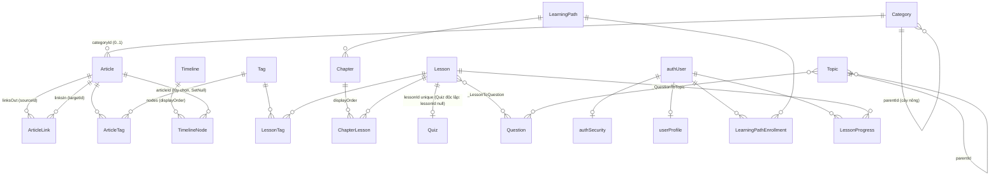

# 🗺️ Codebase Map — HISGO (TLCN-DT07)

> **Đọc file này TRƯỚC khi tìm code.** Viết lại 2026-11-05 sau refactor bỏ Knowledge Graph
> (nhánh `refactor/article-timeline`). Khi thêm/xoá module, đổi schema hoặc đổi luồng dữ liệu → cập nhật file này.
>
> ⚠️ Các tài liệu `docs/phase*-*.md`, `docs/map-parts/*`, `docs/*knowledge-graph*`, `backend/docs/block-schema-reference.md`
> mô tả mô hình CŨ (HistoricalEntity/Statement/Taxonomy/Period) — chỉ để tham khảo lịch sử, **không đúng với code hiện tại**.

## 0. Tổng quan 30 giây

| Phần | Công nghệ | Vai trò |
|---|---|---|
| `backend/` | NestJS 11 + Prisma 7 (multi-file schema) + PostgreSQL, Redis (cache/rate-limit), BullMQ (email), Winston, Prometheus, Swagger | API CMS + API công khai `/public/*` |
| `frontend/` | Next.js **16** App Router (⚠️ `params` là `Promise`, xem `frontend/AGENTS.md`) + Tailwind + TipTap | Trang công khai tiếng Việt + CMS quản trị |
| `docs/` | Sequence diagram theo phase | Lịch sử thiết kế (phần lớn đã lỗi thời) |

Cổng dev: backend `5001` (`backend/.env PORT`), frontend `3000`, Postgres `5433` (container `postgres_db`, DB `tlcn_db`, user `admin`).

**Mô hình nội dung có 2 trục độc lập:**
1. **Tri thức lịch sử** = `Article` (bài viết) thuộc 1 `Category` (chuyên mục quyết định **loại bài** qua `Category.kind`), gắn N `Tag`, nối với bài khác qua `ArticleLink` (nhãn chữ tự do), hồ sơ mô tả tùy chọn trong `Article.metadata` (JSONB); `Timeline` gồm các `TimelineNode` (mốc) có thể trỏ tới `Article`.
2. **Học tập** = `Lesson` (bài học dạng khối) ← `Chapter` ← `LearningPath`; `Quiz`/`Question`; `Topic` (cây chủ đề); tiến độ `LearningPathEnrollment`/`LessonProgress`.

`Tag` là cầu nối duy nhất giữa 2 trục (dùng chung cho Article và Lesson).

---

## 1. DATABASE (`backend/prisma/schema/*.prisma`)

### 1.1 Sơ đồ quan hệ



`ContentRevision` không có FK — tham chiếu mềm bằng (`contentType`, `contentId`).

### 1.2 Bảng theo file

| File | Model | Ghi chú quan trọng |
|---|---|---|
| `article.prisma` | `Category`, `Article`, `ArticleTag`, `ArticleLink` | Comment đầu file giải thích Category vs Tag vs Timeline. `Category.kind` (enum `ArticleKind`, NULL = kế thừa cha). `Article.contentBlocks` = mảng khối **cùng định dạng `Lesson.content`**. `Article.metadata` = hồ sơ mô tả tùy chọn (index GIN). `ArticleLink(sourceId, targetId, label?, note?, displayOrder)` unique (source,target), CHECK không tự liên kết, cascade 2 đầu. Năm âm = TCN, không có năm 0. |
| `timeline.prisma` | `Timeline`, `TimelineNode` | Mốc sắp theo `displayOrder`; `dateText` ưu tiên hơn `year/month/day` khi hiển thị. |
| `tag.prisma` | `Tag`, `LessonTag` | `Tag.name` unique; `articleTags` + `lessonTags`. |
| `lesson.prisma` | `Lesson` + enum `LessonStatus` | `content` JSONB (mảng khối). **Không có `topicId`** — Lesson không thuộc Topic (comment trong `topic.prisma`/`learningPath.prisma` nói "mỗi Lesson thuộc đúng 1 Topic" là **lỗi thời**). |
| `learningPath.prisma` | `LearningPath`, `Chapter`, `ChapterLesson` | Lộ trình = khoá học, Chương nằm trong 1 lộ trình. |
| `learner.prisma` | `LearningPathEnrollment`, `LessonProgress` | Đọc bài trong lộ trình cần đăng ký. |
| `quiz.prisma` | `Quiz`, `Question` | `Quiz.questions` JSONB (5 dạng); `Question` = ngân hàng câu hỏi tập trung, N-N ngầm với Lesson/Topic. |
| `topic.prisma` | `Topic` | Cây chủ đề (`parentId`), dùng cho curriculum + ngân hàng câu hỏi. Không gắn Period (Period đã xoá). |
| `contentRevision.prisma` | `ContentRevision` | PROPOSAL / SNAPSHOT cho LESSON, ARTICLE, TOPIC, LEARNING_PATH, CHAPTER. |
| `auth.prisma`, `profile.prisma`, `history.prisma` | `authUser`, `authSecurity`, `userProfile`, `loginHistory`, `emailHistory` | |
| `subscription.prisma` | `Subscription`, `SubscriptionPlan`, `Payment`, `Invoice` | **Chưa có module nào dùng.** |
| `enums.prisma`, `base.prisma` | enum dùng chung, generator/datasource | |

### 1.3 Quy tắc: khi nào dùng **enum**, **Category**, **Tag**

| Dùng | Khi nào | Ví dụ hiện có |
|---|---|---|
| **Prisma enum** | Giá trị **điều khiển logic code** (phân quyền, workflow, validate), không phải người dùng tự thêm | `ContentStatus` (Article/Timeline/Topic/LearningPath/Chapter), `LessonStatus` (Lesson — có `REVIEW` thay cho `PENDING_REVIEW`), `userRole`, `DatePrecision`, `DifficultyLevel`, `LearningPathType`, `TopicIcon` |
| **Category** (bảng) | "Bài này **là loại gì**" — mỗi bài đúng 1, quyết định trang hiển thị; biên tập viên thêm trong CMS | Nhân vật, Sự kiện, Di tích, Triều đại; chuyên mục con có loại EVENT = "loại sự kiện" |
| **Tag** (bảng) | "Bài này **liên quan chủ đề nào**" — nhiều-nhiều, gom ngang qua chuyên mục, dùng chung với Lesson | Nhà Trần, Kháng chiến chống Nguyên Mông |
| **ArticleLink** (bảng) | "Bài này **nối với bài kia**" — có FK, tra 2 chiều; KHÔNG có mã loại, nhãn chữ tự do; ý nghĩa suy từ loại 2 đầu | Trần Hưng Đạo –[Chỉ huy]→ Trận Bạch Đằng 1288 |
| **Article.metadata** (JSONB) | Thuộc tính MÔ TẢ tùy chọn của riêng bài, chỉ hiển thị / lọc, không nối | quê quán, tác phẩm, xếp hạng di tích, kết quả sự kiện |

**Loại bài = `Category.kind`** (enum `ArticleKind`: PERSON/EVENT/LOCATION/DYNASTY/OTHER; chuyên mục con để trống thì kế thừa cha). Frontend suy loại ở DUY NHẤT `frontend/src/services/public/article-kind.ts → resolveCategoryKind`. Slug `nhan-vat`/`su-kien`/`di-tich`/`trieu-dai` chỉ còn là đường dẫn của trang lối tắt công khai.

**`Article.metadata`** (chuẩn hoá ở `backend/src/article/article-metadata.ts`, mọi trường tùy chọn): `aliases[]` (đưa vào tìm kiếm), `region`, `sources[]`, `person{titles, occupation, roles[], birthDateLabel, deathDateLabel, hometown, backgroundAndYouth, notableWorks[], legacyAndHonors, anecdotes[], famousQuote}`, `site{address, latitude, longitude, siteType, rank, recognizedYear, preservation, statusNote, managingAgency, architecturalStyle, openingHours}`, `event{dateNote, cause, outcome, belligerents[]}`. Mã cố định (validate ở backend, nhãn ở frontend): `person.roles` ↔ `CANONICAL_ROLE_LABELS`, `site.siteType` ↔ `LocationType`, `site.rank` ↔ `HeritageRank`, `site.preservation` ↔ `PreservationCategory`.

`ContentStatus` ↔ `LessonStatus`: biên tập viên chỉ được đặt `DRAFT`/`PENDING_REVIEW`/`REVIEW` (`backend/src/common/access/access.constant.ts → EDITOR_ALLOWED_STATUSES`).

Enum mới: `ArticleKind` (trên `Category.kind`). Enum **đã xoá** cùng Knowledge Graph: `HistoricalEntityType`, `VerificationStatus`, `StatementValueType`, `StatementRank`, `MediaType`, `EventCategory`, `FigureRole`. Bảng **đã xoá**: `HistoricalEntity`, `Person`, `HistoricalSite`, `HistoricalEvent`, `HistoricalEntityMedia`, `HistoricalStatement`, `HistoricalReference`, `HistoricalStatementReference`, `TaxonomyGroup`, `TaxonomyTerm`, `TaxonomyPredicateRule`, `Period` (migration `20261105120000_article_timeline_replace_knowledge_graph`).

### 1.4 Migration & seed

- Quy trình (KHÔNG dùng `migrate dev` — shadow DB không replay được lịch sử): backup `pg_dump` → sửa schema → `npx prisma migrate diff --from-config-datasource --to-schema prisma/schema --script -o prisma/migrations/<ts>_<name>/migration.sql` → đọc lại SQL → `npx prisma migrate deploy` → `migrate diff` phải ra rỗng.
- Seed: `npm run seed:articles` (`prisma/seeds/articles-v1.seed.ts`, idempotent: 4 chuyên mục, 4 tag, 10 bài, 3 timeline). `prisma/seed-staff.ts` (tài khoản `editor@hisgo.test` MODERATOR, `reviewer@hisgo.test` ADMIN), `prisma/seed-lesson-dien-bien-phu.ts` (fixture bài học).
- Backup trước refactor: `backend/prisma/backups/2026-11-05_pre_article_refactor.dump` (gitignored).

---

## 2. BACKEND (`backend/src/`)

Pattern mỗi module: `*.controller.ts` → `*.service.ts` → `*.module.ts`, `dto/`. Module dùng guard `@ContentWrite`/`@RequireRoles` phải khai `RedisService` + `PrismaService` trong `providers` (AuthGuard cần).

### 2.1 Bảng route

| Module | Route | Quyền |
|---|---|---|
| `article/` | `GET /articles` (lọc `categoryId,tagId,status,search,sort`, phân trang), `GET /articles/:id` (+`links` dạng payload, `linksOut`/`linksIn` kèm bài), `POST`, `PATCH :id` (**versioned**; gửi `metadata` / `links` = thay toàn bộ), `DELETE :id` | GET: STAFF; ghi: `@ContentWrite({model:'article'})` |
| `category/` | `GET /categories`, `GET :id`, `POST`, `PATCH :id`, `DELETE :id` (chặn nếu còn bài) | GET công khai; ghi: ContentWrite |
| `timeline/` | `GET /timelines`, `GET :id` (kèm nodes+article), `POST`, `PATCH :id` (gửi `nodes` = **thay toàn bộ**, thứ tự = vị trí mảng), `DELETE` | GET: STAFF; ghi: ContentWrite (không versioned) |
| `public-content/` | `GET /public/categories`, `/public/categories/:slug`, `/public/articles?category&tag&q&featured&limit`, `/public/articles/:slug` (+`related` chung tag, `previous/next` cùng chuyên mục theo năm, `timelines` chứa bài), `/public/timelines`, `/public/timelines/:slug`, `/public/tags`, `/public/lessons`, `/public/topics/:slug` | Công khai, **chỉ PUBLISHED** |
| `lesson/` | CRUD `/lessons`, `GET slug/:slug`, `PATCH :id/review` | ghi: ContentWrite; xuất bản chỉ qua `/review` |
| `quiz/` | `/lessons/:lessonId/quiz` (GET/PUT/DELETE), `/quizzes` (quiz độc lập), `/questions` (ngân hàng; `backfillFromQuizzes()` chạy lúc khởi động) | |
| `learning-path/` | `/learning-paths` + `chapters` + gán/sắp bài vào chương | |
| `learner/` | `/me/learning` (tổng quan), `paths/:id/enroll`, `lessons/:slug` (403 `NOT_ENROLLED` nếu chưa đăng ký), `lessons/:id/complete` | đăng nhập |
| `topic/`, `tag/` | CRUD + cây/sắp xếp; `POST/GET lessons/:id/tags` | |
| `content-revision/` | `/content-revisions/pending`, `content/:type/:id`, `.../draft`, `:id`, `:id/approve|reject|restore` | REVIEWERS |
| `auth/` | `/auth` (đăng ký, verify, login, refresh, logout, google), `/me/profile`, `/me/change-password` | |
| `dashboard/` | `GET /dashboard/overview` (đếm article/timeline/topic/lesson, hoạt động gần đây) | |
| `upload/`, `user/`, `metrics/` | upload ảnh/tài liệu (disk `uploads/`), CRUD user, Prometheus | |

### 2.2 Phân quyền & phiên bản hoá (đọc trước khi sửa endpoint ghi)

- Vai trò: `USER` (người học) · `MODERATOR` (biên tập viên) · `ADMIN` (người duyệt) · `SUPERADMIN` — `common/access/access.constant.ts`.
- `@ContentWrite(resource)` (`common/access/access.decorator.ts`) = `AuthGuard` + `ContentWriteGuard`:
  1. chỉ STAFF; 2. biên tập viên không tự đặt PUBLISHED; 3. biên tập viên không sửa/xoá nội dung PUBLISHED/ARCHIVED — **trừ** endpoint `versioned: true`.
- `versioned: true` + nội dung đang PUBLISHED → `ContentRevisionInterceptor`: biên tập viên → lưu **PROPOSAL** chờ duyệt (response `{revisionPending, message, revision}`); người duyệt → chụp **SNAPSHOT** rồi sửa thẳng.
- Thêm loại nội dung mới vào phiên bản hoá: `ContentResource.model` (guard) + `findStatus()` + `VERSIONED_MODELS`/`REVISION_FIELDS` (`content-revision.constant.ts`) + target trong `revision-targets.ts`.

### 2.3 Quy tắc niên đại

- Lưu số nguyên có dấu: `-179` = 179 TCN, **không có năm 0** (`common/utils/historical-date.parser.ts → validateHistoricalYearRange`, dùng trong Article/Timeline service).
- Nhãn hiển thị công khai tính **1 lần ở backend**: `public-content/public-content.mapper.ts → buildDateLabel` (Article) và `buildNodeDateLabel` (mốc). Frontend CMS dùng `frontend/src/utils/year-label.ts`. Không viết thêm hàm format năm ở chỗ khác.

### 2.4 `common/`
`services/` prisma, redis (get/set/xoá theo pattern), email, slug (`generateUnique` + checker), logger · `guards/auth.guard.ts` (JWT + `tokenVersion`) · `access/` (roles, content-write) · `filters/all-exception.filter.ts` · `interceptors/transform.interceptor.ts` (bọc `{statusCode,message,data}`) · `queues/email/` (BullMQ) · `modules/` (redis, rate-limit, queue, logger).

Test: `npm test` (jest, 15 suite / 152 test). E2E `test/*.e2e-spec.ts` (supertest, cần DB).

---

## 3. FRONTEND (`frontend/src/`)

### 3.1 Luồng dữ liệu trang công khai (QUAN TRỌNG)

Giao diện công khai **giữ nguyên từ thời Knowledge Graph** (component nhận DTO cũ). Một lớp adapter dịch dữ liệu mới sang DTO cũ:

```
Server Component page
  → services/entities/landing.service.ts   ← ADAPTER (đọc comment "QUY TẮC ÁNH XẠ" đầu file)
      → services/public/public-content.service.ts  (fetch /public/*, no-store)
  → *.adapter.ts của từng feature (landing.adapter, sk-adapter, heritage.adapter, figure-utils,
    period-detail.adapter, entity-reader-adapter)  → component
```

Ánh xạ chính (chi tiết ở comment đầu `landing.service.ts`): Timeline → "thời kỳ" (`PublicPeriodDto`, khu vực = `metadata.region` phổ biến nhất); mốc Timeline → "sự kiện"; loại bài theo `Category.kind` → nhân vật/sự kiện/di tích/triều đại; `ArticleLink` theo loại 2 đầu → PERSON–PERSON: tab "Mối quan hệ", PERSON–EVENT: dòng đời nhân vật (vai trò = nhãn) + người tham gia, EVENT–LOCATION: nơi diễn ra + sự kiện của di tích, EVENT–EVENT: chế độ "Liên kết" của dòng thời gian; `Article.metadata` → tên khác, tab Tiểu sử & di sản, thẻ/bộ lọc di tích; "mạng lưới tri thức" ở trang đọc = liên kết (2 chiều) rồi tới bài chung tag; chuyên mục con loại EVENT → "loại sự kiện" (`services/public/public-taxonomy.ts`). **Không suy dữ liệu**: không đoán tham gia sự kiện theo tag, không gán khu vực mặc định — thiếu thì component tự ẩn.

| Route | Page → component chính |
|---|---|
| `/` | `app/page.tsx` → `features/landing/landing.server.ts` → `landing.adapter.ts` → `LandingView` |
| `/dong-thoi-gian` | `fetchEvents+fetchPeriods+fetchTaxonomyTerms('EVENT_TYPE')` → `components/timeline/sk-adapter.ts buildEraDataset` → `TimelineExplorer` |
| `/giai-doan/[slug]` | slug = **slug Timeline** → `fetchPeriodBySlug` → `features/period-detail/PeriodDetailView` |
| `/nhan-vat` | `fetchFigureDirectory` → `components/figures/FiguresDirectory` |
| `/di-tich` | `fetchLocations` → `features/heritage/HeritageExplorer` (`/heritage` redirect về đây) |
| `/su-kien` | `fetchEvents` → `features/events-library/EventsLibrary` |
| `/nhan-vat/[slug]`, `/su-kien/[slug]`, `/di-tich/[slug]`, `/thuc-the/[slug]`, `/trieu-dai/[slug]`, `/bai-viet/[slug]` | `fetchEntityBySlug` (bất kỳ bài viết) → `components/entity-detail/entity-reader-adapter` → `EntityHero` + `EntityReader` (prefix link theo loại: `entity-strategy.ts`) |
| `/chuyen-muc/[slug]`, `/trieu-dai`, `/tag/[id]` | `features/public-articles/CategoryPage` / `ArticleBrowser` + `components/hisgo/ArticleCard` (dùng thẳng `public-content.service`) |
| `/chuong-trinh-hoc`, `/bai-hoc/[slug]` | `features/public-curriculum` (dùng API CMS `/learning-paths`, `/lessons` + `/me/learning`) |
| `/chuong-su/[slug]` (`/kien-thuc/[slug]` re-export) | Topic + chủ đề con |
| `/login`, `/dang-ky`, `/tai-khoan` | auth người học |

Nội dung khối của bài viết/bài học biên dịch HTML bằng **cùng 1 hàm**: `features/lessons/utils/lesson-toc.util.ts → normalizeContentToBlocks + buildLessonTocAndHtml` (qua `plugins/block-plugin.registry.ts`).

Tìm kiếm toàn trang (Ctrl K): `features/search/` — index bài viết + timeline + bài học, tải 1 lần/phiên; dùng chung cho khối "liên quan" của trang đọc bài học (`public-curriculum/components/hub/LessonRelated.tsx`).

Route công khai phải có tiền tố trong `PUBLIC_ROUTE_PREFIXES` (`components/layout/ClientLayout.tsx`), nếu không sẽ bị bọc khung CMS + `CmsAccessGate`.

### 3.2 CMS

| Route | Component | Service |
|---|---|---|
| `/cms` | `features/dashboard/DashboardView` | `dashboard.service` |
| `/articles`, `/articles/create`, `/articles/[id]` | `features/articles/components/ArticleList`, `ArticleEditor` (tab Thông tin · **Hồ sơ & liên kết** = `ArticleProfilePanel` (nhánh form theo loại bài, liên kết + gợi ý nhãn) · Nội dung = `ContentBlockEditor`; `YearInput` TCN, banner bản sửa) | `services/entities/article.service.ts` (`ArticleApiService`, `CategoryApiService`) |
| `/categories` | `features/articles/components/CategoryManager` (chọn **loại bài** cho chuyên mục) | |
| `/timelines`, `/timelines/create`, `/timelines/[id]` | `features/timelines/components/TimelineList`, `TimelineEditor` (mốc ▲▼, `ArticlePicker`) | `timeline.service.ts` |
| `/tags` | `features/tags/TagList` | `tag.service.ts` |
| `/curriculum` | `HisgoStudioView` (Lộ trình → Chương → Bài, Thư viện Lesson) / `CurriculumExplorer` (cây Topic) | `learning-path`, `topic`, `lesson` |
| `/lessons/create`, `/lessons/[id]` | `features/lessons/components/LessonEditor` | |
| `/topics/create`, `/topics/[id]` | `TopicEditor` | |
| `/questions`, `/quizzes` | `features/quiz/` | |
| `/review` | `ReviewList` (bài học chờ duyệt) + `RevisionReviewList` (bản sửa) | `content-revision.service.ts` |
| `/users`, `/settings`, `/media`, `/analytics` | | |

Menu sidebar: `services/navigation/navigation-strategy.service.ts` (Strategy theo nhóm) + `constants/routes.ts` (`APP_ROUTES`, `NavigationPageKey`) + `constants/navigation.ts`. Tiêu đề trang: `components/layout/PageHeader.tsx`. Phân quyền trang: `components/layout/CmsAccessGate.tsx`. API client: `services/api.ts` (Bearer từ `PublicAuthService`, 401 → refresh/redirect login).

### 3.3 Lesson / Block Builder (`features/lessons/`)

- Loại khối (`types/block-palette.types.ts → LessonBlockType`): TEXT, HEADING, IMAGE, VIDEO, QUOTE, CALLOUT, DIVIDER, TIMELINE, MAP, CHARACTER, EVENT, COMPARISON_TABLE, RELATED_PEOPLE, RELATED_EVENTS, SECTION_ROW, STORY_CHAPTER, RESOURCE_LINK (QUIZ chỉ còn trong registry cho dữ liệu cũ).
- **Thêm khối mới** = 1 file `plugins/<x>-block.plugin.ts` (createDefault + toHtml) + đăng ký ở `plugins/block-plugin.registry.ts` + editor trong `components/builder/` + inspector.
- State: `facades/useLessonBlockManager.ts` (mảng khối, SECTION_ROW lồng cột), `facades/useLessonEditorFacade.ts` (metadata bài học, autosave localStorage).
- Khối CHARACTER/EVENT chọn từ **bài viết** (`strategies/entity-sources/hisgo-internal-source.strategy.ts`, `components/blocks/EventPickerModal.tsx`) hoặc Wikipedia; id bài lưu vào `entityId`/`eventId`.
- Khối TIMELINE: chỉ thủ công; nút "Nhập mốc từ dòng thời gian" (`components/builder/inspectors/TimelineBlockInspector.tsx`) chép mốc của 1 Timeline vào khối. Chế độ AUTO/HYBRID (dựng từ statement) **đã bỏ**.
- Liên kết wiki trong văn bản: `strategies/wiki-link-target.strategy.ts` → `/bai-viet/{slug}`, `/giai-doan/{slug}` hoặc URL ngoài.
- Dùng lại ở bài viết: `features/articles/components/ContentBlockEditor.tsx` bọc canvas + palette + inspector.

---

## 4. Nợ / lưu ý đã biết

- **Lint có sẵn từ trước**: `react-hooks/immutability` ở `features/lessons/components/blocks/EntityPickerModal.tsx` và `features/quiz/components/QuestionBankPickerModal.tsx`.
- `features/revisions/RevisionDiff.tsx` còn renderer cho kind `relations`/`media`/`object` (backend không còn phát ra) — có thể dọn.
- `features/tags/components/TagList.tsx` khi API lỗi vẫn cập nhật state giả ("fallback local update"); cột số bài đọc `lessonCount` không có trong API.
- Comment schema `topic.prisma`/`learningPath.prisma` nói Lesson thuộc 1 Topic — sai (không có `topicId`).
- `Subscription/Payment/Invoice`: có bảng, chưa có module.
- `app/api/subscribe/route.ts`: newsletter lưu trong `Set` RAM.
- Nội dung seed (`articles-v1.seed.ts`) do AI soạn theo mốc sách giáo khoa, chưa có trích dẫn nguồn — cần người duyệt rà trước khi dùng thật.
- Tìm kiếm theo `aliases` hiện chỉ ở ô tìm kiếm frontend (tải toàn bộ bài). Khi dữ liệu lớn: cột `search_vector` (tsvector + unaccent) ở backend.
- `docs/` và `backend/docs/block-schema-reference.md` còn mô tả mô hình cũ.
