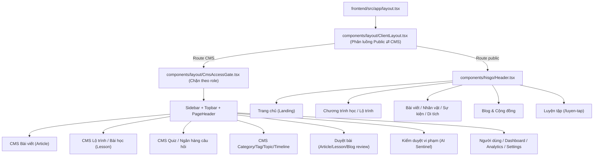

# 🗺️ BẢN ĐỒ KIẾN TRÚC & ĐIỀU HƯỚNG DỰ ÁN (PROJECT MAP)
> **Dự án:** HISGO — Nền tảng học & tra cứu lịch sử Việt Nam (`D:\Fullit\TLCN\TLCN-DT07`)
> **Stack:** Backend NestJS + Prisma (PostgreSQL) · Frontend Next.js (App Router)
> **Mục đích:** Chỉ đúng vị trí file (Frontend ⇄ Backend) của từng phân hệ để tra cứu nhanh và dán trực tiếp đường dẫn vào prompt AI, không cần quét lại toàn repo.
> **Nhánh cập nhật:** `fix/critical-audit-issues` — đối chiếu lại với code ngày **2026-11-20** (sau 56 commit kể từ lần cập nhật trước 2026-11-16: 4 tính năng mới — Flashcards SM-2, Mindmap Studio, Gamification, Saved Materials — cùng tái cấu trúc sâu Quiz/luyện tập, gộp hàng chờ duyệt (`/moderation`+`/blog-review` → `/review`), bỏ hẳn cụm UI Heritage cũ (`/di-tich` giờ redirect sang `/chuyen-muc/di-tich`), viết lại Reader/ghi chú-trên-văn-bản, hồ sơ Article rút gọn). Frontend `src/` **394 file** (từ 335); backend `src/` **219 file code + 63 file unit test**, 15 file e2e (`backend/test/`). Đợt này đọc sâu (đọc hết nội dung file) cho 4 tính năng mới; 47 commit còn lại xác minh ở mức diffstat + đọc có mục tiêu các file đổi nhiều nhất — đánh dấu rõ trong từng mục bên dưới mục nào mới xác minh được đến mức nào. **Tính năng "Không gian học tập" (Workspace)** từng được làm xong đầy đủ (backend + frontend) trên nhánh riêng `feat/workspace-stage1`, nhưng **nhánh đó đã bị xoá (2026-11-20)** theo yêu cầu — tính năng này không còn tồn tại trong repo. DB dev dùng chung trên máy vẫn còn sót bảng `workspace_items`/`workspace_item_versions`/`workspace_assets`/enum `WorkspaceItemType` từ 2 migration của nhánh đó đã từng `migrate deploy` lên — các bảng này **chưa được dọn**; khi sinh migration mới luôn dùng diff schema-to-schema (`--from-schema <bản cũ> --to-schema prisma/schema`) thay vì `--from-config-datasource` để tránh lệnh `DROP TABLE workspace_*` lẫn vào migration không liên quan, xem `CLAUDE.md` mục Prisma.

---

## ⚡ 1. MẸO DÙNG PROMPT NHANH (PROMPT SHORTCUTS)
Thay vì nói chung chung *"Sửa trang bài học"*, hãy copy đường dẫn tương ứng vào câu lệnh:
* **Sửa trình soạn bài học (Block Builder):**
  `"Xem file frontend/src/features/lessons/components/LessonEditor.tsx, facades/useLessonEditorFacade.ts, facades/useLessonBlockManager.ts và backend/src/lesson/lesson.service.ts..."`
* **Sửa Lộ trình học / Chương (HISGO Studio):**
  `"Xem file frontend/src/features/curriculum/components/HisgoStudioView.tsx và backend/src/learning-path/learning-path.service.ts..."`
* **Sửa CMS bài viết lịch sử:**
  `"Xem file frontend/src/features/articles/components/ArticleEditor.tsx, services/entities/article.service.ts và backend/src/article/article.service.ts..."`
* **Sửa Quiz/Ngân hàng câu hỏi:**
  `"Xem file frontend/src/features/quiz/facades/useQuizManagementFacade.ts và backend/src/quiz/standalone-quiz.controller.ts, question.controller.ts..."`
* **Sửa Blog/Cộng đồng:**
  `"Xem file backend/src/blog/blog.service.ts, blog.gateway.ts và frontend/src/features/community/components/CommunityFeed.tsx..."`
* **Sửa Kiểm duyệt nội dung (AI Sentinel):**
  `"Xem file backend/src/moderation/moderation.service.ts, moderation-ai.service.ts và frontend/src/features/moderation/components/ModerationDashboardView.tsx..."`
* **Sửa Đăng nhập/Đăng ký/Phiên:**
  `"Xem file backend/src/auth/auth.service.ts, services/auth-utils.service.ts và frontend/src/services/auth/public-auth.service.ts..."`
* **Sửa Lịch sử chỉnh sửa / duyệt bản sửa (Content Revision):**
  `"Xem file backend/src/content-revision/content-revision.service.ts, revision-targets.ts và frontend/src/features/revisions/RevisionPanels.tsx..."`
* **Sửa Sơ đồ tư duy (Mindmap):**
  `"Xem file frontend/src/features/mindmap/components/MindmapCanvas.tsx và backend/src/mindmap/mindmap.service.ts..."`
* **Sửa Thẻ ghi nhớ (Flashcards):**
  `"Xem file frontend/src/features/flashcards/components/FlashcardStudySession.tsx và backend/src/flashcard/flashcard.service.ts, sm2.scheduler.ts..."`
* **Sửa Trò chơi hoá học tập (Gamification — XP/streak/mục tiêu/huy hiệu):**
  `"Xem file backend/src/gamification/services/gamification-facade.service.ts, listeners/gamification.listener.ts và frontend/src/features/gamification/services/gamification.service.ts..."`
* **Sửa Tư liệu đã lưu / Bookmark:**
  `"Xem file backend/src/saved-material/saved-material.service.ts và frontend/src/features/saved-materials/services/saved-material.service.ts..."`

---

## 🏗️ 2. TỔNG QUAN LUỒNG CHÍNH (MAIN FLOW)

---

## 📑 3. CHI TIẾT CÁC PHÂN HỆ (FRONTEND ⇄ BACKEND)

### 3.1. Bài viết lịch sử (Article)
* **Mục đích:** Thực thể trung tâm của hệ thống (thay cho Entity/Statement cũ đã xoá 2026-11-05). Một bài viết có thể đóng vai trò Nhân vật / Sự kiện / Di tích / Triều đại / Khác tuỳ `Category.kind` của chuyên mục nó thuộc. Có hồ sơ mô tả JSONB tuỳ loại (`metadata`), liên kết 2 chiều bài↔bài (`ArticleLink`), quy trình duyệt 2 người (DRAFT → PENDING_REVIEW → PUBLISHED/REJECTED), tự tạo bản sửa chờ duyệt khi sửa bài đã publish; người duyệt **lưu trữ** bài đã xuất bản (`PUBLISHED → ARCHIVED → DRAFT`, xem 3.20). Trang đọc công khai có ghi chú cá nhân, không có hỏi đáp (dẫn sang Cộng đồng).
* **UI Component chính:** [ArticleList.tsx](frontend/src/features/articles/components/ArticleList.tsx) (danh sách CMS, lọc chuyên mục/tag/trạng thái — có "Lưu trữ", phân trang server), [ArticleEditor.tsx](frontend/src/features/articles/components/ArticleEditor.tsx) (3 tab: Thông tin / Hồ sơ & liên kết / Nội dung). Tab Thông tin có ô chọn **Chuyên mục** (Category, bắt buộc) và **Chủ đề** (`TopicPicker`, tuỳ chọn — `topicId` đi qua bản sửa chờ duyệt như mọi trường khác, khai báo trong `REVISION_FIELDS.ARTICLE`).
* **Component/Modal phụ trợ:**
  * `ArticleProfilePanel.tsx` — nhập `metadata` theo nhánh person/site + `links` liên kết bài khác (ghi rõ chiều nhãn Nguồn → Đích). **[Rút gọn 2026-11-17, `a694884` "trim profile fields to one place per fact"]** Đã bỏ các field hồ sơ trùng ý nghĩa với field khác (nhãn ngày sinh/mất riêng của nhân vật, cả khối "hồ sơ sự kiện" — ghi chú ngày/nguyên nhân/kết quả/phe tham chiến, era/region, toạ độ, giờ mở cửa, occupation gộp vào `titles`) — mỗi sự kiện/thực tế chỉ còn 1 chỗ nhập duy nhất thay vì lặp ở nhiều field; **chưa xác minh lại danh sách field hiện còn**, đọc `ArticleProfilePanel.tsx` trước khi sửa phần hồ sơ.
  * **[Mới 2026-11-17, `3b424db`]** `CategoryManagerParts.tsx`, `CategoryPicker.tsx` — cây chọn Category cha→con (Category giờ có `isActive` và chuyên mục con, ví dụ dưới Nhân vật/Sự kiện/Di tích).
  * `ArticleConnections.tsx` — preview chỉ đọc: dòng đời nhân vật, người liên quan sự kiện, dòng thời gian chứa bài.
  * `ContentBlockEditor.tsx` — soạn nội dung Block Builder (tái dùng hạ tầng `features/lessons`).
  * `ArticlePicker.tsx`, `StatusPill.tsx`, `YearInput.tsx` (hỗ trợ năm TCN), `CategoryManager.tsx`.
  * `person-life.ts` — ghép dòng đời nhân vật dùng chung CMS ⇄ trang công khai (hợp 2 nguồn: LINK + MILESTONE).
* **Route trang (Next.js):**
  * CMS: `frontend/src/app/articles/page.tsx` (danh sách), `articles/create/page.tsx` và `articles/[id]/page.tsx` (→ `ArticleEditor`).
  * `frontend/src/app/bai-viet/[slug]/page.tsx` → trang đọc chung mọi loại bài viết (dùng chung với `/nhan-vat`, `/su-kien`, `/di-tich`, `/thuc-the`).
  * **[Mới 2026-11-15]** `frontend/src/app/bai-viet/page.tsx` → trang lưu trữ (`BaiVietArchivePage`, server component): lọc theo `?chuyen-muc=<slug>&q=<từ khoá>`, dùng `ArticleBrowser` (`features/public-articles/`); chip chuyên mục build từ `fetchCategories()`, route hợp nhất qua hằng số `PUBLIC_ROUTES.ARTICLES` (không hardcode `/bai-viet`).
  * `frontend/src/app/categories/page.tsx` → `CategoryManager`.
* **Service/API Client:** `frontend/src/services/entities/article.service.ts` (`ArticleApiService`, `CategoryApiService`), `frontend/src/services/public/public-content.service.ts` (fetch công khai).
* **Backend Module:** `backend/src/article/`
  * Controller: `article.controller.ts` (route `/articles`, STAFF/REVIEWERS)
  * Service: `article.service.ts` (CRUD, slug unique, validate link, transaction tag/link, quy tắc duyệt 2 người; đổi tag / xoá bài thì xoá cache danh sách Tag)
  * `article-metadata.ts` — validate `metadata` theo mã cố định (PERSON_ROLE_CODES, SITE_TYPE_CODES...)

### 3.2. Phân loại — Category / Tag / Topic
* **Mục đích — 3 vai trò tách bạch, không dùng lẫn:**
  * **Category = bài viết LÀ LOẠI GÌ** — chỉ dành cho Article (mỗi bài đúng 1), quyết định `kind` (PERSON/EVENT/LOCATION/DYNASTY/OTHER). **[Sửa 2026-11-17, `27e5765`]** `kind` chỉ còn suy từ `Category.kind` — đã bỏ hẳn fallback suy theo tiền tố slug. **[Mới, `3b424db`]** Category có `isActive` và chuyên mục con (cây cha→con, `CategoryPicker.tsx`); slug cố định cũ (`nhan-vat`, `su-kien`, `di-tich`, `trieu-dai`) giờ chỉ còn ý nghĩa tham số lọc `?chuyen-muc=` cho trang `ArticleBrowser` dùng chung (xem 3.4), không còn ánh xạ ra route/UI riêng theo từng loại.
  * **Topic = nội dung thuộc PHẦN NÀO của môn sử** — cây phân cấp (chống cycle, giới hạn độ sâu 20). Lesson gắn đúng 1 (bắt buộc), Article / Timeline gắn tối đa 1, Quiz / Question gắn nhiều. Thời kỳ của bài viết trên trang công khai suy theo Topic (xem 3.4).
  * **Tag = từ khoá tự do** — chỉ Lesson (`LessonTag`) và Article (`ArticleTag`), chỉ dùng để tìm kiếm và gợi ý bài liên quan ("Mạng lưới tri thức"); **không** dùng để phân loại hay suy thời kỳ. Cache Redis.
  * **Blog** không dùng cả ba: có `postType` riêng và hashtag trong `metadata`, chỉ trích dẫn một chiều tới Article/Lesson.
* **UI Component chính:** [TagList.tsx](frontend/src/features/tags/components/TagList.tsx) (gọi qua `TagApiService`, cột "Đang dùng" = số bài học · số bài viết, có trạng thái lỗi + thử lại), [TopicEditor.tsx](frontend/src/features/topics/components/TopicEditor.tsx).
* **Component/Modal phụ trợ:** `TagModal.tsx` (gộp `TagForm`); Topic: `TopicEditor.tsx` chỉ điều phối (~140 dòng), state + thao tác ở `hooks/useTopicEditor.ts`, header + cột phải ở `TopicEditorParts.tsx`, các khối form + quản lý chủ đề con ở `TopicEditorFormParts.tsx`; `TopicParentModalPicker.tsx`, `TopicPicker.tsx`, `TopicCoverImagePicker.tsx`.
* **Route trang:** `frontend/src/app/tags/page.tsx`, `frontend/src/app/categories/page.tsx`.
* **Service/API Client:** `services/entities/tag.service.ts` (`TagApiService`), `services/entities/topic.service.ts` (`TopicApiService`).
* **Backend Module:**
  * Category: `backend/src/category/` (`/categories`, chặn xoá khi còn bài viết, chống cycle).
  * Tag: `backend/src/tag/` (`/tags` trả phân trang `{ items, total, ... }` kèm `_count.lessonTags` + `_count.articleTags`, `/lessons/:id/tags`, cache Redis TTL 3600s — `ArticleService` (đổi tag, xoá bài) và `LessonService` (xoá bài) đều xoá cache này nên số đếm cập nhật ngay).
  * Topic: `backend/src/topic/` (`/topics`, cache Redis TTL 300s, MAX_DEPTH 20, bulk reorder qua `$transaction`; xoá bị chặn (409) khi còn chủ đề con hoặc bài học; `/topics/tree` trả cây N cấp, mỗi nút kèm `lessons` rút gọn + `_count.lessons`).

### 3.3. Dòng thời gian (Timeline)
* **Mục đích:** CMS dòng thời gian — danh sách mốc lịch sử theo `displayOrder`. Mỗi lần cập nhật "nodes" = thay toàn bộ danh sách mốc (xoá hết + tạo lại trong transaction). Là nguồn dữ liệu để trang công khai cũ suy ra "Thời kỳ"/"Sự kiện"/dòng đời nhân vật.
* **[Cập nhật 2026-11-15] 1 mốc có thể gắn nhiều bài viết (N-N):** schema giữ cả `TimelineNode.articleId` (1 bài, cũ) **và** bảng nối mới `TimelineNodeArticle` (`node_id` + `article_id` + `displayOrder`, PK ghép, `onDelete: Cascade` cả 2 chiều) để không phá dữ liệu cũ. DTO `TimelineNodeInputDto` nhận thêm `articleIds?: string[]`; nếu gửi `articleIds` thì ghi cả N-N (bài đầu tiên đồng thời lưu vào `articleId` cho tương thích ngược), nếu chỉ gửi `articleId` (form cũ) thì tự suy thành danh sách 1 phần tử (`resolveNodeArticleIds` trong `timeline.service.ts`). Đọc công khai (`public-content.service.ts`) trả cả `node.article` (1 bài, giữ tương thích FE cũ) và `node.articles[]` (danh sách đầy đủ, chỉ lộ bài đã `PUBLISHED`); `Article` chi tiết cũng trả `timelines[]` gộp từ cả 2 nguồn (`timelineNodes` 1-N cũ + `timelineNodeLinks` N-N mới), khử trùng theo id mốc.
* **UI Component chính:** [TimelineList.tsx](frontend/src/features/timelines/components/TimelineList.tsx) (tìm + lọc trạng thái phía client), [TimelineEditor.tsx](frontend/src/features/timelines/components/TimelineEditor.tsx) (có nút Lưu trữ / Khôi phục cho người duyệt, đã cập nhật nhập nhiều bài viết/mốc).
* **Service/API Client:** `services/entities/timeline.service.ts` (`TimelineApiService`); đọc công khai qua `fetchTimelines/fetchTimeline` trong `public-content.service.ts`.
* **Backend Module:** `backend/src/timeline/` — Controller `timeline.controller.ts` (`/timelines`, STAFF), Service `timeline.service.ts` (validate mốc + tồn tại đủ bài viết trong `articleIds`, include `linksIn/linksOut` để CMS xem trước "Gắn với...").

### 3.4. Danh mục bài viết công khai (Di tích / Nhân vật / Sự kiện / Triều đại) & Giai đoạn (Period-detail)
* **[Viết lại hoàn toàn 2026-11-17/18, commit `8804cfc` và các commit lân cận]** Các trang danh mục theo chuyên mục (từng là 3 cụm UI riêng — Heritage/`di-tich`, FiguresDirectory/`nhan-vat`, EventsLibrary/`su-kien`) đã **gộp làm một**: `app/di-tich/page.tsx`, `app/nhan-vat/page.tsx`, `app/su-kien/page.tsx`, `app/chuyen-muc/[slug]/page.tsx` giờ chỉ còn vài dòng `redirect(PUBLIC_ROUTES.CATEGORY(slug))` — đã xác nhận đọc trực tiếp nội dung 4 file này (chỉ redirect, không còn UI). `PUBLIC_ROUTES.CATEGORY` (`public-content.service.ts`) trả `CATEGORY_CANONICAL_ROUTES[slug] ?? /bai-viet?chuyen-muc=<slug>`; `CATEGORY_CANONICAL_ROUTES` hiện là `{}` rỗng nên mọi chuyên mục đều đổ về **`/bai-viet?chuyen-muc=<slug>`** — cùng trang lưu trữ bài viết đã có ở mục 3.1 (`BaiVietArchivePage` → [ArticleBrowser.tsx](frontend/src/features/public-articles/ArticleBrowser.tsx), [ArticleBrowserParts.tsx](frontend/src/features/public-articles/ArticleBrowserParts.tsx), `article-library.strategy.ts`). Thư mục `features/heritage/` chỉ còn sót `heritage.adapter.ts` (không có component); `features/figures/` không còn tồn tại, thay bằng `components/figures/FiguresDirectoryParts.tsx`/`FigureProfileParts.tsx`/`figure-utils.ts` (chỉ còn phần phụ trợ trang hồ sơ 1 nhân vật, không còn trang danh bạ riêng); không tìm thấy `EventsLibrary.tsx` ở đâu trong repo nữa.
* **Mục đích (còn đúng):** Loại bài = `Category.kind`; dữ liệu dựng từ Article + Category + ArticleLink + Timeline qua `landing.service.ts` (tên dễ nhầm — thực chất là **adapter/mapper chính** của toàn hệ thống công khai, dùng cho trang chi tiết 1 bài và trang Giai đoạn, KHÔNG còn dùng cho trang danh mục vì danh mục đã chuyển qua `ArticleBrowser`). Thời kỳ = 1 Timeline; Sự kiện = mốc Timeline hoặc bài chuyên mục Sự kiện chưa gắn mốc nào. Thời kỳ của 1 bài (`createPeriodSlugResolver` trong `landing-graph.ts`): **1 luật duy nhất** — Timeline cùng `topicId` với bài. Tag không tham gia.
* **Thời kỳ cha/con:** BE thêm `topic.parentId` vào `timelineInclude` (`public-content.service.ts`); FE `buildPeriods()` (`landing-graph.ts`) suy `Period.parentId`; `fetchPeriodBySlug` ráp `parent`/`children` (kèm `eventCount`/`figureCount`) và gộp sự kiện/nhân vật của Giai đoạn con vào Thời kỳ cha. `/dong-thoi-gian` (`sk-adapter.ts buildEraDataset`) tự gộp theo cây này.
* **UI Component chính còn lại:**
  * Trang chi tiết 1 thực thể: `app/di-tich/[slug]/page.tsx`, `app/nhan-vat/[slug]/page.tsx`, `app/su-kien/[slug]/page.tsx`, `app/thuc-the/[slug]/page.tsx` — dùng chung `fetchEntityBySlug` + `EntityHero`/`EntityReader` (xem mục 3.9, cũng viết lại nhiều trong đợt này).
  * Period-detail: [PeriodDetailView.tsx](frontend/src/features/period-detail/components/PeriodDetailView.tsx) (`/giai-doan/[slug]`), `PeriodDetailParts.tsx`, `period-detail.adapter.ts` (`groupEventsByStage`, `siblingPeriods`).
  * Danh mục bài viết theo chuyên mục/tìm kiếm: xem mục 3.1 (`ArticleBrowser`, dùng chung cho `/bai-viet` và mọi `?chuyen-muc=`).
* **Nhóm theo Chủ đề (Topic) ở trang danh bạ cũ** [`feat(nhan-vat)`/`feat(su-kien)` 2026-11-17]: nếu còn giữ lại UI nhóm theo Topic cho Danh bạ nhân vật/Thư viện sự kiện, nó nằm trong `article-library.strategy.ts`/`ArticleBrowserParts.tsx` chứ không còn file riêng — **chưa xác minh chi tiết cách nhóm**, cần đọc sâu `article-library.strategy.ts` nếu sửa phần này.
* **Service/API Client:** `frontend/src/services/entities/landing.service.ts` (`fetchPeriods`, `fetchEvents`, `fetchEntityBySlug`, `fetchPeriodBySlug`, `fetchPublicList`) cho trang chi tiết/Giai đoạn; `GET /public/topics`, `GET /public/topics/:slug` (mới, `public-content.controller.ts:167,175`) phục vụ nhóm theo Topic.
* **Backend:** không có module riêng — toàn bộ do `PublicContentService` (xem mục 3.9) tổng hợp.
* **Đã bỏ (2026-11-12):** khái niệm **khu vực** (`region`, `HistoricalRegion`, nhóm "Trong nước / Thế giới") và **xếp hạng di tích** (`HeritageRank`, `site.rank`) ở cả `Article.metadata` lẫn UI.

### 3.5. Trang chủ (Landing)
* **Mục đích:** Spotlight sự kiện, các "kỷ nguyên" theo thời kỳ gốc, dòng thời gian rút gọn (Mini Timeline), nhân vật/di tích nổi bật, lộ trình học, câu hỏi mỗi ngày. Đã loại bỏ hoàn toàn phần "Đối sánh khu vực" (`ParallelBand`, `buildBands`), chip/bộ lọc khu vực và chỉ số "Vùng lịch sử".
* **UI Component chính:** [LandingView.tsx](frontend/src/features/landing/components/LandingView.tsx) (+ `LandingHero`, `ResumeBar`, `ExploreSections`, `InteractivePreview`, `EntitiesSection`, `LearningQuiz`, `JoinBanner`). Đạt 0 errors, 0 warnings.
* **Service/API Client:** `features/landing/landing.adapter.ts` (gộp `landing.server`, `landing.types` — export `fetchLandingData`, `buildLandingData`).
* **Backend:** dùng chung `/public/*` + `/learning-paths`.

### 3.6. Tìm kiếm toàn cục (Search) & Phân loại linh hoạt
* **Search — Mục đích:** Ô tìm kiếm toàn cục (Ctrl/⌘+K) trên trang công khai — tìm Article + Timeline + Lesson, bỏ dấu tiếng Việt, cache 1 lần/phiên.
  * UI: [GlobalSearch.tsx](frontend/src/features/search/GlobalSearch.tsx); Service & Index: `search-index.ts` (gộp `search.service` — `loadPublicCatalog/loadSearchIndex`, `buildSearchIndex`, `normalizeSearch`).
* **Khử bỏ Taxonomy & Enum cũ:** Toàn bộ hệ thống bảng và enum cũ (`FigureRole`, `LocationType`, `EntityType`, `VerificationStatus`, `EntityRelationType`, `EventRelationType`, `EVENT_CATEGORY_CODES`, `TaxonomyGroupCode`, `CategoryFieldType`) đã bị loại bỏ triệt để.
* **Quản lý vai trò nhân vật:** Không dùng danh sách role cứng nào (`PRIMARY_ROLE_CODES`, `CANONICAL_ROLE_LABELS` đã xoá); vai trò được nhập dạng tag chuỗi tự do (`roles: string[]`) qua `ListField` trong `ArticleProfilePanel.tsx`.
* **Backend:** Controller `public-content.controller.ts` đã xoá bỏ hoàn toàn endpoint `/public/taxonomies`. Dữ liệu phân loại dựa vào `Category` (`Category.kind: ArticleKind`) và `Tag`.

### 3.7. Chương trình học / Lộ trình học (Curriculum & Learning Path)
* **Mục đích:** CMS quản lý Lộ trình học (LearningPath) gồm các Chương (Chapter), mỗi chương gom Bài học có sẵn qua bảng nối `ChapterLesson` (có `displayOrder` kéo-thả). 2 chế độ xem: "HISGO Studio" (biên soạn) và "Cây phân cấp Chủ đề".
* **Hai trục độc lập (đọc trước khi sửa):** `Topic` = cây phân loại (Giai đoạn → Chủ đề → Chuyên đề) — `Article`, `Lesson`, `Timeline` gắn 1 `topicId`; `Quiz`, `Question` gắn nhiều Topic. `LearningPath` = khoá học, chia theo **Chương**, mỗi chương chọn & sắp lại Lesson có sẵn — một Lesson vừa thuộc 1 Topic vừa có thể nằm trong nhiều Chương/Lộ trình. `pathType` (`LearningPathType`: `CHRONOLOGICAL` | `THEMATIC`) **chỉ có ở LearningPath** (đã bỏ `Topic.pathType` và giá trị `MYTHOLOGICAL` — migration `20261112220000_drop_topic_path_type`).
* **UI Component chính:** [HisgoStudioView.tsx](frontend/src/features/curriculum/components/HisgoStudioView.tsx), [CurriculumExplorer.tsx](frontend/src/features/curriculum/components/CurriculumExplorer.tsx) — chế độ "Cây phân cấp Chủ đề" dùng `CurriculumTree` + `CurriculumTreeParts.tsx` (`TopicTreeBranch` đệ quy, vẽ được mọi độ sâu) và hook `useCurriculumTree.ts` (lọc/tìm kiếm bằng `pruneTree`, đếm đệ quy). Từ cấp 3 trở xuống nút "+" thêm bài học thay vì thêm chủ đề con.
* **Component/Modal phụ trợ:** `studio/StudioPanels.tsx` (Header, Toolbar — xuất bản/chuyển nháp, Lưu trữ/Khôi phục —, LearningPathListPanel), `studio/ChapterList.tsx`, `studio/LessonLibraryPanel.tsx` (lọc trạng thái gồm Chờ duyệt / Lưu trữ), `studio/StudioModals.tsx` (LearningPathFormModal, CreateChapterModal, AddLessonsToChapterModal), `CurriculumTreePreviewModal.tsx`; state ở `useHisgoStudio.ts` (`handleChangePathStatus`). Nhãn trạng thái dùng `StatusPill` (đủ 5 trạng thái).
* **Strategy:** `strategies/node-detail.strategy.tsx` — `TopicNodeDetailStrategy` / `LessonNodeDetailStrategy`, chọn bằng `NodeDetailStrategyFactory`.
* **Route trang:** `frontend/src/app/curriculum/page.tsx` (chuyển đổi Studio ⇄ Explorer).
* **Service/API Client:** `services/entities/learning-path.service.ts` (`LearningPathApiService`).
* **Backend Module:** `backend/src/learning-path/`
  * Controller: `learning-path.controller.ts` (`learning-paths`, `@ContentWrite`)
  * Service: `learning-path.service.ts` (slug qua `SlugService`, `addLessonsToChapter` dùng `upsert` khoá composite, `reorderChapterLessons` dùng `$transaction`)
  * DTO: `UpdateLearningPathDto` = `PartialType(CreateLearningPathDto)` — chỉ gửi `status` là đủ (trước 2026-11-14 bắt gửi lại `title`, nút Xuất bản lộ trình luôn 400).

### 3.8. Bài học (Lesson) — Block Builder
* **Mục đích:** CRUD + duyệt 2 người cho bài học (`DRAFT → PENDING_REVIEW → PUBLISHED/REJECTED`, người duyệt ≠ người soạn; người duyệt lưu trữ được bài đã xuất bản — xem 3.20). Bài học dùng chung enum `ContentStatus` (enum riêng `LessonStatus` với giá trị `REVIEW` đã bỏ ngày 2026-11-14, migration `20261114140000_lesson_status_uses_content_status`). Nội dung lưu JSONB là **mảng "block"** — `LessonBlockType` (`types/editor.types.ts`) có 17 loại nội dung: TEXT, HEADING, IMAGE, VIDEO, RESOURCE_LINK, TIMELINE, MAP, CHARACTER, EVENT, COMPARISON_TABLE, QUIZ, SECTION_ROW, CALLOUT, QUOTE, DIVIDER, RELATED_PEOPLE, RELATED_EVENTS (đã hợp nhất `STORY_CHAPTER` vào `SECTION_ROW` kèm layout presets; dữ liệu `STORY_CHAPTER` cũ tự động chuyển đổi ngược thành `[HEADING, SECTION_ROW]` qua `migrateLegacyStoryChapterToBlocks`).
* **UI Component chính:** [LessonEditor.tsx](frontend/src/features/lessons/components/LessonEditor.tsx) — bộ điều phối, giữ toàn bộ state/facade; **[Cập nhật 2026-11-15]** chia 2 tab lớn qua `LessonEditorMainTab`: **INFO** (hồ sơ/metadata bài học) và **CONTENT** (Block Builder), nối với `LessonEditorHeader`/`LessonInfoProfileTab`/canvas/cột trái/panel thuộc tính (547 dòng — vượt ngưỡng orchestrator ≤250 dòng của `CLAUDE.md`, xem `CODE_AUDIT.md` mục 3.x).
* **Các file giao diện (`features/lessons/components/`):**
  * `LessonEditorHeader.tsx` (537 dòng) — `LessonEditorHeader` (thoát, tiêu đề, auto-save, Gửi duyệt/Cập nhật, nút Lưu trữ/Khôi phục cho người duyệt, menu "•••"), `AutoSaveIndicator`, `LessonDifficultySelector`, `LessonEditorSubHeader` (Soạn thảo/Chia đôi/Xem trước), `LessonHeaderMetaForm`.
  * **[Mới 2026-11-15]** `LessonHeaderActions.tsx` (434 dòng) — tách hành động/menu khỏi `LessonEditorHeader` (Gửi duyệt, Lưu trữ/Khôi phục, menu "•••", nút chuyển tab INFO/CONTENT).
  * **[Mới 2026-11-15]** `LessonInfoProfileTab.tsx` (480 dòng) — nội dung tab **INFO**, thay cho 3 tab cũ từng nằm trong `LessonPropertiesPanel` (Phân loại, Media, Xuất bản) dồn vào 1 màn hình hồ sơ bài học.
  * `properties/LessonPropertiesPanel.tsx` — **[Cập nhật 2026-11-15]** co lại từ 333 → **80 dòng** sau khi phần hiển thị chuyển sang `LessonInfoProfileTab.tsx` (trạng thái, nguồn tham khảo, Liên kết tài nguyên = khối RESOURCE_LINK).
  * `LessonLeftToolSidebar.tsx`, `LessonPreviewContent.tsx`, `LessonMediaManager.tsx`, `LessonTagPicker.tsx`, `TipTapContent.tsx`, `TipTapToolbar.tsx`.
  * **[Mới 2026-11-15] Footnote/chú giải trong bài:** `extensions/annotation.extension.ts` (extension TipTap, đánh dấu vùng chữ + tham chiếu footnote qua `ANNOTATION_DATA_ATTRS`/`FOOTNOTE_REF_CLASS`), `hooks/useLessonAnnotations.tsx` (bắt hover trên liên kết nội bộ trong `TipTapContent.tsx`, gọi `GET /public/articles/:slug` lấy tóm tắt hiện tooltip, cache trong `Map` module-scope), `builder/TextAnnotationModal.tsx` (473 dòng — modal soạn nội dung chú giải, mở từ `TipTapToolbar.tsx`).
  * `blocks/EntityPickerModal.tsx`, `blocks/EventPickerModal.tsx` (+ `blocks/shared/useWikipediaDetailPicker.ts`, `WikiDetailPreviewPane.tsx` — tra Wikipedia/Wikidata).
  * `quiz/QuizQuestionEditors.tsx` — editor 6 dạng câu hỏi, dùng cho cả **Ngân hàng câu hỏi** (`QuestionBankModal`) và khối **QUIZ** trong canvas bài học (xem bảng khối dưới).
* **Builder (`components/builder/`):**
  * Khung: `BlockBuilderCanvas.tsx` (render theo `LessonBlockType`; loại không có editor thì hiện placeholder), `BlockCardWrapper.tsx`, `BlockLibraryPalette.tsx` (+ `BLOCK_TYPE_ICONS`), `AddBlockDivider.tsx`, `ColumnResizer.tsx`, `WikiLinkInspectorSection.tsx`.
  * Editor từng loại khối:

    | Khối | Editor |
    |---|---|
    | TEXT, MAP, QUOTE, CALLOUT, COMPARISON_TABLE | `BasicBlockItemEditors.tsx` |
    | IMAGE, CHARACTER, EVENT | `RichBlockItemEditors.tsx` |
    | TIMELINE | `TimelineBlockItemEditor.tsx` + `TimelineNodeItemCard.tsx` |
    | SECTION_ROW | `RowSectionBlockEditor.tsx` + `ColumnResizer.tsx` (1–4 cột kèm 6 layout preset như Tạp chí 4:8, Đối xứng 6:6, 3 cột…; luật lồng khối `BlockPlacementRuleEngine` và migration dữ liệu `STORY_CHAPTER` cũ `migrateLegacyStoryChapterToBlocks` trong `strategies/row-layout.strategy.ts`) |
    | HEADING, VIDEO, DIVIDER, RELATED_PEOPLE, RELATED_EVENTS | vẽ trực tiếp trong canvas |
    | RESOURCE_LINK | soạn ở tab Xuất bản, luôn xuất ở cuối bài |
    | QUIZ | **[Có editor từ 2026-11-15]** `builder/QuizBlockEditor.tsx` — soạn tại chỗ hoặc "Lấy từ Ngân hàng" (`QuestionBankPickerModal`, lọc sẵn theo chủ đề bài học), tối đa `LESSON_QUIZ_MAX_QUESTIONS=5` câu/khối (`utils/lesson-quiz.util.ts`). ⚠️ vẫn **chưa có trong bảng thêm khối** `LESSON_BLOCK_ITEMS` — xem mục 6 |

  * Inspector (cột phải): `BlockPropertyInspector.tsx` (bảng `BLOCK_INSPECTOR_STRATEGIES`), `inspectors/` gồm `TypographyInspectorPanel.tsx`, `SimpleBlockInspectors.tsx`, `TimelineBlockInspector.tsx`, `RowSectionBlockInspector.tsx` (chọn 6 mẫu bố cục nhanh, số cột, tỷ lệ chia, khoảng cách, căn dọc, đường kẻ ngăn, chỉnh sửa khối con trong cột).
* **Hạ tầng Block Builder (ngoài `components/`):**
  * Facade: `facades/useLessonEditorFacade.ts` (nạp chủ đề, auto-save nháp localStorage, hợp bản sửa chờ duyệt qua `withPendingDraft`, `submitLesson`), `facades/useLessonBlockManager.ts` (thêm/sửa/xoá/di chuyển khối, cột `SECTION_ROW`, chuyển đổi ngược `STORY_CHAPTER` cũ, `compileToHtml/compileToJson`).
  * Plugin (nơi xử lý thật từng loại khối): `plugins/block-plugin.registry.ts` (`LessonBlockRegistry`, 17 plugin + fallback adapter cho `STORY_CHAPTER` cũ) — 16 plugin gọn trong `plugins/simple-block.plugins.ts`, riêng `timeline-block.plugin.ts`; kiểu chung + `escapeHtml` ở `plugins/block-plugin.types.ts`. Mỗi plugin có `createDefault()` + `toHtml()` (escape dữ liệu người dùng).
  * Strategy: `row-layout.strategy.ts` (độ rộng, luật đặt khối, `RowLayoutPresetRegistry`, `migrateLegacyStoryChapterToBlocks`), `timeline-scene.strategy.ts`, `wiki-link-target.strategy.ts`, `entity-sources/` (`wikipedia-source.strategy.ts`, `hisgo-internal-source.strategy.ts`, adapter `wikipedia.adapter.ts`, `wikidata-claims.adapter.ts`, `wikimedia-commons.adapter.ts`).
  * Khác: `types/block-builder.types.ts`, `types/editor.types.ts` (`LessonBlockType`, `AutoSaveState`, `EditorViewMode`, **[mới]** `LessonEditorMainTab`…), `types/quiz.types.ts`, `constants/lesson.constants.ts` (`LESSON_BLOCK_ITEMS` — bảng thêm khối), `context/ActiveEditorContext.tsx`, `extensions/typography.extension.ts`, **[mới]** `extensions/annotation.extension.ts`, `factories/quiz-question.factory.ts`, `utils/lesson-toc.util.ts` (mục lục — dùng cả ở `usePublicLessonReaderFacade`, `entity-reader-adapter`), **[mới]** `utils/lesson-quiz.util.ts` (`quizBlockQuestions`, `collectQuizBlocks`, `isLessonAnswerCorrect` — tự chấm khối QUIZ ở client, cùng luật với `backend/src/quiz/quiz-grading.ts` nhưng viết lại riêng).
  * Hiển thị HTML: các điểm `dangerouslySetInnerHTML` đi qua `sanitizeRichHtml` (`frontend/src/utils/common.ts`).
  * Phân biệt: khối **TIMELINE trong bài học** (nội dung nhúng) ≠ **Timeline CMS** (mục 3.3).
* **Backend content-normalizer:** `backend/src/lesson/strategies/content-normalizer.strategy.ts` — chuẩn hoá định dạng input của `content` JSONB (`ArrayBlockContentStrategy`/`TipTapDocumentContentStrategy`/`StringContentStrategy`/`FallbackContentStrategy`), dùng tính `estimatedReadMinutes`.
* **Route trang:**
  * CMS: `frontend/src/app/lessons/create/page.tsx` (tạo mới, `dynamic` + `ssr: false`), `frontend/src/app/lessons/[id]/page.tsx` (sửa). `HisgoStudioView` mở bài bằng `/lessons/create?id=<lessonId>` (và `?chapterId=`), `CurriculumExplorer` dùng `APP_ROUTES.LESSONS.DETAIL(id)` và `?topicId=`.
  * Công khai: `frontend/src/app/bai-hoc/[slug]/page.tsx` → `PublicLessonReaderView`.
* **Service/API Client:** `services/entities/lesson.service.ts` (`LessonApiService`).
* **Backend Module:** `backend/src/lesson/`
  * Controller: `lesson.controller.ts` (`POST/GET/PATCH /lessons`, `PATCH /lessons/:id/review` REVIEWERS, `DELETE`)
  * Service: `lesson.service.ts` (slug qua `SlugHelper`, cache Redis TTL 3600s — xoá kèm cache danh sách Tag; lưu `createdBy`; `review()` ép người duyệt ≠ người tạo + bắt buộc `rejectionReason` khi REJECTED)
  * Helper: `helpers/slug.helper.ts`

### 3.9. Người học (Learner) & Nội dung công khai (Public Content)
* **Learner — Mục đích:** Đăng ký/hủy đăng ký Lộ trình học (miễn phí), đọc bài học (chỉ khi bài thuộc lộ trình đã đăng ký, hoặc bài ngoài mọi lộ trình thì chỉ cần đăng nhập), đánh dấu hoàn thành.
  * UI dùng: `features/public-curriculum/components/PublicCurriculumView.tsx` (phân tách `CourseCardActions`), `PublicLessonReaderView.tsx` (xử lý `LessonAccessState`: GRANTED/LOGIN_REQUIRED/NOT_ENROLLED).
  * Cụm Reader & Hub Modules (`features/public-curriculum/components/`): `reader/LessonReaderMainLayout.tsx` (gộp toàn bộ subcomponents reader), `hub/HubReaderParts.tsx` (`HubUi`, `HubSyllabus`, `HubLessonGate`, `LessonToc`, `LessonRelated`), `hub/useLessonReaderHooks.ts`.
  * Bộ đề tương tác cuối bài: `HubLessonQuiz.tsx` (tách các sub-components `ChoiceQuestionBody`, `TrueFalseQuestionBody`, `FillBlankQuestionBody`, `OrderingQuestionBody`, `MatchingQuestionBody`, 100% sạch ESLint).
  * **[Mới 2026-11-15]** Khối **QUIZ** trong thân bài học: nội dung bài là HTML dựng sẵn ở server (`dangerouslySetInnerHTML`), khối QUIZ chỉ để lại placeholder (`data-lesson-quiz`, hằng số `LESSON_QUIZ_PLACEHOLDER_ATTR`) — `hub/LessonQuizIslands.tsx` quét placeholder sau khi HTML render xong rồi mount React (kiểu "island") để khối tự kiểm tra hoạt động được (chấm client qua `isLessonAnswerCorrect`, không gọi API, không lưu).
  * Facade: `facades/usePublicCurriculumFacade.ts`, `facades/usePublicLessonReaderFacade.ts`.
  * Luyện tập (`app/luyen-tap/page.tsx`): xem mục 3.12.
  * Trang đọc bài viết / hồ sơ thực thể (`components/entity-detail/`): `EntityReader.tsx` (ghi chú cá nhân trên văn bản + liên kết "Hỏi trên Cộng đồng"), `EntityReaderParts.tsx` (hero, toolbar, mục lục), `entity-reader-adapter.ts`, `entity-strategy.ts`, `entity-reader.css`. **[Viết lại 2026-11-18, `8804cfc`/`91524cb`]** Đồ thị liên kết tách riêng thành `EntityKnowledgeGraph.tsx`; tab People/Places/Events ở mục lục dùng `entity-place-event-profile.ts` (mới). Previous/Next bài theo đúng Timeline bài đang đọc thuộc về (`ArticleAdjacencyService`, mới — thay vì chỉ cùng chuyên mục + so năm như trước `5700ac4`).
  * **[Mới 2026-11-18] Ghi chú/đánh dấu trên văn bản thật** (thay `useLessonAnnotations` hover-tooltip cũ ở mục 3.8, và mở rộng mạnh so với bôi đen đơn giản cũ ở mục 3.10): `features/notes/components/NoteReaderLayer.tsx`/`NoteReaderParts.tsx` (popup chọn `NoteKind`/màu khi bôi đen đoạn văn), `hooks/useNoteHighlights.ts`, `utils/note-anchor.util.ts` (tự định vị lại đoạn bôi đen khi nội dung bài thay đổi — cùng mục đích "tìm tóm tắt theo đoạn" đã sửa ở `0c73a98`). Dùng ở cả trang đọc bài viết (`EntityReader.tsx`) và bài học (`PublicLessonReaderView`/`LessonReaderMainLayout.tsx`), thay cho `ReadingAidsPanel` cũ gộp chung thanh công cụ đọc không chặn luồng đọc (`8804cfc`).
  * Service: `services/entities/learner.service.ts` (`LearnerApiService`).
  * Backend: `backend/src/learner/` — Controller `learner.controller.ts` (route `me/learning`, toàn bộ `AuthGuard`), Service `learner.service.ts` (`ForbiddenException code: NOT_ENROLLED` nếu chưa đăng ký lộ trình chứa bài — `AllExceptionsFilter` giữ trường `code` để frontend hiện nút Đăng ký; `upsert` idempotent cho enroll/complete; enroll/complete trả 200).
* **Public Content — Mục đích:** Toàn bộ API phục vụ trang công khai (chỉ trả nội dung `PUBLISHED`): chuyên mục, bài viết, blog, timeline/giai đoạn, sự kiện/nhân vật/di tích (suy từ `category.kind`), tag, thư viện bài học, đề luyện tập (đã bỏ đáp án), nộp & thống kê quiz.
  * Backend: `backend/src/public-content/` — Controller `public-content.controller.ts` (`@Controller('public')`, không guard), Service `public-content.service.ts` (`getPublishedArticleListByKind`, `listPracticeQuizzes`, `submitQuizAttempt`), Mapper `public-content.mapper.ts` (`buildDateLabel` — nơi DUY NHẤT format nhãn niên đại/TCN cho toàn trang công khai, tránh lặp ở ≥7 file FE).

### 3.10. Ghi chú (Note)
* **Mục đích:** Người dùng (đăng nhập hoặc khách qua `guestId`) tạo ghi chú cá nhân gắn vào Lesson/Article, kèm đoạn bôi đen (`highlightText`) và màu (`NoteColor`). **[Mở rộng 2026-11-18, `34b6e0b`]** Mỗi ghi chú còn có `kind` (enum `NoteKind`: HIGHLIGHT đơn thuần / NOTE / DEFINITION — `highlightText`=thuật ngữ, `content`=định nghĩa / QUESTION — `resolvedAt` đánh dấu đã hiểu / IMPORTANT / SUMMARY — tóm cả 1 mục qua `anchor.headingId`), nhãn tự do `labels: string[]` (index Gin) để người học tự gắn thẻ ("Thi học kỳ"...), và `contentVersion` để tự định vị lại (`note-anchor.util.ts`) khi nội dung bài đổi — ghi chú cũ (`contentVersion = null`) tìm theo `highlightText`.
* **UI Component chính:** [NoteDrawer.tsx](frontend/src/features/notes/components/NoteDrawer.tsx) (gộp `NoteFloatingButton`, `NoteDrawerParts.tsx`), `services/note.service.ts` (gộp `note.types`). **[Mới]** `NoteReaderLayer.tsx`/`NoteReaderParts.tsx`/`hooks/useNoteHighlights.ts` — lớp đọc/bôi đen trực tiếp trên văn bản (xem mục 3.9), thay vì chỉ thao tác qua Drawer.
* **Facade:** `facades/useNoteFacade.ts` (bắt `mouseup` lấy đoạn bôi đen, lọc theo màu/nhãn/`kind`); `constants/note-kind.constants.ts` (`NOTE_KIND_META`).
* **Service/API Client:** `features/notes/services/note.service.ts` — axios `@/services/api` gọi thẳng backend `/notes` (token do interceptor gắn), khách nhận diện qua header `x-guest-id` (`GUEST_ID_HEADER_NAME`) + `guestId`, lưu `localStorage` khoá `hisgo:guest-id`. Route proxy `app/api/notes` cũ đã xoá.
* **Backend Module:** `backend/src/note/`
  * Controller: `note.controller.ts` (tự `jwt.verify` token trong header, không ép `AuthGuard` để hỗ trợ khách — chưa kiểm `tokenVersion`, xem mục 6; **[mới]** `GET /notes/labels` trả danh sách nhãn đã dùng để gợi ý tự động)
  * Service: `note.service.ts` (`assertOwnership` theo `userId` hoặc `guestId`; `findAll` không có cả `userId` lẫn `guestId` thì trả `[]` — trước 2026-11-13 trả ghi chú của mọi người; danh sách chưa phân trang)
  * Strategy: `strategies/note-target.strategy.ts` — `ArticleNoteStrategy` / `LessonNoteStrategy`, chọn qua `NoteStrategyRegistry`.

### 3.11. Lịch sử chỉnh sửa nội dung (Content Revision)
* **Mục đích:** "Phiên bản hoá" cho 5 loại nội dung: LESSON, ARTICLE, TOPIC, LEARNING_PATH, CHAPTER. Khi nội dung đang PUBLISHED, sửa của biên tập viên lưu thành bản **PROPOSAL** chờ duyệt (bản công khai giữ nguyên); khi **reviewer** sửa trực tiếp, hệ thống tự chụp **SNAPSHOT** trước khi áp dụng ngay. Hỗ trợ xem lịch sử, diff từng trường, duyệt/từ chối, khôi phục snapshot cũ.
* **UI Component chính:** [RevisionPanels.tsx](frontend/src/features/revisions/RevisionPanels.tsx) (`RevisionDetailModal`, `RevisionHistoryModal`, `EditorRevisionBanner`).
* **Component phụ trợ:** [RevisionDiff.tsx](frontend/src/features/revisions/RevisionDiff.tsx) — diff theo `RevisionFieldKind` (TEXT/LONGTEXT dùng LCS, BOOL, IMAGE, LIST/REFS, REF, BLOCKS, OBJECT). **[2026-11-17, `19024d2`]** Bỏ renderer RELATIONS/MEDIA — field kind cho các entity đã xoá khỏi hồ sơ Article (xem mục 3.1).
* **Cơ chế:** `backend/src/content-revision/content-revision.interceptor.ts` (`ContentRevisionInterceptor`) đọc `RevisionDirective` do `ContentWriteGuard` gắn vào request khi endpoint có `@ContentWrite({ versioned: true })` và nội dung đang PUBLISHED — `mode: 'PROPOSE'` chặn handler thật và lưu bản chờ duyệt; `mode: 'SNAPSHOT'` chụp bản cũ rồi mới chạy update thật.
* **Backend Module:** `backend/src/content-revision/`
  * Controller: `content-revision.controller.ts` (`pending`, `content/:type/:id`, `.../draft`, `:revisionId`, `approve/reject/restore`)
  * Service: `content-revision.service.ts` (`propose/approve/reject/restore/history/detail/pending`)
  * `revision-targets.ts` (`RevisionTargets`) — Strategy theo loại nội dung, lấy service qua `ModuleRef.get(..., {strict:false})` tránh circular dependency.
  * Constant: `content-revision.constant.ts` (`REVISION_FIELDS` định nghĩa trường biên tập được của mỗi loại).
* **Service/API Client:** `services/entities/content-revision.service.ts` (`withPendingDraft()` dùng trong các facade CMS để nạp đúng bản sửa chờ duyệt).

### 3.12. Quiz / Ngân hàng câu hỏi (Tái cấu trúc gắn Many-to-Many với Topic)
* **Mô hình Khảo thí & Chuẩn Sư phạm:** Đề thi/Bộ đề khảo thí Quiz được liên kết trực tiếp với nhiều Chủ đề lịch sử (`Quiz.topics Topic[] @relation("TopicQuizzes")`) thay vì gắn cứng phụ thuộc vào `Lesson` (vì Lesson đã có các khối tương tác bài học tại chỗ). Cho phép tạo đề thi tổng hợp nhiều chủ đề và đề thi độc lập theo chuyên đề.
* **Một trang 2 tab:** `/quizzes` = [QuizWorkspaceView.tsx](frontend/src/features/quiz/components/QuizWorkspaceView.tsx), tab "Đề thi" | "Ngân hàng câu hỏi" chọn qua `?tab=` (`QuizWorkspaceTab`, `quizWorkspaceRoute()` ở `constants/routes.ts`). `/questions` chỉ còn chuyển hướng sang `?tab=questions`. Sidebar 1 mục.
* **Ngân hàng câu hỏi (CMS):** Quản lý tập trung câu hỏi dùng chung, **chỉ gắn Chủ đề** (đã bỏ quan hệ Câu hỏi ↔ Bài học — migration `20261117120000_drop_question_lesson_link` chuyển liên kết cũ sang chủ đề của bài học), tái dùng khi soạn đề. Lọc theo chủ đề; cột/chỉ số "Dùng trong N đề" lấy từ `_count.quizQuestions`.
  * UI: `features/quiz/components/QuestionBankView.tsx` (+ `QuestionBankViewParts.tsx`, `useQuestionBankView.ts`), `QuestionBankModal.tsx` (+ `QuestionBankModalParts.tsx`, editor dạng câu dùng chung `features/lessons/components/quiz/QuizQuestionEditors.tsx`), `QuestionOptionsEditor.tsx`, `question-modal.helper.ts`, `QuestionBankPickerModal.tsx` (có nút "Tạo câu hỏi mới" — lưu vào ngân hàng, gắn sẵn chủ đề của đề, chọn sẵn).
  * Service: `services/entities/question.service.ts`.
  * Backend: `question.controller.ts` + `question.service.ts` (dùng enum `DifficultyLevel`; mọi chỗ ghi `questions.data` đi qua `validateAndNormalizeQuestions`).
* **Quản lý bộ đề Quiz độc lập (CMS):** Tạo/sửa/xoá đề Quiz độc lập chọn nhiều Topic, tổng hợp câu hỏi từ Ngân hàng hoặc soạn mới, xem thống kê lượt làm bài.
  * UI: [QuizManagementView.tsx](frontend/src/features/quiz/components/QuizManagementView.tsx), `StandaloneQuizEditorModal.tsx`, `QuizPreviewModal.tsx`, `QuizStatisticsModal.tsx`.
  * Facade: `facades/useQuizManagementFacade.ts`. Route: `frontend/src/app/quizzes/page.tsx` (tab mặc định). Service: `services/entities/quiz.service.ts` (`QuizApiService`).
  * Backend: `backend/src/quiz/quiz.module.ts` — Controller `standalone-quiz.controller.ts` (`/quizzes`); DTO `create-standalone-quiz.dto.ts` (`topicIds`, `questionIds` / `questionItems`). **Đề thi thuộc Chủ đề (nhiều–nhiều), không gắn Bài học; câu hỏi chỉ lấy từ Ngân hàng** qua `quiz_questions` (`quiz-question.mapper.ts`). Ôn tập trong bài học dùng khối QUIZ của Block Builder.
  * **Trạng thái Code Quality:** Toàn bộ thư mục `frontend/src/features/quiz/` đạt **0 ERRORS, 0 WARNINGS (100% sạch)**.
* **Làm bài luyện tập (trang public `/luyen-tap`):** Người học chọn đề theo chủ đề (`?topic=<id>` chọn sẵn chủ đề, **[2026-11-17] lọc theo cả cây Topic gồm chủ đề con** chứ không chỉ Topic phẳng gắn trực tiếp vào đề — trang đọc bài dẫn sang), làm trắc nghiệm có tính giờ, nộp bài (server chấm), xem điểm; role STAFF xem thêm phổ điểm.
  * UI: `frontend/src/app/luyen-tap/page.tsx` (vẫn 1 file trang, **367 dòng** — các route con `bai-thi/chu-de/kham-pha/lich-su` đã bị revert, không còn trong code hiện tại) điều phối 2 màn hình con qua `PracticeQuizParts.tsx` (462 dòng — danh sách chọn đề: `QuizFilterBar`, `QuizSelectorGrid`, `QuizBriefingCard`, `PracticeQuestionCard`) và `QuizExamSidebar.tsx` (193 dòng, tách riêng — sidebar làm bài có tính giờ) + `QuizStatisticsModal.tsx`. **[Mới 2026-11-17]** State/logic làm bài (tính giờ, nộp, cảnh báo thoát giữa chừng, tô màu đúng/sai sau khi nộp) tách vào facade `facades/usePracticeExam.ts` (263 dòng).
  * Strategy & Helper: `utils/practice-quiz.helper.ts` (`extractAvailableTopics`, `filterPracticeQuizzes`, `topicLabelOf` — chuẩn hoá tiếng Việt không dấu; `revealAnswers` ghép đáp án server trả sau khi nộp vào câu đang hiển thị, giữ thứ tự lựa chọn đã xáo).
  * Nguồn dữ liệu: `QuizApiService.getPracticeQuizzes()` → `GET /public/quizzes` — **không có đáp án**: `backend/src/quiz/quiz-question.public.ts` (`toPublicQuestion`) bỏ `isCorrect`/`correctAnswer`/`correctOrder`/`correctPairs`/`acceptedAnswers`/lời giải và xáo thứ tự mục sắp xếp / cột phải câu nối để không trùng đáp án (kiểu FE: `PublicQuizQuestion` trong `quiz.service.ts`). Nộp bài qua `/public/quizzes/:id/submit`; thống kê điểm theo từng câu qua **`GET /quizzes/:id/statistics`** (STAFF-only, `standalone-quiz.controller.ts` — khác route public cũ, đã sửa lỗ hổng lộ tên/điểm học viên qua endpoint public).
  * Làm bài: `PracticeQuestionCard` dùng chung `QuestionBody` của `hub/HubLessonQuiz.tsx` → đủ 6 loại câu; mỗi lượt gọi `prepareQuizSessionForLearner` để xáo lựa chọn / thứ tự sắp xếp / vế ghép (không bao giờ trùng đáp án). **[2026-11-17]** Nộp bài gắn `userId` nếu đã đăng nhập (token optional) để lưu lịch sử vào tài khoản.
  * Chấm điểm **ở server**: client chỉ gửi `answers` (theo id câu hỏi) + `timeSpentSeconds`; `PublicContentService.submitQuizAttempt` đọc câu của đề từ Ngân hàng (`quiz_questions` → `toQuizQuestions`) rồi chấm bằng `backend/src/quiz/quiz-grading.ts` (`gradeQuizAttempt`), trả `scorePercent`, `correctCount`, `isPassed`, `results` (đúng/sai từng câu) và `questions` (bản đầy đủ có đáp án + lời giải — chỉ có sau khi nộp). DTO không còn nhận `scorePercent`/`isPassed` — gửi lên sẽ bị 400.
* **Các loại câu hỏi (Strategy Pattern — backend thật, không phải frontend):** `backend/src/quiz/validators/quiz-question.validator.ts` + `types/quiz-question.types.ts` (enum `QuizQuestionType`). Mỗi `IQuestionValidationStrategy` xử lý 1 loại: `SingleChoiceValidationStrategy`/`MultipleChoiceValidationStrategy` (Template Method qua `BaseChoiceValidationStrategy`), `TrueFalseValidationStrategy`, `OrderingValidationStrategy`, `MatchingValidationStrategy`, `FillInBlankValidationStrategy` — map chọn tại `QUESTION_VALIDATION_STRATEGIES`, dùng cả trong `QuizService` và `QuestionService`.

### 3.13. Blog cá nhân / Bài viết chuyên khảo (Blog)
* **Mục đích:** Không gian viết/đọc bài chuyên khảo dài (LONG_FORM), quy trình duyệt (DRAFT → PENDING_REVIEW → PUBLISHED/REJECTED), thống kê like/comment/view, chia sẻ sang Cộng đồng.
* **UI Component chính:** [BlogLandingPage.tsx](frontend/src/features/blog/components/BlogLandingPage.tsx), `BlogDetailPage.tsx`, `BlogCreatePage.tsx` (uỷ quyền cho `useBlogCreateFacade.ts`, `BlogCreateParts.tsx` gộp `BlogStoryBlockItem`/`BlogHistoricalMetaModal`/`BlogPreviewModal`), `BlogBrowser.tsx`, `BlogLandingParts.tsx` (gộp `BlogComposerBar`, `BlogFeaturedSlider`); tiện ích & kiểu dùng chung: `features/blog/utils/blog-metadata.util.ts` (`extractMetadataFromBlocks`, `BLOG_ACCENT_PALETTE`, `blog-create.types`).
* **Trạng thái Code Quality & Dữ liệu:** Đã xóa bỏ hoàn toàn tệp mock data thừa `blog-data.ts`. Toàn bộ thư mục `frontend/src/features/blog/` đạt **0 ERRORS, 0 WARNINGS (100% sạch)**.
* **Route trang:** `app/blog/page.tsx` (danh sách, filter `?author=`), `app/blog/[slug]/page.tsx` (chi tiết, build HTML từ `contentBlocks`), `app/blog/create/page.tsx` (soạn mới).
* **Service/API Client:** `services/entities/blog.service.ts` (`BlogApiService`), `services/public/public-content.service.ts` (`fetchBlogPost(s)`).
* **Backend Module:** `backend/src/blog/`
  * Controller: `blog.controller.ts` (prefix `/posts`; tạo bài bắt buộc đăng nhập, tác giả lấy từ token — DTO không nhận `authorId`/`userId`)
  * Quyền xuất bản: chỉ người duyệt (ADMIN/SUPERADMIN) xuất bản thẳng bài LONG_FORM hoặc đặt `isFeatured`; người khác gửi `DRAFT`/`PENDING_REVIEW` (QUICK_POST đăng thẳng) — `assertCanSetPublication` trong `blog.service.ts`. Slug sinh bằng `toSlug` chung.
  * Service: `blog.service.ts` (~1600 dòng — CRUD post/comment, like/bookmark/report, follow, hồ sơ cộng đồng, trending score)
  * Gateway: `blog.gateway.ts` (đóng gói trong `blog-gateway.module.ts` độc lập để cả `BlogModule` và `ModerationModule` cùng import 1 chiều, phát WebSocket event `post:*`, `moderation:updated`, `user:follow-updated`)

### 3.14. Cộng đồng (Feed, Profile, Follow, Post, Comment, Report)
* **Mục đích:** Mạng xã hội nội bộ cho câu hỏi ngắn (QUICK_POST) và chia sẻ lại bài Blog (LONG_FORM); có follow, bookmark, comment lồng nhánh, báo cáo vi phạm.
* **UI Component chính:** [CommunityFeed.tsx](frontend/src/features/community/components/CommunityFeed.tsx) (gộp AskBanner, FilterBar, EmptyState, ListSection; tabs all/following/trending/shared_blog/saved, infinite scroll, socket realtime), [CommunityProfileView.tsx](frontend/src/features/community/components/CommunityProfileView.tsx) (gộp các mảnh `profile/` và dùng hook `hooks/useCommunityProfile.ts`).
* **Component/Modal phụ trợ:** `PostCard.tsx` (gộp `PostActionBar`, `PostAuthorHeader`, `PostPreviewCommentBox`, `PostQuestionContent`, `PostReferencesAndTags`, `PostSharedBlogCard`), `PostCommentModal.tsx` (gộp `comment-modal/*` và dùng `hooks/usePostComments.ts`), `QuickComposer.tsx` (gộp các mảnh composer), `ReportDialog.tsx`; hooks/utils: `hooks/useCommunityFeedHooks.ts`, `utils/community-feed.helper.ts` (`AUTHOR_TINTS`, `getAuthorTint`, `getInitials`).
* **Route trang:** `app/cong-dong/page.tsx` (feed chính, SSR), `app/cong-dong/ca-nhan/page.tsx` (hồ sơ của tôi), `app/cong-dong/thanh-vien/[username]/page.tsx`.
* **Backend:** dùng chung `backend/src/blog/` (không có module Community riêng) — endpoint `/posts/users/*`, `/posts/:id/follow`, `/posts/:id/report`, `/posts/:id/bookmark`, `/posts/:id/comments`.
* **Service/API Client:** `frontend/src/features/community/api.ts` (export `CommunityApi`, `fetchCommunityFeedSSR`, `fetchCommunityProfileSSR`... dùng `API_BASE_URL` / `INTERNAL_API_BASE_URL` từ `constants/api-url.ts` — đã khôi phục ở Pha 0 & chuẩn hoá Base URL ở Pha 1).
* **Kiến trúc bình luận & dữ liệu:** Đã tạo model `BlogPostComment` và `PostCommentLike` riêng trong `backend/prisma/schema/blog.prisma`. Backend `blog.service.ts` lưu và truy vấn bình luận trực tiếp từ bảng `blog_post_comments`. Frontend `usePostComments.ts` đã xoá sạch toàn bộ mock preset `HISTORICAL_PRESET_COMMENTS` và `localStorage`, 100% dữ liệu bình luận được lưu trữ vào DB và đồng bộ thời gian thực qua `BlogGateway` WebSocket.

### 3.15. Thảo luận (Discussion — Q&A gắn vào Lesson)
* **Mục đích:** Q&A gắn trực tiếp vào 1 `LESSON` (từ 2026-11-14 bỏ nhánh `ARTICLE` — trang Article chỉ có ghi chú cá nhân và liên kết "Hỏi trên Cộng đồng"); câu trả lời của ADMIN/SUPERADMIN/MODERATOR tự đánh dấu `isOfficial` + `isAnswered=true`.
* **UI Component chính:** [DiscussionSection.tsx](frontend/src/features/discussions/components/DiscussionSection.tsx) — nhúng cuối trang đọc bài học (`LessonReaderMainLayout.tsx`); không có route riêng.
* **Service/API Client:** `services/entities/discussion.service.ts` (`DiscussionApiService`).
* **Backend Module:** `backend/src/discussion/` — Controller `discussion.controller.ts` (`/discussions`), Service `discussion.service.ts` (gửi `NotificationService.notify` khi có reply, link thông báo dựng theo slug: `/bai-hoc/<slug>`, nội dung đã xoá thì không kèm link; không có Gateway riêng).

### 3.16. Kiểm duyệt nội dung (Moderation — AI Sentinel + CMS thủ công)
* **Mục đích:** Quét tự động bài viết/bình luận bằng heuristic regex tiếng Việt (`SENTINEL_RULES`) + Gemini Flash LLM, phân 3 tier (ALLOW / FLAG_FOR_REVIEW / AUTO_HIDE), đẩy job qua BullMQ; CMS xử lý 1-click (CONFIRM_REMOVE/RESTORE/BAN_USER).
* **UI Component chính:** [ModerationDashboardView.tsx](frontend/src/features/moderation/components/ModerationDashboardView.tsx) (6 tab, realtime qua socket `moderation:updated`) — trang vào qua tab "Báo cáo cộng đồng" của Hàng chờ duyệt hợp nhất, xem mục 3.20.
* **Route trang:** `app/moderation/page.tsx` — **[Gộp thêm lần nữa 2026-11-18, `4301e9e`]** giờ chỉ `redirect(reviewHubRoute(ReviewQueueType.REPORT))` sang `/review?tab=REPORT` (đã đọc trực tiếp file, xác nhận chỉ còn redirect).
* **Service/API Client:** `features/moderation/api.ts` (`ModerationApi`, dùng đúng axios instance chung).
* **Backend Module:** `backend/src/moderation/`
  * Controller: `moderation.controller.ts` (`/moderation`, `@RequireRoles(MODERATOR, ADMIN, SUPERADMIN)`)
  * Service: `moderation.service.ts` (tạo `ContentReport`, `resolveReport` kèm đếm vi phạm tái phạm; bình luận đọc/ghi bảng `blog_post_comments` (`BlogPostComment`), không dùng `article_comments`; không khoá tài khoản ADMIN/SUPERADMIN). Test: `moderation.service.spec.ts`.
  * Enum: Prisma `ReportTargetType` (POST/COMMENT — cột `content_reports.target_type`), `ReportSource`, `ReportRiskLevel`, `ReportActionTaken`; `moderation.constant.ts` (`ModerationTab` cho query `tab`, `ModerationResolveAction` cho thao tác duyệt). DTO dùng `@IsEnum`, không dùng `@IsIn([...chuỗi])`.
  * AI Service: `moderation-ai.service.ts` (`SENTINEL_RULES` theo 4 category: PROFANITY/HISTORICAL_REVISIONISM/SPAM/REGIONAL_DISCRIMINATION + Gemini Flash REST API)
  * Queue Worker: `moderation.processor.ts` (`@Processor('moderation-queue')`, BullMQ)
  * Gateway: dùng lại `BlogGateway` (emit `moderation:updated`, `post:hidden`, `post:restored`)
* **Phân biệt với "duyệt bài Blog":** [BlogReviewList.tsx](frontend/src/features/review/components/BlogReviewList.tsx) + `BlogReviewParts.tsx`/`BlogReviewTable.tsx` (`types/review.types.ts`) là duyệt **xuất bản** bài biên tập (`PATCH /posts/:id/review`), KHÁC với Moderation AI Sentinel (duyệt **vi phạm**). `app/blog-review/page.tsx` cũng chỉ còn redirect sang `/review?tab=BLOG` (cùng đợt gộp `4301e9e`, xem 3.20).

### 3.17. Thông báo realtime (Notification)
* **Mục đích:** Thông báo in-app: bình luận mới, reply, like, follower mới, duyệt/từ chối bài, vi phạm nội dung; đồng bộ WebSocket + polling dự phòng 60s.
* **UI Component chính:** [NotificationBell.tsx](frontend/src/components/hisgo/NotificationBell.tsx) (dùng chung Header site + Topbar CMS qua prop `variant`).
* **Service/API Client:** gọi trực tiếp axios instance chung tại chỗ dùng — **chưa có file service riêng** trong `services/entities/`.
* **Backend Module:** `backend/src/notification/` — Controller `notification.controller.ts` (`/notifications`, `AuthGuard`), Service `notification.service.ts` (`notify` tạo record + emit socket), Gateway `notification.gateway.ts` (room `user:<id>`, event `notification:new`).

### 3.18. Xác thực & Tài khoản (Auth/Account)
* **Mục đích:** Đăng ký, đăng nhập (local + Google OAuth2 PKCE), access/refresh token JWT xoay vòng, quản lý phiên nhiều thiết bị qua Redis, tự quản tài khoản cá nhân.
* **Cơ chế:** JWT thuần (không session cookie). Access token 15 phút `{userId, role, tokenVersion}`; refresh token 7 ngày, `jti` hash SHA-256 lưu Redis, xoay vòng mỗi lần refresh. `tokenVersion` tăng để vô hiệu hoá toàn bộ access token ngay (đổi mật khẩu/role/khoá tài khoản/đăng xuất-tất-cả). Google OAuth dùng PKCE + verify chữ ký ID token qua JWKS Google.
* **UI Component chính:** `app/login/page.tsx`, `app/dang-ky/page.tsx`, [AccountView.tsx](frontend/src/features/account/components/AccountView.tsx) (`AccountTabKey`: PROFILE/LEARNING/GAMIFICATION/BOOKMARKS/FLASHCARDS/MINDMAPS/SECURITY — điều phối qua tab). `AccountSections.tsx` giờ chỉ gộp `AccountUi`/`ProfileSection`/`SecuritySection` — **[Tách 2026-11-18, `2e0562f`]** `LearningSection` (lộ trình đang học) và tab "Tư liệu đã lưu" đã tách ra file riêng [AccountLearningSections.tsx](frontend/src/features/account/components/AccountLearningSections.tsx) (`LearningSection` + `SavedBookmarksSection`, dữ liệu bookmark giờ đọc qua `useSavedMaterialsSnapshot` — xem mục 3.2x Saved Materials). Tab FLASHCARDS/MINDMAPS nhúng `FlashcardsSection`/`MindmapsSection` (xem 3.2x); tab GAMIFICATION nhúng `GamificationSection`/`GamificationKpiBar` (xem 3.2x).
* **Route trang:** `app/login/page.tsx`, `app/dang-ky/page.tsx`, `app/tai-khoan/page.tsx`.
* **Service/API Client:**
  * `services/auth/public-auth.service.ts` — session dùng chung Public + CMS, lưu localStorage (3 key), tự refresh khi 401, phát event `hisgo:session-changed`; dùng `fetch` thuần cho login/register/refresh/logout (ngoại lệ hợp lý, có comment rõ).
  * `services/auth/account.service.ts` (`AccountApiService` — qua axios chung).
  * `services/auth/use-auth-session.ts` (hook `useAuthSession`, `useSyncExternalStore`).
* **Backend Module:** `backend/src/auth/`
  * Controller: `auth.controller.ts` (`/auth` — register, verify-email, Google OAuth, login, refresh-token, logout, logout-all), `account.controller.ts` (`/me`)
  * Service: `auth.service.ts` (rate limit email+IP, bcrypt 12 rounds, lockout 5 lần sai/30 phút, distributed lock khi login, tối đa 5 thiết bị/user), `account.service.ts`, `services/auth-utils.service.ts`, `services/google-oauth.service.ts`
  * Config: `config/auth.config.ts`, `config/google-oauth.config.ts`

### 3.19. Người dùng (User management)
* **Mục đích:** CRUD tài khoản do SUPERADMIN quản lý — tạo thủ công, đổi role/status/password, xoá. Đổi role/status/password tự thu hồi mọi session (tăng `tokenVersion` + xoá cache Redis). Không tự xoá chính mình (403); luôn phải còn ≥ 1 SUPERADMIN đang hoạt động — hạ quyền/khoá/xoá SUPERADMIN cuối cùng trả 409. `GET /users` phân trang (`QueryUserDto`: `page`, `limit` ≤ 100, `search` email/username, `role`, `status`); `UserList` gọi qua `services/entities/user.service.ts` (`UserApiService`), lọc + tìm kiếm phía server.
* **UI Component chính:** [UserList.tsx](frontend/src/features/users/components/UserList.tsx) (đổi role trực tiếp trên dòng, trừ chính mình).
* **Route trang:** `app/users/page.tsx`.
* **Service/API Client:** `services/entities/user.service.ts` (`UserApiService`).
* **Backend Module:** `backend/src/user/` — Controller `user.controller.ts` (`/users`, toàn bộ `@RequireRoles(...ROLE_GROUPS.SUPERADMIN)`), Service `user.service.ts`.

### 3.20. Khu vực quản trị CMS (Dashboard, Hàng chờ duyệt hợp nhất, Analytics, Settings, phân quyền)
* **Mục đích:** Tổng quan vận hành CMS (đếm nội dung, hoạt động gần đây) + trang thống kê biểu đồ + **1 hàng chờ duyệt chung** cho mọi loại nội dung cần xử lý. `CmsAccessGate` chặn toàn bộ route CMS ở tầng UI.
* **[Mới 2026-11-18, `4301e9e` "unified review queue and a task-oriented dashboard"]** `/review` ([ReviewHubView.tsx](frontend/src/features/review/components/ReviewHubView.tsx)) gộp 5 loại việc cần duyệt vào 1 trang theo tab `?tab=` (`ReviewQueueType`: REVISION/ARTICLE/LESSON/BLOG/REPORT) — `/moderation` và `/blog-review` giờ chỉ còn `redirect(reviewHubRoute(...))` sang đúng tab tương ứng (đã đọc trực tiếp, xác nhận cả 2 file chỉ redirect — xem 3.16). Backend: `GET /dashboard/review-queue` (`review-queue.controller` trong `dashboard.controller.ts`, Service `backend/src/dashboard/review-queue.service.ts`, mới — gom song song bản sửa chờ duyệt (PROPOSAL/PENDING), Article/Lesson đang PENDING_REVIEW, Blog PENDING_REVIEW, báo cáo vi phạm còn mở (NONE/AUTO_HIDDEN), mỗi loại giới hạn `REVIEW_QUEUE_ITEMS_PER_TYPE`).
* **UI Component chính:** [DashboardView.tsx](frontend/src/features/dashboard/components/DashboardView.tsx) (viết lại cùng đợt, kèm `DashboardParts.tsx` mới), [AnalyticsDashboardView.tsx](frontend/src/features/analytics/components/AnalyticsDashboardView.tsx) (tái dùng cùng API dashboard), [SystemSettingsView.tsx](frontend/src/features/settings/components/SystemSettingsView.tsx), [ReviewHubView.tsx](frontend/src/features/review/components/ReviewHubView.tsx) (mới, 178 dòng — điều phối `ReviewList.tsx`/`ArticleReviewList.tsx`/`RevisionReviewList.tsx`/`BlogReviewList.tsx`/`ModerationDashboardView.tsx` theo tab).
* **Quyền ghi CMS (backend):** `@ContentWrite` = `AuthGuard` + `ContentWriteGuard` — chỉ nhân sự (`ROLE_GROUPS.STAFF`) được ghi; biên tập viên chỉ đặt `DRAFT`/`PENDING_REVIEW` và bị khoá với nội dung đã xuất bản hoặc lưu trữ (trừ endpoint có phiên bản hoá → bản sửa chờ duyệt). **Lưu trữ:** `ContentWriteGuard.assertArchiveTransition` ép một vòng `PUBLISHED → ARCHIVED → DRAFT` cho mọi nội dung CMS (Article, Lesson, Topic, Timeline, LearningPath, Chapter): chỉ người duyệt lưu trữ, chỉ lưu trữ bài đang xuất bản, không tạo mới ở trạng thái lưu trữ, từ lưu trữ chỉ khôi phục về nháp; frontend dùng `components/common/ArchiveStatusButton.tsx`. Lỗi Prisma được `AllExceptionsFilter` đổi sang 400/404/409, lỗi 500 không trả chi tiết nội bộ, mã lỗi nghiệp vụ (`code`) được giữ.
* **Gate:** [CmsAccessGate.tsx](frontend/src/components/layout/CmsAccessGate.tsx) — chưa đăng nhập → `/login?redirect=`; không phải staff role → chặn; bảng `PAGE_ACCESS` riêng cho `review` (REVIEWERS, gồm cả tab trước đây là `/moderation`), `users` (SUPERADMIN).
* **Route trang:** `app/cms/page.tsx` (Dashboard), `app/review/page.tsx` (Hàng chờ duyệt hợp nhất, mới), `app/analytics/page.tsx`, `app/settings/page.tsx`, `app/media/page.tsx`.
* **Service/API Client:** `services/entities/dashboard.service.ts` (`DashboardApiService.getOverview()` dùng chung Dashboard/Analytics; `getReviewQueue()`/`ReviewQueueType`/`reviewHubRoute()` mới cho Hàng chờ duyệt — `reviewHubRoute` ở `constants/routes.ts`).
* **Backend Module:** `backend/src/dashboard/` — Controller `dashboard.controller.ts` (`GET /dashboard/overview` STAFF, **[mới]** `GET /dashboard/review-queue` STAFF), Service `dashboard.service.ts` (facade tổng hợp song song nhiều count/findMany, viết lại nhiều trong đợt này — **chưa audit N+1/transaction dòng-theo-dòng**), `review-queue.service.ts` (mới, xem trên), `dashboard.constant.ts` (mới, `REVIEW_QUEUE_ITEMS_PER_TYPE`).
* **⚠️ Gap phát hiện:**
  1. `SystemSettingsView` (Settings) hoàn toàn UI tĩnh — **chưa có API backend** lưu cấu hình hay health-check thật.
  2. [MediaManagerView.tsx](frontend/src/features/media/components/MediaManagerView.tsx) (`app/media/page.tsx`) lưu metadata thư viện media (tên, tag) chỉ ở `localStorage` (`hisgo_uploaded_media_library`) — không đồng bộ đa máy/người dùng.

### 3.21. Upload file & Metrics
* **Upload — Mục đích:** Tải ảnh (≤5MB) / tài liệu (≤20MB); ưu tiên Cloudinary nếu có env `CLOUDINARY_*`, fallback lưu local `backend/uploads/`.
  * Backend: `backend/src/upload/` — Controller `upload.controller.ts` (`POST /upload/image`, `POST /upload/document`, cả hai `@ContentWrite()`), Service `upload.service.ts` (xử lý Cloudinary hoặc local URL qua `app.config.ts`), Constant `upload.constant.ts`.
* **Metrics — Mục đích:** Expose Prometheus metrics (`/metrics`, `/metrics/json`) — tổng request, lỗi, thời gian xử lý theo route, active users, metrics Node.js mặc định.
  * Backend: `backend/src/metrics/` — Controller `metrics.controller.ts` (`@SkipThrottle`, ẩn Swagger), Service `metrics.service.ts` (`prom-client`: Histogram/Counter/Gauge), Interceptor `metrics.interceptor.ts` (gắn global).

### 3.22. Sơ đồ tư duy (Mindmap Studio) — **[Mới 2026-11-19]**
* **Mục đích:** Studio sơ đồ tư duy cá nhân kiểu XMind/MindMeister — người học tự dựng cây ý tưởng hoặc chọn 1 trong 5 mẫu khởi tạo (Trống/Tổ chức/Nhân-quả/4 góc nhìn/So sánh). Tuỳ biến đầy đủ (theme bản đồ, màu nhánh, kiểu khung/marker/ảnh), đọc song song Bài viết/Bài học/mục Yêu thích ngay trong Studio qua panel tham chiếu 3 cột (dùng chung Saved Materials — mục 3.25).
* **UI Component chính:** [MindmapCanvas.tsx](frontend/src/features/mindmap/components/MindmapCanvas.tsx) (canvas toàn màn hình, tự quản lý kéo-thả/pan/zoom/phím tắt — chưa tách facade riêng, vượt xa ngưỡng component/orchestrator của `CLAUDE.md`, xem `CODE_AUDIT.md`).
* **Component/Modal phụ trợ:** `MindmapNodeCard.tsx` (node + badge/marker/ảnh), `MindmapNodeInspector.tsx` (panel thuộc tính node/nhánh — kiểu/màu/marker/ảnh/liên kết bài viết), `MindmapStyleSidebar.tsx` (chọn theme/màu nhánh/kiểu khung), `MindmapLeftToolbar.tsx`, `MindmapTopBar.tsx` (`MindmapSaveState` tự lưu), `MindmapReferenceDrawer.tsx` (panel đọc Bài viết/Bài học/Yêu thích bên cạnh canvas), `MindmapSavedFavoritesPanel.tsx` (tab "Yêu thích" trong panel trên).
* **Hạ tầng:** `utils/mindmap-layout.strategy.ts` (tính toạ độ tự động theo `MindmapStructure`: MIND_MAP/ORG_CHART/LOGIC_CHART/FISHBONE/FREEFORM), `utils/mindmap-tree.util.ts` (thêm/xoá/di chuyển node, suy cây từ `edges`), `hooks/use-mindmap-history.ts` (undo/redo), `constants/mindmap.constants.ts` (chủ yếu bảng cấu hình theme/marker/màu).
* **Nơi dùng:** không có route `/mindmaps/[id]` riêng — mở qua `MindmapsSection.tsx` (tab "Sơ đồ tư duy" trong `/tai-khoan`, xem 3.18), `activeMindmap` được set rồi render `MindmapCanvas` tại chỗ.
* **Service/API Client:** `services/mindmap.service.ts` (`MindmapApiService` — CRUD, bắn sự kiện gamification sau khi tạo).
* **Backend Module:** `backend/src/mindmap/` — Model `StudyMindmap` (`backend/prisma/schema/mindmap.prisma`, `graph Json`). Controller `mindmap.controller.ts` (`/mindmaps`, AuthGuard). Service `mindmap.service.ts` (CRUD, giới hạn `MINDMAP_LIMITS.MAX_MINDMAPS_PER_USER`/user, bắn `GamificationEventName.MINDMAP_CREATED` qua `@Optional() EventEmitter2` — xem 3.24). Template: `mindmap-template.strategy.ts` (Strategy Registry 5 mẫu).

### 3.23. Thẻ ghi nhớ (Flashcards — SM-2 Spaced Repetition) — **[Mới 2026-11-19]**
* **Mục đích:** Học viên tự tạo bộ thẻ ghi nhớ (deck) cá nhân, ôn tập theo thuật toán lặp lại ngắt quãng SM-2 (ease factor, số lần lặp, khoảng ngày tăng dần theo mức đánh giá AGAIN/HARD/GOOD/EASY).
* **Thuật toán SM-2:** `backend/src/flashcard/sm2.scheduler.ts` (`Sm2Scheduler`, Strategy Pattern qua `RATING_HANDLERS`) — AGAIN giảm `easeFactor -0.2` và đặt ôn lại sau `SM2_DEFAULTS.AGAIN_RETRY_MINUTES`; HARD/GOOD/EASY tăng `repetitions`/`intervalDays` theo công thức chuẩn SM-2, `easeFactor` tối thiểu `SM2_DEFAULTS.MIN_EASE_FACTOR=1.3`. Toàn bộ hằng số khai ở `flashcard.constant.ts` — không có vi phạm magic-number.
* **UI Component chính:** [FlashcardsSection.tsx](frontend/src/features/flashcards/components/FlashcardsSection.tsx) (nhúng tab "Thẻ ghi nhớ" của `AccountView.tsx`, xem 3.18), `FlashcardDeckDetail.tsx` (quản lý thẻ trong 1 bộ), [FlashcardStudySession.tsx](frontend/src/features/flashcards/components/FlashcardStudySession.tsx) (phiên ôn tập, chấm 4 mức), `QuickCreateFlashcardBox.tsx` (tạo nhanh 1 thẻ, dùng lại ở `ReadingAidsPanel`).
* **Nơi dùng:** không có route riêng — nhúng trong `app/tai-khoan/page.tsx` qua `AccountTabKey.FLASHCARDS`.
* **Service/API Client:** `features/flashcards/services/flashcard.service.ts` (`FlashcardApiService`).
* **Backend Module:** `backend/src/flashcard/` — Model `FlashcardDeck`/`Flashcard` (`flashcard.prisma`). Controller `flashcard.controller.ts` (`/flashcards`, AuthGuard). Service `flashcard.service.ts` (giới hạn `MAX_DECKS_PER_USER=100`/`MAX_CARDS_PER_DECK=500`, `createDeckBatch` dùng `$transaction`, `reviewCard` bắn `GamificationEventName.FLASHCARD_REVIEWED` — xem 3.24).

### 3.24. Trò chơi hoá học tập (Gamification) — **[Mới 2026-11-19]**
* **Mục đích:** Thưởng XP, tính chuỗi ngày/tuần học liên tiếp, mục tiêu học tập (ngày/tuần), huy hiệu thành tựu — tạo động lực học đều đặn. Lắng nghe sự kiện từ Bài học/Quiz/Flashcard/Mindmap/Ghi chú/Đọc bài viết qua `EventEmitter2`, không gọi trực tiếp từ các module đó (decoupled qua event, tránh phụ thuộc vòng — xem `CLAUDE.md`).
* **Mô hình:** `UserLearningStats` (1-1 `authUser`, XP/streak/đếm theo loại hoạt động), `LearningActivity` (log từng hoạt động, `dedupKey` chống tính trùng), `LearningGoal` (mục tiêu ngày/tuần, tối đa `GAMIFICATION_LIMITS.MAX_SECONDARY_ACTIVE_GOALS` mục tiêu phụ), `Achievement`/`UserAchievement` (huy hiệu, seed mặc định 8 huy hiệu qua `ensureDefaultSeeded`). Streak tính theo giờ Việt Nam (UTC+7, `utils/vn-date.util.ts`).
* **UI Component chính:** `features/gamification/components/GamificationSection.tsx` (tab "Mục tiêu" trong `/tai-khoan`), `GamificationKpiBar.tsx`, `HeaderStreakPopover.tsx` (hiện trên Header công khai khi đã đăng nhập), `AchievementBadgeAvatar.tsx`, `CircularProgressRing.tsx`, `GoalAimModal.tsx`, `ArticleReadCompleteButton.tsx` (nút đánh dấu đã đọc xong 1 bài viết, nhúng vào `EntityReader.tsx`), `cms/GamificationCmsView.tsx` (CMS quản lý danh mục huy hiệu — `AchievementFormModal.tsx`).
* **Route trang:** `app/gamification/page.tsx` (CMS quản lý huy hiệu, STAFF); phần còn lại nhúng trong `/tai-khoan` (xem 3.18) và `Header.tsx`.
* **Service/API Client:** `features/gamification/services/gamification.service.ts` (`useGamificationOverview`), `services/gamification-admin.service.ts` (CMS).
* **Backend Module:** `backend/src/gamification/` — Controller `gamification.controller.ts` (`/gamification`, AuthGuard: `overview`, `goals`, `articles/:id/read-complete`), `gamification-admin.controller.ts` (CMS huy hiệu). Facade `services/gamification-facade.service.ts` (`processLearningActivity` — bọc `applyActivityToStats` + `syncGoalsOnActivity` trong 1 `prisma.$transaction` dùng chung client `tx`, xem `CLAUDE.md` mục Backend; `evaluateAndUnlock` huy hiệu chạy sau, transaction riêng vì tự phục hồi lỗi unique-constraint). Service con: `activity-tracker.service.ts` (ghi `LearningActivity`, chống trùng qua `dedupKey`), `streak-stats.service.ts` (tính XP/streak, khoá dòng `FOR UPDATE` trong transaction khi cập nhật để tránh race 2 sự kiện cùng lúc), `goal.service.ts`, `achievement.service.ts`. Listener: `listeners/gamification.listener.ts` (map tên sự kiện → `ActivityTrackerService.recordActivity`, **mọi hành động có thể lặp lại cùng đối tượng phải truyền `dedupKey`** — ví dụ ôn flashcard dùng `dedupKey` theo ngày để không farm XP). `GamificationEventName`/`ACTIVITY_XP_MAP`/`QUIZ_XP_BY_RESULT` ở `gamification.constant.ts`.

### 3.25. Tư liệu đã lưu (Saved Materials) — **[Mới 2026-11-19]**
* **Mục đích:** Lưu/bỏ lưu bài viết, bài học, mốc dấu mộc Timeline — dùng chung cho nút "Lưu bài" ở thanh công cụ đọc, tab "Yêu thích" trong Mindmap Studio, tab "Tư liệu đã lưu" ở trang tài khoản, và nguồn bài viết đã lưu cho AI tạo Flashcard/Mindmap. **Thay thế hoàn toàn mô hình localStorage cũ** (`hisgo:saved-articles`/`hisgo.saved`/`hisgo:saved-lessons` từng lặp lại độc lập ở ≥5 file thuộc 4 feature khác nhau) theo đúng rule "100% dữ liệu từ Database" của `CLAUDE.md`.
* **Hành vi đặc biệt:** lưu 1 ARTICLE đồng thời tự ghim kèm 1 bản ghi `TIMELINE_NODE` cùng id (tương thích hành vi cũ — để bài viết đã lưu cũng hiện trong danh sách "mốc đã ghim"); bỏ lưu ARTICLE thì gỡ luôn bản ghi `TIMELINE_NODE` đó. Thao tác này atomically trong 1 `prisma.$transaction`.
* **UI dùng chung:** `frontend/src/features/saved-materials/services/saved-material.service.ts` — hook `useSavedMaterialsSnapshot()` (snapshot `{articleIds, lessonIds, timelineNodeIds}`, cache module-scope + `useSyncExternalStore`), `toggleSavedMaterial(kind, id)`, `removeSavedTimelineNode(id)`, `isMaterialSaved()`, `fetchSavedArticleIds()` (đọc 1 lần, không cần hook React). Nơi dùng: `ReadingAidsPanel.tsx` (nút Lưu bài), `AccountLearningSections.tsx` (`SavedBookmarksSection`), `MindmapReferenceDrawer.tsx`/`MindmapSavedFavoritesPanel.tsx` (mục 3.22), `MindmapsSection.tsx` (tạo mindmap từ bài đã lưu).
* **Backend Module:** `backend/src/saved-material/` — Model `SavedMaterial` (`backend/prisma/schema/savedMaterial.prisma`, `@@unique([userId, kind, targetId])`, enum `SavedMaterialKind`: ARTICLE/LESSON/TIMELINE_NODE). Controller `saved-material.controller.ts` (`/saved-materials`, AuthGuard: `GET` snapshot, `POST toggle`, `DELETE /:kind/:targetId`). Service `saved-material.service.ts`.

---

## 🧱 4. HẠ TẦNG CHUNG

### 4.1. Backend `backend/src/common/`
| Thư mục | Vai trò |
|---|---|
| `access/` | Phân quyền nội dung CMS: `ROLE_GROUPS` (STAFF/REVIEWERS/SUPERADMIN), `RolesGuard`, `ContentWriteGuard` (quyết định luồng PROPOSE/SNAPSHOT cho Content Revision), decorator `@RequireRoles`/`@ContentWrite` |
| `config/` | `app.config.ts` (đọc toàn bộ env 1 chỗ), `throttler.config.ts`, `winston.config.ts`, `swagger.config.ts` (cấu hình auth nằm ở `backend/src/auth/config/`) |
| `constants/` | `cache-keys.constant.ts` — khoá cache chung giữa module (tránh import ngược) |
| `decorators/` | `api-response.decorator.ts`, `api-pagination.decorator.ts` (`PaginationDto`, `createPaginatedResponse()`) |
| `errors/` | `app.error.ts` (`AppError extends HttpException`, factory badRequest/notFound/conflict...) |
| `filters/` | `all-exception.filter.ts` (`AllExceptionsFilter` — chuẩn hoá mọi lỗi, log theo mức 4xx/5xx, giữ `code` nghiệp vụ của `HttpException`) |
| `guards/` | `auth.guard.ts` (verify JWT + `tokenVersion` Redis-cache-first/DB-fallback), `optional-auth.guard.ts`, `custom-throttler.guard.ts` |
| `interceptors/` | `transform.interceptor.ts` (`TransformInterceptor` — bọc response `{statusCode, message, data}`, bỏ qua `/metrics`) |
| `modules/` | `redis.module.ts`, `queue.module.ts` (BullMQ queue `email`), `logger.module.ts`, `rate-limit.module.ts` |
| `queues/email/` | `email.queue.ts` (enqueue job), `email.processor.ts` (`WorkerHost` xử lý thật) |
| `services/` | `prisma.service.ts`, `redis.service.ts`, `custom-logger.service.ts`, `email.service.ts`, `slug.service.ts` |
| `utils/` | `slug.util.ts` (`toSlug`), `historical-date.parser.ts` (`formatHistoricalYear` — hỗ trợ năm TCN) |

### 4.2. Frontend dùng chung
* **Axios instance:** [api.ts](frontend/src/services/api.ts) — client dùng proxy `/api-proxy`, SSR dùng `NEXT_PUBLIC_API_URL`; auto gắn `Authorization`; 401 → tự refresh 1 lần rồi retry, thất bại → redirect login; Network Error → trả `{data: []}` (offline mock); export `extractErrorMessage()`, `parsePaginatedResponse<T>()`.
* **Layout chung:** [ClientLayout.tsx](frontend/src/components/layout/ClientLayout.tsx) (phân luồng Public/CMS theo `PUBLIC_ROUTE_PREFIXES`), [CmsAccessGate.tsx](frontend/src/components/layout/CmsAccessGate.tsx), [Topbar.tsx](frontend/src/components/layout/Topbar.tsx) (breadcrumb, avatar, NotificationBell), [Header.tsx](frontend/src/components/hisgo/Header.tsx) (nav công khai).
* **Hằng số & Tiện ích dùng chung:** `constants/api-url.ts` (`API_BASE_URL`, `INTERNAL_API_BASE_URL`, `resolveBackendAssetUrl`), `constants/routes.ts` (`APP_ROUTES`, `NavigationPageKey`), `constants/navigation.ts` (`NavGroupId`, nav Sidebar), `constants/ui-theme.ts` (`STATUS_TONE_MAP`/`LABEL_MAP`, `DIFFICULTY_TONE_MAP`, `PAGE_META`), vùng URL ngoài trong `constants/routes.ts` (`SOCIAL_LINKS`, `SAMPLE_REMOTE_LINKS`, `WIKIPEDIA_VI_API`, `TIMELINE_HERO_IMAGE_URL` — nơi duy nhất ghi thẳng `https://…`; `APP_ROUTES.LOGIN`), `components/common/RemoteImage.tsx` (ảnh CMS/nguồn ngoài — chỗ duy nhất được dùng ``), `components/common/ArchiveStatusButton.tsx` (nút Lưu trữ / Khôi phục về nháp cho người duyệt), `utils/common.ts` (`sanitizeRichHtml` — bộ lọc allow-list HTML chống XSS dùng chung cho Lesson, Article, Quiz; `escapeHtml`).

### 4.3. `app.module.ts` — toàn bộ module nghiệp vụ được import
`AuthModule, UserModule, TopicModule, LessonModule, TagModule, ContentRevisionModule, DashboardModule, UploadModule, LearningPathModule, CategoryModule, BlogModule, ModerationModule, ArticleModule, TimelineModule, PublicContentModule, QuizModule, LearnerModule, DiscussionModule, NotificationModule, NoteModule, FlashcardModule, MindmapModule, GamificationModule, SavedMaterialModule` (+ global: `ConfigModule, WinstonModule, LoggerModule, RedisModule, QueueModule, RateLimitModule, MetricsModule`). Danh sách này trước đây (2026-11-16) đã thiếu `FlashcardModule`/`MindmapModule` dù 2 module đó đã tồn tại trong code từ trước — đối chiếu lại trực tiếp `backend/src/app.module.ts` khi cần danh sách chắc chắn đúng.

---

## 🗄️ 5. BẢNG TRA CỨU ROUTE API BACKEND

### Nội dung cốt lõi
| Endpoint | Method | Chức năng | Controller |
|---|---|---|---|
| `/articles` | GET, POST | Danh sách / tạo bài viết | `article.controller.ts` |
| `/articles/:id` | GET, PATCH, DELETE | Chi tiết / sửa (versioned) / xoá bài viết | `article.controller.ts` |
| `/articles/:id/review` | PATCH | Duyệt/từ chối bài (quy tắc 2 người) | `article.controller.ts` |
| `/categories` | GET, POST | Danh sách / tạo chuyên mục | `category.controller.ts` |
| `/categories/:id` | GET, PATCH, DELETE | Chi tiết / sửa / xoá chuyên mục | `category.controller.ts` |
| `/tags`, `/tags/:id` | GET/POST, GET/PATCH/DELETE | CRUD tag | `tag.controller.ts` |
| `/lessons/:id/tags` | GET, POST | Lấy / gán tag cho bài học | `tag.controller.ts` |
| `/topics`, `/topics/:id` | GET/POST, GET/PATCH/DELETE | CRUD Topic | `topic.controller.ts` |
| `/topics/tree` | GET | Cây Composite Topic | `topic.controller.ts` |
| `/topics/reorder` | PATCH | Sắp lại `displayOrder` hàng loạt | `topic.controller.ts` |
| `/topics/:id/children`, `/topics/:id/children/:childId` | POST, DELETE | Gắn/tách chủ đề con | `topic.controller.ts` |
| `/timelines`, `/timelines/:id` | GET/POST, GET/PATCH/DELETE | CRUD dòng thời gian (PATCH thay toàn bộ nodes) | `timeline.controller.ts` |
| `/public/topics`, `/public/topics/:slug` | GET | Danh sách / chi tiết Topic công khai (mới) | `public-content.controller.ts` |

### Giáo trình, bài học, ghi chú
| Endpoint | Method | Chức năng | Controller |
|---|---|---|---|
| `/learning-paths`, `/learning-paths/:id` | GET/POST, GET/PUT/DELETE | CRUD lộ trình học | `learning-path.controller.ts` |
| `/learning-paths/chapters`, `/chapters/:id` | POST, PUT/DELETE | CRUD chương | `learning-path.controller.ts` |
| `/learning-paths/chapters/:chapterId/lessons` | POST | Gom bài học vào chương | `learning-path.controller.ts` |
| `/learning-paths/chapters/:chapterId/lessons/:lessonId` | DELETE | Gỡ bài khỏi chương | `learning-path.controller.ts` |
| `/learning-paths/chapters/:chapterId/lessons/reorder` | PUT | Sắp xếp thứ tự bài trong chương | `learning-path.controller.ts` |
| `/lessons` | POST, GET | Tạo (DRAFT) / danh sách bài học (STAFF) | `lesson.controller.ts` |
| `/lessons/slug/:slug`, `/lessons/:id` | GET | Chi tiết bài học | `lesson.controller.ts` |
| `/lessons/:id` | PATCH, DELETE | Cập nhật (versioned) / xoá | `lesson.controller.ts` |
| `/lessons/:id/review` | PATCH | Duyệt/từ chối bài học | `lesson.controller.ts` |
| `/me/learning` | GET | Tổng quan lộ trình đã đăng ký | `learner.controller.ts` |
| `/me/learning/paths/:learningPathId/enroll` | POST, DELETE | Đăng ký / huỷ đăng ký lộ trình | `learner.controller.ts` |
| `/me/learning/lessons/:slug` | GET | Đọc bài (kiểm tra quyền) | `learner.controller.ts` |
| `/me/learning/lessons/:lessonId/complete` | POST | Đánh dấu hoàn thành | `learner.controller.ts` |
| `/notes`, `/notes/:id` | GET/POST, GET/PATCH/DELETE | CRUD ghi chú (user hoặc guest) | `note.controller.ts` |
| `/notes/labels` | GET | Danh sách nhãn đã dùng (gợi ý tự động, mới) | `note.controller.ts` |
| `content-revisions/pending` | GET | Danh sách bản sửa chờ duyệt | `content-revision.controller.ts` |
| `content-revisions/content/:type/:id` | GET | Lịch sử phiên bản | `content-revision.controller.ts` |
| `content-revisions/content/:type/:id/draft` | GET | Bản sửa chờ phủ lên chi tiết | `content-revision.controller.ts` |
| `content-revisions/:revisionId` | GET | Chi tiết 1 phiên bản + diff | `content-revision.controller.ts` |
| `content-revisions/:revisionId/approve\|reject\|restore` | POST | Duyệt / từ chối / khôi phục | `content-revision.controller.ts` |

### Quiz / Luyện tập
| Endpoint | Method | Chức năng | Controller |
|---|---|---|---|
| `/quizzes`, `/quizzes/:id` | GET/POST, GET/PUT/DELETE | CRUD đề thi (gắn Chủ đề, chọn câu từ Ngân hàng) | `standalone-quiz.controller.ts` |
| `/questions`, `/questions/:id` | GET/POST, GET/PUT/DELETE | CRUD Ngân hàng câu hỏi | `question.controller.ts` |
| `/public/quizzes` | GET | Đề luyện tập công khai (lọc `topicId`, tối đa 100; **không kèm đáp án**) | `public-content.controller.ts` |
| `/public/quizzes/:id/submit` | POST | Nộp bài — server chấm, trả kết quả + câu hỏi đầy đủ để xem lại | `public-content.controller.ts` |
| `/quizzes/:id/statistics` | GET | Thống kê kết quả theo từng câu (STAFF-only, mới — thay cho endpoint public cũ từng lộ tên/điểm học viên) | `standalone-quiz.controller.ts` |

### Blog, Cộng đồng, Thảo luận, Kiểm duyệt, Thông báo
| Endpoint | Method | Chức năng | Controller |
|---|---|---|---|
| `/posts` | GET, POST | Danh sách / tạo bài (QUICK_POST/LONG_FORM) | `blog.controller.ts` |
| `/posts/bookmarks/me` | GET | Bài đã lưu của tôi | `blog.controller.ts` |
| `/posts/users/suggested` | GET | Gợi ý thành viên theo dõi | `blog.controller.ts` |
| `/posts/users/me/profile` | GET, PATCH | Hồ sơ Cộng đồng của tôi | `blog.controller.ts` |
| `/posts/users/:identifier/profile` | GET | Hồ sơ thành viên khác | `blog.controller.ts` |
| `/posts/users/:identifier/follow` | POST | Toggle follow | `blog.controller.ts` |
| `/posts/:slug` | GET | Chi tiết bài theo slug | `blog.controller.ts` |
| `/posts/:id/review` | PATCH | Duyệt/từ chối bài (biên tập) | `blog.controller.ts` |
| `/posts/:id` | PATCH, DELETE | Cập nhật / xoá bài | `blog.controller.ts` |
| `/posts/:id/like\|bookmark\|report\|view` | POST/PATCH | Like / lưu / báo cáo / tăng view | `blog.controller.ts` |
| `/posts/:id/comments`, `/posts/:id/comments/:commentId` | GET/POST, PATCH/DELETE | CRUD bình luận | `blog.controller.ts` |
| `/discussions`, `/discussions/:id` | GET/POST, GET/DELETE | Q&A gắn Lesson | `discussion.controller.ts` |
| `/discussions/:id/replies` | POST | Trả lời (auto `isOfficial` nếu BTV) | `discussion.controller.ts` |
| `/moderation/reports` | GET | Danh sách báo cáo vi phạm + thống kê | `moderation.controller.ts` |
| `/moderation/reports/:id/resolve` | PATCH | Xử lý 1-click | `moderation.controller.ts` |
| `/moderation/scan/:targetType/:targetId` | POST | Quét lại bằng AI Sentinel | `moderation.controller.ts` |
| `/notifications` | GET | Danh sách thông báo + số chưa đọc | `notification.controller.ts` |
| `/notifications/read-all`, `/notifications/:id/read` | PATCH | Đánh dấu đã đọc | `notification.controller.ts` |

### Auth, User, Dashboard, Upload, Metrics
| Endpoint | Method | Chức năng | Controller |
|---|---|---|---|
| `/auth/register` (POST `/auth`) | POST | Đăng ký, gửi email xác minh | `auth.controller.ts` |
| `/auth/verify-email`, `/auth/resend-verification-email` | POST | Xác minh / gửi lại OTP | `auth.controller.ts` |
| `/auth/google`, `/auth/google/callback` | GET, GET/POST | Google OAuth2 PKCE | `auth.controller.ts` |
| `/auth/login` | POST | Đăng nhập | `auth.controller.ts` |
| `/auth/refresh-token` | POST | Xoay vòng token | `auth.controller.ts` |
| `/auth/logout`, `/auth/logout-all` | POST | Đăng xuất 1 phiên / mọi thiết bị | `auth.controller.ts` |
| `/me/profile` | GET, PATCH | Hồ sơ tài khoản | `account.controller.ts` |
| `/me/change-password`, `/me/logout-all` | POST | Đổi mật khẩu / đăng xuất toàn bộ | `account.controller.ts` |
| `/users`, `/users/:id` | GET/POST, GET/PATCH/DELETE | CRUD người dùng (SUPERADMIN) | `user.controller.ts` |
| `/dashboard/overview` | GET | Số liệu tổng quan CMS (STAFF) | `dashboard.controller.ts` |
| `/dashboard/review-queue` | GET | Hàng chờ duyệt hợp nhất (bản sửa/bài viết/bài học/blog/báo cáo, mới) | `dashboard.controller.ts` |
| `/upload/image`, `/upload/document` | POST | Tải ảnh / tài liệu | `upload.controller.ts` |
| `/metrics`, `/metrics/json` | GET | Metrics Prometheus / JSON | `metrics.controller.ts` |
| `/public/categories\|articles\|blog\|timelines\|periods\|events\|figures\|locations\|tags\|lessons\|topics/:slug` | GET | Toàn bộ dữ liệu công khai (chỉ PUBLISHED) | `public-content.controller.ts` |

### Mindmap, Flashcards, Gamification, Saved Materials — **[Mới 2026-11-19]**
| Endpoint | Method | Chức năng | Controller |
|---|---|---|---|
| `/mindmaps`, `/mindmaps/:id` | GET/POST, GET/PUT/DELETE | CRUD sơ đồ tư duy (AuthGuard) | `mindmap.controller.ts` |
| `/mindmaps/generate-preview` | POST | Dựng sơ đồ tự động bằng AI/heuristic | `mindmap.controller.ts` |
| `/flashcards/decks`, `/flashcards/decks/:id` | GET/POST, GET/PUT/DELETE | CRUD bộ thẻ ghi nhớ | `flashcard.controller.ts` |
| `/flashcards/decks/:id/cards`, `/flashcards/decks/:id/due` | GET/POST, GET | Thẻ trong bộ / thẻ đến hạn ôn | `flashcard.controller.ts` |
| `/flashcards/cards/:id/review` | POST | Chấm 1 lượt ôn theo SM-2 | `flashcard.controller.ts` |
| `/flashcards/generate-preview` | POST | AI gợi ý bộ thẻ từ ghi chú/bài đã lưu/câu sai | `flashcard.controller.ts` |
| `/gamification/overview` | GET | Streak, XP, cấp bậc, mục tiêu, huy hiệu | `gamification.controller.ts` |
| `/gamification/goals`, `/gamification/goals/:id` | GET/POST, PATCH/DELETE | CRUD mục tiêu học tập | `gamification.controller.ts` |
| `/gamification/articles/:articleId/read-complete` | POST | Đánh dấu đã đọc xong 1 bài viết (tính XP/streak) | `gamification.controller.ts` |
| `/saved-materials` | GET | Snapshot id đã lưu (`articleIds`/`lessonIds`/`timelineNodeIds`) | `saved-material.controller.ts` |
| `/saved-materials/toggle` | POST | Lưu/bỏ lưu 1 tư liệu | `saved-material.controller.ts` |
| `/saved-materials/:kind/:targetId` | DELETE | Bỏ lưu trực tiếp (dùng cho tab "Yêu thích") | `saved-material.controller.ts` |

---

## ⚠️ 6. GHI CHÚ RỦI RO / GAP KỸ THUẬT CẦN LƯU Ý

Các điểm dưới đây được phát hiện khi đọc trực tiếp code (không suy đoán), nên lưu ý trước khi dùng tài liệu này để prompt sửa code:

1. **[ĐÃ KHẮC PHỤC Ở PHA 0 ✅]** `frontend/src/features/community/api.ts` trước đây bị thiếu trong repo khiến phân hệ Cộng đồng không build được — đã được viết lại đầy đủ theo đúng contract backend (`blog.controller.ts`/`blog.service.ts`) và `npm run build` đã pass hoàn toàn.
2. **`SystemSettingsView`** (trang Settings) và tab "Trạng thái hạ tầng" là UI tĩnh/giả — chưa có API backend lưu cấu hình hay health-check thật.
3. **`MediaManagerView`** lưu metadata thư viện media (tên, tag) chỉ ở `localStorage` — không đồng bộ đa máy/người dùng, lệch với file thật trên server/Cloudinary.
4. **`NotificationBell`** gọi axios instance chung trực tiếp tại chỗ dùng, chưa tách file `services/entities/` riêng (`UserList` đã dùng `UserApiService`).
5. **`BlogService.listPosts`** lấy toàn bộ `findMany` không phân trang ở DB, phân trang/sort trending làm ở tầng Node sau khi fetch hết — lệch quy ước "API trả danh sách phải có phân trang ở DB" khi dữ liệu lớn.
6. **`ModerationAiService`** đọc `process.env.GEMINI_API_KEY` trực tiếp, không qua `ConfigService`/`app.config.ts` — lệch quy ước đọc biến môi trường của CLAUDE.md.
7. **[ĐÃ GỘP ✅, cập nhật 2026-11-18]** `/cms/moderation` → `/moderation` → giờ `/moderation` + `/blog-review` đều chỉ `redirect` sang `/review?tab=...` (Hàng chờ duyệt hợp nhất, xem mục 3.20) — 2 route cũ chỉ còn 4 dòng redirect, không còn UI.
8. Trang luyện tập public **`/luyen-tap`** vẫn chỉ 1 file `page.tsx` (367 dòng) nhưng state/logic làm bài đã tách ra facade `usePracticeExam.ts` + `QuizExamSidebar.tsx` riêng (2026-11-17) — các route con `bai-thi/`, `chu-de/`, `kham-pha/`, `lich-su/` vẫn không tồn tại trong code hiện tại (không phải hướng phát triển đang theo).
9. `frontend/src/services/entities/landing.service.ts` có tên dễ gây nhầm — đây không chỉ phục vụ trang chủ mà là **adapter chính** tái tạo toàn bộ DTO công khai cũ (Period/Figure/Event/Location/Entity) cho hầu hết route công khai (`/giai-doan`, `/nhan-vat`, `/su-kien`, `/di-tich`, `/thuc-the`, `/bai-viet`, `/chuyen-muc`).
10. **Knip:** 19 file frontend không ai import (`FormField.tsx`, `TabbedRichTextEditor.tsx`, `EntityInfobox.tsx`, `TopicModal.tsx`…) đã xoá; backend (2026-11-15) không còn file thừa, chỉ còn vài export không dùng (`LogoutAllDto`, `PUBLIC_LANDING_CACHE_TTL_SECONDS`, `bankDataOf`, type `PublicArticleSummary`).
11. Bảng **`article_comments`** đã xoá (2026-11-14, migration `20261114063000_drop_article_comments`): Blog dùng `blog_post_comments`, Lesson dùng `Discussion`, Article chỉ có ghi chú cá nhân.
12. **Frontend chưa có bộ chạy test** (không jest/vitest): các helper thuần như `createPeriodSlugResolver` (`landing-graph.ts`) hay `pruneTree` (`useCurriculumTree.ts`) mới chỉ được kiểm tra bằng tsc/ESLint + chạy thật trên trình duyệt.
13. Xoá bài học/chủ đề trong cây chủ đề (`CurriculumExplorer.confirmDelete`) gọi API thật rồi nạp lại cây.
14. **[ĐÃ KHẮC PHỤC 2026-11-15 ✅]** Khối `QUIZ` trong bài học giờ soạn được tại chỗ (`builder/QuizBlockEditor.tsx`) hoặc lấy từ Ngân hàng câu hỏi, chấm ở client (`isLessonAnswerCorrect`), hiển thị qua `LessonQuizIslands.tsx` ở trang đọc công khai. Còn tồn: vẫn **chưa có trong `LESSON_BLOCK_ITEMS`** (bảng thêm khối ở cột trái) nên người soạn phải biết trước khối này tồn tại mới thêm được (qua đường khác, chưa xác minh UI chèn khối từ đâu).
15. **`/notes`** tự `jwt.verify` mà không kiểm `tokenVersion` (token của tài khoản bị khoá / đổi mật khẩu vẫn dùng được cho ghi chú tới khi hết hạn); `GET /notes` chưa phân trang.
16. **Kích thước file:** số liệu "47 file vượt ngưỡng" ở `CODE_AUDIT_PLAN.md` đã **lỗi thời sau 2026-11-15** — redesign Lesson Editor vừa tách bớt vài file cũ (`LessonPropertiesPanel.tsx` 333→80 dòng) nhưng cũng tạo thêm ít nhất 3 file mới vượt ngưỡng 400 dòng component (`LessonHeaderActions.tsx` 434, `LessonInfoProfileTab.tsx` 480, `TextAnnotationModal.tsx` 473) và `LessonEditor.tsx` (bộ điều phối) tăng lên 547 dòng — xem `CODE_AUDIT.md` mục 3.x để có danh sách cập nhật, chưa chạy lại kiểm đếm toàn repo.
17. **E2E (`backend/test/`, 92 test):** có cho auth, dashboard, bài học, tag, chủ đề, bài viết (duyệt + lưu trữ), đề thi, lộ trình + người học, hỏi đáp + ghi chú. Chưa có: timeline (kể cả N-N mới `TimelineNodeArticle`), blog/cộng đồng, kiểm duyệt, người dùng, upload, bản sửa chờ duyệt.
18. **[Mới 2026-11-15]** `TimelineService.update()` có điều kiện thừa `if (linkRows.length && tx.timelineNodeArticle)` khi ghi liên kết N-N mốc↔bài viết — sau khi đã `migrate deploy`, delegate Prisma này luôn tồn tại nên điều kiện không cần thiết; nếu từng có lý do (ví dụ phòng chạy trên schema chưa migrate), nó sẽ **nuốt âm thầm** việc ghi N-N mà không log lỗi. Xem `CODE_AUDIT.md` mục 2.
19. **[Mới 2026-11-15]** Footnote/chú giải hover (`useLessonAnnotations.tsx`) gọi `GET /public/articles/:slug` và cache kết quả trong `Map` ở module-scope (không giới hạn kích thước/TTL, không giải phóng) — rò nhớ nhẹ trên phiên soạn bài dài nếu người soạn hover rất nhiều bài viết khác nhau.
20. **[Cập nhật 2026-11-20] Tính năng "Không gian học tập" (Workspace) đã bị xoá khỏi repo** — từng phát triển đầy đủ (backend `backend/src/workspace/`, frontend `frontend/src/features/workspace/` + route `app/khong-gian-hoc-tap/**`: tổng quan, "Tài liệu của tôi", thùng rác, phiên bản, quota ảnh) trên nhánh riêng `feat/workspace-stage1` (local-only, chưa từng push/merge); nhánh đó đã bị **xoá hẳn** theo yêu cầu, không khôi phục được qua git thường. **Rủi ro còn sót lại:** DB dev dùng chung giữa các nhánh trên máy này vẫn còn bảng `workspace_items`/`workspace_item_versions`/`workspace_assets`/enum `WorkspaceItemType` từ 2 migration của nhánh đó (`20261119100000_workspace_items`, `20261119120000_workspace_item_excerpt`) đã từng `migrate deploy` — chưa dọn. Khi sinh migration mới trên nhánh hiện tại, `prisma migrate diff --from-config-datasource` sẽ đòi `DROP TABLE workspace_*`/`DROP TYPE WorkspaceItemType` (vì schema hiện tại không biết các bảng này); luôn sinh diff schema-to-schema (`--from-schema <bản schema trước khi sửa> --to-schema prisma/schema`) để tránh lẫn, xem `CLAUDE.md` mục Prisma.
21. **[Mới 2026-11-19]** `process.env.GEMINI_API_KEY`/`GEMINI_MODEL` đọc trực tiếp (không qua `ConfigService`) giờ lặp lại độc lập ở **3 AI service**: `moderation-ai.service.ts` (đã biết từ trước), `flashcard-ai.service.ts`, `mindmap-ai.service.ts` (cả 2 mới thêm 2026-11-19) — cùng 1 lớp vi phạm, nên gom về `app.config.ts` 1 lần cho cả 3 thay vì sửa lẻ.
22. **[Mới 2026-11-19]** `MindmapCanvas.tsx` (805 dòng), `MindmapNodeInspector.tsx` (883 dòng), `MindmapReferenceDrawer.tsx` (692 dòng), `utils/mindmap-layout.strategy.ts` (720 dòng) đều vượt xa ngưỡng kích thước của `CLAUDE.md` — Mindmap Studio chưa áp dụng mẫu phân rã SOLID/Facade đã dùng cho Lesson Editor (hook facade + sub-components + orchestrator mỏng). Khác với Lesson Editor, các file này chưa từng được tách — ưu tiên `MindmapCanvas.tsx` trước vì vừa dài vừa ôm cả state (không có facade riêng).
23. **[Mới 2026-11-19 — mức xác minh: diffstat + đọc có mục tiêu, chưa đọc dòng-theo-dòng]** `backend/src/dashboard/dashboard.service.ts` và `review-queue.service.ts` (mới) viết lại/thêm mới gần hết trong đợt gộp Hàng chờ duyệt (`4301e9e`) — nhiều truy vấn song song, chưa kiểm N+1/transaction; nên audit sâu trước khi sửa thêm.
24. **[Mới 2026-11-19]** `ArticleProfilePanel.tsx` vừa bỏ nhiều field hồ sơ (`a694884` "trim profile fields to one place per fact") — mô tả field cụ thể ở mục 3.1 **chưa xác minh lại theo dòng**, đọc file trước khi sửa phần hồ sơ Article.

> Danh sách lỗi/vi phạm coding-rule chi tiết (không thuộc phạm vi "bản đồ") được tách riêng sang [CODE_AUDIT.md](CODE_AUDIT.md) để file này giữ vai trò thuần tra cứu kiến trúc.
