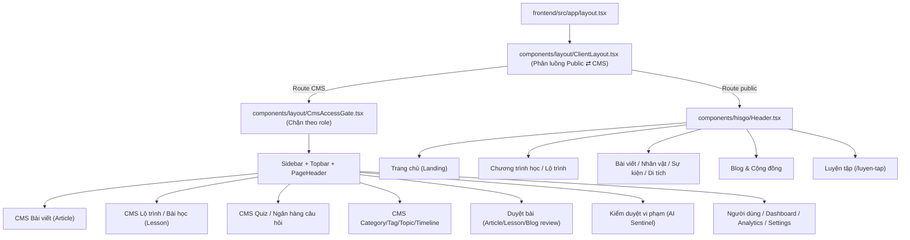

# 🗺️ BẢN ĐỒ KIẾN TRÚC & ĐIỀU HƯỚNG DỰ ÁN (PROJECT MAP)
> **Dự án:** HISGO — Nền tảng học & tra cứu lịch sử Việt Nam (`D:\Fullit\TLCN\TLCN-DT07`)
> **Stack:** Backend NestJS + Prisma (PostgreSQL) · Frontend Next.js (App Router)
> **Mục đích:** Chỉ đúng vị trí file (Frontend ⇄ Backend) của từng phân hệ để tra cứu nhanh và dán trực tiếp đường dẫn vào prompt AI, không cần quét lại toàn repo.
> **Nhánh khảo sát:** `refactor/blog` (sau khi pull `438adf9`) — tài liệu này mô tả đúng code thực tế tại thời điểm khảo sát, không suy đoán.

---

## ⚡ 1. MẸO DÙNG PROMPT NHANH (PROMPT SHORTCUTS)
Thay vì nói chung chung *"Sửa trang bài học"*, hãy copy đường dẫn tương ứng vào câu lệnh:
* **Sửa trình soạn bài học (Block Builder):**
  `"Xem file frontend/src/features/lessons/components/LessonEditor.tsx, facades/useLessonEditorFacade.ts, facades/useLessonBlockManager.ts và backend/src/lesson/lesson.service.ts..."`
* **Sửa Lộ trình học / Chương (HISGO Studio):**
  `"Xem file frontend/src/features/curriculum/components/HisgoStudioView.tsx và backend/src/learning-path/learning-path.service.ts..."`
* **Sửa CMS bài viết lịch sử:**
  `"Xem file frontend/src/features/articles/components/ArticleEditor.tsx, services/entities/article.service.ts và backend/src/article/article.service.ts..."`
* **Sửa Quiz/Ngân hàng câu hỏi:**
  `"Xem file frontend/src/features/quiz/facades/useQuizManagementFacade.ts và backend/src/quiz/standalone-quiz.controller.ts, question.controller.ts..."`
* **Sửa Blog/Cộng đồng:**
  `"Xem file backend/src/blog/blog.service.ts, blog.gateway.ts và frontend/src/features/community/components/CommunityFeed.tsx..."`
* **Sửa Kiểm duyệt nội dung (AI Sentinel):**
  `"Xem file backend/src/moderation/moderation.service.ts, moderation-ai.service.ts và frontend/src/features/moderation/components/ModerationDashboardView.tsx..."`
* **Sửa Đăng nhập/Đăng ký/Phiên:**
  `"Xem file backend/src/auth/auth.service.ts, services/auth-utils.service.ts và frontend/src/services/auth/public-auth.service.ts..."`
* **Sửa Lịch sử chỉnh sửa / duyệt bản sửa (Content Revision):**
  `"Xem file backend/src/content-revision/content-revision.service.ts, revision-targets.ts và frontend/src/features/revisions/RevisionPanels.tsx..."`

---

## 🏗️ 2. TỔNG QUAN LUỒNG CHÍNH (MAIN FLOW)

---

## 📑 3. CHI TIẾT CÁC PHÂN HỆ (FRONTEND ⇄ BACKEND)

### 3.1. Bài viết lịch sử (Article)
* **Mục đích:** Thực thể trung tâm của hệ thống (thay cho Entity/Statement cũ đã xoá 2026-11-05). Một bài viết có thể đóng vai trò Nhân vật / Sự kiện / Di tích / Triều đại / Khác tuỳ `Category.kind` của chuyên mục nó thuộc. Có hồ sơ mô tả JSONB tuỳ loại (`metadata`), liên kết 2 chiều bài↔bài (`ArticleLink`), quy trình duyệt 2 người (DRAFT → PENDING_REVIEW → PUBLISHED/REJECTED), tự tạo bản sửa chờ duyệt khi sửa bài đã publish.
* **UI Component chính:** [ArticleList.tsx](frontend/src/features/articles/components/ArticleList.tsx) (danh sách CMS), [ArticleEditor.tsx](frontend/src/features/articles/components/ArticleEditor.tsx) (3 tab: Thông tin / Hồ sơ & liên kết / Nội dung).
* **Component/Modal phụ trợ:**
  * `ArticleProfilePanel.tsx` — nhập `metadata` theo nhánh person/site/event + `links` liên kết bài khác.
  * `ArticleConnections.tsx` — preview chỉ đọc: dòng đời nhân vật, người liên quan sự kiện, dòng thời gian chứa bài.
  * `ContentBlockEditor.tsx` — soạn nội dung Block Builder (tái dùng hạ tầng `features/lessons`).
  * `ArticlePicker.tsx`, `StatusPill.tsx`, `YearInput.tsx` (hỗ trợ năm TCN), `CategoryManager.tsx`.
  * `person-life.ts` — ghép dòng đời nhân vật dùng chung CMS ⇄ trang công khai (hợp LINK + OWN_NODE + MILESTONE).
* **Route trang (Next.js):**
  * CMS: `frontend/src/app/articles/page.tsx` (danh sách), `articles/create/page.tsx` và `articles/[id]/page.tsx` (→ `ArticleEditor`).
  * `frontend/src/app/bai-viet/[slug]/page.tsx` → trang đọc chung mọi loại bài viết (dùng chung với `/nhan-vat`, `/su-kien`, `/di-tich`, `/thuc-the`).
  * `frontend/src/app/categories/page.tsx` → `CategoryManager`.
* **Service/API Client:** `frontend/src/services/entities/article.service.ts` (`ArticleApiService`, `CategoryApiService`), `frontend/src/services/public/public-content.service.ts` (fetch công khai).
* **Backend Module:** `backend/src/article/`
  * Controller: `article.controller.ts` (route `/articles`, STAFF/REVIEWERS)
  * Service: `article.service.ts` (CRUD, slug unique, validate link, transaction tag/link, quy tắc duyệt 2 người)
  * `article-metadata.ts` — validate `metadata` theo mã cố định (PERSON_ROLE_CODES, SITE_TYPE_CODES...)

### 3.2. Phân loại — Category / Tag / Topic
* **Mục đích:**
  * **Category** — chuyên mục bài viết (cây nông), quyết định `kind` (PERSON/EVENT/LOCATION/DYNASTY/OTHER); slug cố định (`nhan-vat`, `su-kien`, `di-tich`, `trieu-dai`) ánh xạ route công khai.
  * **Tag** — nhãn dùng chung cho Article (`ArticleTag`) và Lesson (`LessonTag`); cache Redis.
  * **Topic** — "Chủ đề/Thời kỳ" phân cấp N cấp (chống cycle, giới hạn độ sâu 20), gắn Timeline/Lesson/Article, reorder, cache Redis.
* **UI Component chính:** [TagList.tsx](frontend/src/features/tags/components/TagList.tsx), [TopicEditor.tsx](frontend/src/features/topics/components/TopicEditor.tsx).
* **Component/Modal phụ trợ:** `TagModal.tsx`, `TagForm.tsx`, `TopicForm.tsx`, `TopicModal.tsx`, `TopicParentModalPicker.tsx`, `TopicPicker.tsx`, `TopicCoverImagePicker.tsx`.
* **Route trang:** `frontend/src/app/tags/page.tsx`, `frontend/src/app/tags/create/page.tsx`, `frontend/src/app/tag/[id]/page.tsx` (công khai), `frontend/src/app/categories/page.tsx`.
* **Service/API Client:** `services/entities/tag.service.ts` (`TagApiService`), `services/entities/topic.service.ts` (`TopicApiService`).
* **Backend Module:**
  * Category: `backend/src/category/` (`/categories`, chặn xoá khi còn bài viết, chống cycle).
  * Tag: `backend/src/tag/` (`/tags`, `/lessons/:id/tags`, cache Redis TTL 3600s).
  * Topic: `backend/src/topic/` (`/topics`, cache Redis TTL 300s, MAX_DEPTH 20, bulk reorder qua `$transaction`).

### 3.3. Dòng thời gian (Timeline)
* **Mục đích:** CMS dòng thời gian — danh sách mốc lịch sử theo `displayOrder`, mỗi mốc tuỳ chọn gắn 1 bài viết (`articleId`). Mỗi lần cập nhật "nodes" = thay toàn bộ danh sách mốc (xoá hết + tạo lại trong transaction). Là nguồn dữ liệu để trang công khai cũ suy ra "Thời kỳ"/"Sự kiện"/dòng đời nhân vật.
* **UI Component chính:** [TimelineList.tsx](frontend/src/features/timelines/components/TimelineList.tsx), [TimelineEditor.tsx](frontend/src/features/timelines/components/TimelineEditor.tsx).
* **Service/API Client:** `services/entities/timeline.service.ts` (`TimelineApiService`); đọc công khai qua `fetchTimelines/fetchTimeline` trong `public-content.service.ts`.
* **Backend Module:** `backend/src/timeline/` — Controller `timeline.controller.ts` (`/timelines`, STAFF), Service `timeline.service.ts` (validate mốc, include `linksIn/linksOut` để CMS xem trước "Gắn với...").

### 3.4. Heritage / Period-detail (Di tích, Giai đoạn, Triều đại, Nhân vật, Sự kiện — công khai)
* **Mục đích:** Lớp tương thích cho giao diện công khai CŨ, dựng lại hoàn toàn từ Article + Category + ArticleLink + Timeline qua `landing.service.ts` (tên dễ nhầm — thực chất là **adapter/mapper chính** của toàn hệ thống công khai). Quy tắc: Loại bài = `Category.kind`; Thời kỳ = 1 Timeline; Sự kiện = mốc Timeline hoặc bài chuyên mục Sự kiện chưa gắn mốc nào.
* **UI Component chính:**
  * Heritage: [HeritageExplorer.tsx](frontend/src/features/heritage/components/HeritageExplorer.tsx) (`/di-tich`).
  * Period-detail: [PeriodDetailView.tsx](frontend/src/features/period-detail/components/PeriodDetailView.tsx) (`/giai-doan/[slug]`).
* **Component/Modal phụ trợ:** `HeritageCards.tsx`, `HeritageFilterBar.tsx`, `heritage.adapter.ts` (`toHeritageSummaries`), `period-detail.adapter.ts` (`groupEventsByStage`, `siblingPeriods`), `EventStream.tsx`, `TimeRuler.tsx`.
* **Route trang:**
  * `app/di-tich/page.tsx`, `app/di-tich/[slug]/page.tsx`, `app/nhan-vat/[slug]/page.tsx`, `app/su-kien/[slug]/page.tsx`, `app/thuc-the/[slug]/page.tsx` — dùng chung `fetchEntityBySlug` + `EntityHero`/`EntityReader`.
  * `app/nhan-vat/page.tsx` (FiguresDirectory), `app/su-kien/page.tsx` (EventsLibrary), `app/trieu-dai/page.tsx` (CategoryPage), `app/trieu-dai/[slug]/page.tsx` (re-export EntityDetailPage), `app/kien-thuc/[slug]/page.tsx` (re-export ChapterDetailPage), `app/giai-doan/[slug]/page.tsx` (PeriodDetailView).
* **Service/API Client:** `frontend/src/services/entities/landing.service.ts` — thực chất là adapter công khai chính (`fetchPeriods`, `fetchEvents`, `fetchFigureDirectory`, `fetchLocations`, `fetchEntityBySlug`, `fetchPeriodBySlug`, `fetchTaxonomyTerms`, `fetchPublicList`).
* **Backend:** không có module riêng — toàn bộ do `PublicContentService` (xem mục 3.9) tổng hợp.

### 3.5. Trang chủ (Landing)
* **Mục đích:** Spotlight sự kiện, các "kỷ nguyên" theo thời kỳ gốc, dòng thời gian rút gọn, dải đối sánh khu vực, nhân vật/di tích nổi bật, lộ trình học, câu hỏi mỗi ngày.
* **UI Component chính:** [LandingView.tsx](frontend/src/features/landing/components/LandingView.tsx) (+ `LandingHero`, `ResumeBar`, `ExploreSections`, `InteractivePreview`, `EntitiesSection`, `LearningQuiz`, `JoinBanner`).
* **Service/API Client:** `features/landing/landing.server.ts` (`fetchLandingData` — gọi song song periods/events/figures/locations/lessons/learning-paths/taxonomy), `features/landing/landing.adapter.ts` (`buildLandingData`).
* **Backend:** dùng chung `/public/*` + `/learning-paths`.

### 3.6. Tìm kiếm toàn cục (Search) & Taxonomy
* **Search — Mục đích:** Ô tìm kiếm toàn cục (Ctrl/⌘+K) trên trang công khai — tìm Article + Timeline + Lesson, bỏ dấu tiếng Việt, cache 1 lần/phiên.
  * UI: [GlobalSearch.tsx](frontend/src/features/search/GlobalSearch.tsx); Service: `search.service.ts` (`loadPublicCatalog/loadSearchIndex`), `search-index.ts` (`buildSearchIndex`, `normalizeSearch`).
* **Taxonomy — Mục đích:** Lớp tương thích cho UI công khai cũ cần `TaxonomyTermItem[]` (bảng Taxonomy đã xoá 2026-11-05) — nhóm `EVENT_TYPE` sinh từ chuyên mục con `kind=EVENT`, nhóm khác trả rỗng.
  * File: `taxonomy-labels.ts`, `taxonomy-tree.ts` (`loadPublicTaxonomy`), `usePublicTaxonomy.ts`; `services/public/public-taxonomy.ts`, `services/public/article-kind.ts` (`resolveCategoryKind` — nguồn DUY NHẤT suy loại bài từ `Category.kind`).
* **Backend:** không có module riêng — dùng lại `/public/articles`, `/public/timelines`, `/public/lessons`, `/public/categories`, `/public/taxonomies`.

### 3.7. Chương trình học / Lộ trình học (Curriculum & Learning Path)
* **Mục đích:** CMS quản lý Lộ trình học (LearningPath) gồm các Chương (Chapter), mỗi chương gom Bài học có sẵn qua bảng nối `ChapterLesson` (có `displayOrder` kéo-thả). 2 chế độ xem: "HISGO Studio" (biên soạn) và "Cây phân cấp Chủ đề".
* **UI Component chính:** [HisgoStudioView.tsx](frontend/src/features/curriculum/components/HisgoStudioView.tsx), [CurriculumExplorer.tsx](frontend/src/features/curriculum/components/CurriculumExplorer.tsx).
* **Component/Modal phụ trợ:** `studio/StudioHeader.tsx`, `studio/LearningPathToolbar.tsx`, `studio/ChapterList.tsx`, `studio/LessonLibraryPanel.tsx`, `studio/modals/LearningPathFormModal.tsx`, `studio/modals/CreateChapterModal.tsx`, `studio/modals/AddLessonsToChapterModal.tsx`, `CurriculumTreePreviewModal.tsx`.
* **Strategy:** `strategies/node-detail.strategy.tsx` — `TopicNodeDetailStrategy` / `LessonNodeDetailStrategy`, chọn bằng `NodeDetailStrategyFactory`.
* **Route trang:** `frontend/src/app/curriculum/page.tsx` (chuyển đổi Studio ⇄ Explorer).
* **Service/API Client:** `services/entities/learning-path.service.ts` (`LearningPathApiService`).
* **Backend Module:** `backend/src/learning-path/`
  * Controller: `learning-path.controller.ts` (`learning-paths`, `@ContentWrite`)
  * Service: `learning-path.service.ts` (slug qua `SlugService`, `addLessonsToChapter` dùng `upsert` khoá composite, `reorderChapterLessons` dùng `$transaction`)

### 3.8. Bài học (Lesson) — Block Builder
* **Mục đích:** CRUD + review workflow (DRAFT → REVIEW → PUBLISHED/REJECTED, người duyệt ≠ người soạn) cho nội dung bài học; nội dung lưu JSONB là **mảng "block"** (18 loại: TEXT, HEADING, IMAGE, VIDEO, RESOURCE_LINK, TIMELINE, MAP, CHARACTER, EVENT, COMPARISON_TABLE, QUIZ, SECTION_ROW, CALLOUT, QUOTE, DIVIDER, RELATED_PEOPLE, RELATED_EVENTS, STORY_CHAPTER).
* **UI Component chính:** [LessonEditor.tsx](frontend/src/features/lessons/components/LessonEditor.tsx) (header meta, block canvas, properties panel, quiz panel).
* **Component/Modal phụ trợ (nhóm chính):**
  * Toolbar/sidebar: `LessonLeftToolSidebar.tsx`, `LessonBlockPalette.tsx`, `TipTapToolbar.tsx`, `AutoSaveIndicator.tsx`.
  * Khung soạn thảo & header (`components/`): `LessonEditorHeader.tsx` (tầng 1: thoát, tiêu đề, trạng thái auto-save, Gửi duyệt/Cập nhật, menu "•••"), `LessonEditorSubHeader.tsx` (tầng 2: chuyển chế độ Soạn thảo/Chia đôi/Xem trước, ẩn-hiện cột trái), `LessonHeaderMetaForm.tsx` (form meta tiêu đề/chủ đề), `LessonPreviewContent.tsx` (xem trước giao diện Wiki + Mục lục + đề ôn tập kèm đáp án), `TipTapContent.tsx` (nhúng TipTap cho khối TEXT), `LessonMediaManager.tsx` (upload ảnh/tài liệu/URL, dùng trong `LessonMediaTab`).
  * **Builder — khung canvas (`components/builder/`):** `BlockBuilderCanvas.tsx` (render theo `LessonBlockType`, gọi đúng editor từng loại), `BlockCardWrapper.tsx` (vỏ thẻ khối: chọn độ rộng, xoá, di chuyển), `BlockLibraryPalette.tsx` (palette thả khối + `BLOCK_TYPE_ICONS`; dùng bởi `ContentBlockEditor`, `AddBlockDivider`, `BlockPropertyInspector`), `AddBlockDivider.tsx` (nút "+" giữa 2 khối), `ColumnResizer.tsx` (kéo đổi tỷ lệ cột `SECTION_ROW`).
  * **Builder — editor từng loại khối (`components/builder/*ItemEditor.tsx`, gọi từ `BlockBuilderCanvas`):**

    | Khối | Editor | Ghi chú |
    |---|---|---|
    | TEXT | `TextBlockEditor.tsx` | Rich text TipTap, toolbar ẩn, điều khiển ở Inspector phải |
    | HEADING | *(vẽ trực tiếp trong canvas)* | Chỉnh qua `HeadingBlockInspector` |
    | IMAGE | `ImageBlockItemEditor.tsx` | Upload (giới hạn 10MB) / URL |
    | VIDEO | *(vẽ trực tiếp trong canvas)* | Không có Inspector riêng; node TipTap dùng `VideoBlockView.tsx` |
    | QUOTE | `QuoteBlockItemEditor.tsx` | Inspector: `QuoteBlockInspector` |
    | CALLOUT | `CalloutBlockItemEditor.tsx` | 4 variant INFO/WARNING/HISTORICAL_NOTE/SUCCESS; Inspector: `CalloutBlockInspector` |
    | DIVIDER | *(vẽ trực tiếp trong canvas)* | Không có thuộc tính |
    | CHARACTER | `CharacterBlockItemEditor.tsx` | Chọn qua `EntityPickerModal` (HISGO / Wikipedia) |
    | EVENT | `EventBlockItemEditor.tsx` | Chọn qua `EventPickerModal` |
    | TIMELINE | `TimelineBlockItemEditor.tsx` | Dùng `TimelineSceneStrategy` + `HistoricalTimelineBlock`; Inspector: `TimelineBlockInspector` (chép mốc từ Timeline CMS) |
    | MAP | `MapBlockItemEditor.tsx` | Chỉ lưu tên địa danh + mô tả (chưa có bản đồ tương tác) |
    | COMPARISON_TABLE | `ComparisonTableBlockItemEditor.tsx` | 2 cột so sánh, thêm/xoá dòng tiêu chí |
    | RELATED_PEOPLE / RELATED_EVENTS | *(vẽ trực tiếp trong canvas)* | Inspector: `RelatedPeopleBlockInspector` / `RelatedEventsBlockInspector` |
    | SECTION_ROW | `RowSectionBlockEditor.tsx` | Kiểm tra lồng khối bằng `BlockPlacementRuleEngine`; Inspector: `RowSectionBlockInspector` |
    | STORY_CHAPTER | `StoryChapterBlockEditor.tsx` | Container nhiều chương; Inspector: `StoryChapterBlockInspector` + `StorySubElementInspector` |
    | QUIZ | *(không có editor trên canvas)* | Soạn ở `LessonQuizPanel` (đề cuối bài); plugin `quiz-block.plugin.ts` chỉ phục vụ biên dịch/hiển thị |
    | RESOURCE_LINK | *(không có editor trên canvas)* | Soạn ở tab Xuất bản (`LessonPublishingTab`); luôn xuất ở cuối bài |
  * **Builder — Inspector (cột phải):** `BlockPropertyInspector.tsx` (bảng `BLOCK_INSPECTOR_STRATEGIES` ánh xạ loại khối → Inspector, OCP; TEXT dùng `TypographyInspectorPanel`), thư mục `inspectors/` gồm `TypographyInspectorPanel.tsx` (chữ, căn lề, drop-cap, lead paragraph), `SimpleBlockInspectors.tsx` (Heading/Callout/Quote/RelatedPeople/RelatedEvents), `TimelineBlockInspector.tsx`, `RowSectionBlockInspector.tsx` (hiện thuộc tính khối con khi chọn khối trong cột), `StoryChapterBlockInspector.tsx` (cấp 1: chương), `StorySubElementInspector.tsx` (cấp 2: ghi đè từng ô/khối con). `WikiLinkInspectorSection.tsx` — gắn liên kết wiki (Ctrl/⌘+K) vào chữ, dùng `WikiLinkTargetStrategyFactory`.
  * **Hiển thị / NodeView TipTap (`components/blocks/`):** `ImageBlockView.tsx`, `VideoBlockView.tsx` (upload/URL/embed, tự đổi link YouTube sang embed), `CharacterBlockView.tsx`, `EventBlockView.tsx`, `TimelineBlockView.tsx` (thêm/sửa/xoá/đổi thứ tự mốc), `HistoricalTimelineBlock.tsx` (UI mốc + định nghĩa `TimelineNode`), `EntityPickerModal.tsx` & `EventPickerModal.tsx` (dùng chung hook `blocks/shared/useWikipediaDetailPicker.ts` và `blocks/shared/WikiDetailPreviewPane.tsx` để tra cứu/bóc tách dữ liệu từ Wikipedia & Wikidata), `AddBlockBelowMenu.tsx` (menu thêm khối ngay bên dưới).
  * **TipTap Extension (`extensions/`):** `image-`, `video-`, `character-`, `event-`, `timeline-block.extension.ts` (node tuỳ chỉnh gắn NodeView ở trên), `typography.extension.ts` (`BlockTypographyExtension` — căn lề/giãn dòng/drop-cap/lead; `InlineTypographyMark`).
  * ⚠️ **File chưa được dùng:** `templates/` (`LessonTemplateFactory`, 5 template Standard/MilitaryCampaign/HistoricalFigure/TreatyConference/Blank — chỉ tham chiếu nội bộ, chưa nối vào UI tạo bài). (`TimelineNodeCanvasDrawer.tsx` đã được xoá ở Pha 4).
  * **✅ Đã kiểm chứng & xử lý (Pha 2 & Pha 4):**
    * `BlockBuilderCanvas.tsx` có 3 `switch` (khối cấp ngoài / khối trong cột `SECTION_ROW` / khối con `STORY_CHAPTER` qua `renderGenericChildBlock`). Cả 3 nhánh đều hiển thị placeholder thống nhất cho loại khối chưa hỗ trợ trực tiếp trên canvas.
    * **Đường biên dịch HTML:** `LessonBlockFactory` → `LessonBlockRegistry.blockToHtml` → `plugin.toHtml()`; các plugin có dữ liệu người dùng đều `escapeHtml`/`safeUrl`, còn `text-block.plugin.ts` và các điểm `dangerouslySetInnerHTML` (`PublicLessonReaderView`, `EntityReader`, `LessonPreviewContent`, `HubLessonQuiz`) đều đi qua `sanitizeRichHtml` (`frontend/src/utils/sanitize-html.ts`). **Blog (người dùng thường viết, qua duyệt):** `BlogDetailPage` đã escape cả `contentBlocks` lẫn fallback `post.excerpt`.
    * **Phạm vi dùng lại:** `ContentBlockEditor` chỉ được `ArticleEditor` dùng; `BlogCreatePage` không dùng hạ tầng block của `features/lessons`. Hạ tầng block hiện chỉ phục vụ `LessonEditor`, `ArticleEditor`, `lesson-toc.util`.
    * **Backend `lesson/`:** `lesson.service.ts` trả `Promise<LessonResponseDto>`, `CreateLessonDto` dùng `@IsEnum(DifficultyLevel)` và gõ rõ kiểu — đã xử lý ở Pha 2.
  * **Hai palette dùng chung nguồn danh sách & icon:** `LessonBlockPalette.tsx` (cột trái "Thêm khối") và `builder/BlockLibraryPalette.tsx` (palette trong canvas/ContentBlockEditor) cùng đọc `constants/block-palette.constants.ts` (16 loại; `QUIZ` và `RESOURCE_LINK` soạn ở tab riêng) và dùng chung `BLOCK_TYPE_ICONS`.
  * Khối kể chuyện `STORY_CHAPTER`: `StoryChapterBlockEditor.tsx` (đã phân rã sạch về 224 dòng, uỷ quyền cho cụm chuyên trách `components/builder/story-chapter/` gồm `StoryChapterRenderer.tsx`, `StoryChapterContentBlock.tsx`, `StoryChapterHeading.tsx`, `StoryChapterToolbar.tsx`, `StoryChapterTocBar.tsx`, `StoryChapterAddBlockMenu.tsx`, `useStoryChapterColumnResize.ts`, `types.ts`), `StoryChapterBlockInspector.tsx`, `StorySubElementInspector.tsx`, `story-chapter-layout.strategy.ts`.
  * Khối Quiz: `LessonQuizPanel.tsx`, `quiz/AddQuestionMenu.tsx`, `quiz/QuizQuestionCard.tsx` (thẻ thu gọn/mở rộng, ▲▼, xoá), `quiz/QuizQuestionEditors.tsx` (6 loại câu hỏi); `factories/quiz-question.factory.ts` (`createDefaultQuestion`), `types/quiz.types.ts`.
  * Properties: `properties/LessonPropertiesPanel.tsx`, `properties/LessonClassificationTab.tsx`, `properties/LessonMediaTab.tsx`, `properties/LessonPublishingTab.tsx` (trạng thái, nguồn tham khảo, Liên kết tài nguyên, 2 nút lưu), `LessonDifficultySelector.tsx`, `LessonOrderField.tsx`, `LessonTagPicker.tsx`, `LessonTopicModalPicker.tsx`.
  * **Hạ tầng hỗ trợ Block Builder (ngoài `components/`):**
    * `types/`: `block-builder.types.ts` (toàn bộ `*BlockData`, `LessonBlockItem`, `StoryChapterUnit`, `EditorialSpreadConfig`), `block-palette.types.ts` (`LessonBlockType`, `LessonBlockGroup`), `editor.types.ts` (`AutoSaveState`, `EditorViewMode`, `LeftSidebarMode`), `entity-source.types.ts`, `header-meta.types.ts`, `left-sidebar.types.ts`.
    * `constants/`: `block-palette.constants.ts`, `block-node.constants.ts`, `entity-source.constants.ts`, `left-sidebar.constants.ts`, `row-layout.constants.ts`.
    * `context/ActiveEditorContext.tsx` (`ActiveEditorProvider`/`useActiveEditor` — đồng bộ selection TipTap ⇄ Inspector, ô con/chương đang chọn).
    * `rules/block-placement.rule.ts` (`BlockPlacementRuleEngine` — SECTION_ROW chỉ ở Root, QUIZ chỉ Root, TIMELINE ≥50% cột, COMPARISON_TABLE ≥40% cột).
    * `strategies/`: `block-width.strategy.ts` (độ rộng cho phép theo loại khối), `lesson-block-insert.strategy.ts` (sinh HTML chèn khối, dùng bởi NodeView/TipTap toolbar), `wiki-link-target.strategy.ts` (đích liên kết: bài viết vs dòng thời gian), `timeline-layout.strategy.ts`, `timeline-scene.strategy.ts` (đồng bộ `contentHtml` ⇄ title/description/role của mốc), `entity-sources/` (+ adapter `wikipedia.adapter.ts`, `wikidata-claims.adapter.ts`, `wikimedia-commons.adapter.ts`).
    * `utils/lesson-toc.util.ts` (dựng Mục lục — dùng cả ở `LessonEditor`, `usePublicLessonReaderFacade`, `entity-reader-adapter`).
    * `factories/`: `lesson-block.factory.ts`, `entity-source-strategy.factory.ts`, `quiz-question.factory.ts`.
  * **Khối đặc thù — 2 nhóm khối trùng tên cần phân biệt:** khối **TIMELINE trong bài học** (nội dung nhúng, `timeline-block.plugin.ts`, mốc thủ công hoặc chép từ Timeline CMS) khác với **Timeline CMS** (mục 3.3) và `lesson-timeline.strategy.ts` (vị trí bài trong chủ đề).
* **Kiến trúc Facade/Plugin/Strategy/Factory:**
  * **Facade:** `facades/useLessonEditorFacade.ts` (load topics, auto-save nháp localStorage debounce 1500ms, hợp bản sửa chờ duyệt qua `withPendingDraft`, `submitLesson`); `facades/useLessonBlockManager.ts` (add/update/remove/move block, quản lý cột `SECTION_ROW`, `compileToHtml/compileToJson`); `facades/useQuizEditor.ts`.
  * **Plugin Pattern (đây là nơi thật xử lý từng loại khối — KHÔNG phải `strategies/`):** `plugins/block-plugin.registry.ts` (`LessonBlockRegistry`) đăng ký 18 `BlockPlugin` (1 file/loại trong `plugins/*.plugin.ts`, ví dụ `map-block.plugin.ts`, `timeline-block.plugin.ts`, `event-block.plugin.ts`, `character-block.plugin.ts`); mỗi plugin có `createDefault()` + `toHtml()` (có `escapeHtml`/`safeUrl` chống XSS); kiểu chung `BlockPlugin` và `renderCollapsibleDetail` nằm ở `plugins/block-plugin.types.ts`. `factories/lesson-block.factory.ts` ủy quyền sang Registry để giữ tương thích ngược.
  * **Strategies khác (`strategies/`):** `lesson-timeline.strategy.ts` (tính vị trí bài trong chủ đề — KHÔNG liên quan khối Timeline nội dung), `row-layout.strategy.ts`, `block-width.strategy.ts`, `timeline-layout.strategy.ts`/`timeline-scene.strategy.ts`, `story-chapter-layout.strategy.ts`, `entity-sources/` (nguồn tra cứu thực thể: `wikipedia-source.strategy.ts` vs `hisgo-internal-source.strategy.ts`, chọn qua `factories/entity-source-strategy.factory.ts`).
  * **Backend content-normalizer (khác mục đích với FE):** `backend/src/lesson/strategies/content-normalizer.strategy.ts` — chuẩn hoá **định dạng input** của `content` JSONB (`ArrayBlockContentStrategy`/`TipTapDocumentContentStrategy`/`StringContentStrategy`/`FallbackContentStrategy`), dùng tính `estimatedReadMinutes`.
* **Route trang:**
  * CMS soạn bài: `frontend/src/app/lessons/create/page.tsx` (tạo mới — nạp `LessonEditor` bằng `dynamic`, `ssr: false`), `frontend/src/app/lessons/[id]/page.tsx` (sửa — `<LessonEditor lessonId={id} />`). Mục 3.7 chỉ điều hướng sang đây: `HisgoStudioView` mở bài bằng `/lessons/create?id=<lessonId>` (và `?chapterId=` khi soạn bài mới trong chương), `CurriculumExplorer` dùng `APP_ROUTES.LESSONS.DETAIL(id)` và `?topicId=`.
  * Công khai: `frontend/src/app/bai-hoc/[slug]/page.tsx` → `PublicLessonReaderView`.
* **Service/API Client:** `services/entities/lesson.service.ts` (`LessonApiService`).
* **Backend Module:** `backend/src/lesson/`
  * Controller: `lesson.controller.ts` (`POST/GET/PATCH /lessons`, `PATCH /lessons/:id/review` REVIEWERS, `DELETE`)
  * Service: `lesson.service.ts` (slug qua `SlugHelper`, cache Redis TTL 3600s, lưu `createdBy` khi tạo bài và `review()` ép người duyệt ≠ người tạo + bắt buộc `rejectionReason` khi REJECTED)
  * Helper: `helpers/slug.helper.ts`

### 3.9. Người học (Learner) & Nội dung công khai (Public Content)
* **Learner — Mục đích:** Đăng ký/hủy đăng ký Lộ trình học (miễn phí), đọc bài học (chỉ khi bài thuộc lộ trình đã đăng ký, hoặc bài ngoài mọi lộ trình thì chỉ cần đăng nhập), đánh dấu hoàn thành.
  * UI dùng: `features/public-curriculum/components/PublicCurriculumView.tsx`, `PublicLessonReaderView.tsx` (xử lý `LessonAccessState`: GRANTED/LOGIN_REQUIRED/NOT_ENROLLED).
  * Facade: `facades/usePublicCurriculumFacade.ts`, `facades/usePublicLessonReaderFacade.ts`.
  * Service: `services/entities/learner.service.ts` (`LearnerApiService`).
  * Backend: `backend/src/learner/` — Controller `learner.controller.ts` (route `me/learning`, toàn bộ `AuthGuard`), Service `learner.service.ts` (`ForbiddenException code: NOT_ENROLLED` nếu chưa đăng ký lộ trình chứa bài; `upsert` idempotent cho enroll/complete).
* **Public Content — Mục đích:** Toàn bộ API phục vụ trang công khai (chỉ trả nội dung `PUBLISHED`): chuyên mục, bài viết, blog, timeline/giai đoạn, sự kiện/nhân vật/di tích (suy từ `category.kind`), tag, taxonomy legacy, thư viện bài học, nộp & thống kê quiz.
  * Backend: `backend/src/public-content/` — Controller `public-content.controller.ts` (`@Controller('public')`, không guard), Service `public-content.service.ts` (`getPublishedArticleListByKind`, `getTaxonomies`), Mapper `public-content.mapper.ts` (`buildDateLabel` — nơi DUY NHẤT format nhãn niên đại/TCN cho toàn trang công khai, tránh lặp ở ≥7 file FE).

### 3.10. Ghi chú (Note)
* **Mục đích:** Người dùng (đăng nhập hoặc khách qua `guestId`) tạo ghi chú cá nhân gắn vào Lesson/Article, kèm đoạn bôi đen (`highlightText`) và màu (`NoteColor`).
* **UI Component chính:** [NoteDrawer.tsx](frontend/src/features/notes/components/NoteDrawer.tsx), `NoteFloatingButton.tsx`.
* **Facade:** `facades/useNoteFacade.ts` (bắt `mouseup` lấy đoạn bôi đen, lọc theo màu).
* **Service/API Client:** `features/notes/services/note.service.ts` — gọi trực tiếp `fetch` tới `/api/notes` (route handler Next.js, thuộc ngoại lệ CLAUDE.md), guest id lưu `localStorage` khoá `hisgo:guest-id`.
* **Backend Module:** `backend/src/note/`
  * Controller: `note.controller.ts` (tự decode JWT từ header, không ép `AuthGuard` để hỗ trợ khách)
  * Service: `note.service.ts` (`assertOwnership` theo `userId` hoặc `guestId`)
  * Strategy: `strategies/note-target.strategy.ts` — `ArticleNoteStrategy` / `LessonNoteStrategy`, chọn qua `NoteStrategyRegistry`.

### 3.11. Lịch sử chỉnh sửa nội dung (Content Revision)
* **Mục đích:** "Phiên bản hoá" cho 5 loại nội dung: LESSON, ARTICLE, TOPIC, LEARNING_PATH, CHAPTER. Khi nội dung đang PUBLISHED, sửa của biên tập viên lưu thành bản **PROPOSAL** chờ duyệt (bản công khai giữ nguyên); khi **reviewer** sửa trực tiếp, hệ thống tự chụp **SNAPSHOT** trước khi áp dụng ngay. Hỗ trợ xem lịch sử, diff từng trường, duyệt/từ chối, khôi phục snapshot cũ.
* **UI Component chính:** [RevisionPanels.tsx](frontend/src/features/revisions/RevisionPanels.tsx) (`RevisionDetailModal`, `RevisionHistoryModal`, `EditorRevisionBanner`).
* **Component phụ trợ:** [RevisionDiff.tsx](frontend/src/features/revisions/RevisionDiff.tsx) — diff theo `RevisionFieldKind` (TEXT/LONGTEXT dùng LCS, BOOL, IMAGE, LIST/REFS, REF, BLOCKS, RELATIONS, MEDIA, OBJECT).
* **Cơ chế:** `backend/src/content-revision/content-revision.interceptor.ts` (`ContentRevisionInterceptor`) đọc `RevisionDirective` do `ContentWriteGuard` gắn vào request khi endpoint có `@ContentWrite({ versioned: true })` và nội dung đang PUBLISHED — `mode: 'PROPOSE'` chặn handler thật và lưu bản chờ duyệt; `mode: 'SNAPSHOT'` chụp bản cũ rồi mới chạy update thật.
* **Backend Module:** `backend/src/content-revision/`
  * Controller: `content-revision.controller.ts` (`pending`, `content/:type/:id`, `.../draft`, `:revisionId`, `approve/reject/restore`)
  * Service: `content-revision.service.ts` (`propose/approve/reject/restore/history/detail/pending`)
  * `revision-targets.ts` (`RevisionTargets`) — Strategy theo loại nội dung, lấy service qua `ModuleRef.get(..., {strict:false})` tránh circular dependency.
  * Constant: `content-revision.constant.ts` (`REVISION_FIELDS` định nghĩa trường biên tập được của mỗi loại).
* **Service/API Client:** `services/entities/content-revision.service.ts` (`withPendingDraft()` dùng trong các facade CMS để nạp đúng bản sửa chờ duyệt).

### 3.12. Quiz / Ngân hàng câu hỏi (Tái cấu trúc gắn Many-to-Many với Topic)
* **Mô hình Khảo thí & Chuẩn Sư phạm:** Đề thi/Bộ đề khảo thí Quiz được liên kết trực tiếp với nhiều Chủ đề lịch sử (`Quiz.topics Topic[] @relation("TopicQuizzes")`) thay vì gắn cứng phụ thuộc vào `Lesson` (vì Lesson đã có các khối tương tác bài học tại chỗ). Cho phép tạo đề thi tổng hợp nhiều chủ đề và đề thi độc lập theo chuyên đề.
* **Ngân hàng câu hỏi (CMS):** Quản lý tập trung câu hỏi dùng chung, gắn nhiều bài học/chủ đề, tái dùng khi soạn đề.
  * UI: `features/quiz/components/QuestionBankView.tsx`, `QuestionBankModal.tsx` (đã phân rã thành `QuestionCategorySection.tsx`, `QuestionOptionsEditor.tsx`, `QuestionTypeCardSelector.tsx`, `QuestionAnswersSection.tsx`, `QuestionModalHeaderFooter.tsx`, `question-modal.helper.ts`), `QuestionBankPickerModal.tsx`, `CategoryTreePicker.tsx`.
  * Route: `frontend/src/app/questions/page.tsx`. Service: `services/entities/question.service.ts`.
  * Backend: `question.controller.ts` + `question.service.ts` (dùng enum `DifficultyLevel`, có `onModuleInit` tự backfill câu hỏi từ Quiz cũ bằng `$transaction` nếu ngân hàng trống).
* **Quản lý bộ đề Quiz độc lập (CMS):** Tạo/sửa/xoá đề Quiz độc lập chọn nhiều Topic, tổng hợp câu hỏi từ Ngân hàng hoặc soạn mới, xem thống kê lượt làm bài.
  * UI: [QuizManagementView.tsx](frontend/src/features/quiz/components/QuizManagementView.tsx), `StandaloneQuizEditorModal.tsx`, `QuizPreviewModal.tsx`, `QuizStatisticsModal.tsx`.
  * Facade: `facades/useQuizManagementFacade.ts`. Route: `frontend/src/app/quizzes/page.tsx`. Service: `services/entities/quiz.service.ts` (`QuizApiService`).
  * Backend: `backend/src/quiz/quiz.module.ts` — Controller `standalone-quiz.controller.ts` (`/quizzes`) + `quiz.controller.ts` (nested `/lessons/:lessonId/quiz`, tương thích Lesson Editor cũ); DTO `create-standalone-quiz.dto.ts` (`topicIds?: string[]`). Toàn bộ 24/24 Jest test suites pass 100%.
  * **Trạng thái Code Quality:** Toàn bộ thư mục `frontend/src/features/quiz/` đạt **0 ERRORS, 0 WARNINGS (100% sạch)**.
* **Làm bài luyện tập (trang public `/luyen-tap`):** Người học chọn bài có đề ôn tập, làm trắc nghiệm có tính giờ, nộp bài, xem điểm; role STAFF xem thêm phổ điểm.
  * UI: `frontend/src/app/luyen-tap/page.tsx` (**file trang duy nhất** — các route con `bai-thi/chu-de/kham-pha/lich-su` đã bị revert, không còn trong code hiện tại), tái dùng `QuizFilterBar.tsx`, `QuizSelectorGrid.tsx`, `QuizBriefingCard.tsx`.
  * Strategy lọc: `strategies/quiz-filter.strategy.ts` (`extractAvailableTopics`, `filterQuizLessons` — chuẩn hoá tiếng Việt không dấu).
  * Nguồn dữ liệu: gọi trực tiếp route handler `fetch('/api/public/lessons')`, `/api/public/quizzes/:id/submit|statistics` (ngoại lệ hợp lệ cho `app/api/`).
  * Chấm điểm: làm thủ công tại client (`calculateScore`), hỗ trợ `MULTIPLE_CHOICE/TRUE_FALSE/FILL_IN_BLANK`; `SINGLE_CHOICE/ORDERING/MATCHING` **chưa có UI làm bài riêng** ở trang này.
* **Các loại câu hỏi (Strategy Pattern — backend thật, không phải frontend):** `backend/src/quiz/validators/quiz-question.validator.ts` + `types/quiz-question.types.ts` (enum `QuizQuestionType`). Mỗi `IQuestionValidationStrategy` xử lý 1 loại: `SingleChoiceValidationStrategy`/`MultipleChoiceValidationStrategy` (Template Method qua `BaseChoiceValidationStrategy`), `TrueFalseValidationStrategy`, `OrderingValidationStrategy`, `MatchingValidationStrategy`, `FillInBlankValidationStrategy` — map chọn tại `QUESTION_VALIDATION_STRATEGIES`, dùng cả trong `QuizService` và `QuestionService`.

### 3.13. Blog cá nhân / Bài viết chuyên khảo (Blog)
* **Mục đích:** Không gian viết/đọc bài chuyên khảo dài (LONG_FORM), quy trình duyệt (DRAFT → PENDING_REVIEW → PUBLISHED/REJECTED), thống kê like/comment/view, chia sẻ sang Cộng đồng.
* **UI Component chính:** [BlogLandingPage.tsx](frontend/src/features/blog/components/BlogLandingPage.tsx), `BlogDetailPage.tsx`, `BlogCreatePage.tsx` (đã phân rã về 260 dòng, uỷ quyền cho `useBlogCreateFacade.ts`, `BlogStoryBlockItem.tsx`, `BlogHistoricalMetaModal.tsx`, `BlogPreviewModal.tsx`, `blog-create.types.ts`, `blog.constant.ts`), `BlogBrowser.tsx` (đã tách `BlogPostCard`, `BlogTagFilterBar`), `BlogComposerBar.tsx`, `BlogFeaturedSlider.tsx`; tiện ích dùng chung: `features/blog/utils/blog-metadata.util.ts` (`extractMetadataFromBlocks`, `BLOG_ACCENT_PALETTE`).
* **Trạng thái Code Quality & Dữ liệu:** Đã xóa bỏ hoàn toàn tệp mock data thừa `blog-data.ts`. Toàn bộ thư mục `frontend/src/features/blog/` đạt **0 ERRORS, 0 WARNINGS (100% sạch)**.
* **Route trang:** `app/blog/page.tsx` (danh sách, filter `?author=`), `app/blog/[slug]/page.tsx` (chi tiết, build HTML từ `contentBlocks`), `app/blog/create/page.tsx` (soạn mới).
* **Service/API Client:** `services/entities/blog.service.ts` (`BlogApiService`), `services/public/public-content.service.ts` (`fetchBlogPost(s)`).
* **Backend Module:** `backend/src/blog/`
  * Controller: `blog.controller.ts` (prefix `/posts`)
  * Service: `blog.service.ts` (~1297 dòng — CRUD post/comment, like/bookmark/report, follow, hồ sơ cộng đồng, trending score)
  * Gateway: `blog.gateway.ts` (đóng gói trong `blog-gateway.module.ts` độc lập để cả `BlogModule` và `ModerationModule` cùng import 1 chiều, phát WebSocket event `post:*`, `moderation:updated`, `user:follow-updated`)

### 3.14. Cộng đồng (Feed, Profile, Follow, Post, Comment, Report)
* **Mục đích:** Mạng xã hội nội bộ cho câu hỏi ngắn (QUICK_POST) và chia sẻ lại bài Blog (LONG_FORM); có follow, bookmark, comment lồng nhánh, báo cáo vi phạm.
* **UI Component chính:** [CommunityFeed.tsx](frontend/src/features/community/components/CommunityFeed.tsx) (tabs all/following/trending/shared_blog/saved, infinite scroll, socket realtime), [CommunityProfileView.tsx](frontend/src/features/community/components/CommunityProfileView.tsx) (đã phân rã về 214 dòng, uỷ quyền cho cụm `features/community/components/profile/` gồm `useCommunityProfile.ts`, `ProfileSidebar.tsx`, `ProfileHeaderKpi.tsx`, `ProfileTabsToolbar.tsx`, `ProfileMembersList.tsx`, `ProfilePostsList.tsx`, `profile.types.ts`).
* **Component/Modal phụ trợ:** `PostCard.tsx`, `PostActionBar.tsx`, `PostCommentModal.tsx` (đã phân rã về 180 dòng, uỷ quyền cho cụm `features/community/components/comment-modal/` gồm `usePostComments.ts`, `PostSummaryPane.tsx`, `CommentItemRow.tsx`, `CommentComposerBar.tsx`, `comment-tree.util.ts`, `comment-modal.types.ts`), `QuickComposer.tsx`, `ReportDialog.tsx`; tiện ích avatar dùng chung: `features/community/utils/author-avatar.util.ts` (`AUTHOR_TINTS`, `getAuthorTint`, `getInitials`).
* **Route trang:** `app/cong-dong/page.tsx` (feed chính, SSR), `app/cong-dong/ca-nhan/page.tsx` (hồ sơ của tôi), `app/cong-dong/tai-khoan/page.tsx` (re-export), `app/cong-dong/thanh-vien/[username]/page.tsx`.
* **Backend:** dùng chung `backend/src/blog/` (không có module Community riêng) — endpoint `/posts/users/*`, `/posts/:id/follow`, `/posts/:id/report`, `/posts/:id/bookmark`, `/posts/:id/comments`.
* **Service/API Client:** `frontend/src/features/community/api.ts` (export `CommunityApi`, `fetchCommunityFeedSSR`, `fetchCommunityProfileSSR`... dùng `API_BASE_URL` / `INTERNAL_API_BASE_URL` từ `constants/api-url.ts` — đã khôi phục ở Pha 0 & chuẩn hoá Base URL ở Pha 1).
* **Kiến trúc bình luận & dữ liệu:** Đã tạo model `BlogPostComment` và `PostCommentLike` riêng trong `backend/prisma/schema/blog.prisma`. Backend `blog.service.ts` lưu và truy vấn bình luận trực tiếp từ bảng `blog_post_comments`. Frontend `usePostComments.ts` đã xoá sạch toàn bộ mock preset `HISTORICAL_PRESET_COMMENTS` và `localStorage`, 100% dữ liệu bình luận được lưu trữ vào DB và đồng bộ thời gian thực qua `BlogGateway` WebSocket.

### 3.15. Thảo luận (Discussion — Q&A gắn vào Article/Lesson)
* **Mục đích:** Q&A gắn trực tiếp vào 1 `ARTICLE` hoặc `LESSON`; câu trả lời của ADMIN/SUPERADMIN/MODERATOR tự đánh dấu `isOfficial` + `isAnswered=true`.
* **UI Component chính:** [DiscussionSection.tsx](frontend/src/features/discussions/components/DiscussionSection.tsx) (nhúng vào trang chi tiết bài học/sự kiện, không có route riêng).
* **Service/API Client:** `services/entities/discussion.service.ts` (`DiscussionApiService`).
* **Backend Module:** `backend/src/discussion/` — Controller `discussion.controller.ts` (`/discussions`), Service `discussion.service.ts` (gửi `NotificationService.notify` khi có reply, không có Gateway riêng).

### 3.16. Kiểm duyệt nội dung (Moderation — AI Sentinel + CMS thủ công)
* **Mục đích:** Quét tự động bài viết/bình luận bằng heuristic regex tiếng Việt (`SENTINEL_RULES`) + Gemini Flash LLM, phân 3 tier (ALLOW / FLAG_FOR_REVIEW / AUTO_HIDE), đẩy job qua BullMQ; CMS xử lý 1-click (CONFIRM_REMOVE/RESTORE/BAN_USER).
* **UI Component chính:** [ModerationDashboardView.tsx](frontend/src/features/moderation/components/ModerationDashboardView.tsx) (6 tab, realtime qua socket `moderation:updated`).
* **Route trang:** `app/moderation/page.tsx` và `app/cms/moderation/page.tsx` (2 route cùng trỏ 1 component).
* **Service/API Client:** `features/moderation/api.ts` (`ModerationApi`, dùng đúng axios instance chung).
* **Backend Module:** `backend/src/moderation/`
  * Controller: `moderation.controller.ts` (`/moderation`, `@RequireRoles(MODERATOR, ADMIN, SUPERADMIN)`)
  * Service: `moderation.service.ts` (tạo `ContentReport`, `resolveReport` kèm đếm vi phạm tái phạm)
  * AI Service: `moderation-ai.service.ts` (`SENTINEL_RULES` theo 4 category: PROFANITY/HISTORICAL_REVISIONISM/SPAM/REGIONAL_DISCRIMINATION + Gemini Flash REST API)
  * Queue Worker: `moderation.processor.ts` (`@Processor('moderation-queue')`, BullMQ)
  * Gateway: dùng lại `BlogGateway` (emit `moderation:updated`, `post:hidden`, `post:restored`)
* **Phân biệt với "duyệt bài Blog":** [BlogReviewList.tsx](frontend/src/features/review/components/BlogReviewList.tsx) (route `app/blog-review/page.tsx` và `app/review/blog/page.tsx`, cùng trỏ 1 component) là duyệt **xuất bản** bài biên tập (`PATCH /posts/:id/review`), KHÁC với Moderation AI Sentinel (duyệt **vi phạm**).

### 3.17. Thông báo realtime (Notification)
* **Mục đích:** Thông báo in-app: bình luận mới, reply, like, follower mới, duyệt/từ chối bài, vi phạm nội dung; đồng bộ WebSocket + polling dự phòng 60s.
* **UI Component chính:** [NotificationBell.tsx](frontend/src/components/hisgo/NotificationBell.tsx) (dùng chung Header site + Topbar CMS qua prop `variant`).
* **Service/API Client:** gọi trực tiếp axios instance chung tại chỗ dùng — **chưa có file service riêng** trong `services/entities/`.
* **Backend Module:** `backend/src/notification/` — Controller `notification.controller.ts` (`/notifications`, `AuthGuard`), Service `notification.service.ts` (`notify` tạo record + emit socket), Gateway `notification.gateway.ts` (room `user:<id>`, event `notification:new`).

### 3.18. Xác thực & Tài khoản (Auth/Account)
* **Mục đích:** Đăng ký, đăng nhập (local + Google OAuth2 PKCE), access/refresh token JWT xoay vòng, quản lý phiên nhiều thiết bị qua Redis, tự quản tài khoản cá nhân.
* **Cơ chế:** JWT thuần (không session cookie). Access token 15 phút `{userId, role, tokenVersion}`; refresh token 7 ngày, `jti` hash SHA-256 lưu Redis, xoay vòng mỗi lần refresh. `tokenVersion` tăng để vô hiệu hoá toàn bộ access token ngay (đổi mật khẩu/role/khoá tài khoản/đăng xuất-tất-cả). Google OAuth dùng PKCE + verify chữ ký ID token qua JWKS Google.
* **UI Component chính:** `app/login/page.tsx`, `app/dang-ky/page.tsx`, [AccountView.tsx](frontend/src/features/account/components/AccountView.tsx) (`ProfileSection`, `SecuritySection`, `LearningSection`).
* **Route trang:** `app/login/page.tsx`, `app/dang-ky/page.tsx`, `app/tai-khoan/page.tsx`.
* **Service/API Client:**
  * `services/auth/public-auth.service.ts` — session dùng chung Public + CMS, lưu localStorage (3 key), tự refresh khi 401, phát event `hisgo:session-changed`; dùng `fetch` thuần cho login/register/refresh/logout (ngoại lệ hợp lý, có comment rõ).
  * `services/auth/account.service.ts` (`AccountApiService` — qua axios chung).
  * `services/auth/useAuthSession.ts` (hook `useSyncExternalStore`).
* **Backend Module:** `backend/src/auth/`
  * Controller: `auth.controller.ts` (`/auth` — register, verify-email, Google OAuth, login, refresh-token, logout, logout-all), `account.controller.ts` (`/me`)
  * Service: `auth.service.ts` (rate limit email+IP, bcrypt 12 rounds, lockout 5 lần sai/30 phút, distributed lock khi login, tối đa 5 thiết bị/user), `account.service.ts`, `services/auth-utils.service.ts`, `services/google-oauth.service.ts`
  * Config: `config/auth.config.ts`, `config/google-oauth.config.ts`

### 3.19. Người dùng (User management)
* **Mục đích:** CRUD tài khoản do SUPERADMIN quản lý — tạo thủ công, đổi role/status/password, xoá. Đổi role/status/password tự thu hồi mọi session (tăng `tokenVersion` + xoá cache Redis).
* **UI Component chính:** [UserList.tsx](frontend/src/features/users/components/UserList.tsx) (đổi role trực tiếp trên dòng, trừ chính mình).
* **Route trang:** `app/users/page.tsx`.
* **Service/API Client:** gọi trực tiếp axios chung `api.ts` (chưa tách `services/entities/user.service.ts`).
* **Backend Module:** `backend/src/user/` — Controller `user.controller.ts` (`/users`, toàn bộ `@RequireRoles(...ROLE_GROUPS.SUPERADMIN)`), Service `user.service.ts`.

### 3.20. Khu vực quản trị CMS (Dashboard, Analytics, Settings, phân quyền)
* **Mục đích:** Tổng quan vận hành CMS (đếm nội dung, hoạt động gần đây, hàng chờ duyệt) + trang thống kê biểu đồ. `CmsAccessGate` chặn toàn bộ route CMS ở tầng UI.
* **UI Component chính:** [DashboardView.tsx](frontend/src/features/dashboard/components/DashboardView.tsx), [AnalyticsDashboardView.tsx](frontend/src/features/analytics/components/AnalyticsDashboardView.tsx) (tái dùng cùng API dashboard), [SystemSettingsView.tsx](frontend/src/features/settings/components/SystemSettingsView.tsx).
* **Gate:** [CmsAccessGate.tsx](frontend/src/components/layout/CmsAccessGate.tsx) — chưa đăng nhập → `/login?redirect=`; không phải staff role → chặn; bảng `PAGE_ACCESS` riêng cho `review`/`moderation` (REVIEWERS), `users` (SUPERADMIN).
* **Route trang:** `app/cms/page.tsx` (Dashboard), `app/analytics/page.tsx`, `app/settings/page.tsx`, `app/media/page.tsx`.
* **Service/API Client:** `services/entities/dashboard.service.ts` (`DashboardApiService.getOverview()` — dùng chung cho cả Dashboard và Analytics).
* **Backend Module:** `backend/src/dashboard/` — Controller `dashboard.controller.ts` (`GET /dashboard/overview`, STAFF), Service `dashboard.service.ts` (facade tổng hợp song song nhiều count/findMany).
* **⚠️ Gap phát hiện:**
  1. `SystemSettingsView` (Settings) hoàn toàn UI tĩnh — **chưa có API backend** lưu cấu hình hay health-check thật.
  2. [MediaManagerView.tsx](frontend/src/features/media/components/MediaManagerView.tsx) (`app/media/page.tsx`) lưu metadata thư viện media (tên, tag) chỉ ở `localStorage` (`hisgo_uploaded_media_library`) — không đồng bộ đa máy/người dùng.

### 3.21. Upload file & Metrics
* **Upload — Mục đích:** Tải ảnh (≤5MB) / tài liệu (≤20MB); ưu tiên Cloudinary nếu có env `CLOUDINARY_*`, fallback lưu local `backend/uploads/`.
  * Backend: `backend/src/upload/` — Controller `upload.controller.ts` (`POST /upload/image`, `POST /upload/document`, cả hai `@ContentWrite()`), Service `upload.service.ts` (xử lý Cloudinary hoặc local URL qua `app.config.ts`), Constant `upload.constant.ts`.
* **Metrics — Mục đích:** Expose Prometheus metrics (`/metrics`, `/metrics/json`) — tổng request, lỗi, thời gian xử lý theo route, active users, metrics Node.js mặc định.
  * Backend: `backend/src/metrics/` — Controller `metrics.controller.ts` (`@SkipThrottle`, ẩn Swagger), Service `metrics.service.ts` (`prom-client`: Histogram/Counter/Gauge), Interceptor `metrics.interceptor.ts` (gắn global).

---

## 🧱 4. HẠ TẦNG CHUNG

### 4.1. Backend `backend/src/common/`
| Thư mục | Vai trò |
|---|---|
| `access/` | Phân quyền nội dung CMS: `ROLE_GROUPS` (STAFF/REVIEWERS/SUPERADMIN), `RolesGuard`, `ContentWriteGuard` (quyết định luồng PROPOSE/SNAPSHOT cho Content Revision), decorator `@RequireRoles`/`@ContentWrite` |
| `config/` | `app.config.ts` (đọc toàn bộ env 1 chỗ), `auth.config.ts`, `throttler.config.ts`, `winston.config.ts`, `swagger.config.ts` |
| `constants/` | `cache-keys.constant.ts` — khoá cache chung giữa module (tránh import ngược) |
| `decorators/` | `api-response.decorator.ts`, `api-pagination.decorator.ts` (`PaginationDto`, `createPaginatedResponse()`) |
| `errors/` | `app.error.ts` (`AppError extends HttpException`, factory badRequest/notFound/conflict...) |
| `filters/` | `all-exception.filter.ts` (`AllExceptionsFilter` — chuẩn hoá mọi lỗi, log theo mức 4xx/5xx) |
| `guards/` | `auth.guard.ts` (verify JWT + `tokenVersion` Redis-cache-first/DB-fallback), `optional-auth.guard.ts`, `custom-throttler.guard.ts` |
| `interceptors/` | `transform.interceptor.ts` (`TransformInterceptor` — bọc response `{statusCode, message, data}`, bỏ qua `/metrics`) |
| `modules/` | `redis.module.ts`, `queue.module.ts` (BullMQ queue `email`), `logger.module.ts`, `rate-limit.module.ts` |
| `queues/email/` | `email.queue.ts` (enqueue job), `email.processor.ts` (`WorkerHost` xử lý thật) |
| `services/` | `prisma.service.ts`, `redis.service.ts`, `custom-logger.service.ts`, `email.service.ts`, `slug.service.ts` |
| `utils/` | `slug.util.ts` (`toSlug`), `historical-date.parser.ts` (`formatHistoricalYear` — hỗ trợ năm TCN) |

### 4.2. Frontend dùng chung
* **Axios instance:** [api.ts](frontend/src/services/api.ts) — client dùng proxy `/api-proxy`, SSR dùng `NEXT_PUBLIC_API_URL`; auto gắn `Authorization`; 401 → tự refresh 1 lần rồi retry, thất bại → redirect login; Network Error → trả `{data: []}` (offline mock); export `extractErrorMessage()`, `parsePaginatedResponse<T>()`.
* **Layout chung:** [ClientLayout.tsx](frontend/src/components/layout/ClientLayout.tsx) (phân luồng Public/CMS theo `PUBLIC_ROUTE_PREFIXES`), [CmsAccessGate.tsx](frontend/src/components/layout/CmsAccessGate.tsx), [Topbar.tsx](frontend/src/components/layout/Topbar.tsx) (breadcrumb, avatar, NotificationBell), [Header.tsx](frontend/src/components/hisgo/Header.tsx) (nav công khai).
* **Hằng số & Tiện ích dùng chung:** `constants/api-url.ts` (`API_BASE_URL`, `INTERNAL_API_BASE_URL`, `resolveBackendAssetUrl`), `constants/routes.ts` (`APP_ROUTES`, `NavigationPageKey`), `constants/navigation.ts` (`NavGroupId`, nav Sidebar), `constants/ui-theme.ts` (`STATUS_TONE_MAP`/`LABEL_MAP`, `DIFFICULTY_TONE_MAP`, `PAGE_META`), `utils/sanitize-html.ts` (`sanitizeRichHtml` — bộ lọc allow-list HTML chống XSS dùng chung cho Lesson, Article, Quiz).

### 4.3. `app.module.ts` — toàn bộ module nghiệp vụ được import
`AuthModule, UserModule, TopicModule, LessonModule, TagModule, ContentRevisionModule, DashboardModule, UploadModule, LearningPathModule, CategoryModule, BlogModule, ModerationModule, ArticleModule, TimelineModule, PublicContentModule, QuizModule, LearnerModule, DiscussionModule, NotificationModule, NoteModule` (+ global: `ConfigModule, WinstonModule, LoggerModule, RedisModule, QueueModule, RateLimitModule, MetricsModule`).

---

## 🗄️ 5. BẢNG TRA CỨU ROUTE API BACKEND

### Nội dung cốt lõi
| Endpoint | Method | Chức năng | Controller |
|---|---|---|---|
| `/articles` | GET, POST | Danh sách / tạo bài viết | `article.controller.ts` |
| `/articles/:id` | GET, PATCH, DELETE | Chi tiết / sửa (versioned) / xoá bài viết | `article.controller.ts` |
| `/articles/:id/review` | PATCH | Duyệt/từ chối bài (quy tắc 2 người) | `article.controller.ts` |
| `/categories` | GET, POST | Danh sách / tạo chuyên mục | `category.controller.ts` |
| `/categories/:id` | GET, PATCH, DELETE | Chi tiết / sửa / xoá chuyên mục | `category.controller.ts` |
| `/tags`, `/tags/:id` | GET/POST, GET/PATCH/DELETE | CRUD tag | `tag.controller.ts` |
| `/lessons/:id/tags` | GET, POST | Lấy / gán tag cho bài học | `tag.controller.ts` |
| `/topics`, `/topics/:id` | GET/POST, GET/PATCH/DELETE | CRUD Topic | `topic.controller.ts` |
| `/topics/tree` | GET | Cây Composite Topic | `topic.controller.ts` |
| `/topics/reorder` | PATCH | Sắp lại `displayOrder` hàng loạt | `topic.controller.ts` |
| `/topics/:id/children`, `/topics/:id/children/:childId` | POST, DELETE | Gắn/tách chủ đề con | `topic.controller.ts` |
| `/timelines`, `/timelines/:id` | GET/POST, GET/PATCH/DELETE | CRUD dòng thời gian (PATCH thay toàn bộ nodes) | `timeline.controller.ts` |

### Giáo trình, bài học, ghi chú
| Endpoint | Method | Chức năng | Controller |
|---|---|---|---|
| `/learning-paths`, `/learning-paths/:id` | GET/POST, GET/PUT/DELETE | CRUD lộ trình học | `learning-path.controller.ts` |
| `/learning-paths/chapters`, `/chapters/:id` | POST, PUT/DELETE | CRUD chương | `learning-path.controller.ts` |
| `/learning-paths/chapters/:chapterId/lessons` | POST | Gom bài học vào chương | `learning-path.controller.ts` |
| `/learning-paths/chapters/:chapterId/lessons/:lessonId` | DELETE | Gỡ bài khỏi chương | `learning-path.controller.ts` |
| `/learning-paths/chapters/:chapterId/lessons/reorder` | PUT | Sắp xếp thứ tự bài trong chương | `learning-path.controller.ts` |
| `/lessons` | POST, GET | Tạo (DRAFT) / danh sách bài học (STAFF) | `lesson.controller.ts` |
| `/lessons/slug/:slug`, `/lessons/:id` | GET | Chi tiết bài học | `lesson.controller.ts` |
| `/lessons/:id` | PATCH, DELETE | Cập nhật (versioned) / xoá | `lesson.controller.ts` |
| `/lessons/:id/review` | PATCH | Duyệt/từ chối bài học | `lesson.controller.ts` |
| `/me/learning` | GET | Tổng quan lộ trình đã đăng ký | `learner.controller.ts` |
| `/me/learning/paths/:learningPathId/enroll` | POST, DELETE | Đăng ký / huỷ đăng ký lộ trình | `learner.controller.ts` |
| `/me/learning/lessons/:slug` | GET | Đọc bài (kiểm tra quyền) | `learner.controller.ts` |
| `/me/learning/lessons/:lessonId/complete` | POST | Đánh dấu hoàn thành | `learner.controller.ts` |
| `/notes`, `/notes/:id` | GET/POST, GET/PATCH/DELETE | CRUD ghi chú (user hoặc guest) | `note.controller.ts` |
| `content-revisions/pending` | GET | Danh sách bản sửa chờ duyệt | `content-revision.controller.ts` |
| `content-revisions/content/:type/:id` | GET | Lịch sử phiên bản | `content-revision.controller.ts` |
| `content-revisions/content/:type/:id/draft` | GET | Bản sửa chờ phủ lên chi tiết | `content-revision.controller.ts` |
| `content-revisions/:revisionId` | GET | Chi tiết 1 phiên bản + diff | `content-revision.controller.ts` |
| `content-revisions/:revisionId/approve\|reject\|restore` | POST | Duyệt / từ chối / khôi phục | `content-revision.controller.ts` |

### Quiz / Luyện tập
| Endpoint | Method | Chức năng | Controller |
|---|---|---|---|
| `/lessons/:lessonId/quiz` | GET, PUT, DELETE | Đề ôn tập gắn 1 bài học | `quiz.controller.ts` |
| `/quizzes`, `/quizzes/:id` | GET/POST, GET/PUT/DELETE | CRUD đề Quiz độc lập | `standalone-quiz.controller.ts` |
| `/questions`, `/questions/:id` | GET/POST, GET/PUT/DELETE | CRUD Ngân hàng câu hỏi | `question.controller.ts` |
| `/public/quizzes/:id/submit` | POST | Nộp bài luyện tập | `public-content.controller.ts` |
| `/public/quizzes/:id/statistics` | GET | Thống kê kết quả | `public-content.controller.ts` |

### Blog, Cộng đồng, Thảo luận, Kiểm duyệt, Thông báo
| Endpoint | Method | Chức năng | Controller |
|---|---|---|---|
| `/posts` | GET, POST | Danh sách / tạo bài (QUICK_POST/LONG_FORM) | `blog.controller.ts` |
| `/posts/bookmarks/me` | GET | Bài đã lưu của tôi | `blog.controller.ts` |
| `/posts/users/suggested` | GET | Gợi ý thành viên theo dõi | `blog.controller.ts` |
| `/posts/users/me/profile` | GET, PATCH | Hồ sơ Cộng đồng của tôi | `blog.controller.ts` |
| `/posts/users/:identifier/profile` | GET | Hồ sơ thành viên khác | `blog.controller.ts` |
| `/posts/users/:identifier/follow` | POST | Toggle follow | `blog.controller.ts` |
| `/posts/:slug` | GET | Chi tiết bài theo slug | `blog.controller.ts` |
| `/posts/:id/review` | PATCH | Duyệt/từ chối bài (biên tập) | `blog.controller.ts` |
| `/posts/:id` | PATCH, DELETE | Cập nhật / xoá bài | `blog.controller.ts` |
| `/posts/:id/like\|bookmark\|report\|view` | POST/PATCH | Like / lưu / báo cáo / tăng view | `blog.controller.ts` |
| `/posts/:id/comments`, `/posts/:id/comments/:commentId` | GET/POST, PATCH/DELETE | CRUD bình luận | `blog.controller.ts` |
| `/discussions`, `/discussions/:id` | GET/POST, GET/DELETE | Q&A gắn Article/Lesson | `discussion.controller.ts` |
| `/discussions/:id/replies` | POST | Trả lời (auto `isOfficial` nếu BTV) | `discussion.controller.ts` |
| `/moderation/reports` | GET | Danh sách báo cáo vi phạm + thống kê | `moderation.controller.ts` |
| `/moderation/reports/:id/resolve` | PATCH | Xử lý 1-click | `moderation.controller.ts` |
| `/moderation/scan/:targetType/:targetId` | POST | Quét lại bằng AI Sentinel | `moderation.controller.ts` |
| `/notifications` | GET | Danh sách thông báo + số chưa đọc | `notification.controller.ts` |
| `/notifications/read-all`, `/notifications/:id/read` | PATCH | Đánh dấu đã đọc | `notification.controller.ts` |

### Auth, User, Dashboard, Upload, Metrics
| Endpoint | Method | Chức năng | Controller |
|---|---|---|---|
| `/auth/register` (POST `/auth`) | POST | Đăng ký, gửi email xác minh | `auth.controller.ts` |
| `/auth/verify-email`, `/auth/resend-verification-email` | POST | Xác minh / gửi lại OTP | `auth.controller.ts` |
| `/auth/google`, `/auth/google/callback` | GET, GET/POST | Google OAuth2 PKCE | `auth.controller.ts` |
| `/auth/login` | POST | Đăng nhập | `auth.controller.ts` |
| `/auth/refresh-token` | POST | Xoay vòng token | `auth.controller.ts` |
| `/auth/logout`, `/auth/logout-all` | POST | Đăng xuất 1 phiên / mọi thiết bị | `auth.controller.ts` |
| `/me/profile` | GET, PATCH | Hồ sơ tài khoản | `account.controller.ts` |
| `/me/change-password`, `/me/logout-all` | POST | Đổi mật khẩu / đăng xuất toàn bộ | `account.controller.ts` |
| `/users`, `/users/:id` | GET/POST, GET/PATCH/DELETE | CRUD người dùng (SUPERADMIN) | `user.controller.ts` |
| `/dashboard/overview` | GET | Số liệu tổng quan CMS (STAFF) | `dashboard.controller.ts` |
| `/upload/image`, `/upload/document` | POST | Tải ảnh / tài liệu | `upload.controller.ts` |
| `/metrics`, `/metrics/json` | GET | Metrics Prometheus / JSON | `metrics.controller.ts` |
| `/public/categories\|articles\|blog\|timelines\|periods\|events\|figures\|locations\|taxonomies\|tags\|lessons\|topics/:slug` | GET | Toàn bộ dữ liệu công khai (chỉ PUBLISHED) | `public-content.controller.ts` |

---

## ⚠️ 6. GHI CHÚ RỦI RO / GAP KỸ THUẬT CẦN LƯU Ý

Các điểm dưới đây được phát hiện khi đọc trực tiếp code (không suy đoán), nên lưu ý trước khi dùng tài liệu này để prompt sửa code:

1. **[ĐÃ KHẮC PHỤC Ở PHA 0 ✅]** `frontend/src/features/community/api.ts` trước đây bị thiếu trong repo khiến phân hệ Cộng đồng không build được — đã được viết lại đầy đủ theo đúng contract backend (`blog.controller.ts`/`blog.service.ts`) và `npm run build` đã pass hoàn toàn.
2. **`SystemSettingsView`** (trang Settings) và tab "Trạng thái hạ tầng" là UI tĩnh/giả — chưa có API backend lưu cấu hình hay health-check thật.
3. **`MediaManagerView`** lưu metadata thư viện media (tên, tag) chỉ ở `localStorage` — không đồng bộ đa máy/người dùng, lệch với file thật trên server/Cloudinary.
4. **`NotificationBell`** và **`UserList`** gọi axios instance chung trực tiếp tại chỗ dùng, chưa tách file `services/entities/` riêng (khác convention các feature khác đã tách `*ApiService`).
5. **`BlogService.listPosts`** lấy toàn bộ `findMany` không phân trang ở DB, phân trang/sort trending làm ở tầng Node sau khi fetch hết — lệch quy ước "API trả danh sách phải có phân trang ở DB" khi dữ liệu lớn.
6. **`ModerationAiService`** đọc `process.env.GEMINI_API_KEY` trực tiếp, không qua `ConfigService`/`app.config.ts` — lệch quy ước đọc biến môi trường của CLAUDE.md.
7. Route **`/moderation/page.tsx`** và **`/cms/moderation/page.tsx`** cùng trỏ 1 component; **`/blog-review/page.tsx`** và **`/review/blog/page.tsx`** cũng cùng trỏ 1 component — route trùng chức năng, cân nhắc gộp khi refactor routing.
8. Trang luyện tập public **`/luyen-tap`** hiện chỉ có 1 file `page.tsx`; các route con `bai-thi/`, `chu-de/`, `kham-pha/`, `lich-su/` đã bị revert trong quá trình dọn working tree trước khi khảo sát — không còn tồn tại trong code hiện tại.
9. `frontend/src/services/entities/landing.service.ts` có tên dễ gây nhầm — đây không chỉ phục vụ trang chủ mà là **adapter chính** tái tạo toàn bộ DTO công khai cũ (Period/Figure/Event/Location/Entity) cho hầu hết route công khai (`/giai-doan`, `/nhan-vat`, `/su-kien`, `/di-tich`, `/thuc-the`, `/bai-viet`, `/trieu-dai`, `/kien-thuc`).
10. **Phát hiện từ Knip Audit:** Có 19 files frontend hiện không được import ở bất kỳ đâu (dead files tiềm năng cần dọn dẹp ở Pha 3/Pha 4: `FormField.tsx`, `TabbedRichTextEditor.tsx`, `EntityInfobox.tsx`, `LifeTimelineHero.tsx`, `ScrollRevealProvider.tsx`, `VideoModal.tsx`, `ScrollToTopButton.tsx`, `config.ts`, `blog-data.ts`, `LessonOrderField.tsx`, `LessonTopicModalPicker.tsx`, `TopicForm.tsx`, `TopicModal.tsx`...).

> Danh sách lỗi/vi phạm coding-rule chi tiết (không thuộc phạm vi "bản đồ") được tách riêng sang [CODE_AUDIT.md](CODE_AUDIT.md) để file này giữ vai trò thuần tra cứu kiến trúc.
