# 🗺️ BẢN ĐỒ KIẾN TRÚC & ĐIỀU HƯỚNG DỰ ÁN (PROJECT MAP)
> **Dự án:** HISGO — Nền tảng học & tra cứu lịch sử Việt Nam & Thế giới (`D:\Fullit\TLCN\TLCN-DT07`)
> **Stack:** Backend NestJS + Prisma (PostgreSQL) + Redis/BullMQ + Vertex AI RAG · Frontend Next.js 16 (App Router, React 19)
> **Mục đích:** Chỉ đúng vị trí file (Frontend ⇄ Backend) của từng phân hệ để tra cứu nhanh và dán trực tiếp đường dẫn vào prompt AI, không cần quét lại toàn repo.
> **Cập nhật đối chiếu trực tiếp với code ngày 2026-11-28:**
> - **Backend `backend/src/`:** **265 file code** + **78 file unit test (`.spec.ts`)**, `backend/test/` có **12 file `.e2e-spec.ts`**.
> - **Frontend `frontend/src/`:** **326 file** (**36 route `app/**/page.tsx`**), `frontend/tests/unit/` có **31 file unit test Vitest**, `frontend/tests/e2e/` có **4 suite Playwright E2E TypeScript**.
> - **Các nâng cấp mới nhất đã hợp nhất:** Thư viện bài viết phân trang Server (`GET /public/articles/catalog`) phục vụ 6.281+ tư liệu; Hộp Bộ lọc dùng chung 100% từ DB (`PublicContentFilterSections` + `CategoryHierarchyFilterSection`) trên `/bai-viet`, `/dong-thoi-gian`, `/giai-doan/[slug]`; Chuẩn hoá Dòng thời gian theo `displayOrder` CMS & `Topic.eyebrow` kèm Mục lục 3 tầng; Mạch tiến trình học tập (`CurriculumTrack`), điều kiện tiên quyết giữa Lộ trình & gắn nhiều Đề kiểm tra trên từng Chương (`ChapterQuiz`); Tab `Lịch sử học tập` (`/tai-khoan?tab=lich-su`) xem lại bài làm chi tiết; Chế độ Tự kiểm tra (Active Recall) trên Sơ đồ tư duy; Header Mega-Menu phân cấp; Vertex AI RAG Corpus (`6.288` tài liệu Markdown sạch) + Google Search Grounding.

---

## ⚡ 1. MẸO DÙNG PROMPT NHANH (PROMPT SHORTCUTS)
Thay vì nói chung chung *"Sửa trang bài học"*, hãy copy đường dẫn tương ứng vào câu lệnh:
* **Sửa Thư viện bài viết công khai (`/bai-viet`) & Hộp Bộ lọc dùng chung:**
  `"Xem file frontend/src/features/public-articles/ArticleBrowser.tsx, useArticleCatalogFacade.ts, components/filters/PublicContentFilterSections.tsx, CategoryHierarchyFilterSection.tsx và backend/src/public-content/public-article-catalog.service.ts..."`
* **Sửa Dòng thời gian (`/dong-thoi-gian`) & Chi tiết Giai đoạn (`/giai-doan/[slug]`):**
  `"Xem file frontend/src/components/timeline/TimelineExplorer.tsx, TimelineChrome.tsx, sk-adapter.ts, features/period-detail/components/PeriodDetailView.tsx, PeriodDetailParts.tsx và backend/src/public-content/public-timeline.service.ts..."`
* **Sửa trình soạn bài học (Block Builder):**
  `"Xem file frontend/src/features/lessons/components/LessonEditor.tsx, facades/useLessonEditorFacade.ts, facades/useLessonBlockManager.ts và backend/src/lesson/lesson.service.ts..."`
* **Sửa Lộ trình học / Chương / Mạch tiến trình (HISGO Studio & `/chuong-trinh-hoc`):**
  `"Xem file frontend/src/features/curriculum/components/HisgoStudioView.tsx, studio/ChapterQuizzesModal.tsx, features/public-curriculum/components/PublicCurriculumView.tsx và backend/src/learning-path/learning-path.service.ts..."`
* **Sửa CMS bài viết lịch sử & Chuyên mục:**
  `"Xem file frontend/src/features/articles/components/ArticleEditor.tsx, ArticleList.tsx, CategoryManager.tsx, services/entities/article.service.ts và backend/src/article/article.service.ts..."`
* **Sửa Quiz / Ngân hàng câu hỏi / Luyện tập (`/luyen-tap`):**
  `"Xem file frontend/src/features/quiz/facades/useQuizManagementFacade.ts, usePracticeExam.ts và backend/src/quiz/standalone-quiz.controller.ts, question.controller.ts, public-content/public-quiz.service.ts..."`
* **Sửa Nhật ký & Lịch sử học tập (`/tai-khoan?tab=lich-su`):**
  `"Xem file frontend/src/features/account/components/AccountView.tsx, LearnerActivityHistoryPanel.tsx, QuizAttemptReviewModal.tsx và backend/src/learner/learner.service.ts, strategies/learner-history.strategy.ts..."`
* **Sửa Blog & Cộng đồng:**
  `"Xem file backend/src/blog/blog.service.ts, blog.gateway.ts và frontend/src/features/community/components/CommunityFeed.tsx, features/blog/components/BlogLandingPage.tsx..."`
* **Sửa Kiểm duyệt nội dung (AI Sentinel) & Hàng chờ duyệt hợp nhất (`/review`):**
  `"Xem file backend/src/moderation/moderation.service.ts, moderation-ai.service.ts, dashboard/review-queue.service.ts và frontend/src/features/review/components/ReviewHubView.tsx, features/moderation/components/ModerationDashboardView.tsx..."`
* **Sửa Đăng nhập / Đăng ký / Phiên:**
  `"Xem file backend/src/auth/auth.service.ts, services/auth-session.service.ts và frontend/src/services/auth/public-auth.service.ts..."`
* **Sửa Lịch sử chỉnh sửa / duyệt bản sửa (Content Revision):**
  `"Xem file backend/src/content-revision/content-revision.service.ts, revision-targets.ts và frontend/src/features/revisions/RevisionPanels.tsx..."`
* **Sửa Sơ đồ tư duy (Mindmap Studio & Active Recall) + Bản đồ Khái niệm AI (`/kham-pha-khai-niem`):**
  `"Xem file frontend/src/features/mindmap/components/MindmapCanvas.tsx, MindmapRecallPopover.tsx, SpatialConceptCanvas.tsx và backend/src/mindmap/mindmap.service.ts, concept-canvas.service.ts..."`
* **Sửa Thẻ ghi nhớ (Flashcards SM-2):**
  `"Xem file frontend/src/features/flashcards/components/FlashcardStudySession.tsx và backend/src/flashcard/flashcard.service.ts, sm2.scheduler.ts..."`
* **Sửa Trò chơi hoá học tập (Gamification — XP / Streak / Mục tiêu / Huy hiệu):**
  `"Xem file backend/src/gamification/services/gamification-facade.service.ts, listeners/gamification.listener.ts và frontend/src/features/gamification/services/gamification.service.ts..."`
* **Sửa Trợ lý Lịch sử Sử Gia AI (Chatbox Vertex AI RAG & Google Grounding):**
  `"Xem file frontend/src/features/ai-assistant/components/HisgoAiChatWidget.tsx, services/ai-assistant.service.ts và backend/src/ai-assistant/ai-assistant.service.ts, ai-assistant.rag.ts, ai-assistant.search.ts..."`

---

## 🏗️ 2. TỔNG QUAN LUỒNG CHÍNH (MAIN FLOW)

```mermaid
flowchart TD
    Layout["frontend/src/app/layout.tsx"] --> ClientLayout["components/layout/ClientLayout.tsx (Phân luồng Public ⇄ CMS + CmsAccessGate + Topbar)"]
    ClientLayout -->|Route public| Header["components/hisgo/Header.tsx + HeaderDesktopNav.tsx + HeaderMobileDrawer.tsx"]
    ClientLayout -->|Route CMS| Sidebar["components/layout/Sidebar.tsx"]

    Header --> Landing["Trang chủ (/)"]
    Header --> Curriculum["Chương trình học (/chuong-trinh-hoc) & Đọc bài (/bai-hoc/[slug])"]
    Header --> ArticlesPublic["Kho tư liệu (/bai-viet) & Trang đọc (/bai-viet/[slug])"]
    Header --> TimelinePublic["Dòng thời gian (/dong-thoi-gian) & Giai đoạn (/giai-doan/[slug])"]
    Header --> BlogPublic["Blog (/blog) & Cộng đồng (/cong-dong)"]
    Header --> Practice["Luyện tập (/luyen-tap)"]
    Header --> ConceptCanvas["Bản đồ Khái niệm AI (/kham-pha-khai-niem)"]
    Header --> Account["Tài khoản & Lịch sử học tập (/tai-khoan)"]
    Header --> AiWidget["Sử Gia AI Chatbox (Global Widget)"]

    Sidebar --> CMS_Article["CMS Bài viết (/articles) & Chuyên mục (/categories)"]
    Sidebar --> CMS_Curriculum["CMS Lộ trình (/curriculum) & Bài học (/lessons)"]
    Sidebar --> CMS_Quiz["CMS Đề thi & Ngân hàng câu hỏi (/quizzes)"]
    Sidebar --> CMS_Taxonomy["CMS Chủ đề (/topics), Thẻ (/tags), Dòng thời gian (/timelines)"]
    Sidebar --> CMS_Review["Hàng chờ duyệt hợp nhất (/review)"]
    Sidebar --> CMS_Users["Người dùng (/users) & Huy hiệu (/gamification)"]
```

---

## 📦 BẢNG ÁNH XẠ NHANH `frontend/src/services/entities/` (TRÁNH NHẦM TÊN FILE)
Các API client của CMS đã được gom gọn vào **10 file thực tế** dưới `frontend/src/services/entities/`:

| File thực tế | Các Service / Hàm export chính |
|---|---|
| `article.service.ts` | `ArticleApiService`, `CategoryApiService`, `orderCategoriesByHierarchy`, `CONTENT_STATUS_LABELS` |
| `topic.service.ts` | `TopicApiService`, `TagApiService`, `TimelineApiService` |
| `learner.service.ts` | `LearnerApiService` (tiến độ, đăng ký lộ trình, `getActivityHistory`, `getQuizAttemptReview`), `LessonApiService`, `LearningPathApiService` |
| `quiz.service.ts` | `QuizApiService`, `QuestionApiService` |
| `dashboard.service.ts` | `DashboardApiService`, `BlogApiService`, `DiscussionApiService`, `UserApiService` |
| `content-revision.service.ts` | `ContentRevisionApiService`, `AccountApiService`, `withPendingDraft`, `isRevisionPending` |
| `upload.service.ts` | Re-export `UploadApiService` từ `services/api.ts` |
| `landing-graph.ts` | `loadGraph` (`React.cache`), `buildPeriods` (sort theo `displayOrder` CMS), `comparePeriodOrder`, `collectDescendantTopicIds`, `createPeriodSlugResolver` |
| `landing.service.ts` | `fetchPeriods`, `fetchEvents`, `fetchPeriodBySlug`, `fetchEntityBySlug`, `fetchFigureDirectory`, `fetchLocations`, `mapSummaryToLibraryItem`, `fetchPublicList` |
| `landing.dto.ts` | Kiểu DTO dùng chung cho Landing / Timeline / PeriodDetail / EntityDetail |

---

## 📑 3. CHI TIẾT CÁC PHÂN HỆ (FRONTEND ⇄ BACKEND)

### 3.1. Bài viết lịch sử (Article) — CMS & Trang đọc chi tiết
* **Mục đích:** Thực thể tư liệu trung tâm của HISGO. Phân loại qua cây `Category` đa tầng (`parentId`, `SYSTEM_CATEGORY_ROOT_SLUGS`: `trieu-dai`, `nhan-vat`, `su-kien`, `di-tich`, `van-hoa-tu-tuong`, `the-che-xa-hoi`, `tac-pham-su-lieu` — cột `Category.kind` cũ đã xoá). Lưu hồ sơ bổ trợ JSONB (`metadata`: `aliases`, `sources`, `person`, `site`), quy trình duyệt 2 người (`DRAFT → PENDING_REVIEW → PUBLISHED/REJECTED`), phiên bản hoá khi sửa bài đang `PUBLISHED`, và lưu trữ (`PUBLISHED → ARCHIVED → DRAFT`).
* **UI CMS (`frontend/src/features/articles/components/`):**
  * `ArticleList.tsx` — danh sách bài viết CMS, lọc theo cây chuyên mục (`TreeSelectModal`), tag, trạng thái (kể cả Lưu trữ), phân trang server; kiêm export `StatusPill` và `YearInput` (hỗ trợ năm TCN).
  * `ArticleEditor.tsx` — trình soạn bài 2 tab (`ArticleEditorTab.INFO` & `CONTENT`), chọn Chuyên mục phân cấp (`CategoryPicker.tsx`), Chủ đề (`TopicPicker`), Thẻ (`LessonTagPicker`), `aliases` & `sources`.
  * `ContentBlockEditor.tsx` — soạn nội dung bài viết tái sử dụng hạ tầng Block Builder của `features/lessons`.
  * `CategoryManager.tsx` + `CategoryManagerParts.tsx` + `CategoryPicker.tsx` — quản lý & chọn cây Chuyên mục cha→con N cấp.
* **Trang đọc bài viết công khai (`app/bai-viet/[slug]/page.tsx`):**
  * Các đường dẫn cũ `/nhan-vat/:slug`, `/su-kien/:slug`, `/di-tich/:slug`, `/thuc-the/:slug` được `next.config.ts` `rewrites()` đưa về `/bai-viet/[slug]` kèm `?nguon=`.
  * UI (`frontend/src/components/entity-detail/`): `EntityReader.tsx`, `EntityReaderParts.tsx`, `entity-reader-adapter.ts`, `entity-reader.css` — tích hợp thanh công cụ đọc `ReadingAidsPanel` (`features/reading-aids/`), đánh dấu đã đọc (`ArticleReadCompleteButton`), ghi chú/bôi đen trực tiếp trên văn bản (`NoteReaderLayer`), và điều hướng Bài trước / Bài sau theo đúng Dòng thời gian (`ArticleAdjacencyService`).
* **Backend Module:** `backend/src/article/` (`article.controller.ts`, `article.service.ts`, `article-metadata.ts`, `dto/article.dto.ts`) + `backend/src/public-content/article-adjacency.service.ts`.

### 3.2. Phân loại — Category / Tag / Topic
* **Ba trục phân loại tách bạch:**
  1. **Category (`backend/src/category/`)** — bài viết *thuộc loại tư liệu nào* (mỗi `Article` gắn tối đa 1 `categoryId`). Cây tự tham chiếu `parentId` N tầng, chống vòng lặp, chặn xoá khi còn bài viết.
  2. **Topic (`backend/src/topic/`)** — nội dung *thuộc thời kỳ / giai đoạn / chuyên đề nào* của môn sử. Cây Composite N tầng (`MAX_DEPTH = 20`), có `eyebrow` (nhãn học thuật như *"Bộ Thông sử 15 Tập"*, *"Tập 1 · Chương I"*) và `displayOrder`. `Lesson` gắn bắt buộc 1 Topic; `Article` và `Timeline` gắn tối đa 1 Topic; `Quiz` và `Question` gắn nhiều Topic (`N-N`).
  3. **Tag (`backend/src/tag/`)** — chủ điểm / từ khoá tự do cho `Lesson` (`LessonTag`) và `Article` (`ArticleTag`), cache Redis TTL 3600s.
* **UI CMS:**
  * Chuyên mục: `frontend/src/app/categories/page.tsx` → `CategoryManager.tsx`.
  * Thẻ Tag: `frontend/src/app/tags/page.tsx` → `features/tags/components/TagList.tsx` (gộp cả danh sách & modal form tạo/sửa Tag).
  * Chủ đề: `frontend/src/app/topics/create/page.tsx`, `app/topics/[id]/page.tsx` → `features/topics/components/TopicEditor.tsx` (+ `TopicEditorParts.tsx`, `TopicEditorFormParts.tsx`, `TopicParentModalPicker.tsx`, `TopicCoverImagePicker.tsx`, `hooks/useTopicEditor.ts`).
* **Header điều hướng công khai (`components/hisgo/`):** `Header.tsx`, `HeaderDesktopNav.tsx`, `HeaderMobileDrawer.tsx`, `header-navigation.config.ts`, `category-navigation.facade.ts` — dựng Mega-Menu Chuyên mục & Khám phá tự động từ cây Category thực tế.

### 3.3. Thư viện tư liệu phân trang Server (`/bai-viet`) & Hộp Bộ lọc dùng chung
* **Mục đích:** Trang lưu trữ hợp nhất cho toàn bộ **6.281+ bài viết xuất bản** (mọi route danh mục cũ `/di-tich`, `/nhan-vat`, `/su-kien`, `/chuyen-muc/:slug` đều redirect về `/bai-viet?chuyen-muc=<slug>`).
* **Backend Catalog Engine (`backend/src/public-content/`):**
  * `GET /public/articles/catalog` → `public-article-catalog.service.ts` + `dto/public-article-catalog.dto.ts`: phân trang trực tiếp tại PostgreSQL (`page`, `limit` hỗ trợ `24 / 48 / 96`, tối đa `100`), sắp xếp theo Strategy (`ArticleCatalogSortEnum`: `FEATURED`, `YEAR_ASC`, `YEAR_DESC`, `NAME`), đồng thời chạy `groupBy` song song trả số lượng thật cho toàn cây `categoryCounts`, `topicCounts` và `tags`.
* **UI Thư viện (`frontend/src/features/public-articles/`):**
  * `app/bai-viet/page.tsx` (SSR nạp trang đầu) → `ArticleBrowser.tsx`, `ArticleBrowserParts.tsx` (`ArticleCatalogPagination` chọn `24/48/96` + nhảy trang), `useArticleCatalogFacade.ts` (đồng bộ URL bằng `window.history.replaceState` không gây vòng lặp RSC `Rendering...`), `article-library.strategy.ts`.
  * Nút nổi `Mục lục` bám cạnh phải mở `components/common/TocDrawer.tsx` (`buildServerTopicTocNodes`) lọc theo cây Chủ đề kèm số bài thật của từng nhánh.
* **Hộp Bộ lọc dùng chung 100% (`frontend/src/components/filters/`):**
  * `PublicContentFilterSections.tsx` + `CategoryHierarchyFilterSection.tsx` + `ChipFilter.tsx` — tái sử dụng nguyên khối trên cả **3 trang** (`/bai-viet`, `/dong-thoi-gian`, `/giai-doan/[slug]`):
    1. **Chuyên mục:** Chọn đơn 1 chuyên mục gốc ở trên ➔ mở **1 khung `Chuyên mục con` cố định** bên dưới (hỗ trợ khoan sâu N tầng qua nút `›` kèm Breadcrumb lùi cấp, không dùng nút *"Tất cả nhánh"*).
    2. **Chủ điểm (`Tag`):** Tích chọn nhiều thẻ chủ điểm kèm ô tìm kiếm nhanh, 100% lấy động từ DB.

### 3.4. Dòng thời gian (`/dong-thoi-gian`) & Trang chi tiết Thời kỳ/Giai đoạn (`/giai-doan/[slug]`)
* **CMS Dòng thời gian (`backend/src/timeline/` ⇄ `frontend/src/features/timelines/`):**
  * `TimelineList.tsx`, `TimelineEditor.tsx` (`app/timelines/`, `create`, `[id]`).
  * Mỗi `Timeline` gắn 1 `Topic`, đánh `displayOrder` phân dải chuẩn (`1..35` cho Lịch sử Việt Nam, `100..129` cho Lịch sử & Văn minh Thế giới). Mỗi `TimelineNode` hỗ trợ gắn nhiều bài viết qua bảng nối `TimelineNodeArticle` (`N-N`), nhập `year`/`month`/`day`/`endYear` (âm = TCN) và `dateText` ước lệ.
* ** Chuẩn hoá hiển thị công khai (`backend/src/public-content/public-timeline.service.ts`):**
  * Sắp xếp Thời kỳ & Giai đoạn **100% theo `displayOrder` CMS** (`comparePeriodOrder` trong `landing-graph.ts`), không tự tính/quét đệ quy khoảng năm trên `Period`; nhãn phụ chỉ lấy từ `topic.eyebrow` (vd *"Bộ Thông sử 15 Tập"*, *"Tập 1 · Chương I"*).
  * Tự động đính kèm tối đa `15` bài viết tiêu biểu có niên đại (`previewArticles`) và tổng số tư liệu nhánh (`totalTopicArticles`) cho từng giai đoạn kèm đầy đủ `category` và `tags`.
* **UI `/dong-thoi-gian` (`frontend/src/components/timeline/`):**
  * `TimelineExplorer.tsx`, `TimelineSections.tsx` (`EraSection`, `SubEraSection` mở mặc định 5 mốc + nút `+ Xem thêm 5 mốc` + nút `Xem tất cả N tư liệu giai đoạn này ↗`), `TimelineChrome.tsx` (`FilterBar` gọn không lặp nút Mục lục, `FilterSheet` dùng `PublicContentFilterSections`), `TimelineNodes.tsx`, `HorizontalTimelineRuler.tsx`, `sk-adapter.ts` (`tocSubEras` bảo toàn đủ cây 3 tầng trong `TocDrawer` cạnh phải).
* **UI `/giai-doan/[slug]` (`frontend/src/features/period-detail/`):**
  * `app/giai-doan/[slug]/page.tsx` → `PeriodDetailView.tsx`, `PeriodDetailParts.tsx` (`TimeRuler` tự chia vạch trực tiếp từ năm của các mốc trên thước, `EventStream` dùng chung hộp `Bộ lọc` `PublicContentFilterSections`), `utils/period-category-filter.strategy.ts`.

### 3.5. Trang chủ (Landing — `/`)
* **UI:** `frontend/src/app/page.tsx` → `features/landing/components/LandingTopSections.tsx` & `LandingBottomSections.tsx`, `features/landing/landing.adapter.ts` (sắp xếp các kỷ nguyên gốc đúng theo `displayOrder` CMS), `landing.css`.

### 3.6. Tìm kiếm toàn cục (Global Search — Ctrl/⌘+K)
* **UI & Index (`frontend/src/features/search/`):** `GlobalSearch.tsx`, `search-index.ts` — tìm nhanh Article + Timeline + Lesson không dấu tiếng Việt.

### 3.7. Chương trình học, Mạch tiến trình & Lộ trình học (HISGO Studio & `/chuong-trinh-hoc`)
* **Mô hình kiến trúc:**
  * `CurriculumTrack` (Mạch tiến trình lớn) gom nhiều `LearningPath` theo thứ tự giai đoạn; các `LearningPath` hỗ trợ điều kiện tiên quyết (`LearningPathPrerequisite`, kiểm tra vòng lặp DAG tại `backend/src/learning-path/policies/path-prerequisite.policy.ts`) và bài thi vượt chặng (`stageExamQuizId`).
  * Mỗi `Chapter` trong `LearningPath` gồm danh sách bài học (`ChapterLesson`) **và** danh sách nhiều đề kiểm tra chương (`ChapterQuiz` N-N, cấu hình ngưỡng điểm qua môn).
  * Chiến lược mở khoá tiến độ học tập tuân thủ Strategy + Factory Pattern tại `backend/src/learning-path/strategies/` (`progression-strategy.factory.ts`, `sequential-progression.strategy.ts`, `free-paced-progression.strategy.ts`, `chapter-progression.evaluator.ts`, `stage-unlock.strategy.ts`).
* **UI CMS (`frontend/src/features/curriculum/`):**
  * `app/curriculum/page.tsx` → `HisgoStudioView.tsx`, `CurriculumExplorer.tsx`, `CurriculumTreeParts.tsx`, `CurriculumSidePanel.tsx`, `useHisgoStudio.ts`, `useCurriculumTree.ts`, `strategies/node-detail.strategy.tsx`.
  * `components/studio/`: `StudioPanels.tsx`, `ChapterList.tsx`, `ChapterQuizzesModal.tsx` (gắn/sắp xếp nhiều đề Quiz cho từng Chương), `LessonLibraryPanel.tsx`, `StudioModals.tsx`.
* **UI Công khai `/chuong-trinh-hoc` (`frontend/src/features/public-curriculum/`):**
  * `PublicCurriculumView.tsx`, `CurriculumNavigationTabs.tsx`, `CurriculumTrackShowcase.tsx`, `CurriculumTrackRoadmap.tsx`, `CurriculumThematicGrid.tsx`, `CurriculumLibraryBrowser.tsx`, `CurriculumFilterBar.tsx`, `TopicSelectorPopover.tsx`, `TagSelectorModal.tsx`, `journey/LearningJourneyRoadmap.tsx` (+ `LearningJourneyRoadmapParts.tsx`), `facades/usePublicCurriculumFacade.ts`, `strategies/public-curriculum.strategies.ts`, `utils/curriculum-track.util.ts`, `utils/chapter-progression.util.ts`.
* **Backend Module:** `backend/src/learning-path/` (`learning-path.controller.ts`, `learning-path.service.ts`, `dto/`, `policies/`, `strategies/`).

### 3.8. Bài học (Lesson) — Block Builder
* **Mục đích:** Soạn bài học đa phương tiện 17 loại khối (`LessonBlockType`), duyệt 2 người (`DRAFT → PENDING_REVIEW → PUBLISHED/REJECTED`), phiên bản hoá `ContentRevision`.
* **UI CMS (`frontend/src/features/lessons/`):**
  * Điều phối: `components/LessonEditor.tsx` (2 tab lớn `INFO` / `CONTENT`), `LessonEditorHeader.tsx`, `LessonHeaderActions.tsx`, `LessonInfoProfileTab.tsx`, `LessonLeftToolSidebar.tsx`, `LessonPreviewContent.tsx`, `LessonMediaManager.tsx`, `LessonTagPicker.tsx`, `TipTapContent.tsx`, `TipTapToolbar.tsx`.
  * Builder (`components/builder/`): `BlockBuilderCanvas.tsx`, `BlockCardWrapper.tsx`, `BlockPropertyInspector.tsx` (chứa luôn `LessonPropertiesPanel`), `BasicBlockItemEditors.tsx`, `RichBlockItemEditors.tsx`, `CalloutBlockItemEditor.tsx`, `StructuredBlockEditors.tsx` (Timeline & `SECTION_ROW` 1–4 cột), `BlockAudioAttachmentField.tsx`, `TextAnnotationModal.tsx`, `inspectors/` (`TypographyInspectorPanel.tsx`, `TypographyListAndTablePanels.tsx`, `SimpleBlockInspectors.tsx`, `StructuredBlockInspectors.tsx`), `components/quiz/QuizQuestionEditors.tsx`.
  * Hạ tầng: `facades/useLessonEditorFacade.ts`, `facades/useLessonBlockManager.ts`, `plugins/block-plugin.registry.ts`, `plugins/simple-block.plugins.ts`, `strategies/row-layout.strategy.ts`, `hooks/useLessonAnnotations.tsx`, `utils/lesson-toc.util.ts`, `utils/lesson-quiz.util.ts`.
* **UI Đọc bài học (`/bai-hoc/[slug]`):** `PublicLessonReaderView.tsx`, `reader/LessonReaderMainLayout.tsx`, `hub/HubReaderParts.tsx`, `hub/HubLessonQuiz.tsx`, `hub/LessonQuizIslands.tsx`, `features/reading-aids/components/ReadingAidsPanel.tsx`.
* **Backend Module:** `backend/src/lesson/` (`lesson.controller.ts`, `lesson.service.ts`, `strategies/content-normalizer.strategy.ts`, `helpers/slug.helper.ts`).

### 3.9. Người học & Nhật ký Lịch sử học tập (`Learner` — `/tai-khoan?tab=lich-su`)
* **Mục đích:** Quản lý đăng ký lộ trình, mở khoá bài học tuần tự, đánh dấu hoàn thành bài học, và lưu vết toàn bộ lịch sử làm đề / đọc bài học / đọc tư liệu của học viên.
* **Tab `Lịch sử học tập` (`/tai-khoan?tab=lich-su`):**
  * UI (`frontend/src/features/account/components/`): `LearnerActivityHistoryPanel.tsx` (3 phân mục: *Lịch sử làm đề*, *Bài học đã xong*, *Bài viết đã đọc* — phân trang server), `QuizAttemptReviewModal.tsx` (xem lại chi tiết từng câu đúng/sai/đáp án chuẩn/giải thích của lượt thi cũ).
  * Backend (`backend/src/learner/`): `learner.controller.ts` (`GET /me/learning`, `POST/DELETE /me/learning/paths/:id/enroll`, `GET /me/learning/lessons/:slug`, `POST /me/learning/lessons/:id/complete`, `GET /me/learning/activity-history`, `GET /me/learning/quiz-attempts/:attemptId`), `learner.service.ts`, `strategies/learner-history.strategy.ts` (Strategy Pattern cho 3 luồng nhật ký), `dto/learner-history.dto.ts`.

### 3.10. Ghi chú & Đánh dấu trên văn bản (Note)
* **UI (`frontend/src/features/notes/`):** `components/NoteDrawer.tsx`, `NoteReaderLayer.tsx`, `NoteReaderParts.tsx`, `facades/useNoteFacade.ts`, `hooks/useNoteHighlights.ts`, `utils/note-anchor.util.ts`, `services/note.service.ts` (+ tab ghi chú đã lưu `SavedNotesPanel.tsx` trong `features/account/`).
* **Backend:** `backend/src/note/` (`note.controller.ts`, `note.service.ts`, `strategies/note-target.strategy.ts`).

### 3.11. Lịch sử chỉnh sửa nội dung (Content Revision)
* **UI (`frontend/src/features/revisions/`):** `RevisionPanels.tsx`, `RevisionDiff.tsx`.
* **Backend (`backend/src/content-revision/`):** `content-revision.controller.ts`, `content-revision.service.ts`, `content-revision.interceptor.ts`, `revision-targets.ts`, `content-revision.constant.ts` — phiên bản hoá cho 5 loại: `LESSON`, `ARTICLE`, `TOPIC`, `LEARNING_PATH`, `CHAPTER`.

### 3.12. Quiz / Ngân hàng câu hỏi (`/quizzes`) & Trang luyện tập (`/luyen-tap`)
* **CMS (`/quizzes`):** `app/quizzes/page.tsx` điều phối 2 tab (`QuizManagementView.tsx` & `QuestionBankViewParts.tsx`), `StandaloneQuizEditorModal.tsx`, `QuestionBankModal.tsx`, `QuestionBankModalParts.tsx`, `QuestionBankPickerModal.tsx`, `QuestionOptionsEditor.tsx`, `QuizPreviewModal.tsx`, `QuizStatisticsModal.tsx`, `facades/useQuizManagementFacade.ts`.
* **Luyện tập công khai (`/luyen-tap`):** `app/luyen-tap/page.tsx` (có nút dẫn thẳng sang `/tai-khoan?tab=lich-su`), `PracticeQuizParts.tsx`, `facades/usePracticeExam.ts`, `utils/practice-quiz.helper.ts`.
* **Backend (`backend/src/quiz/` & `public-content/public-quiz.service.ts`):** `standalone-quiz.controller.ts`, `question.controller.ts`, `quiz-grading.ts`, `quiz-question.public.ts`, `validators/quiz-question.validator.ts` (Strategy Pattern cho 6 loại câu hỏi).

### 3.13. Blog chuyên khảo (`/blog`) & 3.14. Cộng đồng (`/cong-dong`)
* **Blog UI (`frontend/src/features/blog/`):** `BlogLandingPage.tsx`, `BlogLandingParts.tsx`, `BlogBrowser.tsx`, `BlogDetailPage.tsx`, `BlogCreatePage.tsx`, `BlogCreateParts.tsx`, `facades/useBlogCreateFacade.ts`, `utils/blog-metadata.util.ts`. Routes: `app/blog/page.tsx`, `app/blog/[slug]/page.tsx`, `app/blog/create/page.tsx`.
* **Cộng đồng UI (`frontend/src/features/community/`):** `CommunityFeed.tsx`, `CommunityProfileView.tsx`, `PostCommentModal.tsx`, `QuickComposer.tsx`, `api.ts`, `hooks/`, `utils/`. Routes: `app/cong-dong/page.tsx`, `app/cong-dong/thanh-vien/page.tsx`, `app/cong-dong/thanh-vien/[username]/page.tsx`.
* **Backend (`backend/src/blog/`):** `blog.controller.ts` (`/posts`), `blog.service.ts`, `blog-comment.service.ts`, `blog-interaction.service.ts`, `blog-follow.service.ts`, `blog.gateway.ts` (`blog-gateway.module.ts`).

### 3.15. Thảo luận bài học (Discussion)
* **UI:** `features/discussions/components/DiscussionSection.tsx` (nhúng cuối bài học).
* **Backend:** `backend/src/discussion/` (`discussion.controller.ts`, `discussion.service.ts`).

### 3.16. Kiểm duyệt AI Sentinel (Moderation) & 3.17. Thông báo (Notification)
* **Moderation:** `features/moderation/components/ModerationDashboardView.tsx`, `api.ts` (mở qua `/review?tab=REPORT`) ⇄ `backend/src/moderation/` (`moderation.controller.ts`, `moderation.service.ts`, `moderation-ai.service.ts`, `moderation.processor.ts`).
* **Notification:** `components/hisgo/NotificationBell.tsx` ⇄ `backend/src/notification/` (`notification.controller.ts`, `notification.service.ts`, `notification.gateway.ts`).

### 3.18. Xác thực & Trung tâm Tài khoản (`/login`, `/dang-ky`, `/tai-khoan`)
* **UI Tài khoản (`frontend/src/features/account/components/`):**
  * `AccountView.tsx` điều phối thanh bên chia nhóm rõ ràng (`AccountTabKey`: `PROFILE`, `LEARNING`, `HISTORY` = `lich-su`, `GAMIFICATION`, `BOOKMARKS`, `FLASHCARDS`, `MINDMAPS`, `SECURITY`).
  * Các panel thành phần: `AccountSections.tsx`, `AccountLearningSections.tsx`, `LearnerActivityHistoryPanel.tsx`, `QuizAttemptReviewModal.tsx`, `SavedNotesPanel.tsx`.
* **Auth Services:** `services/auth/public-auth.service.ts`, `services/auth/use-auth-session.ts`, `services/entities/content-revision.service.ts` (`AccountApiService`).
* **Backend (`backend/src/auth/`):** `auth.controller.ts`, `account.controller.ts`, `auth.service.ts`, `account.service.ts`, `services/auth-session.service.ts`, `services/auth-login-security.service.ts`, `services/auth-verification.service.ts`, `services/auth-utils.service.ts`, `services/google-oauth.service.ts`.

### 3.19. Quản lý người dùng (`/users`) & 3.20. Vận hành CMS (`/cms`, `/review`)
* **Users:** `app/users/page.tsx` → `features/users/components/UserList.tsx` ⇄ `backend/src/user/` (`SUPERADMIN`).
* **Dashboard & Review Hub:** `app/cms/page.tsx` → `features/dashboard/components/DashboardView.tsx` (+ `DashboardParts.tsx`); `app/review/page.tsx` → `features/review/components/ReviewHubView.tsx` (`ReviewList.tsx`, `ArticleReviewList.tsx`, `BlogReviewList.tsx`, `BlogReviewTable.tsx`, `ModerationDashboardView.tsx`) ⇄ `backend/src/dashboard/` (`dashboard.controller.ts`, `dashboard.service.ts`, `review-queue.service.ts`).

### 3.21. Upload file & Prometheus Metrics
* **Backend:** `backend/src/upload/` (`/upload/image`, `/upload/document`, Cloudinary/local) & `backend/src/metrics/` (`/metrics`, `/metrics/json`).

### 3.22. Sơ đồ tư duy (Mindmap Studio + Active Recall) & Bản đồ Khái niệm AI (`/kham-pha-khai-niem`)
* **Mindmap Studio (`frontend/src/features/mindmap/`):**
  * `MindmapCanvas.tsx`, `MindmapTopBar.tsx`, `MindmapLeftToolbar.tsx`, `MindmapNodeCard.tsx`, `MindmapNodeInspector.tsx`, `MindmapStyleSidebar.tsx`, `MindmapReferenceDrawer.tsx`, `MindmapSavedFavoritesPanel.tsx`, `MindmapsSection.tsx`, `AiMindmapPromptModal.tsx`, `ShareMindmapCommunityModal.tsx`.
  * **Chế độ Tự kiểm tra (Active Recall):** `MindmapRecallPopover.tsx`, `hooks/use-mindmap-recall-session.ts`, `utils/mindmap-recall.strategy.ts` — ẩn nhãn nhánh con để học viên tự nhớ lại và đối chiếu độ khớp thuật ngữ.
* **Spatial Concept Canvas (`/kham-pha-khai-niem`):**
  * `app/kham-pha-khai-niem/page.tsx` → `SpatialConceptCanvas.tsx`, `SpatialNodeCard.tsx`, `SpatialCanvasParts.tsx`, `SpatialCanvasToolbar.tsx`, `utils/concept-canvas-poster.util.ts` (xuất ảnh Poster học thuật), `utils/concept-to-mindmap.adapter.ts` (chuyển bản đồ AI sang Mindmap cá nhân).
* **Backend (`backend/src/mindmap/`):** `mindmap.controller.ts`, `mindmap.service.ts`, `mindmap-ai.service.ts`, `mindmap-template.strategy.ts`, `concept-canvas.controller.ts` (`POST /public/concept-canvas/explore`), `concept-canvas.service.ts` (Pure Vertex AI RAG + Google Search Grounding).

### 3.23. Thẻ ghi nhớ SM-2 (`Flashcards`) · 3.24. Gamification · 3.25. Tư liệu đã lưu (`Saved Materials`)
* **Flashcards (`frontend/src/features/flashcards/` ⇄ `backend/src/flashcard/`):** `FlashcardsSection.tsx`, `FlashcardDeckDetail.tsx`, `FlashcardStudySession.tsx`, `AiFlashcardGeneratorModal.tsx` ⇄ `flashcard.controller.ts`, `flashcard.service.ts`, `flashcard-ai.service.ts`, `sm2.scheduler.ts`.
* **Gamification (`frontend/src/features/gamification/` ⇄ `backend/src/gamification/`):** `GamificationSection.tsx`, `GoalAimModal.tsx`, `ArticleReadCompleteButton.tsx`, `cms/GamificationCmsView.tsx` (`app/gamification/page.tsx`) ⇄ `gamification.controller.ts`, `gamification-admin.controller.ts`, `services/gamification-facade.service.ts`, `listeners/gamification.listener.ts`.
* **Saved Materials (`frontend/src/features/saved-materials/` ⇄ `backend/src/saved-material/`):** `services/saved-material.service.ts` (`useSavedMaterialsSnapshot`, `toggleSavedMaterial`) ⇄ `saved-material.controller.ts`, `saved-material.service.ts`.

### 3.26. Trợ lý Lịch sử Sử Gia AI (`ai-assistant`)
* **UI (`frontend/src/features/ai-assistant/`):** `HisgoAiChatWidget.tsx`, `HisgoAiChatWidgetParts.tsx`, `services/ai-assistant.service.ts`, `constants/ai-assistant.constants.ts`.
* **Backend (`backend/src/ai-assistant/`):** `ai-assistant.controller.ts` (`POST /ai-assistant/chat`), `ai-assistant.service.ts`, `ai-assistant.rag.ts` (truy vấn Vertex AI RAG Corpus `6.288` tài liệu `.md`), `ai-assistant.search.ts` (Google Search Grounding), `ai-assistant.guide.ts`.
* **Pipeline xuất dữ liệu RAG (`backend/prisma/rag/`):** `rag-cloud.ts` (xuất `.md`, upload GCS và đồng bộ Vertex AI RAG Corpus).

---

## 🧱 4. HẠ TẦNG CHUNG

### 4.1. Backend `backend/src/common/`
* `access/`: `access.constant.ts` (`ROLE_GROUPS`), `access.decorator.ts` (`@RequireRoles`, `@ContentWrite`), `roles.guard.ts`, `content-write.guard.ts`.
* `config/`: `app.config.ts`, `cors.config.ts`, `swagger.config.ts`, `throttler.config.ts`, `winston.config.ts`.
* `decorators/`: `api-response.decorator.ts`, `api-pagination.decorator.ts`.
* `errors/` & `filters/` & `interceptors/`: `app.error.ts`, `all-exception.filter.ts`, `transform.interceptor.ts`.
* `guards/`: `auth.guard.ts`, `optional-auth.guard.ts`, `custom-throttler.guard.ts`.
* `modules/` & `services/`: `google-ai.module.ts` / `google-ai.service.ts`, `prisma.service.ts`, `redis.module.ts` / `redis.service.ts`, `queue.module.ts` (`queues/email/`), `logger.module.ts` / `custom-logger.service.ts`, `rate-limit.module.ts`, `slug.service.ts`.
* `utils/`: `historical-date.parser.ts` (`formatHistoricalYear`), `slug.util.ts` (`toSlug`), `author-names.ts`.

### 4.2. Frontend dùng chung
* **HTTP Client:** `frontend/src/services/api.ts` (proxy `/api-proxy` ở client, `INTERNAL_API_BASE_URL` ở SSR, tự động gắn Bearer token & xoay vòng refresh token khi 401).
* **Layout & Gate:** `components/layout/ClientLayout.tsx` (tích hợp phân luồng Public/CMS, `CmsAccessGate`, `Topbar`, `PageHeader`), `components/layout/Sidebar.tsx`.
* **UI & Bộ lọc dùng chung:** `components/common/CommonUi.tsx` (`RemoteImage`, `ArchiveStatusButton`, `ConfirmDialog`...), `components/common/TocDrawer.tsx`, `components/common/TreeSelectModal.tsx`, `components/filters/PublicContentFilterSections.tsx`, `components/filters/CategoryHierarchyFilterSection.tsx`, `components/filters/ChipFilter.tsx`.
* **Hằng số & Tiện ích:** `constants/enums.ts`, `constants/routes.ts`, `constants/api-url.ts`, `constants/navigation.ts`, `constants/ui-theme.ts`, `utils/common.ts` (`sanitizeRichHtml`, `formatYear`, `dateLabelOf`, `formatPublishedDate`, `getInitials`).

---

## 🗄️ 5. BẢNG TRA CỨU ROUTE API BACKEND (ĐANG HOẠT ĐỘNG)

### Nội dung công khai (`/public/*` — `public-content.controller.ts` & `concept-canvas.controller.ts`)
| Endpoint | Method | Chức năng |
|---|---|---|
| `/public/categories`, `/public/categories/:slug` | GET | Danh sách cây chuyên mục (kèm số bài xuất bản) & chi tiết chuyên mục |
| `/public/articles/catalog` | GET | Thư viện bài viết phân trang Server (`page`, `limit`, `sort`, `q`, `categoryIds`, `topicIds`, `tags`) kèm thống kê facets thật |
| `/public/articles`, `/public/articles/:slug` | GET | Truy vấn bài viết gọn (hỗ trợ `topicIds`, `ids` cho bookmark, `featured`) & chi tiết bài viết |
| `/public/timelines`, `/public/timelines/:slug` | GET | Danh sách Dòng thời gian (kèm `topic.eyebrow`, `previewArticles`, `totalTopicArticles`, `tags`) & chi tiết |
| `/public/topics`, `/public/topics/:slug` | GET | Cây Chủ đề công khai & chi tiết Chủ đề |
| `/public/tags` | GET | Danh sách Thẻ Tag đang có bài viết xuất bản |
| `/public/lessons` | GET | Thư viện bài học đã xuất bản |
| `/public/blog`, `/public/blog/:slug` | GET | Danh sách & chi tiết bài Blog xuất bản |
| `/public/quizzes`, `/public/quizzes/:id/submit` | GET, POST | Danh sách đề luyện tập (đã lọc đáp án) & nộp bài chấm điểm tại server (`OptionalAuthGuard`) |
| `/public/concept-canvas/explore` | POST | Khám phá Bản đồ Khái niệm AI (Vertex AI RAG + Google Search Grounding) |

### CMS Nội dung, Giáo trình & Khảo thí
| Endpoint | Method | Chức năng | Controller |
|---|---|---|---|
| `/articles`, `/articles/:id`, `/articles/:id/review` | GET/POST, GET/PATCH/DELETE, PATCH | CRUD & duyệt bài viết lịch sử | `article.controller.ts` |
| `/categories`, `/categories/:id` | GET/POST, GET/PATCH/DELETE | CRUD cây chuyên mục | `category.controller.ts` |
| `/topics`, `/topics/tree`, `/topics/reorder`, `/topics/:id` | GET/POST, GET, PATCH, GET/PATCH/DELETE | CRUD & sắp xếp cây Chủ đề | `topic.controller.ts` |
| `/tags`, `/tags/:id`, `/lessons/:id/tags` | GET/POST, GET/PATCH/DELETE, GET/POST | CRUD Thẻ Tag & gắn Tag bài học | `tag.controller.ts` |
| `/timelines`, `/timelines/:id` | GET/POST, GET/PATCH/DELETE | CRUD Dòng thời gian & mốc N-N bài viết | `timeline.controller.ts` |
| `/learning-paths`, `/learning-paths/tracks`, `/learning-paths/:id` | GET/POST, GET, GET/PUT/DELETE | CRUD Lộ trình học & Mạch tiến trình (`CurriculumTrack`) | `learning-path.controller.ts` |
| `/learning-paths/chapters`, `/learning-paths/chapters/:id` | POST, PUT/DELETE | CRUD Chương học | `learning-path.controller.ts` |
| `/learning-paths/chapters/:chapterId/lessons`, `.../reorder` | POST/DELETE, PUT | Gắn/gỡ & sắp xếp bài học trong Chương | `learning-path.controller.ts` |
| `/learning-paths/chapters/:chapterId/quizzes` | PUT | Gắn & sắp xếp danh sách nhiều Đề kiểm tra cho Chương | `learning-path.controller.ts` |
| `/lessons`, `/lessons/slug/:slug`, `/lessons/:id`, `/lessons/:id/review` | POST/GET, GET, GET/PATCH/DELETE, PATCH | CRUD & duyệt bài học Block Builder | `lesson.controller.ts` |
| `/quizzes`, `/quizzes/:id`, `/quizzes/:id/statistics` | GET/POST, GET/PUT/DELETE, GET | CRUD Đề thi độc lập & phổ điểm | `standalone-quiz.controller.ts` |
| `/questions`, `/questions/:id` | GET/POST, GET/PUT/DELETE | CRUD Ngân hàng câu hỏi | `question.controller.ts` |
| `/content-revisions/pending`, `/content-revisions/content/:type/:id`, `.../:revisionId/approve\|reject\|restore` | GET, GET, POST | Hàng chờ & lịch sử phiên bản nội dung | `content-revision.controller.ts` |

### Học viên, Cộng đồng, AI & Quản trị hệ thống
| Endpoint | Method | Chức năng | Controller |
|---|---|---|---|
| `/me/learning`, `/me/learning/paths/:id/enroll` | GET, POST/DELETE | Tổng quan lộ trình & đăng ký học | `learner.controller.ts` |
| `/me/learning/lessons/:slug`, `/me/learning/lessons/:id/complete` | GET, POST | Đọc bài học (kiểm quyền mở khoá) & hoàn thành bài | `learner.controller.ts` |
| `/me/learning/activity-history`, `/me/learning/quiz-attempts/:attemptId` | GET, GET | Nhật ký học tập phân trang & xem lại chi tiết bài làm đề thi | `learner.controller.ts` |
| `/notes`, `/notes/labels`, `/notes/:id` | GET/POST, GET, GET/PATCH/DELETE | Ghi chú & bôi đen trên văn bản | `note.controller.ts` |
| `/mindmaps`, `/mindmaps/:id`, `/mindmaps/generate-preview` | GET/POST, GET/PUT/DELETE, POST | Sơ đồ tư duy cá nhân & gợi ý AI | `mindmap.controller.ts` |
| `/flashcards/decks`, `.../cards`, `/flashcards/cards/:id/review`, `/flashcards/generate-preview` | CRUD, POST | Thẻ ghi nhớ SM-2 & tạo bộ thẻ bằng AI | `flashcard.controller.ts` |
| `/gamification/overview`, `/gamification/goals`, `/gamification/articles/:id/read-complete` | GET, CRUD, POST | Streak, XP, mục tiêu, huy hiệu & hoàn thành đọc tư liệu | `gamification.controller.ts` |
| `/saved-materials`, `/saved-materials/toggle`, `/saved-materials/:kind/:targetId` | GET, POST, DELETE | Tư liệu đã lưu đồng bộ DB | `saved-material.controller.ts` |
| `/ai-assistant/chat` | POST | Trợ lý Sử Gia AI (Vertex AI RAG + Google Search Grounding) | `ai-assistant.controller.ts` |
| `/posts`, `/posts/:slug`, `/posts/:id/*`, `/posts/users/*` | CRUD, POST/PATCH | Blog chuyên khảo, Cộng đồng, bình luận, follow | `blog.controller.ts` |
| `/discussions`, `/discussions/:id`, `/discussions/:id/replies` | GET/POST, GET/DELETE, POST | Thảo luận Q&A cuối bài học | `discussion.controller.ts` |
| `/moderation/reports`, `/moderation/reports/:id/resolve`, `/moderation/scan/:type/:id` | GET, PATCH, POST | Kiểm duyệt vi phạm AI Sentinel | `moderation.controller.ts` |
| `/notifications`, `/notifications/read-all`, `/notifications/:id/read` | GET, PATCH | Thông báo thời gian thực | `notification.controller.ts` |
| `/auth/*`, `/me/profile`, `/me/change-password`, `/me/logout-all` | GET/POST/PATCH | Xác thực JWT + Google OAuth2 PKCE & tự quản tài khoản | `auth.controller.ts`, `account.controller.ts` |
| `/dashboard/overview`, `/dashboard/review-queue` | GET | Tổng quan CMS & Hàng chờ duyệt hợp nhất 5 luồng | `dashboard.controller.ts` |
| `/users`, `/users/:id` | GET/POST, GET/PATCH/DELETE | Quản trị người dùng (`SUPERADMIN`) | `user.controller.ts` |
| `/upload/image`, `/upload/document`, `/metrics`, `/metrics/json` | POST, GET | Tải tệp & Prometheus Metrics | `upload.controller.ts`, `metrics.controller.ts` |

---

## ⚠️ 6. GHI CHÚ KỸ THUẬT CẦN LƯU Ý KHI PHÁT TRIỂN TIẾP

1. **Đã dọn sạch toàn bộ 9 API `/public/periods|events|figures|locations` cũ (2026-11-28):** Mọi dữ liệu công khai giờ đi thống nhất qua `/public/articles/catalog`, `/public/articles`, `/public/timelines`, `/public/categories`, `/public/topics`, `/public/tags`.
2. **Prisma Migration an toàn trên DB dev:** Nếu DB dev cục bộ còn sót bảng từ nhánh thử nghiệm cũ, luôn sinh migration bằng diff schema-to-schema (`--from-schema ... --to-schema prisma/schema`) theo hướng dẫn trong `CLAUDE.md`.
3. **Đồng bộ URL phía Client trên trang danh mục lớn:** Ở `/bai-viet` (`useArticleCatalogFacade.ts`), khi cập nhật query string sau tương tác lọc/phân trang client, dùng `window.history.replaceState` thay vì `router.replace` trong `useEffect` để tránh kích hoạt lại chu kỳ Server Component gây treo trạng thái `Rendering...`.
4. **Còn có thể tối ưu thêm khi rảnh:**
   * `BlogService.listPosts` hiện vẫn sort điểm trending ở tầng ứng dụng sau khi `findMany`.
   * `/notes` hỗ trợ khách (`x-guest-id`) nên tự `jwt.verify` mà chưa đối chiếu `tokenVersion` trên Redis.
   * Các file lớn của Mindmap Studio (`MindmapCanvas.tsx`, `MindmapNodeInspector.tsx`) có thể tách thêm custom hook facade khi mở rộng tính năng mới.
