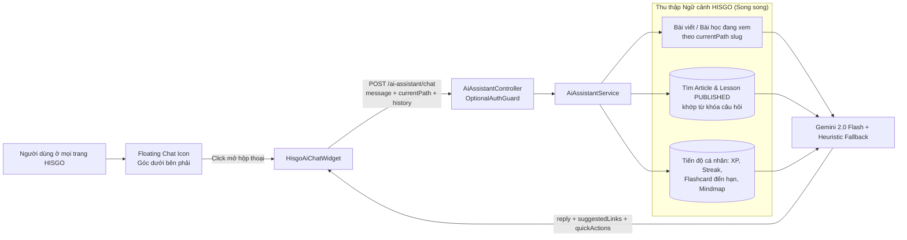

# 🪷 KẾ HOẠCH TRIỂN KHAI TRỢ LÝ AI CHATBOX TOÀN HỆ THỐNG (HISGO AI ASSISTANT)

> **Dự án:** HISGO — Nền tảng học & tra cứu lịch sử Việt Nam (`TLCN-DT07`)  
> **Tính năng:** Trợ lý Sử học & Điều hướng Hệ thống AI (`HisgoAiChatWidget` ⇄ `AiAssistantModule`)  
> **Mô hình AI:** Dual-Engine (`Gemini 2.0 Flash` qua `app.config.ts` + `Context-Aware Heuristic Fallback`)

---

## 1. Mục tiêu & Phạm vi Tính năng

Xây dựng một **Floating AI Chatbox** (biểu tượng icon nhỏ cố định ở góc phải dưới cùng trên mọi trang giao diện của HISGO; khi bấm vào sẽ mở hộp thoại trò chuyện) giúp người dùng tương tác trực tiếp với toàn bộ hệ sinh thái HISGO:

1. **Hướng dẫn & Điều hướng mọi tính năng thuộc hệ thống (System Navigator)**:
   - Giải đáp cách sử dụng và dẫn đường 1-click tới: *Chương trình học & Lộ trình*, *Dòng thời gian*, *Luyện tập Quiz*, *Cộng đồng & Blog*, *Thẻ ghi nhớ SM-2 & Flashcard AI*, *Sơ đồ tư duy Mindmap Canvas AI*, *Ghi chú trên văn bản*, *Tư liệu đã lưu*, *Chuỗi ngày học Streak & XP Gamification*.
2. **Tra cứu & Giải đáp Lịch sử Việt Nam có trích dẫn tư liệu nội bộ (Historical RAG & Citation)**:
   - Tự động tìm kiếm các bài viết (`Article`) và bài học (`Lesson`) đã xuất bản (`PUBLISHED`) trong cơ sở dữ liệu HISGO khớp với câu hỏi của người dùng.
   - Kết hợp với tri thức chuẩn SGK Lịch sử Việt Nam (Chương trình GDPT 2018) của **Gemini Flash** để giải đáp súc tích, chính xác và đính kèm **Thẻ tư liệu liên quan (`suggestedLinks`)** ngay dưới câu trả lời để người dùng bấm vào đọc ngay.
3. **Cố vấn học tập cá nhân hóa theo tài khoản đang đăng nhập (Personal Study Coach)**:
   - Khi người học đã đăng nhập (`OptionalAuthGuard`), Chatbox tự động tra cứu nhanh từ DB: tổng XP, chuỗi ngày học hiện tại (`currentDayStreak`), số thẻ Flashcard đến hạn ôn hôm nay (`dueCards`), số sơ đồ tư duy và số tư liệu đã lưu để nhắc lịch học tập cá nhân.
4. **Nhận diện ngữ cảnh trang hiện tại (Page-Aware Context)**:
   - Tự động biết người dùng đang đứng ở trang nào (`currentPath`, ví dụ đang đọc `/bai-viet/<slug>` hay `/bai-hoc/<slug>`) để hỗ trợ *"Tóm tắt bài đang xem"* hoặc gợi ý hướng học tiếp theo.

---

## 2. Kiến trúc Kỹ thuật (Backend ⇄ Frontend)

### 2.1. Backend (`backend/src/ai-assistant/`)
* `ai-assistant.constant.ts`:
  - Hằng số route (`AI_ASSISTANT_ROUTES`), giới hạn (`AI_ASSISTANT_LIMITS`), enum `AssistantChatRole` (`USER`, `ASSISTANT`), enum `AssistantLinkKind` (`ARTICLE`, `LESSON`, `ROUTE`), và `HISGO_SYSTEM_PROMPT` chứa bản đồ đầy đủ các tính năng và đường dẫn của HISGO.
* `dto/ai-assistant.dto.ts`:
  - `ChatHistoryItemDto` (`role`, `content`), `AskAiAssistantDto` (`message`, `currentPath?`, `history?`).
* `ai-assistant.service.ts`:
  - Thu thập ngữ cảnh trang đang xem (`resolveCurrentPageArticleOrLesson`), tìm kiếm bài viết/bài học liên quan (`searchRelevantContent`), đọc tiến độ cá nhân (`fetchUserStudySnapshot`).
  - Gọi Gemini Flash (`config.gemini_api_key` / `config.gemini_model` từ `app.config.ts`) hoặc fallback Heuristic thông minh theo ý định câu hỏi (Cognitive Complexity $\le 10$ cho mọi hàm).
* `ai-assistant.controller.ts` & `ai-assistant.module.ts`:
  - Endpoint `POST /ai-assistant/chat` dùng `@UseGuards(OptionalAuthGuard)`.
  - Đăng ký `AiAssistantModule` vào `backend/src/app.module.ts`.
* Unit Tests:
  - `ai-assistant.service.spec.ts` & `ai-assistant.controller.spec.ts`.

### 2.2. Frontend (`frontend/src/features/ai-assistant/`)
* `constants/ai-assistant.constants.ts`:
  - Khai báo `AI_ASSISTANT_API`, `AssistantChatRole`, `AssistantLinkKind`, tin nhắn chào mừng mặc định và danh sách chip gợi ý nhanh.
* `services/ai-assistant.service.ts`:
  - `AiAssistantApiService.chat(payload)` gọi qua axios instance chung `@/services/api`.
* `components/HisgoAiChatWidget.tsx`:
  - Icon tròn nổi cố định ở góc dưới bên phải màn hình (`bottom-20 right-6 z-50` để nằm ngay phía trên nút `ScrollToTopButton` ở `bottom-7 right-7`).
  - Khi bấm vào icon: mở hộp thoại Chatbox phong cách Hoàng gia HISGO (`#7A1F24` & `#D4AE67`), có nút phóng to/thu nhỏ, nút làm mới đoạn chat, hiển thị ngữ cảnh trang đang đứng, chip câu hỏi nhanh, thẻ tư liệu gợi ý (`suggestedLinks`) và nút chuyển trang 1-click (`quickActions`).
* Tích hợp toàn hệ thống tại `frontend/src/components/layout/ClientLayout.tsx`.
