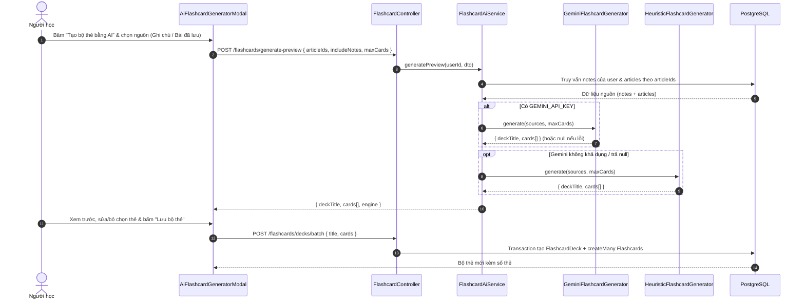

# Sequence Diagram: Tạo bộ Flashcards tự động bằng AI từ Ghi chú & Bài viết đã lưu

Tài liệu mô tả luồng **AI Flashcard Generator** (không sửa đổi schema DB):
1. Người học mở hộp thoại **Tạo bộ thẻ bằng AI** từ tab `Thẻ ghi nhớ` (`/tai-khoan`).
2. Frontend gửi danh sách `articleIds` (từ `localStorage` `hisgo:saved-articles`) + tuỳ chọn `includeNotes` lên `POST /flashcards/generate-preview`.
3. Backend tổng hợp nội dung từ `notes` và `articles` trong DB, gọi **Gemini Flash** (qua `GEMINI_API_KEY`) để sinh bộ câu hỏi/đáp án JSON; nếu chưa cấu hình API key hoặc lỗi mạng thì tự chuyển sang **HeuristicFlashcardGenerator** (Strategy Pattern).
4. Người học xem trước, chỉnh sửa/bỏ chọn từng thẻ rồi bấm **Lưu bộ thẻ** (`POST /flashcards/decks/batch`) trong 1 transaction.

