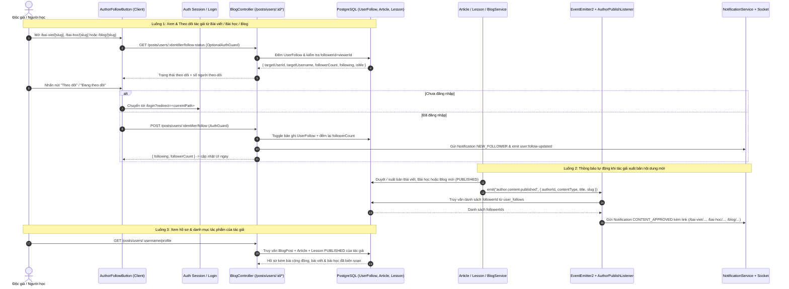

# Sequence Diagram: Theo dõi (Follow) Người viết bài & Thông báo bài mới

Tính năng thống nhất mạng lưới theo dõi `UserFollow` từ Blog Cộng đồng sang **Bài viết lịch sử** (`/bai-viet/[slug]`), **Bài học** (`/bai-hoc/[slug]`), **Blog chuyên khảo** (`/blog/[slug]`) và **Hồ sơ tác giả** (`/cong-dong/thanh-vien/[username]`).

