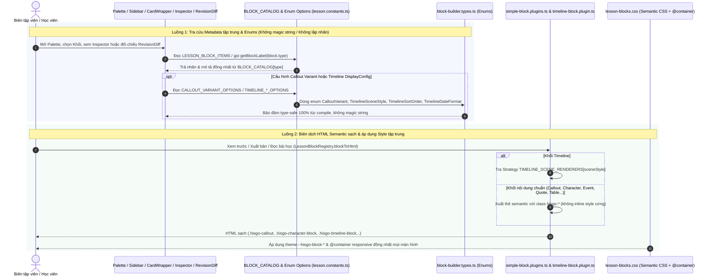

# Sequence Diagram: Chuẩn hóa `BLOCK_CATALOG`, Enums & Tách Inline CSS Block Builder

Tài liệu mô tả kiến trúc sau khi loại bỏ hardcode ở tầng Block Builder:
1. **Single Source of Truth cho Metadata & Enums (`BLOCK_CATALOG` & Enum Options)**:
   - Toàn bộ nhãn tiếng Việt, mô tả, nhóm và cờ hiển thị trên Palette của 17 loại khối (`LessonBlockType`) được định nghĩa duy nhất tại `BLOCK_CATALOG` (`frontend/src/features/lessons/constants/lesson.constants.ts`), kèm helper `getBlockLabel(type)`.
   - `BlockLibraryPalette`, `LessonLeftToolSidebar`, `BlockCardWrapper`, `BlockPropertyInspector` và `RevisionDiff` cùng tra cứu từ `BLOCK_CATALOG` thay vì khai báo map/switch lặp lại.
   - Các cấu hình dạng chuỗi (`CalloutVariant`, `TimelineSceneStyle`, `TimelineSortOrder`, `TimelineDateFormat`) được chuẩn hóa thành `enum` trong `block-builder.types.ts` và cung cấp mảng tùy chọn dùng chung (`CALLOUT_VARIANT_OPTIONS`, `TIMELINE_DATE_FORMAT_OPTIONS`, `TIMELINE_SORT_ORDER_OPTIONS`, `TIMELINE_SCENE_STYLE_OPTIONS`).
2. **Semantic HTML + Strategy Pattern (`LessonBlockRegistry` → `lesson-blocks.css`)**:
   - `simple-block.plugins.ts` và `timeline-block.plugin.ts` (với Strategy Map `TIMELINE_SCENE_RENDERERS`) chỉ biên dịch HTML semantic gắn class `hisgo-*` (không nhúng inline `style="..."` cứng).
   - Toàn bộ CSS giao diện thẻ khối, biến chủ đề (`--hisgo-block-*`) và Container Queries (`@container hisgo-row`, `@container hisgo-col`, `@container hisgo-card`) được quản lý tập trung tại `frontend/src/features/lessons/styles/lesson-blocks.css` và nạp qua `globals.css`.

