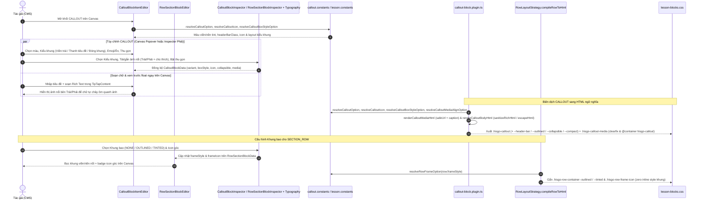

# Sequence Diagram: Nâng cấp Hộp ghi chú (CALLOUT) & Khung bao Bố cục nhiều cột (SECTION_ROW)

Tài liệu mô tả luồng dữ liệu 2 chiều giữa Canvas Editor, Property Inspector và Compiler Plugin cho:
- **CALLOUT**: tùy chọn màu sắc, kiểu khung (`LEFT_ACCENT` | `HEADER_BAR` | `OUTLINED`), icon/emoji hoặc ẩn icon, tiêu đề tùy chọn, chế độ thu gọn (`collapsible`), nội dung Rich Text và ảnh chèn nổi (`media`: Trái/Phải + chú thích) cho chữ chảy ôm quanh ảnh.
- **SECTION_ROW**: tùy chọn khung bao (`frameStyle`: `NONE` | `OUTLINED` | `TINTED`) và icon góc (`frameIcon`).

