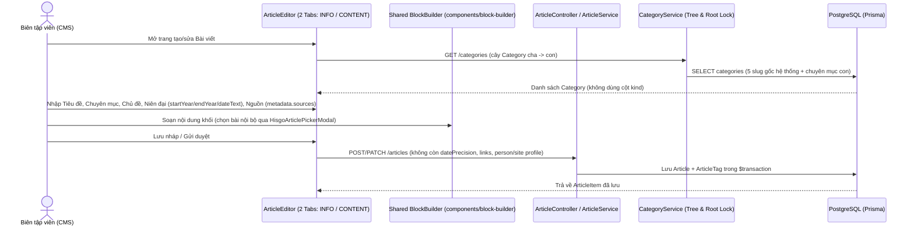
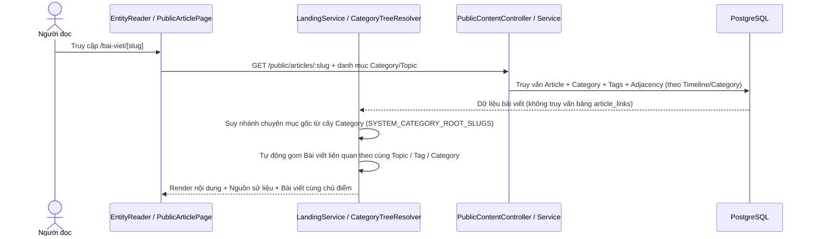
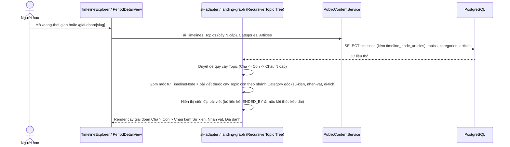

# Sequence Diagram — Tinh gọn Schema (`ArticleLink`, `ArticleKind`, `DatePrecision`), Cây `Category`, Timeline Đệ quy `Topic` & Shared Block Builder

## 1. Luồng Biên soạn Bài viết CMS (2 Tab: Thông tin & Nội dung) và Phân loại theo Cây `Category`

## 2. Luồng Đọc Bài viết Công khai & Gợi ý Bài viết Liên quan (Thay thế `ArticleLink`)

## 3. Luồng Dòng thời gian (`/dong-thoi-gian` & `/giai-doan/[slug]`) Gom Đệ quy Cây `Topic` (`Cha > Con > Cháu`)

