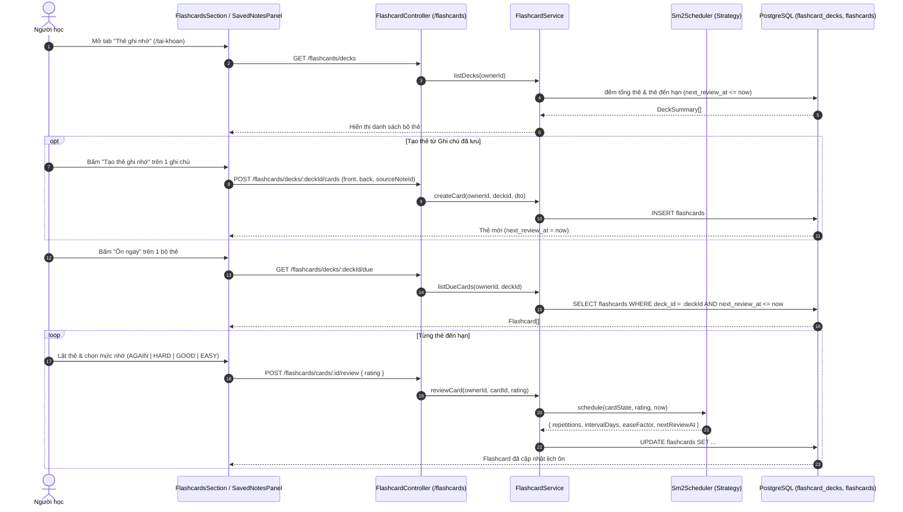

# Sequence Diagram: Thẻ ghi nhớ Flashcards & Lặp lại ngắt quãng (SM-2)

Tài liệu mô tả luồng **Flashcards SM-2** (chỉ tạo mới 2 bảng độc lập `flashcard_decks` và `flashcards`, không sửa các bảng cũ):
1. Tạo / xem danh sách bộ thẻ (`GET /flashcards/decks`, `POST /flashcards/decks`).
2. Tạo thẻ mới (nhập tay hoặc chuyển từ **Ghi chú & Đánh dấu** ở Tủ sách cá nhân).
3. Phiên ôn tập SM-2: lấy thẻ đến hạn (`GET /flashcards/decks/:deckId/due`), lật thẻ và chấm mức nhớ (`AGAIN | HARD | GOOD | EASY`) qua `POST /flashcards/cards/:id/review`.

