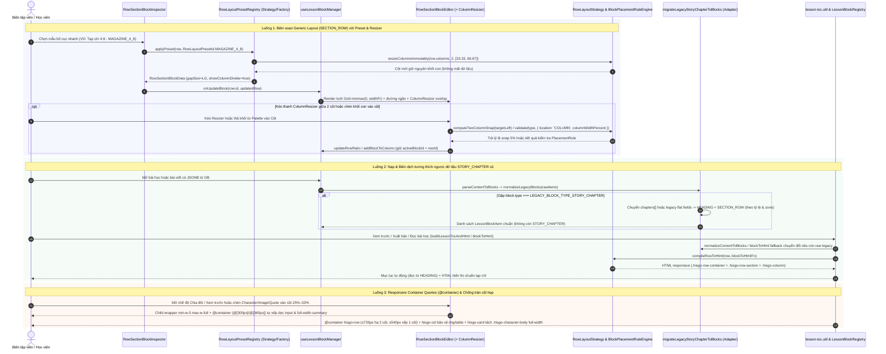

# Sequence Diagram: Hợp nhất `STORY_CHAPTER` vào Generic Layout Block (`SECTION_ROW`)

Tài liệu mô tả kiến trúc sau khi gộp khối chuyên biệt `STORY_CHAPTER` (~4,252 dòng, 16+ file) về một khối bố cục tổng quát duy nhất (`SECTION_ROW` — **Bố cục nhiều cột**) kèm **Preset Strategy / Factory** và **Legacy Adapter** để bảo toàn khả năng đọc dữ liệu cũ:

1. **Luồng biên soạn Generic Layout (`SECTION_ROW`) với Preset Strategy**:
   - `RowLayoutPresetRegistry` (Strategy + Factory Pattern) cho phép áp dụng nhanh các mẫu dàn trang (`MAGAZINE_4_8`, `SYMMETRIC_6_6`, `MEDIA_LEAD_7_5`, `THREE_COLUMNS`, `THREE_COL_FEATURE`, `SINGLE_COLUMN`) bằng cách tái phân bổ bất biến các khối con sang danh sách cột mới (`RowLayoutStrategy.resizeColumnsImmutably`).
   - Hỗ trợ tùy chỉnh khoảng cách cột (`RowGapSize`: `SM` | `MD` | `LG`), căn dọc (`RowVerticalAlign`: `TOP` | `CENTER` | `STRETCH`), đường kẻ ngăn cột (`showColumnDivider`), kéo thanh `ColumnResizer` overlay giữa 2 cột mà không chiếm track Grid, và bật Drop Cap / Chia cột văn bản ngay trong `TypographyInspectorPanel` cho khối `TEXT` bên trong cột.
2. **Luồng tương thích ngược dữ liệu cũ (`STORY_CHAPTER` → `[HEADING, SECTION_ROW]`)**:
   - `migrateLegacyStoryChapterToBlocks` (Adapter Pattern) tự động chuyển đổi bản ghi `STORY_CHAPTER` cũ (cả dạng `chapters[]` lẫn dạng phẳng cũ) thành mảng các khối chuẩn `[HEADING, SECTION_ROW, ...]` ngay khi nạp vào trình soạn thảo (`useLessonBlockManager`), dựng mục lục (`lesson-toc.util.ts`) hoặc biên dịch HTML (`LessonBlockRegistry.blockToHtml`).
3. **Luồng Responsive Container Queries (`@container`) & Chống tràn nội dung trong cột hẹp**:
   - HTML xuất bản bọc `.hisgo-row-section` trong `.hisgo-row-container` (`container-name: hisgo-row`), từng cột mang `.hisgo-column` (`container-name: hisgo-col`, `min-width: 0`, `overflow-wrap: break-word`) và khối Nhân vật tách thành `.hisgo-character-header` (avatar + tên/năm) + `.hisgo-character-body` (tiểu sử 100% chiều rộng, `container-name: hisgo-card`).
   - Khi pane Chia đôi / Preview hoặc cột 25–33% bị thu hẹp, CSS `@container` tự hạ lưới 3–4 cột → 2 cột (`≤720px`) → 1 cột dọc (`≤540px`) và xếp dọc header Nhân vật (`≤250px`). Trên Canvas, các editor con (`CharacterBlockItemEditor`, `ImageBlockItemEditor`, `QuoteBlockItemEditor`, `CalloutBlockItemEditor`) sử dụng `@container` Tailwind (`@[300px]:`, `@[360px]:`) thay cho breakpoint toàn màn hình `sm:`.

