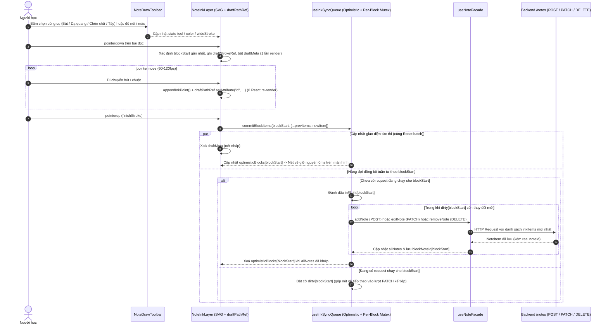

# Sequence Diagram: Vẽ tự do (Ink Layer), Thanh công cụ gọn & Đồng bộ tức thì

Tài liệu mô tả luồng xử lý sau khi sửa lỗi tràn ngang, tinh gọn thanh công cụ vẽ và loại bỏ độ trễ biến mất nét vẽ (`quẹt 1 đường bị mất rồi vài giây sau mới hiện`):

1. **Thanh công cụ vẽ (`NoteDrawToolbar`)**: Căn giữa bằng `inset-x-0 mx-auto w-fit max-w-[calc(100vw-24px)]` (tránh lỗi `left-1/2` ép chiều rộng xuống `50vw` gây rớt dòng 2 hàng), các công cụ (`Bút mực`, `Dạ quang`, `Chèn chữ`, `Tẩy nét`, `Nét mảnh/đậm`, `Hoàn tác`) hiển thị bằng icon trực quan + tooltip để giảm chữ thừa, giữ duy nhất nhãn ngắn `Xong`.
2. **Lớp phủ SVG & Lề (`NoteInkLayer` + `NoteStickyMarginLayer`)**: Theo dõi thay đổi kích thước trên cả `root` và `document.documentElement`, giới hạn khung hình và chữ bổ sung trong `[0, clientWidth]` kèm `overflow-hidden` để không bao giờ phát sinh thanh cuộn ngang.
3. **Vẽ 60fps & Optimistic Coalescing Queue (`useInkSyncQueue`)**: Khi kéo bút, cập nhật đường path trực tiếp trên DOM (`draftPathRef`) không re-render toàn cây; khi nhấc bút, đẩy ngay nét vẽ vào trạng thái lạc quan theo từng đoạn (`optimisticBlocks`) trong cùng batch với lúc xoá nét nháp (0ms biến mất), đồng thời xếp hàng đồng bộ tuần tự theo từng đoạn (`blockStart`) và gộp các nét vẽ liên tiếp khi request trước đang chờ phản hồi.

