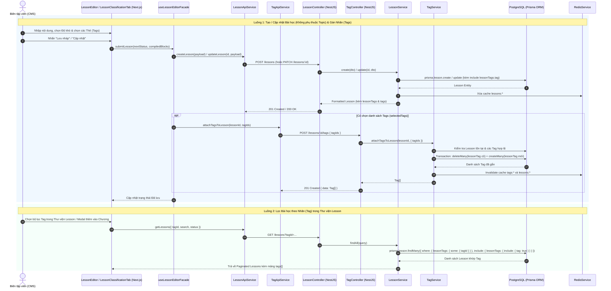

# Thiết Kế Tính Năng: Quản Lý Nhãn Bài Học (Lesson - Tag Many-to-Many) & Độc Lập Hóa Bài Học Khỏi Topic

## 1. Mục tiêu kiến trúc
1. **Tách rời `Lesson` khỏi `Topic` (`Lesson` độc lập trong Thư viện)**:
   - Bỏ khóa ngoại `topicId` trên model `Lesson` (tạm thời chưa đụng vào logic cây `Topic`).
   - Bài học (`Lesson`) chỉ thuộc về Thư viện chung, được đóng gói vào các khóa học thông qua `LearningPath -> Chapter -> ChapterLesson` và được phân loại đa chiều thông qua `Tag`.
2. **Hoàn thiện liên kết `Lesson` ↔ `Tag` (Quan hệ N - N qua bảng `LessonTag`)**:
   - Bổ sung bảng trung gian `LessonTag` (`lesson_tags`) trong Prisma Schema, thay thế hoàn toàn các hàm stub `[]` trước đây trong `TagService`.
   - Hỗ trợ gán danh sách `Tag` cho `Lesson` (`POST /lessons/:id/tags`), lấy danh sách `Tag` của `Lesson` (`GET /lessons/:id/tags`), và lọc `Lesson` theo `tagId` (`GET /lessons?tagId=...`).

---

## 2. Sequence Diagram: Lưu Bài Học & Gán Nhãn Phân Loại (Lesson ↔ Tag)

---

## 3. Áp dụng Nguyên tắc SOLID & Design Patterns
- **Single Responsibility Principle (SRP)**:
  - `LessonService` chịu trách nhiệm vòng đời nội dung bài học và chuẩn hóa dữ liệu trả về (`formatLessonResponse` ánh xạ `lessonTags` thành mảng `tags` phẳng tiện lợi cho UI).
  - `TagService` chịu trách nhiệm quản lý danh mục `Tag` và đồng bộ bảng trung gian `LessonTag` trong Transaction nguyên tử (`$transaction`).
- **Open/Closed Principle (OCP)**:
  - Bộ lọc bài học trong `LessonService.findAll` mở rộng điều kiện lọc theo `tagId` thông qua quan hệ `lessonTags: { some: { tagId } }` mà không làm thay đổi cấu trúc phân trang hay cache hiện có.
- **Không Magic String**:
  - Toàn bộ khóa cache, thông báo lỗi của module `Tag` được định nghĩa tập trung tại `tag.constant.ts`.
