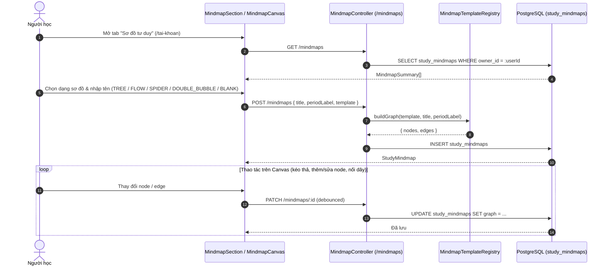

# Sequence Diagram: Sơ đồ tư duy Lịch sử (HISGO Mindmap)

Tài liệu mô tả luồng **Sơ đồ tư duy Lịch sử** (1 bảng mới độc lập `study_mindmaps`, không sửa bảng cũ):
1. Tạo sơ đồ mới từ 1 trong 5 mẫu (`TREE | FLOW | SPIDER | DOUBLE_BUBBLE | BLANK`) qua `MindmapTemplateRegistry` (Strategy Pattern).
2. Chỉnh sửa tự do trên canvas (kéo thả node, thêm/sửa/xoá node & liên kết, gắn bài viết HISGO) và tự động lưu (`PATCH /mindmaps/:id`).

