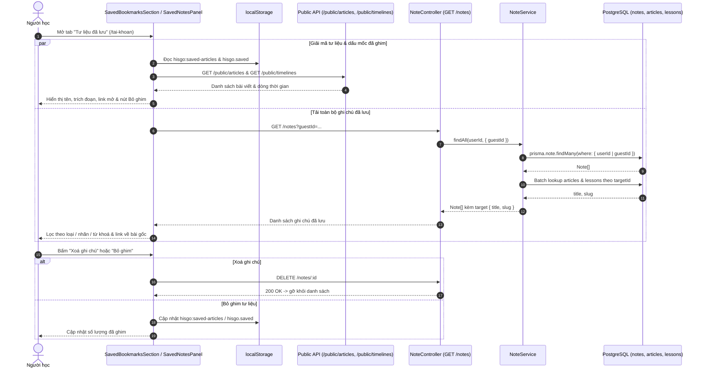

# Sequence Diagram: Tủ sách cá nhân & Xem lại Ghi chú đã lưu

Tài liệu mô tả luồng tải và quản lý **Tủ sách cá nhân** (`/tai-khoan`, tab `Tư liệu đã lưu`) gồm:
1. Giải mã ID tư liệu đã lưu trong `localStorage` (`hisgo:saved-articles`, `hisgo.saved`) thành tên, thời kỳ và liên kết thực qua `/public/articles` & `/public/timelines`.
2. Tải toàn bộ ghi chú & đánh dấu đã lưu của người học qua `GET /notes` (không truyền `targetId`), backend gắn kèm thông tin bài viết / bài học gốc (`target: { title, slug }`).

