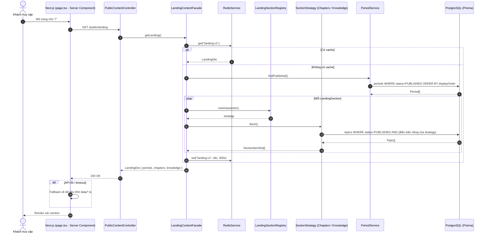

# Phase 1 — Public Content API cho Landing Page

## 1. Mục tiêu
Landing page (Timeline, Khám phá theo giai đoạn, Chặng sử đáng nhớ, Kiến thức lịch sử) lấy dữ liệu từ DB thay cho `frontend/src/data/*.ts`.
Endpoint public **không cần đăng nhập**, chỉ trả nội dung `status = PUBLISHED`.

## 2. Thay đổi schema

| Model | Cột mới | Ghi chú |
|---|---|---|
| `Period` | `slug` (unique), `timeLabel?` | `timeLabel` VD: "(thế kỷ VII TCN - thế kỷ II TCN)"; nếu rỗng thì tự sinh từ `startYear/endYear` |
| `Topic` | `slug` (unique), `eyebrow?`, `icon?`, `isFeatured` (default false) | `icon` lưu tên enum `TopicIcon` (Landmark, Castle, Swords, Scale, BookOpen, MapPin), không dùng chuỗi tự do |

`slug` được sinh tự động từ `name` (bỏ dấu tiếng Việt) bởi `SlugService` dùng chung; trùng thì thêm hậu tố `-2`, `-3`.

## 3. Endpoint

| Method | Path | Dùng cho section |
|---|---|---|
| GET | `/public/landing` | Toàn bộ landing trong **1 request** |
| GET | `/public/periods` | Timeline + Khám phá theo giai đoạn |
| GET | `/public/topics?section=CHAPTERS\|KNOWLEDGE` | Chặng sử / Kiến thức |

## 4. Thiết kế (SOLID + Pattern)
- **Facade** `LandingContentFacade`: gom dữ liệu từ `PeriodService`, `TopicService` → controller không phụ thuộc nhiều service.
- **Strategy** `LandingSectionStrategy` (mỗi section 1 strategy: `ChaptersSectionStrategy` = Topic CHRONOLOGICAL + `isFeatured`; `KnowledgeSectionStrategy` = Topic THEMATIC gốc). Thêm section mới = thêm 1 class + đăng ký vào registry, không sửa code cũ (OCP).
- **Hằng số** `LandingSection` enum, `PUBLIC_CONTENT_STATUS = PUBLISHED` → không magic string.
- **Mapper** riêng cho response public (không lộ cột nội bộ như `status`, `createdAt`).
- **Cache**: Redis TTL 5 phút cho `/public/landing` (đã có `RedisService`). Xóa cache khi Period/Topic thay đổi.

## 5. Sequence Diagram

## 6. Kiểm thử
- **Unit (Jest)**: `SlugService` (bỏ dấu, chống trùng), từng strategy, facade (cache hit/miss).
- **E2E API (Supertest — tương đương MockMvc bên NestJS)**: `/public/landing` không cần token; nội dung DRAFT không xuất hiện.
- **E2E UI (Playwright)**: trang chủ hiển thị đúng tên Period/Topic lấy từ seed.
