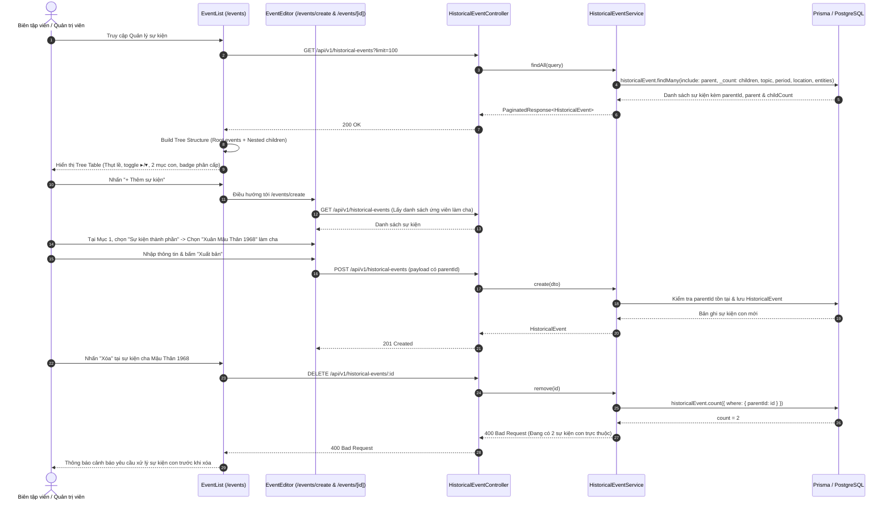

# Sequence Diagram: Quản lý Sự kiện Phân cấp (Event Tree Table Hierarchy)

## 1. Kiến trúc & Design Patterns áp dụng
- **Composite Pattern / Adjacency List Hierarchy**:
  - `HistoricalEvent` sở hữu quan hệ tự tham chiếu (Self-referencing relationship): `parentId -> id`.
  - Một sự kiện có thể là **Sự kiện độc lập** (`parentId = null`, không có con), **Sự kiện cha / Chiến dịch lớn** (`parentId = null`, có các sự kiện thành phần con `children`), hoặc **Sự kiện thành phần** (`parentId = eventId`).
  - Phân định rạch ròi: Cấu trúc cây chính phản ánh quan hệ cấu thành (Chiến dịch -> Đợt tiến công -> Trận đánh cụ thể), trong khi các quan hệ tham chiếu khác (Thời kỳ, Chủ đề/Giai đoạn, Nhân vật, Lực lượng, Hiện vật, Địa danh) được quản lý qua Quan hệ Tri thức (Knowledge Graph).
- **Tree Table Presentation Pattern (`EventList`)**:
  - Hỗ trợ chuyển đổi linh hoạt 2 chế độ:
    1. **`[ Cây phân cấp ]`**: Bảng dạng cây thụt lề cấp bậc, hỗ trợ thu gọn/mở rộng từng nhánh (`▸` / `▾`), hiển thị số mục con (ví dụ: `2 mục con`), bộ lọc `[ ] Chỉ xem cấp cao nhất`, tác vụ nhanh `[ Mở rộng cây ]` | `[ Thu gọn ]`.
    2. **`[ Danh sách phẳng ]`**: Bảng phẳng chuẩn mực, hiển thị trực tiếp danh sách sự kiện kèm nhãn sự kiện cha (`Thuộc: [Tên sự kiện cha]`).
  - Tìm kiếm thông minh có bảo toàn ngữ cảnh: Khi gõ từ khóa tìm kiếm, các sự kiện con phù hợp sẽ tự động mở rộng nhánh cha và hiển thị đường dẫn phân cấp để người biên tập không bị mất ngữ cảnh lịch sử.
- **Defensive Deletion Guard (Data Integrity)**:
  - Khi quản trị viên yêu cầu xóa một sự kiện cha: Backend kiểm tra số lượng sự kiện con trực thuộc (`_count.children`). Nếu sự kiện đang chứa các sự kiện thành phần, hệ thống từ chối xóa và yêu cầu người quản trị xử lý/chuyển các sự kiện con trước nhằm bảo vệ tính toàn vẹn dữ liệu sử học.
- **Form Integration (Mục 1 `Thông tin cơ bản` trong `EventEditor`)**:
  - Tích hợp bộ chọn trực quan không làm phình to biểu mẫu:
    - `(•) Sự kiện độc lập — không có sự kiện cha`
    - `( ) Sự kiện thành phần — thuộc một sự kiện khác`
  - Khi chọn "Sự kiện thành phần", mở ô Searchable Combobox chọn Sự kiện cha từ cơ sở dữ liệu (tự động loại trừ chính sự kiện đang sửa để chống vòng lặp).

---

## 2. Sequence Diagram: Tải Tree Table & Tạo Sự kiện phân cấp

