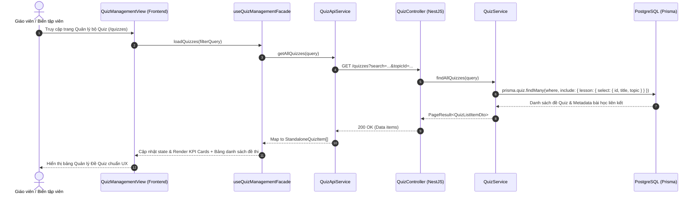
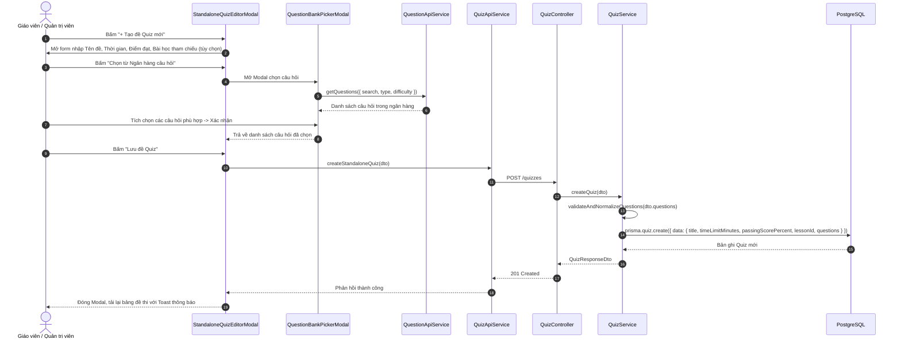
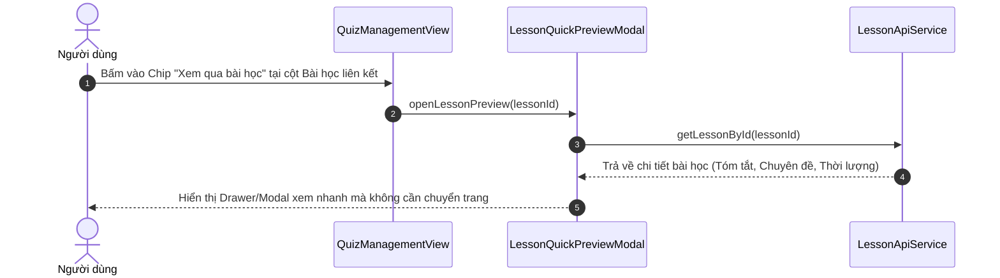

# THIẾT KẾ KIẾN TRÚC HỆ THỐNG QUẢN LÝ BỘ ĐỀ QUIZ ĐỘC LẬP & TỔNG HỢP TỪ NGÂN HÀNG CÂU HỎI
*(Standalone Quiz Assessment & Question Bank Aggregation Architecture)*

## 1. Bối cảnh & Yêu cầu nghiệp vụ (Context & Business Requirements)
- **Vấn đề tồn tại:**
  - Trước đây, Quiz bị gắn chặt vào cấu trúc của từng Bài học (`Lesson 1-1 Quiz`). Bảng quản lý hiển thị cột đầu tiên là `BÀI HỌC LIÊN KẾT`, khiến giao diện bị hiểu nhầm thành "Bảng quản lý bài học".
  - Người dùng phản hồi:
    > *"Quiz là riêng mà ta, nó tổng hợp lấy từ bộ ngân hàng câu hỏi ấy, còn liên kết kiểu để xem qua thôi. Làm lại giao diện đàng hoàng áp dụng skill vô."*
- **Mục tiêu tái cấu trúc:**
  1. **Độc lập hóa thực thể Quiz (Standalone Assessment)**:
     - Quiz là một bài thi/đề ôn tập hoàn chỉnh, có định danh riêng (`title`, `code`, `description`), cấu hình làm bài (`timeLimitMinutes`, `passingScorePercent`).
     - "Bài học liên kết" (`linkedLesson`) chỉ đóng vai trò là siêu dữ liệu tham chiếu (Reference Metadata), phục vụ việc xem qua nhanh nội dung bài học mà không chiếm vị trí định danh chính.
  2. **Tổng hợp câu hỏi từ Ngân hàng câu hỏi (Question Bank Integration)**:
     - Hỗ trợ chọn nhanh các câu hỏi đã được chuẩn hóa từ Ngân hàng câu hỏi (`/questions`) vào đề thi thông qua `QuestionBankPickerModal`.
     - Phân loại trực quan cấu trúc câu hỏi (Nhận biết, Thông hiểu, Vận dụng) và nguồn gốc câu hỏi trong đề.
  3. **UI/UX hiện đại theo chuẩn Design System (`frontend-design`, `ui-ux-designer`)**:
     - Thống kê KPI Dashboard 4 chỉ số (Tổng số đề, Đề đang kích hoạt, Đề nháp, Tổng câu hỏi đã tích hợp).
     - Bảng quản lý tập trung vào Đề thi (Tên đề, Mã đề, Bài học tham chiếu kèm nút Xem nhanh, Chuyên đề, Cấu trúc câu hỏi, Điều kiện đạt, Trạng thái, Bộ tác vụ đầy đủ).
     - Hỗ trợ Modal xem trước đề thi (`QuizPreviewModal`) và Modal xem nhanh bài học (`LessonQuickPreviewModal`).

---

## 2. Sequence Diagram (Luồng hoạt động chuẩn Feature-by-Feature)

### 2.1. Luồng Lấy danh sách & Quản lý Đề Quiz độc lập

### 2.2. Luồng Tạo đề Quiz tổng hợp từ Ngân hàng câu hỏi

### 2.3. Luồng "Xem qua" Bài học liên kết (Quick View Drawer / Modal)

---

## 3. Kiến trúc Thiết kế & Áp dụng Design Patterns (SOLID)

1. **Facade Pattern (`useQuizManagementFacade.ts`)**:
   - Đóng gói toàn bộ logic state: tải dữ liệu, tìm kiếm, lọc theo chủ đề/trạng thái, phân trang, điều khiển mở modal xem trước, modal biên tập và modal xem nhanh bài học.
   - Tách biệt hoàn toàn phần Logic khỏi Giao diện UI (`QuizManagementView.tsx`).

2. **Open/Closed Principle (OCP)**:
   - Hệ thống mở rộng thêm RESTful endpoints độc lập (`/quizzes`, `/quizzes/:id`) trong khi vẫn duy trì endpoint cũ (`/lessons/:lessonId/quiz`) để đảm bảo các màn hình hiện có (`LessonEditor`, `LessonQuizPanel`) hoạt động ổn định 100%.

3. **Data Transfer Object (DTO) & Type Safety**:
   - DTOs kiểm tra chặt chẽ kiểu dữ liệu của đề thi và mảng câu hỏi JSONB, loại bỏ hoàn toàn rủi ro ép kiểu cưỡng bức (`as any`).

4. **UI/UX Refactoring (`frontend-design`, `ui-ux-designer`)**:
   - Màu sắc nhã nhặn, tôn trọng chủ đề Lịch sử (Tone Slate, Amber, Indigo, Emerald).
   - Card KPI trực quan hỗ trợ quản trị viên nắm nhanh tình hình ngân hàng đề.
   - Bảng hiển thị thông tin rõ ràng, phân cấp thị giác mạch lạc.
