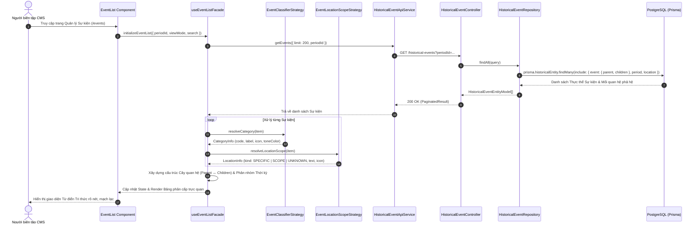

# THIẾT KẾ KIẾN TRÚC TỔ CHỨC VÀ HIỂN THỊ PHÂN CẤP SỰ KIỆN LỊCH SỬ (HISTORICAL EVENT HIERARCHY & SMART CLASSIFICATION)

## 1. Bối cảnh & Yêu cầu nghiệp vụ (Context & Requirements)

Từ điển tri thức lịch sử trong hệ thống CMS đang gặp 5 vấn đề cốt lõi:
1. **Cột phân loại vô nghĩa**: Phần lớn sự kiện hiển thị nhãn "Khác" do thiếu cơ chế suy luận và danh mục chưa ánh xạ trực quan.
2. **Quan hệ cha - con (Hierarchy) chưa rõ ràng**: Các sự kiện cha (như *Kháng chiến chống Nguyên - Mông lần thứ hai*) và sự kiện con (*Trận Tây Kết, Trận Vạn Kiếp, Trận Chương Dương*) chỉ có một dòng chữ nhỏ "Sự kiện trực thuộc", không thể hiện được cấu trúc chiến dịch - trận đánh.
3. **Địa danh mơ hồ**: Cụm từ "Toàn quốc / Chưa rõ" bị gộp chung, không phân định được Địa điểm cụ thể (Site/Location), Phạm vi chiến lược (National/Regional Scope) và Chưa xác định.
4. **Thiếu gom nhóm theo Thời kỳ lịch sử**: Các sự kiện cùng thời kỳ hoặc cùng bối cảnh cách mạng đứng rời rạc.
5. **Quá tải thông tin ngang hàng trên bảng**: Quá nhiều cột chia cắt sự tập trung, thiếu phân cấp thị giác mạch lạc.

### Giải pháp Kiến trúc:
- **Smart Event Classifier (Strategy Pattern)**: Tự động phân loại chính xác sự kiện (Chiến tranh / Kháng chiến, Trận đánh, Cách mạng / Khởi nghĩa, Hiệp ước / Văn kiện, Biến cố chính trị, Hội nghị, Văn hóa) dựa trên Taxonomy + Heuristic historical patterns.
- **Location & Scope Formatter (Strategy Pattern)**: Phân tách minh bạch giữa Địa điểm thực địa, Phạm vi toàn quốc / liên khu, và Chưa rõ địa điểm.
- **Hierarchical Tree & Grouping Modes**: Cung cấp 2 chế độ hiển thị linh hoạt:
  - *Chế độ Cây chiến dịch (Campaign & Sub-events Tree)*: Sự kiện cha gom các trận đánh con ngay dưới dạng cây phân cấp.
  - *Chế độ Gom nhóm theo Thời kỳ (Group by Historical Period)*: Phân đoạn các khối sự kiện theo Thời kỳ lịch sử.
- **Tái cấu trúc bảng hiển thị (Compact Visual Hierarchy)**: Gộp thông tin liên quan theo cụm ngữ nghĩa (Định danh + Cấp độ + Thời kỳ; Niên đại + Địa danh; Trạng thái; Tác vụ).

---

## 2. Sequence Diagram (Luồng lấy dữ liệu & Phân loại sự kiện)

---

## 3. Thiết kế Thiết lập Cấp độ & Phân loại (SOLID Patterns)

### 3.1. Smart Event Classifier Strategy
| Mã phân loại | Tên danh mục | Biểu trưng (Icon) | Tone màu | Tiêu chí nhận diện Heuristic |
| :--- | :--- | :--- | :--- | :--- |
| `WAR` | Chiến tranh / Kháng chiến | 🛡️ ShieldAlert | Đỏ mận (`tone="danger"`) | Chiến tranh, kháng chiến, chiến dịch lớn, xung đột |
| `BATTLE` | Trận đánh / Tập kích | ⚔️ Swords | Cam hổ phách (`tone="warn"`) | Trận, hải chiến, không chiến, tập kích, phục kích |
| `REVOLUTION` | Cách mạng / Khởi nghĩa | 🚩 Flag | Tím phong trào (`tone="purple"`) | Khởi nghĩa, cách mạng, nổi dậy, binh biến |
| `TREATY` | Hiệp ước / Văn kiện | 📜 Scroll | Xanh ngọc (`tone="emerald"`) | Hiệp định, hòa ước, hiệp ước, tuyên ngôn, chiếu |
| `POLITICAL_EVENT` | Chính trị / Thể chế | 🏛️ Landmark | Xanh lam (`tone="blue"`) | Cải cách, dời đô, đảo chính, ban hành hiến pháp |
| `SUMMIT_CONFERENCE` | Hội nghị / Đại hội | 👥 Users | Chàm (`tone="indigo"`) | Hội nghị, đại hội, hội thề, thượng đỉnh |
| `CULTURE_SCIENCE` | Văn hóa / Khoa học | 📖 BookOpen | Vàng cát (`tone="neutral"`) | Dựng bia, văn hóa, giáo dục, khảo cổ |

### 3.2. Location & Scope Strategy
- **`SPECIFIC`**: Có địa danh/di tích cụ thể (`📍 Sông Bạch Đằng, Quảng Ninh`).
- **`SCOPE`**: Phạm vi chiến lược hoặc quy mô toàn quốc/liên khu (`🌐 Toàn quốc`, `🌐 Miền Bắc`, `🌐 Địa bàn quốc tế`).
- **`UNKNOWN`**: Chưa xác định địa điểm thực địa cụ thể (`⚪ Chưa xác định địa điểm`).
