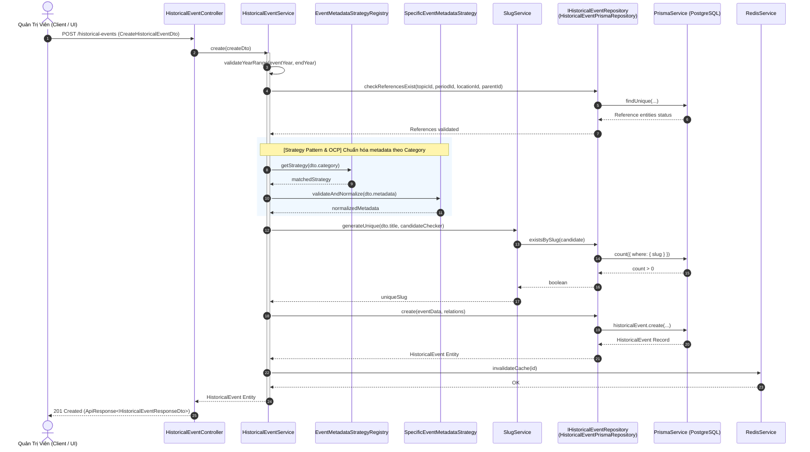
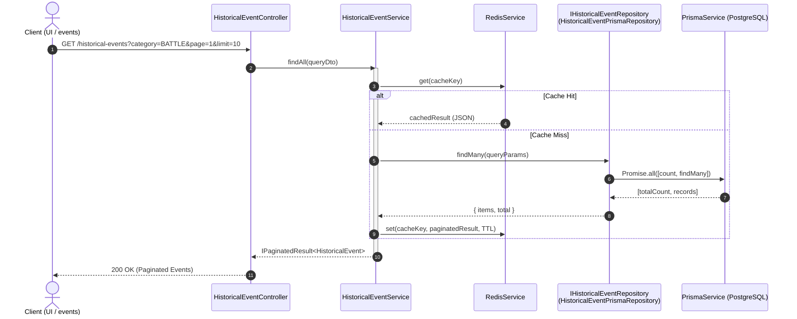

# Sequence Diagram — Phase 11: Bóc tách Tầng Repository (Repository Pattern & DIP trong SOLID) cho Historical Event

## 1. Bối cảnh & Mục tiêu
- **Vấn đề**: `HistoricalEventService` trước đây gọi trực tiếp xuống `PrismaService`, vi phạm Dependency Inversion Principle (DIP) và Single Responsibility Principle (SRP).
- **Giải pháp**: 
  - Đưa vào mẫu thiết kế **Repository Pattern** với Interface trừu tượng `IHistoricalEventRepository`.
  - Triển khai cụ thể `HistoricalEventPrismaRepository` đóng gói toàn bộ logic truy vấn cơ sở dữ liệu.
  - `HistoricalEventService` phụ thuộc vào Interface qua Injection Token `HISTORICAL_EVENT_REPOSITORY` (không magic string).
  - Kết hợp với **Strategy Pattern** cho việc chuẩn hóa `metadata` theo `EventCategory`.

## 2. Sequence Diagram: Luồng Tạo Sự Kiện với Repository Pattern & Strategy Pattern

## 3. Sequence Diagram: Luồng Truy Vấn Danh Sách (findAll) với Repository & Cache

