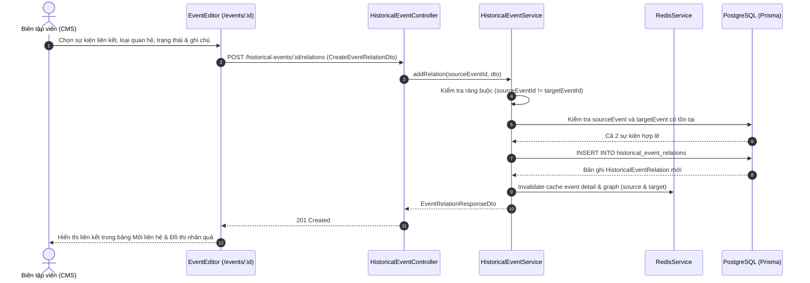
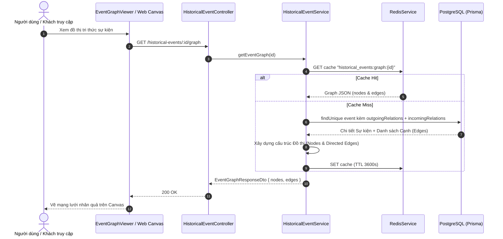

# Phase 12 — Mạng Lưới Quan Hệ Nhân Quả & Đồ Thị Tri Thức Sự Kiện (`HistoricalEventRelation`)

## 1. Mục tiêu kiến trúc & Nguyên tắc thiết kế (SOLID & Design Patterns)
1. **Kiến trúc Lai (Hybrid Architecture)**:
   - Giữ nguyên cấu trúc cây phân cấp (`parentId` $\leftrightarrow$ `children`) để tối ưu hóa truy vấn hiển thị cây (Tree Table) và breadcrumb.
   - Bổ sung bảng mạng lưới `historical_event_relations` để mô hình hóa đồ thị tri thức phi cấu trúc cây (Non-hierarchical Semantic & Causal Graph) giữa các sự kiện lịch sử $A \xrightarrow{relationType} B$.
2. **Bộ trường dữ liệu chuẩn mực (Domain Model)**:
   - `id`: UUID (PK).
   - `source_event_id`: UUID (FK $\rightarrow$ `historical_events.id`), sự kiện nguồn A.
   - `target_event_id`: UUID (FK $\rightarrow$ `historical_events.id`), sự kiện đích B.
   - `relation_type`: Quản lý bằng enum `EventRelationType` (không magic string):
     - `CAUSES`: Nguyên nhân trực tiếp / Dẫn tới
     - `PRECEDES`: Tiền đề lịch sử
     - `FOLLOWS`: Tiếp nối / Hệ quả
     - `INFLUENCES`: Tác động / Ảnh hưởng
     - `PARALLEL_TO`: Song song / Đồng thời
     - `OPPOSES`: Đối kháng / Phản ứng lại
     - `DERIVED_FROM`: Bắt nguồn từ
     - `OTHER`: Khác
   - `description`: `TEXT?` — Luận giải phân tích cơ chế tác động hoặc ngữ cảnh nhân quả giữa hai sự kiện.
   - `status`: Quản lý bằng enum `VerificationStatus`:
     - `VERIFIED`: Đã xác minh (Đồng thuận sử học)
     - `HYPOTHESIS`: Giả thuyết lịch sử
     - `DISPUTED`: Còn nhiều quan điểm tranh cãi
     - `DRAFT`: Bản nháp đang nghiên cứu
   - `source_reference`: `TEXT?` — Trích dẫn nguồn tài liệu, thư tịch cổ, công trình nghiên cứu chứng minh.
   - `created_at`: `DateTime`.
3. **Áp dụng SOLID & Design Patterns**:
   - **Open/Closed Principle (OCP)**: Dùng Enum cho loại quan hệ và trạng thái xác minh, dễ dàng mở rộng thêm mà không sửa đổi cấu trúc cốt lõi.
   - **Single Responsibility (SRP)**: Tách riêng Service quản lý quan hệ và bộ điều phối Event Graph.
   - **Validation Strategy**: Chặn tự liên kết chính mình (`sourceEventId === targetEventId`).

---

## 2. Sequence Diagram — Luồng Thêm Liên Kết Sự Kiện (Add Event Relation)

---

## 3. Sequence Diagram — Luồng Truy Vấn Đồ Thị Sự Kiện (Event Causal Graph)

