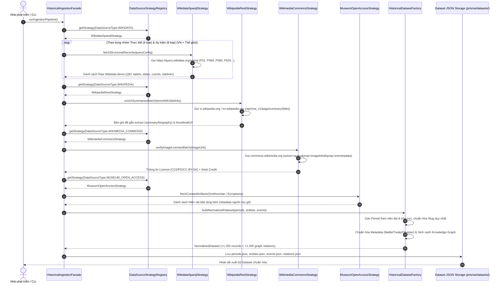
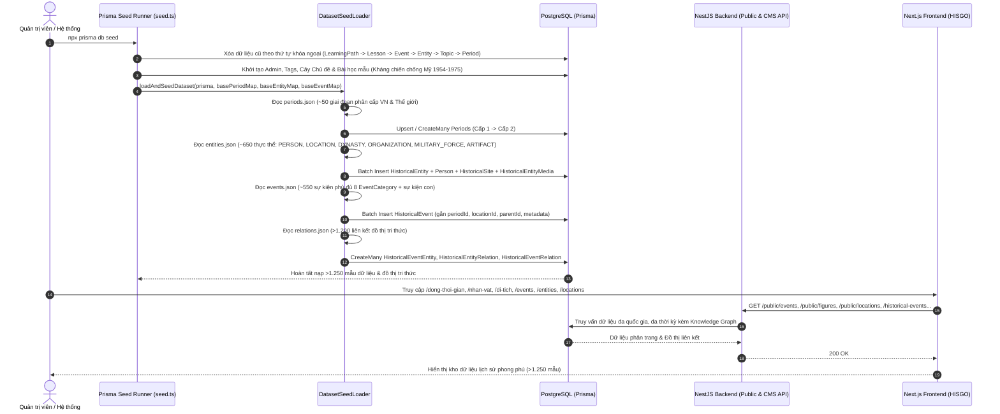

# Phase 13 — Hệ Thống Thu Thập, Làm Giàu & Nạp Dữ Liệu Lịch Sử Đa Nguồn (>1.250 Mẫu)

## 1. Mục tiêu Kiến trúc & Nguyên tắc Thiết kế (SOLID & Design Patterns)

1. **Mục tiêu Nghiệp vụ**:
   - Xây dựng hệ thống thu thập và chuẩn hóa hơn **1.250 mẫu dữ liệu lịch sử chính** (Giai đoạn `Period`, Thực thể `HistoricalEntity` thuộc đủ 6 phân loại, Sự kiện `HistoricalEvent` thuộc đủ 8 phân loại) cùng hơn **1.200 mối quan hệ Đồ thị Tri thức** (`HistoricalEventEntity`, `HistoricalEntityRelation`, `HistoricalEventRelation`).
   - Đa dạng hóa phạm vi: Lịch sử Việt Nam (từ thời Hồng Bàng đến Hiện đại) & Lịch sử Thế giới (Á, Âu, Mỹ, Phi, Đại Dương), kết nối chặt chẽ với các bài học mẫu có sẵn của HISGO.
   - Phối hợp chuẩn xác 5 nguồn API Lịch sử Mở:
     1. **Wikidata (`query.wikidata.org/sparql` & `wikidata.org/w/api.php`)**: Lấy khung xương dữ liệu có cấu trúc (QID, năm sinh/mất `P569`/`P570`, thời điểm diễn ra `P580`/`P582`/`P585`, tọa độ địa lý `P625`, các bên tham chiến `P710`, chỉ huy `P4791`, người ký kết `P1891`).
     2. **Wikipedia REST API (`vi.wikipedia.org` / `en.wikipedia.org/api/rest_v1/page/summary`)**: Trích xuất đoạn tóm tắt học thuật (`extract`), mô tả ngắn và ảnh đại diện (`thumbnail`/`originalimage`).
     3. **Wikimedia Commons API (`commons.wikimedia.org/w/api.php`)**: Kiểm tra giấy phép bản quyền hình ảnh (`extmetadata`: `Public Domain`, `CC0`, `CC BY`, `CC BY-SA`) và thông tin tác giả (`Artist`, `Credit`).
     4. **Smithsonian Open Access API (`api.si.edu/openaccess/api/v1.0/search`)**: Bổ sung tư liệu hiện vật bảo tàng (`ARTIFACT`) có giấy phép mở `CC0`.
     5. **Europeana API (`api.europeana.eu/record/v2/search.json`)**: Bổ sung tư liệu hiện vật, bản đồ, tranh lịch sử châu Âu và Đông Dương (`reusability=open`).

2. **Tuân thủ Nguyên tắc SOLID & Design Patterns**:
   - **Single Responsibility Principle (SRP)**:
     - Tách riêng tầng **Thu thập & Làm giàu (Ingestion/Enrichment Adapters)**, tầng **Chuẩn hóa & Ánh xạ (Normalizer/Factory)**, tầng **Lưu trữ Dataset JSON (`backend/prisma/datasets/*.json`)** và tầng **Seeding Database (`seed.ts`)**.
   - **Open/Closed Principle (OCP) & Strategy Pattern (`IHistoricalDataSourceStrategy`)**:
     - Mỗi nguồn API (Wikidata SPARQL, Wikipedia REST, Wikimedia Commons, Smithsonian/Europeana) là một Strategy độc lập thực thi interface chung. Khi cần thêm nguồn API mới (ví dụ: Bảo tàng Lịch sử Quốc gia hoặc Library of Congress), chỉ cần tạo class Strategy mới và đăng ký vào Registry mà không sửa đổi Pipeline cốt lõi.
   - **Factory & Builder Pattern (`HistoricalDatasetFactory`)**:
     - Tự động phân loại `EventCategory` (`BATTLE`, `WAR`, `TREATY`, `REVOLUTION`, `POLITICAL_EVENT`, `SUMMIT_CONFERENCE`, `CULTURE_SCIENCE`, `NATURAL_DISASTER`) và chuẩn hóa JSON `metadata` tương ứng với [`BattleMetadataStrategy`](../backend/src/historical-event/strategies/category-metadata.strategies.ts), [`TreatyMetadataStrategy`](../backend/src/historical-event/strategies/category-metadata.strategies.ts) và [`NaturalDisasterMetadataStrategy`](../backend/src/historical-event/strategies/category-metadata.strategies.ts).
     - Tự động gắn `periodId` phù hợp dựa trên khoảng thời gian (`startYear`, `endYear` / `birthYear`) và khu vực địa lý (`region`).
   - **Facade Pattern (`HistoricalIngestionFacade`)**:
     - Điểm vào duy nhất điều phối toàn bộ quy trình: Truy vấn khung dữ liệu $\rightarrow$ Làm giàu nội dung & kiểm tra bản quyền ảnh $\rightarrow$ Xây dựng mạng lưới quan hệ Knowledge Graph $\rightarrow$ Xuất Dataset JSON $\rightarrow$ Nạp hàng loạt vào PostgreSQL qua Prisma Batch Transaction.
   - **Không dùng Magic String**:
     - Toàn bộ URL endpoint, Wikidata Property ID (`P31`, `P569`, `P570`, `P580`, `P582`, `P585`, `P625`, `P18`...), mã quan hệ [`relation-rules.json`](../backend/prisma/relation-rules.json), và cấu hình phân bổ được định nghĩa tập trung tại `ingestion.constants.ts`.

---

## 2. Sequence Diagram — Luồng Thu Thập & Làm Giàu Dataset Từ Đa Nguồn API

---

## 3. Sequence Diagram — Luồng Seeding Tốc Độ Cao Vào PostgreSQL & Hiển Thị UI

