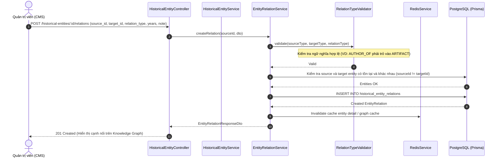
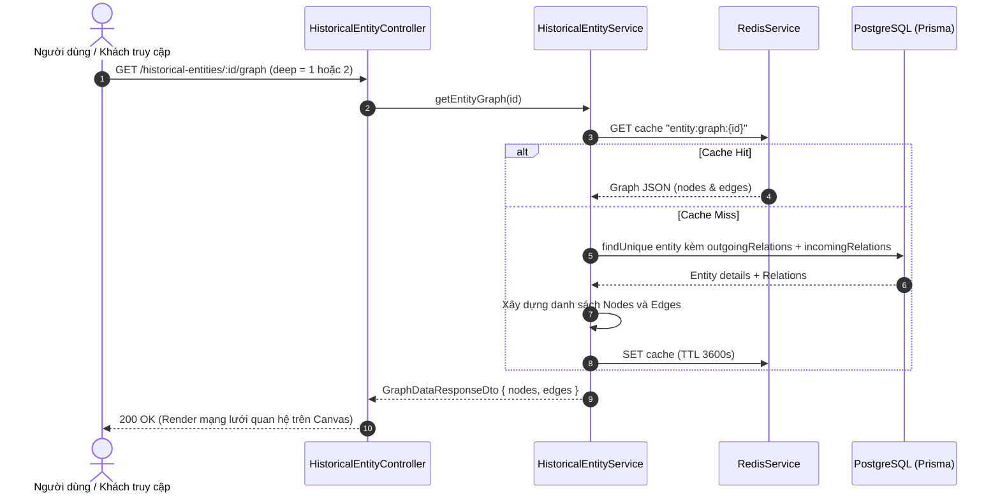

# Phase 2 — Module `HistoricalEntity` & Mạng Lưới Quan Hệ Hồi Quy `EntityRelation`

## 1. Mục tiêu kiến trúc
1. Nâng cấp bảng Master Data `historical_entities` chuẩn hóa theo dữ liệu thực tế (hỗ trợ `aliases`, `birthDateLabel`, `deathDateLabel`, `imageCaption`, `metadata JsonB`, `media`).
2. Xây dựng mô hình quan hệ đồ thị tri thức (Knowledge Graph) hồi quy chính nó $N-N$ qua bảng `historical_entity_relations`:
   - `id`: UUID (PK)
   - `source_entity_id`: UUID (FK $\rightarrow$ `historical_entities.id`), chủ thể phát sinh quan hệ.
   - `target_entity_id`: UUID (FK $\rightarrow$ `historical_entities.id`), đối tượng nhận quan hệ.
   - `relation_type`: `VARCHAR(50)`, quản lý bằng Enum ở backend (không magic string) theo chuẩn OCP: `LEADER_OF`, `MEMBER_OF`, `FOUNDER_OF`, `HOUSED_AT`, `AUTHOR_OF`, `LOCATED_IN`, `ALLIED_WITH`, `OPPOSED_TO`, `CHILD_OF`, `SPOUSE_OF`, `SUCCESSOR_TO`, `OTHER`...
   - `start_year`: `INT?` (năm bắt đầu trị vì / công tác / sở hữu)
   - `end_year`: `INT?` (năm kết thúc)
   - `note`: `TEXT?` (ngữ cảnh bổ sung)
   - `created_at`: `DateTime`
3. Cung cấp bảng tài liệu đa phương tiện `historical_entity_media` tương tự `HistoricalEventMedia`.
4. Áp dụng nghiêm ngặt các nguyên tắc SOLID, Strategy Pattern cho validation quan hệ và hiển thị ngữ nghĩa, không magic string.

---

## 2. Thiết kế Schema Prisma (`backend/prisma/schema/historicalEntity.prisma`)

```prisma
// ================================
// Historical Entity (Master Data: Person, Organization, Dynasty, Military Force, Artifact)
// ================================

model HistoricalEntity {
    id             String               @id @default(uuid())
    periodId       String?              @map("period_id")
    name           String               @db.VarChar(255)
    slug           String               @unique @db.VarChar(255)
    type           HistoricalEntityType @default(PERSON)
    tagline        String?              @db.VarChar(255)
    description    String?              @db.Text
    aliases        String[]             @default([])
    imageUrl       String?              @map("image_url") @db.VarChar(500)
    imageCaption   String?              @map("image_caption") @db.VarChar(255)
    birthYear      Int?                 @map("birth_year")
    deathYear      Int?                 @map("death_year")
    birthDateLabel String?              @map("birth_date_label") @db.VarChar(100)
    deathDateLabel String?              @map("death_date_label") @db.VarChar(100)
    metadata       Json?                @db.JsonB
    isFeatured     Boolean              @default(false) @map("is_featured")
    displayOrder   Int                  @default(0) @map("display_order")
    status         ContentStatus        @default(DRAFT)
    createdAt      DateTime             @default(now()) @map("created_at")
    updatedAt      DateTime             @updatedAt @map("updated_at")

    // Relations
    period         Period?                 @relation(fields: [periodId], references: [id], onDelete: SetNull)
    eventEntities  HistoricalEventEntity[]
    lessonEntities LessonEntity[]
    media          HistoricalEntityMedia[]

    // Quan hệ hồi quy N-N đồ thị tri thức (Source & Target)
    outgoingRelations HistoricalEntityRelation[] @relation("SourceEntityRelation")
    incomingRelations HistoricalEntityRelation[] @relation("TargetEntityRelation")

    @@index([periodId])
    @@index([status, type, isFeatured, displayOrder])
    @@map("historical_entities")
}

// Bảng quan hệ hồi quy N-N giữa các thực thể lịch sử (Knowledge Graph)
model HistoricalEntityRelation {
    id             String   @id @default(uuid())
    sourceEntityId String   @map("source_entity_id")
    targetEntityId String   @map("target_entity_id")
    relationType   String   @map("relation_type") @db.VarChar(50)
    startYear      Int?     @map("start_year")
    endYear        Int?     @map("end_year")
    note           String?  @db.Text
    createdAt      DateTime @default(now()) @map("created_at")

    // Relations
    sourceEntity HistoricalEntity @relation("SourceEntityRelation", fields: [sourceEntityId], references: [id], onDelete: Cascade)
    targetEntity HistoricalEntity @relation("TargetEntityRelation", fields: [targetEntityId], references: [id], onDelete: Cascade)

    @@index([sourceEntityId, targetEntityId, relationType])
    @@index([sourceEntityId])
    @@index([targetEntityId])
    @@index([relationType])
    @@map("historical_entity_relations")
}

// Bảng tư liệu đa phương tiện (ảnh, video, văn kiện, tài liệu pdf)
model HistoricalEntityMedia {
    id           String    @id @default(uuid())
    entityId     String    @map("entity_id")
    type         MediaType @default(IMAGE)
    url          String    @db.VarChar(500)
    caption      String?   @db.VarChar(255)
    displayOrder Int       @default(0) @map("display_order")
    createdAt    DateTime  @default(now()) @map("created_at")

    // Relations
    entity HistoricalEntity @relation(fields: [entityId], references: [id], onDelete: Cascade)

    @@index([entityId])
    @@index([displayOrder])
    @@map("historical_entity_media")
}
```

---

## 3. Sequence Diagram — Luồng Quản Lý Quan Hệ Hồi Quy Thực Thể (CRUD Graph Edge)



---

## 4. Sequence Diagram — Luồng Truy Vấn Đồ Thị Thực Thể (Knowledge Graph Query)


