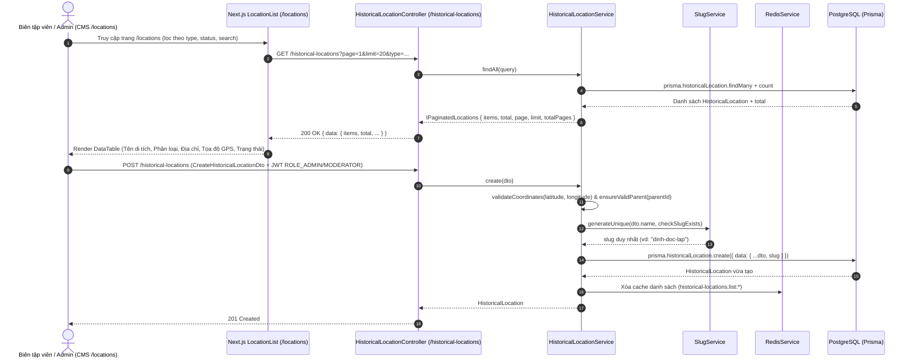

# Sequence Diagram — Phase 3: Địa danh & Di tích lịch sử (`HistoricalLocation` Module)

## 1. Bối cảnh & Mục tiêu (Phase 3)
Dựa trên tài liệu kiến trúc tổng thể (`docs/universal-history-knowledge-architecture.md`) và giao diện CMS Quản lý Địa danh (`/locations` — `frontend/src/features/locations/components/LocationList.tsx`):
- **CMS `/locations`**: Đang gọi `GET /historical-locations` và hiển thị bảng danh sách địa danh/di tích lịch sử gồm các trường: `id`, `name`, `type` (`BATTLEFIELD`, `MONUMENT`, `ANCIENT_CAPITAL`, `CITADEL`, `TEMPLE`, `OTHER`), `address`, `latitude`, `longitude`, `historicalSignificance`, `status`, `updatedAt`.
- **Kiến trúc dữ liệu nền tảng (`universal-history-knowledge-architecture.md`)**:
  - Địa danh (`HistoricalLocation`) là **Master Data dùng chung** cho nhiều Sự kiện (`HistoricalEvent`) và Bài học (`Lesson`), có tọa độ GPS (`latitude`, `longitude`) phục vụ Bản đồ lịch sử tương tác và hỗ trợ phân cấp địa lý (`parentId`: Tỉnh/Vùng -> Thành phố -> Di tích cụ thể) cùng danh sách tên gọi lịch sử qua các thời kỳ (`historicalNames: String[]`).

## 2. Thiết kế Schema & Áp dụng SOLID / Design Patterns
- **Prisma Model `HistoricalLocation`** (`backend/prisma/schema/historicalLocation.prisma`):
  - `id` (UUID), `parentId` (tự tham chiếu phân cấp địa lý tùy chọn), `name`, `slug` (`@unique`), `historicalNames` (`String[]`), `type` (`HistoricalLocationType` enum), `address`, `latitude` (`Float?`), `longitude` (`Float?`), `historicalSignificance` (`@db.Text`), `description` (`@db.Text`), `imageUrl`, `status` (`ContentStatus`), `createdAt`, `updatedAt`.
- **Nguyên tắc SOLID & Design Patterns**:
  - **Single Responsibility Principle (SRP)**:
    - `HistoricalLocationService`: Chịu trách nhiệm xác thực nghiệp vụ tọa độ GPS (`-90 <= latitude <= 90`, `-180 <= longitude <= 180`), kiểm tra phân cấp `parentId` chống vòng lặp tự tham chiếu, sinh `slug` duy nhất qua `SlugService` và quản lý cache Redis (`historical-locations:*`).
  - **Open/Closed Principle (OCP)**:
    - Phân loại địa danh dùng enum `HistoricalLocationType` đồng bộ tuyệt đối giữa Prisma, NestJS DTO và Frontend `LocationType`, không dùng magic string.

## 3. Sequence Diagram

### 3.1. Luồng CMS quản lý Địa danh & Di tích (`/historical-locations`)

