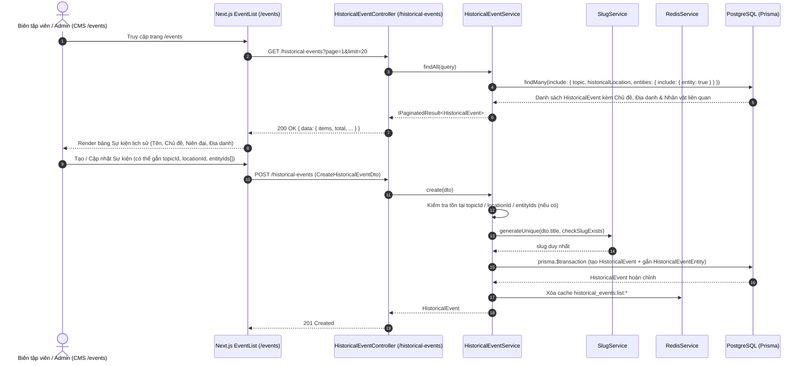

# Sequence Diagram — Phase 4: Nâng cấp `HistoricalEvent` thành Master Data & Mạng lưới liên kết Tri thức (Knowledge Graph)

## 1. Bối cảnh & Mục tiêu (Phase 4)
Theo tài liệu kiến trúc tổng thể (`docs/universal-history-knowledge-architecture.md`) và bảng phân tích khoảng trống (`gap-analysis.md`):
- **Hạn chế của `HistoricalEvent` hiện tại**:
  1. Trường `topicId` đang bắt buộc (`NOT NULL`) và đặt `onDelete: Cascade`: khi xóa một Chủ đề (`Topic`), toàn bộ Sự kiện lịch sử gắn với chủ đề đó sẽ bị xóa mất; đồng thời khi tạo sự kiện mới từ giao diện CMS `/events` (`EventList.tsx` không bắt buộc gửi `topicId`), API đang trả lỗi `400 Bad Request`.
  2. Chưa có `slug` (`@unique`), `endYear`, `status` (`ContentStatus`), `locationId` (liên kết khóa ngoại tới `HistoricalLocation`) và chưa có các bảng nối nhiều-nhiều (**Knowledge Graph**):
     - Sự kiện ↔ Thực thể lịch sử (`HistoricalEventEntity`: Nhân vật, Lực lượng, Hiện vật tham gia sự kiện với vai trò cụ thể `role`).
     - Bài học ↔ Sự kiện / Thực thể / Địa danh (`LessonEvent`, `LessonEntity`, `LessonLocation`): cho phép một Bài học tái sử dụng nhiều Sự kiện, Nhân vật, Hiện vật và Địa danh dùng chung.

## 2. Thiết kế Schema & Áp dụng SOLID / Design Patterns
- **Nâng cấp `HistoricalEvent`** (`backend/prisma/schema/historicalEvent.prisma`):
  - Chuyển `topicId` thành tùy chọn (`String?`, `onDelete: SetNull`).
  - Bổ sung `periodId` (`String?`), `locationId` (`String?`, tham chiếu `HistoricalLocation`), `slug` (`@unique`), `endYear` (`Int?`), `status` (`ContentStatus @default(PUBLISHED)`).
- **3 Bảng liên kết Tri thức (Knowledge Graph Junction Tables)**:
  - `HistoricalEventEntity` (`event_id`, `entity_id`, `role?`): Liên kết Sự kiện ↔ Nhân vật / Lực lượng / Hiện vật.
  - `LessonEntity` (`lesson_id`, `entity_id`, `role?`): Liên kết Bài học ↔ Nhân vật / Lực lượng / Hiện vật.
  - `LessonEvent` (`lesson_id`, `event_id`): Liên kết Bài học ↔ Sự kiện.
  - `LessonLocation` (`lesson_id`, `location_id`): Liên kết Bài học ↔ Địa danh.
- **Nguyên tắc SOLID & Design Patterns**:
  - **Single Responsibility Principle (SRP)**: Tách logic đồng bộ liên kết nhiều-nhiều (`entityIds`, `locationId`) của `HistoricalEvent` vào phương thức giao dịch (`prisma.$transaction`) nguyên tử.
  - **Adapter / Backward Compatibility**: Trong `EventList.tsx` (CMS `/events`), sử dụng `parsePaginatedResponse` để giải nén chuẩn `{ statusCode, data: { items } }` từ `TransformInterceptor`, đồng thời hiển thị tên địa danh từ `event.historicalLocation?.name || event.location`.

## 3. Sequence Diagram

