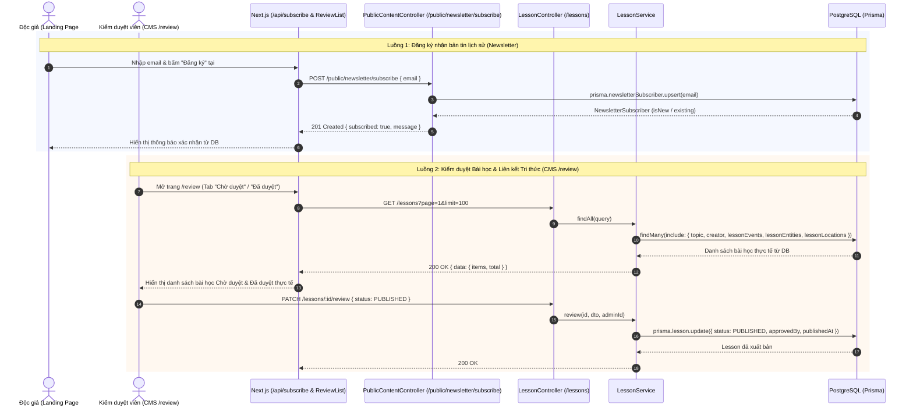

# Sequence Diagram — Phase 5 & 6: Liên kết Bài học ↔ Kho Tri thức (Lesson Knowledge Graph), Kiểm duyệt bài học (`/review`) & Đăng ký nhận tin (`NewsletterSubscriber`)

## 1. Bối cảnh & Mục tiêu
Đây là chặng hoàn thiện cuối cùng trong lộ trình kết nối toàn diện giữa **Landing Page + CMS** và **Cơ sở dữ liệu**:
1. **Liên kết Bài học (`Lesson`) với Kho Tri thức dùng chung (`LessonEvent`, `LessonEntity`, `LessonLocation`)**:
   - Cho phép khi Tạo mới (`POST /lessons`) hoặc Cập nhật (`PATCH /lessons/:id`) một Bài học trong bất kỳ Chuyên đề nào, tác giả có thể đính kèm danh sách `eventIds`, `entityIds`, `locationIds` từ Kho dữ liệu lịch sử dùng chung.
   - Khi xem chi tiết hoặc lấy danh sách bài học (`GET /lessons`, `GET /lessons/:id`), API trả về đầy đủ các Sự kiện, Nhân vật/Hiện vật và Địa danh liên kết với bài học đó.
2. **Kiểm duyệt Bài học (`CMS /review` — `ReviewList.tsx`)**:
   - Hiện tại `ReviewList.tsx` chưa dùng `parsePaginatedResponse` nên không đọc được `res.data.data.items` từ `GET /lessons` mà rơi về `DEFAULT_REVIEW_LESSONS`.
   - Cần cập nhật `ReviewList.tsx` dùng `parsePaginatedResponse` và bổ sung 1 bài học ở trạng thái `PENDING_REVIEW` trong `seed.ts` để luồng kiểm duyệt (`Chờ duyệt` -> `Đã duyệt` / `Bị từ chối`) hoạt động với dữ liệu thực.
3. **Đăng ký Bản tin Lịch sử (`NewsletterSubscriber` — Section `#dang-ky` trên Landing Page)**:
   - Hiện tại `/api/subscribe` trên Next.js chỉ lưu vào `Set` trong RAM (`subscribedEmails`), mất sạch khi khởi động lại server.
   - Cần bổ sung bảng `NewsletterSubscriber` (`newsletter_subscribers`) trong Prisma và endpoint `POST /public/newsletter/subscribe` ở Backend để lưu trữ bền vững vào PostgreSQL, chống trùng lặp (idempotent) và kết nối trực tiếp với route `/api/subscribe`.

## 2. Sequence Diagram

