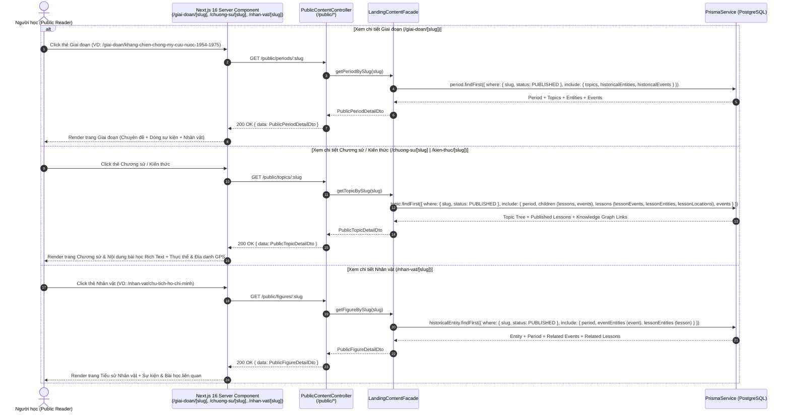

# Sequence Diagram — Phase 7: Public Detail Pages by Slug & Knowledge Graph Reader

Tài liệu đặc tả luồng truy xuất chi tiết cho các trang Công khai (Public Detail Pages) khi người dùng bấm vào các thẻ trên trang chủ HisGo:
- **Giai đoạn lịch sử**: `/giai-doan/[slug]` (`GET /public/periods/:slug`)
- **Chương sử đáng nhớ & Chủ đề kiến thức**: `/chuong-su/[slug]` và `/kien-thuc/[slug]` (`GET /public/topics/:slug`)
- **Nhân vật lịch sử tiêu biểu**: `/nhan-vat/[slug]` (`GET /public/figures/:slug`)

---

## 1. Kiến trúc & Design Patterns áp dụng
- **Facade Pattern (`LandingContentFacade`)**: Mở rộng điểm vào duy nhất của module `PublicContentModule` với 3 phương thức truy xuất chi tiết theo `slug`:
  - `getPeriodBySlug(slug: string)`
  - `getTopicBySlug(slug: string)`
  - `getFigureBySlug(slug: string)`
- **Mapper Pattern (`PublicContentMapper`)**: Chuẩn hóa toàn bộ dữ liệu trả về sang DTO công khai (ẩn các trường nội bộ như `status`, `createdBy`, `approvedBy`, `rejectionReason`), đồng thời tính toán thời lượng đọc bài học (`estimatedReadMinutes`) và định dạng niên đại (`timeLabel`).
- **2-Tier Knowledge Graph Traversal**:
  - Trang chi tiết **Giai đoạn (`/giai-doan/[slug]`)** trả về: thông tin giai đoạn + danh sách Chương sử/Chủ đề con (`topics`) + các Sự kiện tiêu biểu (`events`) + các Nhân vật tiêu biểu thuộc giai đoạn (`figures`).
  - Trang chi tiết **Chương sử / Kiến thức (`/chuong-su/[slug]`, `/kien-thuc/[slug]`)** trả về: thông tin chủ đề + các chuyên đề con (`children`) + các Sự kiện lịch sử (`events`) + toàn bộ Bài học đã xuất bản (`lessons` có nội dung Rich Text, thực thể liên quan, địa danh GPS liên quan).
  - Trang chi tiết **Nhân vật (`/nhan-vat/[slug]`)** trả về: tiểu sử nhân vật + giai đoạn (`period`) + các Sự kiện nhân vật tham gia (`events` kèm `role`) + các Bài học liên quan (`lessons`).

---

## 2. Sequence Diagram — Luồng xem chi tiết Giai đoạn, Chương sử, Nhân vật

