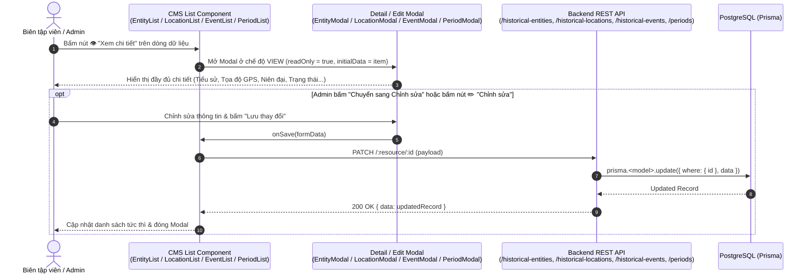

# Sequence Diagram — CMS Detail View & Edit Modals (`/entities`, `/locations`, `/events`, `/periods`, `/lessons`)

Tài liệu đặc tả luồng **Xem chi tiết (View Detail)** và **Chỉnh sửa / Thêm mới / Xóa (CRUD)** trực tiếp trên toàn bộ các trang Quản trị CMS của HisGo.

---

## 1. Kiến trúc & Design Patterns áp dụng
- **Modal View/Edit State Pattern**:
  - Mỗi phân hệ CMS (`EntityList`, `LocationList`, `EventList`, `PeriodList`) hỗ trợ đầy đủ 3 thao tác trên từng dòng dữ liệu (`DataTable` / `ActionMenu`):
    1. **👁 Xem chi tiết (`onView`)**: Mở Modal xem chi tiết đầy đủ mọi trường thông tin (Tiểu sử, Niên đại, Phân loại, Tọa độ GPS, Tên gọi lịch sử qua các thời kỳ, Trạng thái xuất bản...) và có nút **"Chỉnh sửa ngay"** chuyển thẳng sang chế độ Edit.
    2. **✏️ Chỉnh sửa (`onEdit`)**: Mở Modal Form điền sẵn dữ liệu hiện tại (`initialData`), gửi `PATCH /historical-entities/:id`, `PATCH /historical-locations/:id`, `PATCH /historical-events/:id`, hoặc `PATCH /periods/:id`.
    3. **🗑 Xóa (`onDelete`)**: Mở `ConfirmDeleteModal` xác nhận trước khi gọi `DELETE`.
- **Đối với Bài học (`LessonList`)**:
  - Bấm **👁 Xem chi tiết (`onView`)** hoặc **✏️ Chỉnh sửa (`onEdit`)** điều hướng tới trình soạn thảo chuyên sâu `/lessons/create?id=:id` (hỗ trợ cả chế độ **Xem trước Wiki** và **Soạn thảo Rich Text**).

---

## 2. Sequence Diagram — Luồng Xem chi tiết & Chỉnh sửa trong CMS

