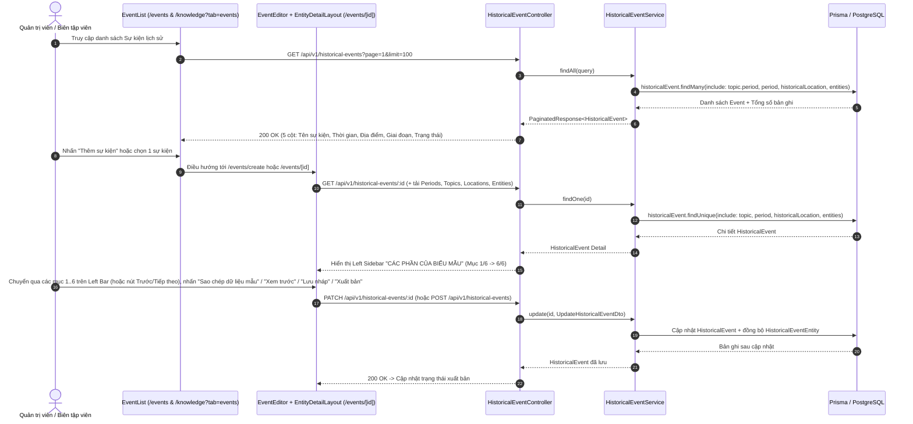

# Sequence Diagram: Quản lý chi tiết Sự kiện lịch sử (Event CMS & EntityDetailLayout)

## 1. Kiến trúc & Design Patterns áp dụng
- **Composite / Stepper Layout Pattern (`EntityDetailLayout`)**:
  - Đóng gói khung giao diện dùng chung cho các thực thể thuộc **Từ điển Tri thức** (`Sự kiện`, `Nhân vật`, `Địa danh & Di tích`, `Triều đại / Tổ chức`, `Thẻ phân loại`), bám sát thiết kế chuẩn trong `abc.png`:
  - **Top Action Header**:
    - `Breadcrumb`: `CMS / Từ điển tri thức / Sự kiện / Chỉnh sửa`
    - `Tiêu đề`: `Chỉnh sửa sự kiện` / `Tạo sự kiện mới` + Badge trạng thái (`Bản nháp`, `Chờ kiểm duyệt`, `Đã xuất bản`)
    - `Action Buttons`: `Xem trước`, `Sao chép dữ liệu mẫu`, `Lưu nháp`, `✓ Xuất bản`
  - **Left Sidebar Navigation (`CÁC PHẦN CỦA BIỂU MẪU`) + Main Step Panel**:
    - Đặt thanh điều hướng dọc bên trái (`Left Sidebar` sticky) gồm **6 mục biểu mẫu** (có thể bấm chuyển trực tiếp từng mục hoặc dùng nút `← Trước` / `Tiếp theo →` ở đáy):
      1. `1. Thông tin cơ bản` (Tên sự kiện, ảnh đại diện `TopicCoverImagePicker`, `Tóm tắt ngắn` `summary` 2-3 dòng cho card/preview)
      2. `2. Thời gian & địa điểm`:
         - **A. Bộ chọn kiểu mốc ngắn gọn (Segmented Control / Switch)**: `[ Một thời điểm ]` | `[ Khoảng thời gian ]` (không kèm thuyết minh rườm rà).
         - **B. Gộp Ngày - Tháng - Năm vào một ô linh hoạt (Flexible Date Input)**:
           - **Mốc bắt đầu**: 1 ô nhập duy nhất theo cú pháp `DD/MM/YYYY`, `MM/YYYY` hoặc `YYYY` (ví dụ: `19/05/1959` hoặc `1959`), đi kèm checkbox nhỏ `[ ] Trước CN (TCN)`.
           - **Mốc kết thúc (nếu chọn Khoảng thời gian)**: 1 ô nhập `DD/MM/YYYY` hoặc `YYYY`, đi kèm checkbox `[ ] TCN`.
         - **C. Thời gian hiển thị (tự động tạo)**: Tự động ghép chuỗi từ mốc thời gian đã nhập và khóa mặc định (`readOnly`), kèm nút `[Tùy chỉnh]` để mở sửa tay khi cần ghi chú ước lượng (ví dụ: `"Khoảng thế kỷ III TCN"`, `"Mùa xuân năm 1789"`).
         - **Địa điểm**: Liên kết Địa danh & Di tích (`locationId`) và nhãn vị trí (`location`).
      3. `3. Nội dung lịch sử` (**Lựa chọn B: Gom thành Tab trên 1 khung Editor duy nhất**):
         - **Bên trên**: 1 ô `Tóm tắt ngắn` (`summary`, textarea 2-3 dòng luôn hiển thị).
         - **Bên dưới**: 1 khung Rich Text Editor (`TipTapContent`) duy nhất tích hợp thanh Tab chuyển đổi ngay phía trên Toolbar:
           - `[ Bối cảnh & Nguyên nhân ]` | `[ Diễn biến chi tiết (Chính) ]` | `[ Kết quả & Ý nghĩa ]`
           - Ngay dưới thanh Tab là `[Toolbar: Format | B I U | •≡ 1. ❝ | 🔗 🖼 +]` chuẩn `tmp.png` và vùng soạn thảo hiển thị nội dung của tab đang chọn (`cause` / `description` / `outcome`).
      4. `4. Quan hệ tri thức` (**Chuẩn UI 100% theo `abc.png` & `xyz.png` — KnowledgeRelationManager**):
         - **Giao diện bảng danh sách liên kết tri thức (`abc.png`)**:
           - Header: Tiêu đề `4. Quan hệ tri thức`, subtitle `Liên kết sự kiện với thời kỳ, chủ đề, nhân vật, địa danh và hiện vật liên quan`, nút `+ Thêm liên kết`.
           - Thanh phân loại Pill Tabs: `[ Tất cả ]` | `[ Sự kiện ]` | `[ Thời kỳ ]` | `[ Nhân vật ]` | `[ Địa điểm ]` | `[ Chủ đề ]` | `[ Lực lượng ]` | `[ Hiện vật ]`.
           - Bảng 3 cột:
             1. `STT` (Đánh số thứ tự tăng dần).
             2. `Thực thể liên kết` (Tên thực thể, badge loại thực thể kèm màu đặc trưng, subtitle/tagline ngữ cảnh).
             3. `Thao tác` (Nút chi tiết thông tin `(i)` và nút xóa liên kết dạng icon thùng rác).
           - Footer: Tổng số liên kết (`Tổng số: X liên kết`), nút `+ Thêm mục khác`, dòng hướng dẫn lưu ý dữ liệu.
         - **Hộp thoại Modal "Thêm liên kết tri thức" (`xyz.png`)**:
           - Bấm `+ Thêm liên kết` hoặc `+ Thêm mục khác` mở Modal popup tối giản, không chiếm trang.
           - Hàng Pill Tabs lọc nhanh danh mục cần tìm (`Tất cả`, `Sự kiện`, `Thời kỳ`, `Nhân vật`, `Địa điểm`, `Chủ đề`, `Lực lượng`, `Hiện vật`).
           - Ô tìm kiếm thời gian thực: `🔍 Nhập tên sự kiện, nhân vật, địa điểm...` tự động lọc tức thì.
           - Danh sách các mục ứng viên: Checkbox tròn nhiều lựa chọn, tên, subtitle mô tả, badge danh mục.
           - Footer Modal: Đếm số lượng đã chọn (`Đã chọn: X`), nút `Hủy` và nút hành động nổi bật `Gắn vào sự kiện (+X)`.
      5. `5. Tài liệu` (Ảnh đại diện/tư liệu `thumbnailUrl`, Nguồn sử liệu tham khảo & chú thích xuất xứ `sourceReferenceNote`)
      6. `6. Kiểm duyệt & xuất bản` (Checklist kiểm tra dữ liệu: Tên sự kiện, Niên đại, Mô tả, Nguồn và quan hệ; Radio chọn trạng thái `Bản nháp` / `Chờ kiểm duyệt` / `Đã xuất bản`)
- **Strategy & Parser Pattern (`FlexibleHistoricalDateParser` / `HistoricalDateStrategy` & `ParentContextMappingStrategy`)**:
  - Phân tách chuỗi `DD/MM/YYYY`, `MM/YYYY` hoặc `YYYY` kết hợp cờ `isBce` thành `{ signedYear, month, day }` kèm kiểm tra ngày hợp lệ theo tháng/năm nhuận, đồng thời tự động sinh chuỗi `Thời gian hiển thị`.
  - Hợp nhất các mục `Thời kỳ`, `Giai đoạn`, `Chiến dịch` vào 1 danh sách phẳng có gắn nhãn loại (`badgeLabel`) và tự động phân giải ngược về `{ periodId, topicId }` khi lưu.
- **Reusable Clean Components (SOLID / SRP & OCP)**:
  - **`KnowledgeRelationManager`** (`src/components/common/KnowledgeRelationManager.tsx`): Đóng gói toàn bộ quản lý liên kết tri thức chuẩn theo `abc.png` (bảng danh sách liên kết + filter pill tabs + xóa) và `xyz.png` (modal chọn nhiều thực thể liên tiếp với searchbox và filter pills). Tự động phân loại quan hệ (`PERIOD`, `TOPIC`, `LOCATION`, `PERSON`, `FORCE`, `ARTIFACT`, `EVENT`), không đòi hỏi nhập trường "Loại quan hệ" rườm rà.
  - **`HistoricalDateRangeField`** (`src/components/common/HistoricalDateRangeField.tsx`): Đóng gói trọn vẹn 3 cụm điều khiển thời gian lịch sử (`Segmented Control [Một thời điểm | Khoảng thời gian]`, `Ô nhập linh hoạt DD/MM/YYYY hoặc YYYY + Checkbox TCN`, và `Thời gian hiển thị tự động tạo + Nút [Tùy chỉnh]`) để tái sử dụng cho `Sự kiện`, `Nhân vật` (năm sinh - năm mất), `Triều đại / Tổ chức` (năm thành lập - giải thể), và `Thời kỳ lịch sử`.
  - **`TabbedRichTextEditor`** (`src/components/common/TabbedRichTextEditor.tsx`): Đóng gói khung Rich Text Editor tích hợp thanh Tab động (`tabs: RichTextTabItem[]`) và `TipTapToolbar` chuẩn `tmp.png`, cho phép bất kỳ thực thể nào trong Từ điển Tri thức truyền danh sách các tab nội dung vào là dùng ngay, không lặp lại code UI hay state chuyển tab.
  - **`ParentContextComboboxField`** (`src/components/common/ParentContextComboboxField.tsx`): Đóng gói 1 ô Searchable Combobox duy nhất cho phép tìm và gắn `Sự kiện / giai đoạn cha` kèm badge phân loại và chip `Đã gắn vào: [ ... × ]`.
  - **`EntityAutocompleteChipsField`** (`src/components/common/EntityAutocompleteChipsField.tsx`): Đóng gói ô tìm kiếm chọn nhiều thực thể hiển thị dạng Tag Chips (`Đã chọn: [ ... × ]`), giữ dropdown mở để chọn nhiều kết quả liên tiếp với ít thao tác nhất.
  - Giữ nguyên khung danh sách chuẩn (`DataTable`), định nghĩa **5 cột đặc thù riêng của Sự kiện**:
    1. `Tên sự kiện` (Ảnh tư liệu `thumbnailUrl`, Tiêu đề, tóm tắt, nhân vật tham gia)
    2. `Thời gian` (Chuỗi hiển thị `eventDateNote` & mốc năm `eventYear` – `endYear`)
    3. `Địa điểm` (Địa danh liên kết `historicalLocation` / `location`)
    4. `Giai đoạn` (Thời kỳ lịch sử `period` / `topic.period`)
    5. `Trạng thái` (`PUBLISHED` - Đã xuất bản, `DRAFT` - Bản nháp, `PENDING_REVIEW` - Chờ duyệt)

---

## 2. Luồng Danh sách Sự kiện & Trang Chi tiết / Chỉnh sửa (`EventList` & `EventEditor`)

