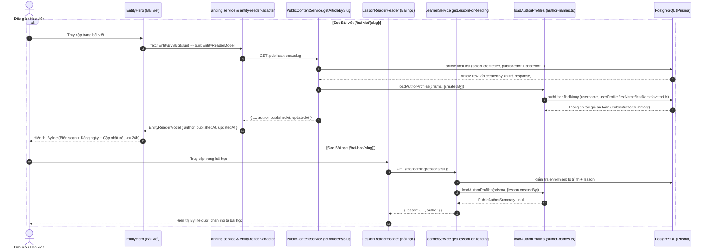

# Sequence Diagram: Hiển thị Tác giả & Thời gian đăng / cập nhật trên Bài viết & Bài học

Tài liệu mô tả luồng tải thông tin tác giả (`PublicAuthorSummary`) và mốc thời gian (`publishedAt`, `updatedAt`) cho hai trang đọc công khai: Bài viết (`/bai-viet/[slug]`) và Bài học (`/bai-hoc/[slug]`).

