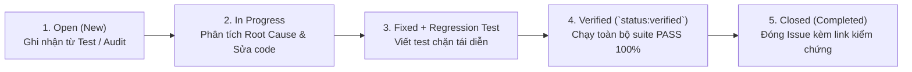

# BÁO CÁO BUG TRACKER & VÒNG ĐỜI LỖI — HISGO

> **Hệ thống quản lý lỗi chính thức:** [GitHub Issues — Nguyen-Thanh-Huy-io/TLCN-DT07](https://github.com/Nguyen-Thanh-Huy-io/TLCN-DT07/issues)  
> **Tiêu chuẩn cổng phát hành:** `0` defect mức **Blocker / Critical** còn ở trạng thái `Open`. Tracker chỉ ghi nhận các lỗi thực sự có mức độ ảnh hưởng nghiêm trọng (`Blocker` / `Critical` / `Major`).

---

## 1. Quy trình vòng đời lỗi (Defect Lifecycle)

### Quy ước nhãn (Labels) trên GitHub Issues
- `severity:blocker` — Chặn build/deploy hoặc làm sập toàn hệ thống.
- `severity:critical` — Hỏng luồng nghiệp vụ cốt lõi / mất an toàn truy cập trên luồng chính.
- `severity:major` — Ảnh hưởng vận hành hoặc độ tin cậy quy trình kiểm thử/hệ thống.
- `status:verified` — Đã khắc phục và có regression test tự động xác nhận PASS.

---

## 2. Thống kê trạng thái Defect hiện tại

| Mức độ (Severity) | Tổng ghi nhận | Đã đóng (`Closed` + Verified) | Đang mở (`Open`) | Đạt ngưỡng Gate? |
|---|---|---|---|---|
| **Blocker** | 0 | 0 | **0** | ✅ ĐẠT (`0` open) |
| **Critical** | 2 | 2 | **0** | ✅ ĐẠT (`0` open) |
| **Major** | 1 | 1 | **0** | ✅ ĐẠT (`0` open) |
| **Tổng cộng** | **3** | **3** | **0** | **PASS Gate** |

---

## 3. Danh sách Defect & Bằng chứng Regression Test

### `[BUG-001]` Flashcards: Thiếu Prisma migration cho bảng `flashcard_decks` & `flashcards` gây HTTP `500`
- **GitHub Issue:** [#3](https://github.com/Nguyen-Thanh-Huy-io/TLCN-DT07/issues/3)
- **Mức độ:** `severity:critical` · **Trạng thái:** `Closed` (`status:verified`)
- **Phát hiện tại:** Tầng API Integration E2E ([learning-tools.e2e-spec.ts](../../backend/test/learning-tools.e2e-spec.ts)) khi gọi `POST /flashcards/decks` trên database dựng mới từ `migrations/`.
- **Nguyên nhân gốc:** [flashcard.prisma](../../backend/prisma/schema/flashcard.prisma) khai báo 2 model nhưng thiếu file migration trong `backend/prisma/migrations/` (unit test trước đó mock Prisma nên không phát hiện).
- **Khắc phục:** Sinh và kiểm tra SQL tại [20261121021500_flashcards/migration.sql](../../backend/prisma/migrations/20261121021500_flashcards/migration.sql).
- **Regression Test:** `npm run test:e2e:prepare` (áp đủ `22` migrations) + [learning-tools.e2e-spec.ts](../../backend/test/learning-tools.e2e-spec.ts) (`12/12` suite E2E PASS).

---

### `[BUG-002]` Public Reader: Khách chưa đăng nhập đọc bài viết (`/bai-viet/[slug]`) bị tự động redirect sang `/login`
- **GitHub Issue:** [#4](https://github.com/Nguyen-Thanh-Huy-io/TLCN-DT07/issues/4)
- **Mức độ:** `severity:critical` · **Trạng thái:** `Closed` (`status:verified`)
- **Phát hiện tại:** Tầng Selenium E2E (`test_author_follow_unauthenticated_redirects_to_login` trong [test_smoke_journeys.py](../../frontend/tests/e2e/test_smoke_journeys.py)).
- **Nguyên nhân gốc:** [ReadingAidsPanel.tsx](../../frontend/src/features/reading-aids/components/ReadingAidsPanel.tsx) gọi `useSavedMaterialsSnapshot(Boolean(articleId))` ngay cả khi người dùng chưa đăng nhập → gửi `GET /saved-materials` nhận `401` → Axios interceptor ở [api.ts](../../frontend/src/services/api.ts) ép chuyển sang `/login`.
- **Khắc phục:** Chỉ bật `useSavedMaterialsSnapshot` khi có `sessionUser?.id` tại `ReadingAidsPanel.tsx`, đồng thời trả `EMPTY_SAVED_MATERIAL_SNAPSHOT` sớm khi không có access token tại [saved-material.service.ts](../../frontend/src/features/saved-materials/services/saved-material.service.ts).
- **Regression Test:**
  - Unit regression test trong [saved-material.normalizer.test.ts](../../frontend/tests/unit/saved-material.normalizer.test.ts) (`48/48` Vitest PASS).
  - Selenium E2E `test_author_follow_unauthenticated_redirects_to_login` (`9/9` Selenium E2E PASS).

---

### `[BUG-003]` Backend E2E: Rò rỉ kết nối Redis ở `RateLimitModule` & thiếu `app.close()` gây treo Jest
- **GitHub Issue:** [#5](https://github.com/Nguyen-Thanh-Huy-io/TLCN-DT07/issues/5)
- **Mức độ:** `severity:major` · **Trạng thái:** `Closed` (`status:verified`)
- **Phát hiện tại:** Chạy `npm run test:e2e` trong `backend/`.
- **Nguyên nhân gốc:** `ThrottlerStorageRedisService(redisClient)` không tự ngắt `Redis` client truyền từ ngoài vào; đồng thời [app.e2e-spec.ts](../../backend/test/app.e2e-spec.ts) thiếu `afterEach(() => app?.close())` và dùng timeout mặc định `5000 ms` khi khởi tạo `AppModule`.
- **Khắc phục:** Bọc bằng `OwnedThrottlerStorageRedisService` (`onModuleDestroy`) tại [rate-limit.module.ts](../../backend/src/common/modules/rate-limit.module.ts), thêm `app?.close()` tại `app.e2e-spec.ts` và `testTimeout: 60000` tại [jest-e2e.json](../../backend/test/jest-e2e.json).
- **Regression Test:** Toàn bộ `12/12` suite `npm run test:e2e` (`107/107` tests) hoàn tất trong `55.656 s`, tự thoát sạch `exit 0`.
