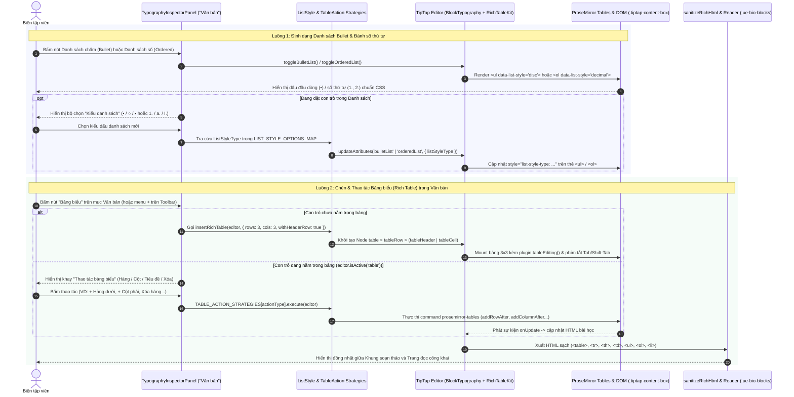

# Sequence Diagram: Danh sách (Bullet / Numbered List) & Bảng biểu (Rich Table) trong Văn bản

Tài liệu mô tả kiến trúc và luồng xử lý tính năng **Danh sách đa kiểu (Bullet & Ordered List Styles)** cùng **Bảng biểu trực tiếp trong Văn bản (Rich Text Table)** cho trình soạn thảo Bài học & Khảo cứu lịch sử:

1. **Khôi phục & Mở rộng Danh sách (`bulletList` / `orderedList`)**:
   - Khắc phục triệt để việc Tailwind CSS v4 Preflight reset `ul, ol { list-style: none; padding: 0 }` khiến văn bản không hiện dấu chấm đầu dòng (`•`) hoặc số thứ tự (`1., 2.`) trong `.tiptap-content-box` và `.ue-bio-blocks`.
   - Mở rộng `BlockTypographyExtension` hỗ trợ thuộc tính `listStyleType` trên `bulletList` (`disc`, `circle`, `square`) và `orderedList` (`decimal`, `lower-alpha`, `upper-roman`) thông qua bảng chọn **Kiểu danh sách** trên `TypographyInspectorPanel`.
2. **Kiến trúc Bảng biểu Rich Text (`RichTableExtensionKit` & `TableActionStrategy`)**:
   - Xây dựng bộ Node `RichTableNode` (`table`), `RichTableRowNode` (`tableRow`), `RichTableHeaderNode` (`tableHeader`), `RichTableCellNode` (`tableCell`) trên nền `@tiptap/core` và `@tiptap/pm/tables` (`prosemirror-tables`).
   - Áp dụng **Strategy / Command Pattern** (`TableActionType` enum + `TABLE_ACTION_STRATEGIES`) để thực thi các thao tác chèn bảng, thêm/xóa hàng, thêm/xóa cột, chuyển đổi dòng tiêu đề và xóa bảng mà không dùng chuỗi cứng (No Magic Strings) hay câu lệnh rẽ nhánh phức tạp (Tuân thủ SOLID / OCP).

