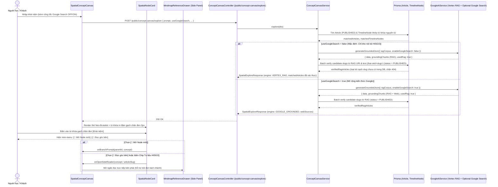
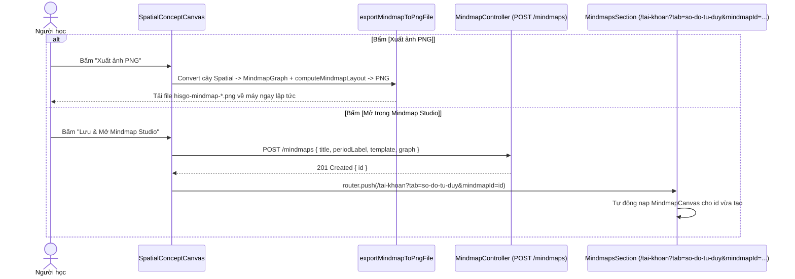

# Sequence Diagram — Interactive Spatial Concept Canvas (HISGO v2)

## 1. Khám phá khái niệm (Mặc định Kho nội bộ HISGO RAG vs. Bật mở rộng Google Search)

## 2. Xuất ảnh PNG tại chỗ & Lưu mở thẳng trong Mindmap Studio

