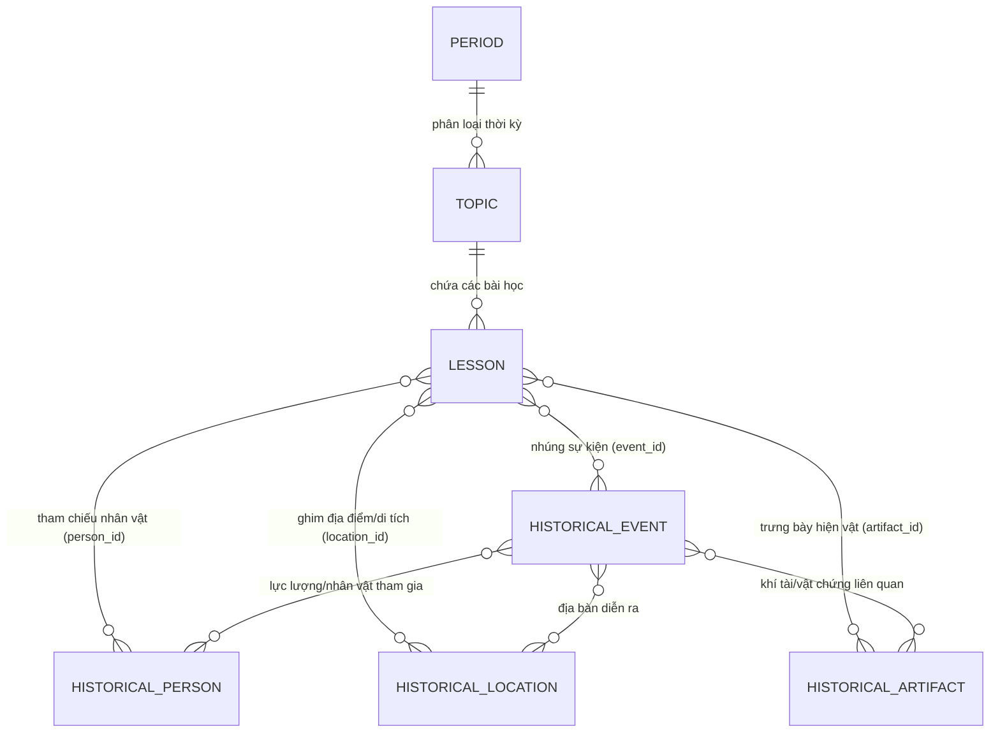

# KIẾN TRÚC HỆ THỐNG QUẢN LÝ TRI THỨC VÀ BIÊN SOẠN BÀI HỌC LỊCH SỬ TOÀN DIỆN
## (Universal History CMS & Knowledge Architecture)

> **Phạm vi áp dụng:** Lịch sử Toàn cầu (Thế giới), Lịch sử Khu vực & Nền văn minh, Lịch sử Quốc gia (Việt Nam, các nước) và Lịch sử Địa phương / Di sản.

---

## 1. TỔNG QUAN VÀ TRIẾT LÝ THIẾT KẾ (DESIGN PHILOSOPHY)

Lịch sử không đơn thuần là những trang văn bản phẳng. Lịch sử là một **Đồ thị Tri thức Đa chiều (Multi-dimensional Knowledge Graph)** giao thoa giữa:
1. **Trục Thời gian (Niên đại học - Chronology):** Từ Tiền sử, Cổ đại, Trung đại, Cận đại đến Hiện đại (BCE / CE).
2. **Trục Không gian (Địa lý Lịch sử - Historical Geography):** Từ cấp Toàn cầu, Châu lục, Nền văn minh, Quốc gia đến Tỉnh/Thành phố/Địa phương.
3. **Trục Thực thể (Con người & Sự vật - Entities):** Nhân vật, Sự kiện, Hiện vật/Khí tài, Di tích, Học thuyết.

Hệ thống được tổ chức theo **Mô hình 3 Lớp Kiến trúc (3-Layer Architecture)**:
* **Lớp 1: Mẫu bài học (Lesson Templates):** Định hướng khung bài (Chiến dịch/Chiến trận, Danh nhân, Nền văn minh/Triều đại, Di sản/Khảo cổ, Bài học tự do).
* **Lớp 2: Khối nội dung soạn thảo (Content Blocks):** Các thành phần giao diện động được nhúng vào bài học (đã tinh gọn tối đa, loại bỏ trùng lặp).
* **Lớp 3: Tầng Dữ liệu Tri thức Nguồn (Master Knowledge Graph):** Các thực thể lá được quản lý độc lập, chuẩn hóa và tái sử dụng đa bài học.

---

## 2. TRỤC TỌA ĐỘ PHÂN LOẠI TOÀN CẦU (SPATIAL & TEMPORAL TAXONOMY)

### 2.1. Phân loại Không gian (Spatial Scope)
* **Toàn cầu (Global):** Các sự kiện có tính chất bao trùm nhân loại (Thế chiến I & II, Đại dịch Cái chết Đen, Cách mạng Công nghiệp, Chiến tranh Lạnh).
* **Khu vực / Nền văn minh (Civilization / Regional):** Lưỡng Hà, Ai Cập, Hy Lạp - La Mã, Đông Á, Đông Nam Á, Maya/Inca, Châu Âu Phục Hưng...
* **Quốc gia (National):** Lịch sử Việt Nam, Lịch sử Pháp, Lịch sử Mỹ, Lịch sử Trung Hoa, Lịch sử Nhật Bản...
* **Địa phương & Vùng miền (Local / Sub-national):** 
  * Vùng miền: Nam Bộ, Bắc Bộ, Tây Nguyên, Xứ Đoài...
  * Tỉnh / Thành phố: Thăng Long - Hà Nội, Gia Định - Sài Gòn, Cố đô Huế...
  * Địa danh cụ thể: Di chỉ Óc Eo, Quần thể Angkor, Đồi A1, Căn cứ Địa đạo Củ Chi...

### 2.2. Phân loại Thời gian (Temporal Era)
* **Tiền sử & Khảo cổ (Prehistory):** Đồ đá, Đồ đồng, Văn hóa Đông Sơn, Cung điện Knossos...
* **Thời kỳ Cổ đại (Ancient Era):** Lưỡng Hà, Ai Cập Pharaoh, Hy Lạp cổ đại, Văn Lang - Âu Lạc, Nhà Tần - Hán...
* **Thời kỳ Trung đại / Phong kiến (Medieval / Feudal Era):** Châu Âu phong kiến, Các triều đại Lý - Trần - Lê, Thời kỳ Phục hưng, Đế quốc Ottoman...
* **Thời kỳ Cận đại (Early Modern & Modern Era):** Kỷ nguyên Khai sáng, Chủ nghĩa thực dân, Cách mạng Pháp 1789, Phong trào Cần Vương...
* **Thời kỳ Hiện đại (Contemporary Era):** Kháng chiến chống Pháp - Mỹ, Chiến tranh Lạnh, Toàn cầu hóa, Kỷ nguyên số...

---

## 3. DANH MỤC CÁC KHỐI NỘI DUNG BIÊN SOẠN (CONTENT BLOCKS - ĐÃ TINH GỌN)

Triết lý: **Ít khối hơn nhưng mỗi khối thông minh và đa năng hơn.** Loại bỏ các khối phân mảnh, tích hợp tính năng đồng đại và địa phương học trực tiếp vào các khối cốt lõi.

### 3.1. Nhóm 1: Nội dung Cơ bản (4 khối phổ quát)
| Khối | Mục đích & Ngữ cảnh | Thuộc tính chính | Cách hiển thị & Tính năng |
| :--- | :--- | :--- | :--- |
| **1. VĂN BẢN (Text)** | Diễn giải diễn biến, phân tích sử liệu, bối cảnh | `content` (Rich Text), `heading_level` (H1, H2, H3, P) | Soạn thảo rich-text trực tiếp |
| **2. HÌNH ẢNH (Image)** | Trưng bày ảnh tư liệu, bản chụp văn kiện, ảnh hiện vật | `src`, `alt`, `caption`, `mediaId` | Tải ảnh lên (≤10MB), nhập URL, chọn từ Thư viện Media, nút thêm khối bên dưới |
| **3. VIDEO (Video)** | Thước phim tài liệu, bài giảng, mô phỏng diễn biến | `sourceType` (Upload, URL, Embed), `src`, `caption` | Tabs chọn Upload/URL/Embed, xem trước video player, nút thêm khối bên dưới |
| **4. TÀI LIỆU & NGUỒN (References)** | Trích dẫn nguồn sử liệu, sách nghiên cứu, kỷ yếu lưu trữ | `resources[]`: `id`, `title`, `citation`, `url` | Khung trích dẫn nguồn chuẩn khoa học ở chân bài |

### 3.2. Nhóm 2: Khối Chuyên biệt Lịch sử (7 khối cốt lõi)
| Khối | Vai trò & Giá trị giáo dục | Thuộc tính dữ liệu | Điểm cải tiến & Tích hợp (Không trùng lặp) |
| :--- | :--- | :--- | :--- |
| **1. DÒNG THỜI GIAN (Timeline)** | Trực quan hóa tiến trình thời gian từ mở đầu đến kết thúc | `mode`: `SINGLE` \| `PARALLEL`, `items[]`: `date`, `title`, `desc`, `world_context?` | **Tích hợp tính năng Niên đại Đồng đại**: Hỗ trợ chuyển đổi giữa mốc đơn tuyến và mốc song song (Việt Nam vs Thế giới) trong cùng 1 khối! |
| **2. BẢN ĐỒ LỊCH SỬ (Map)** | Định vị địa bàn tác chiến, di tích lịch sử và địa phương học | `markers[]`: `location_id`, `coordinates`, `site_name`, `address`, `heritage_rank` | **Tích hợp Địa phương học & Di tích**: Ghim vị trí tọa độ, hiển thị địa chỉ thực tế và cấp xếp hạng di tích ngày nay, không cần đẻ khối riêng! |
| **3. HỒ SƠ NHÂN VẬT (Person Profile)** | Khắc họa tướng lĩnh, vua chúa, nhà tư tưởng, danh nhân | `person_id`, `role_in_lesson`, `display_mode` (Card / Mini) | Thẻ chân dung kèm năm sinh-mất, chức danh, chiến công |
| **4. HIỆN VẬT & KHÍ TÀI (Artifact / Weapon)** | Minh họa vũ khí, khí tài, bảo vật khảo cổ gắn với bài học | `artifact_id`, `specifications`, `museum_location`, `image_url` | Card hiện vật từ súng pháo, xe tăng, nỏ thần đến trống đồng, có thông số kỹ thuật và bảo tàng lưu giữ |
| **5. TRÍCH DẪN & HIỆU TRIỆU (Historical Quote)** | Tuyên ngôn, nhật lệnh, bức điện tín, lời hịch đanh thép | `author`, `role`, `context`, `quote_text`, `portrait_url` | Khung trích dẫn trang trọng cổ điển kèm chân dung người phát ngôn, tạo cảm xúc hào hùng |
| **6. SO SÁNH TƯƠNG QUAN (Comparison / VS)** | So sánh thế trận 2 bên (Ta vs Địch) hoặc 2 giai đoạn lịch sử | `side_a` vs `side_b` (Quân số, Vũ khí, Chiến thuật, Chỉ huy) | **Thay thế bảng so sánh thô**: Giao diện chia 2 cột đối đầu (VS Card) có thanh trực quan tỷ lệ lực lượng |
| **7. CÂU HỎI ÔN TẬP (Checkpoint Quiz)** | Kiểm tra ghi nhớ nhanh của học viên ngay giữa bài học | `question`, `options[]`, `correct_index`, `explanation` | **Inline Checkpoint**: Học sinh bấm chọn đáp án A/B/C/D ngay trong bài, báo đúng/sai tức thì, không cần ngân hàng đề thi phức tạp |

---

## 4. QUY TẮC LƯU TRỮ VÀ QUẢN LÝ DỮ LIỆU (DATABASE & STORAGE ARCHITECTURE)

Hệ thống phân định 2 phạm vi dữ liệu rõ ràng nhằm giữ cho Database luôn tinh gọn và linh hoạt:

### 4.1. Dữ liệu Nội bộ Bài học (Lưu trực tiếp trong `Lesson.contentRichText`)
* **Bao gồm:** Văn bản, Hình ảnh, Video, Trích dẫn/Lời hiệu triệu, So sánh tương quan (VS), Câu hỏi nhanh (Checkpoint Quiz).
* **Cơ chế:** Lưu dưới dạng cấu trúc HTML/JSON Blocks trong cột `content_rich_text` của bảng `lessons`.
* **Ưu điểm:** Không sinh ra hàng loạt bảng con lắt nhắt trong DB (`lesson_quotes`, `lesson_quizzes`, `lesson_versus`), bài học tự khép kín (self-contained), tốc độ biên soạn và tải trang tối ưu.

### 4.2. Dữ liệu Tri thức Nguồn (Master Data / Tầng Lá Dưới Cùng - Quản lý bằng Database riêng)
Các thực thể có tính chất dùng chung cho nhiều bài học được quản lý độc lập tại Database PostgreSQL:
* **`Topic`** (Chủ đề — *đã có bảng DB `topics` với quan hệ cây cha-con `parent_id`*).
* **`Period`** (Thời kỳ — *đã có bảng DB `periods` với `region`, `start_year`, `end_year`*).
* **`HistoricalEvent`** (Sự kiện lịch sử — *đã có bảng DB `historical_events` trong NestJS*).
* **`HistoricalPerson`** (Hồ sơ Nhân vật lịch sử — *bổ sung tầng lá*).
* **`HistoricalArtifact`** (Hiện vật, Khí tài & Cổ vật — *bổ sung tầng lá*).
* **`HistoricalLocation`** (Địa danh, tọa độ GPS & Di tích — *bổ sung tầng lá*).
* **`MediaAsset`** (Kho ảnh/phim tư liệu có cơ quan lưu trữ — *đã có `lesson_media` và `uploads`*).

---

## 5. BẢN ĐỒ QUAN HỆ ĐỒ THỊ TRI THỨC (KNOWLEDGE GRAPH ERD)

---
*Tài liệu đã được cập nhật tinh gọn, loại bỏ hoàn toàn các khối trùng lặp theo phiên làm việc ngày 13/10/2026.*
